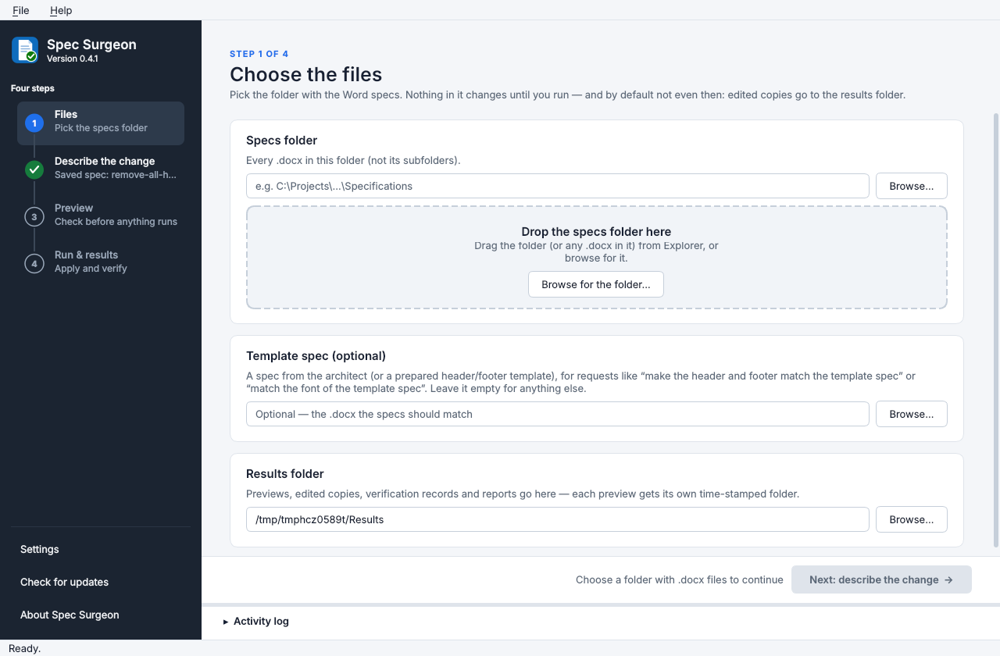
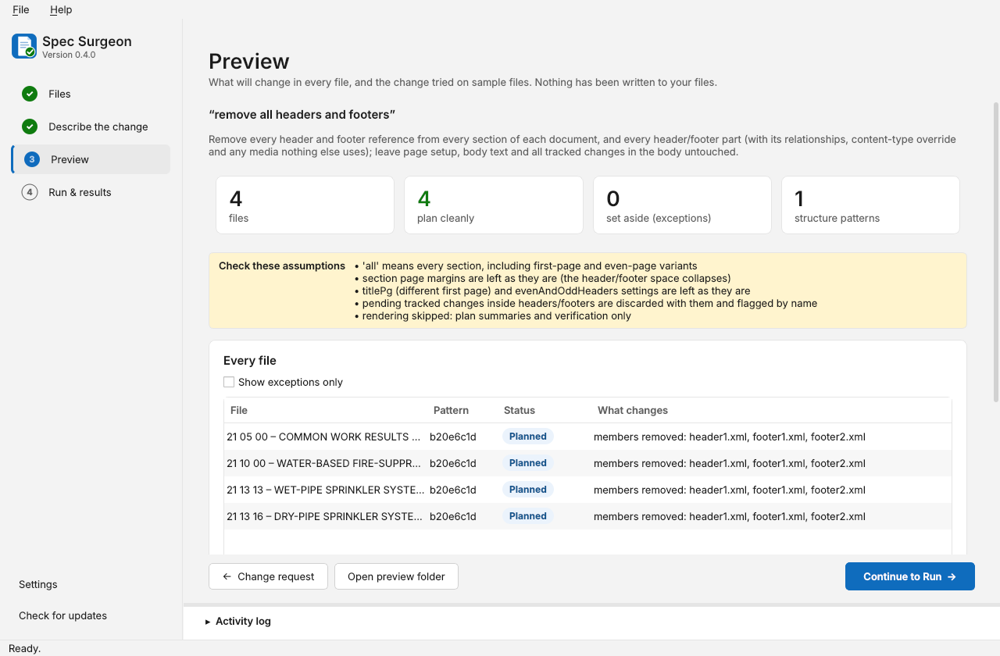
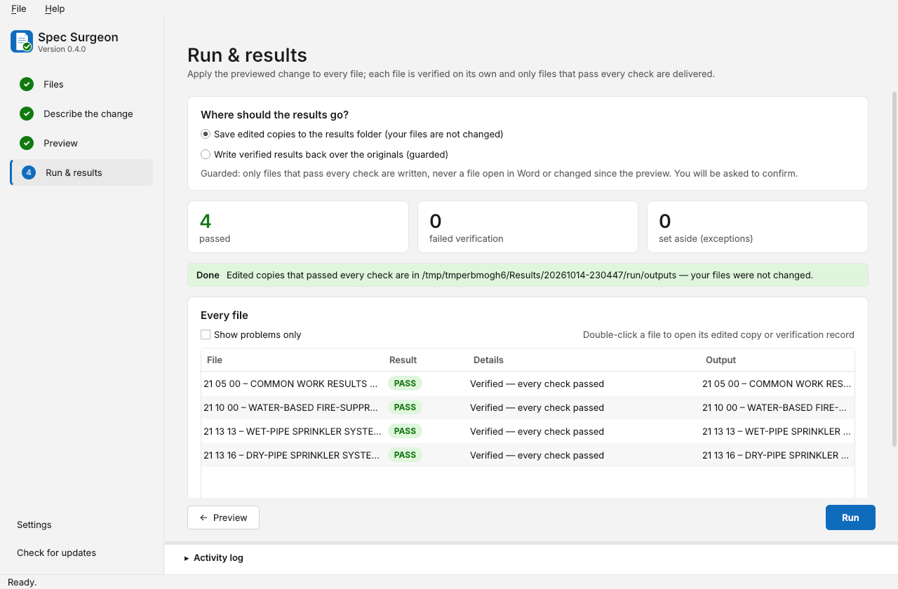
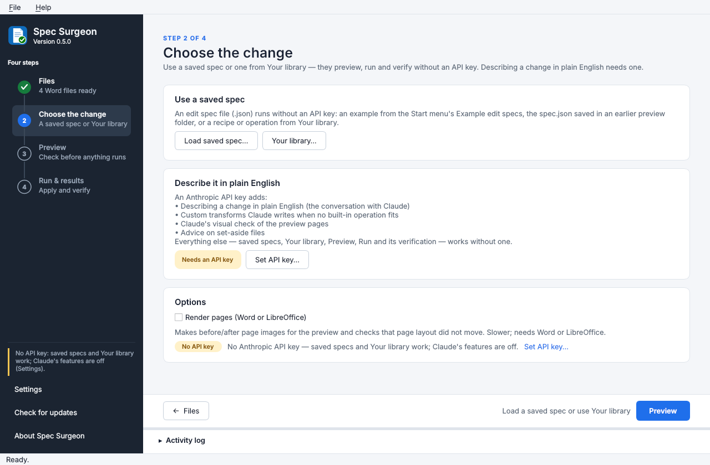
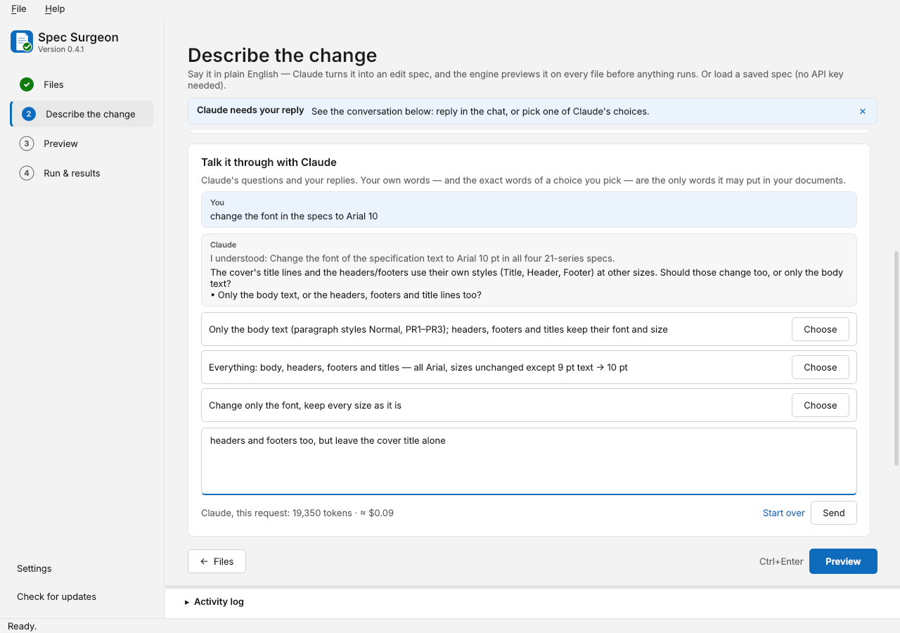

# Spec Surgeon

**In this source checkout: persistent multi-project workspaces and ample agent resources.**
The new `spec-surgeon workspace` commands and desktop **Multi-project workspace** window inventory multiple
folders recursively, keep project facts and requests separate, and retain verified candidates while remaining
documents are investigated. Recovery can be reopened and continued with its evidence, attempts, and scoped user
answers intact. Agents investigate and propose an explicit outcome contract for review, then can revise their
methods while independent checks enforce that contract. Supported outcomes include per-document title roles,
formatting, exact wording edits, paragraph insertion/deletion, page setup, and header/footer templates or removal.
Read-only analysis scripts, durable context archives, sandboxed custom methods, and a separate critic support
difficult cases. See [Adaptive workspaces](docs/ADAPTIVE_WORKSPACES.md). This is source functionality; the published
installer remains the version identified below.

The default investigation allowance is now **50 candidate attempts per problem group, 512 model calls,
64,000 output tokens per call, 20 million estimated total tokens, maximum reasoning effort, and $250 estimated
model spend**. These are configurable ceilings, not spending targets. Each project investigation has its own
allowance; a workspace containing several projects can spend more than one allowance. No model call or charge is
needed to inventory files, review saved progress, or execute an unambiguous approved goal using built-in operations.

**Latest: v0.6.0 — run without an API key, apply verified formatting properties, and let Claude find your saved recipes and operations.** Includes the Qt window teardown crash fix and everything in v0.5.0. [v0.6.0 release notes](docs/releases/v0.6.0.md) include installation and update instructions.

**In this source checkout: bounded recovery and local repair memory.** Investigate failed requests, previews and batches within an explicit model budget, try verified repairs or sequences on copies, review the final result, and remember useful cases for future investigations. See [Recovery and local repair memory](docs/RECOVERY.md) for desktop and CLI usage, limits and privacy details, and the [real-batch evaluation protocol](docs/RECOVERY_EVALUATION.md) for validation still to be done. This describes source changes; it does not announce a published installer.

**New since v0.6.0 (not released yet): built-in operations, batch 1.** Ten prebuilt operations for the work you repeat across sites and projects: fill `{{SITE_NAME}}`-style placeholders and highlighted fields from your PROJECT.json or Excel sheet (a master set becomes a site set); a replacement table applied in one pass; MasterSpec `[option] [option]` choices resolved by your rules; paragraphs tagged for a system type (wet, dry, preaction, clean agent) kept or deleted; the issue stamp updated wherever it sits; every file ending with its own END OF SECTION number; the header/footer, title line and file name made to agree; a logo swapped in every header, fitted to the same space; a snippet library (a saved paragraph inserted after an anchor in every file that has it); and output files named by convention from their content. Every one is planned before it runs, places only your words, and is checked by its own independent V10 kind. Details: ["Built-in operations, batch 1"](#built-in-operations-batch-1-tables-options-tags-stamps-logos-names).

**New in v0.6.0: run it without an API key.** Most people who use Spec Surgeon will not have an Anthropic API key, or will not want one. Without a key the app now runs in **keyless mode**: the *Describe the change* step becomes *Choose the change*, with saved specs and **Your library** first and a note saying what a key would add. Those are typing a request in plain English, custom transforms, Claude's visual check of the preview pages, and advice on set-aside files. Everything else works without a key: saved specs, your library's recipes and operations, Preview, Run and its verification, set-aside passes and diagnostics. On the command line, the new `spec-surgeon library use NAME FILES…` runs one of your recipes or operations without a key. Details: ["Running without an API key"](#running-without-an-api-key).

**Also new in v0.6.0:** `set_properties` applies bold, italic, caps, small caps, strikethrough, underline, text colour and paragraph pagination flags, with independent V10 verification. In a conversation, Claude can find an item in **Your library** and offer it as a choice; choosing it uses the saved recipe or operation, and an item changed since the offer must be offered again. The Qt teardown fix prevents windows from being destroyed on a worker thread, addressing the suite's segmentation fault. Details: ["Formatting properties"](#formatting-properties-bold-caps-colour-keep-with-next-set_properties) and ["Claude and your library"](#claude-and-your-library).

**New in v0.5.0: the conversation, Claude's visual check, your own library, a reworked window, diagnostics and the MIT license.**
- **Claude no longer gives up when no operation fits.** It says what it understood, what is missing, and offers choices: a question, the closest built-in operation (with exactly how it differs), a rephrasing, or a one-off custom transform. You reply in a chat on the *Describe the change* and *Preview* steps, or at the terminal with `spec-surgeon do`. A word Claude suggests goes into your documents only when you pick the choice that shows those exact words.
- **The "Allow AI-written transforms" checkbox is gone.** A custom transform is now offered as one of Claude's choices, only when no built-in operation can do the request and Claude judges it within what the engine can verify. The transform's writer gets the whole conversation, can read the sample files' XML, and its result gets a real preview (samples, before/after pages) before Run, which writes edited copies only.
- **Claude's visual check.** With *Render pages* on, Claude looks at the before/after pages of the preview's sample files. It is advisory: it can stop Run until you have looked at what it flagged, and it can never pass anything. In the chat Claude can also look at pages of your files when it needs to see what you mean.
- **Your library.** Save a previewed spec as a **recipe**, or a passing custom transform as **one of your operations**, under a name you choose, and use it again on another project (*Your library…*, `spec-surgeon library`, `do … --save-as NAME`).
- **Every Claude call is streamed, with a 64,000-token output cap.** The window and the terminal show what the conversation has cost so far.
- **The old `spec-surgeon ask` / `agent` commands are retired.** `do` and `advise` cover what they did.
- **A reworked window.** A step rail that says where each step stands, an action bar per step whose hint says what is still missing while its button is off, a drop zone for the specs folder, and a pill that says where the API key comes from. The look follows Windows' light or dark setting; Settings is down to the results folder and the API key; the update check runs once a day with nothing to set.
- **Diagnostics.** Every file that does not pass says where it stopped, why in specifics and how it got there: `DIAGNOSTICS.md`, a trace per file, `logs\run.log` and a *WHY IT FAILED* section in each verification record. Double-click the file in the window, or run `spec-surgeon diagnose`; **Help → Save diagnostics bundle…** zips everything someone needs to diagnose it (never the documents). Claude's whole exchange is kept beside the preview it led to, and an API error (no network, a bad key, an overloaded service) is a recorded failure with its HTTP status and request id.
- **MIT license and an About box** (Help → About Spec Surgeon): who made it, the license, the open-source components the app ships with, and where this copy keeps its files.
- **The Phase 8 review fixes.** Defects a review of the merged work found (an internal review, Codex and the merge's verifiers), each fixed with a test that fails without it: a malformed answer from Claude can no longer break the conversation or the visual check; same-named files in different folders are told apart; a custom transform whose files changed is tried again instead of refusing for ever; `do` checks the approval again right before it runs; the window's buttons and the diagnostics bundle follow the preview and the session; the tests never touch the API key saved on your computer; a custom transform can no longer reach past the sandbox's whitelist to the file system. See ["The Phase 8 review fixes"](#the-phase-8-review-fixes-2026-10-15).

Details: ["Talk it through with Claude"](#talk-it-through-with-claude), ["Claude's visual check"](#claudes-visual-check), ["Your library"](#your-library), ["How Spec Surgeon calls Claude"](#how-spec-surgeon-calls-claude), ["The window"](#the-window-gui--start-here), ["Diagnostics"](#diagnostics--when-something-fails), ["License"](#license).

**v0.4.1 fixed the hands-on sweep of v0.4.0.** A changed template requires a new preview; conflicting header/footer and formatting operations are refused at plan time; single-section specs work in batches using a cover/body template; read-only files are set aside without stopping the batch; and preview summaries explain tracked deletions. [v0.4.1 release notes](docs/releases/v0.4.1.md) describe those fixes, all included in v0.5.0.

Fast, provably lossless surgical edits to Word (.docx) specification files — a few files or dozens — with a mandatory verification record per file.

Spec Surgeon is the engine form of the `docx-surgical-edit` method: the transform is a deterministic Python/lxml script, the verifier is an independent script that reads only the before/after packages, the expected result is predicted *before* the transform runs, and the output is never written back unless every check passes and the source has not moved. No language model is in the per-file loop; the model's jobs are to build new job modules, to advise on exceptions, and (optionally) to turn a natural-language request into a job call.

**Start here: the window.** Install it on Windows from [GitHub Releases](https://github.com/Abe-Borg/spec-surgeon/releases) and open **Spec Surgeon** from the Start menu (or run `spec-surgeon-gui`). The window has four steps: **Files → Describe the change → Preview → Run & results**. Pick the specs folder, type what should change (or load a spec file), look at the preview, then run. Once installed, it updates itself: a banner offers each new version, and **Help → Check for updates…** checks at any time. Setup on Windows and a walkthrough: ["The window"](#the-window-gui--start-here); updates: ["Updates"](#updates).

**v0.4.0 introduced a new Qt window, in-app updates and an installable Windows app; the mixed-quality batch workflow from v0.3.x is included.** v0.4.0 replaces the first-cut Tk window with a Qt 6 (PySide6) window. It has step navigation, preview and results tables, before/after page images in the app, light/dark themes and remembered settings. The API key can be kept in Windows Credential Manager. The installed app checks GitHub Releases for updates and installs them with one click, and v0.4.0 also ships the v0.3.1 audit fixes. The natural-language editor prototype is complete through plan Phase 6 (op library, templating, profiles and dry runs, the Claude compiler with preview and approval, Tier B generated transforms, the exception advisor), with the Phase 7 GUI, set-aside reports and retries, messy-document matching, and paragraph insertion/deletion. What remains needs your machine and your files: Word COM rendering, a read-only sweep over real project specs, and live runs of the Claude layer (all marked [unproven] below). The original v0.1.0 engine capabilities remain: two job modules, the nine-check verification suite (now extended through V10), batch orchestration, Word/LibreOffice rendering, geometry assertion, guarded in-place write-back, and the optional Claude layer.

**Packaged releases:** download the Windows installer, wheel, or source archive from [GitHub Releases](https://github.com/Abe-Borg/spec-surgeon/releases). [v0.6.0 release notes](docs/releases/v0.6.0.md) include installation and update instructions; [v0.5.0](docs/releases/v0.5.0.md), [v0.4.0](docs/releases/v0.4.0.md) and [v0.3.0](docs/releases/v0.3.0.md) describe earlier releases. The source archive includes the worked examples, documentation, and complete test fixtures. Windows packaging scripts live in `packaging/windows/` in the repository and are included in subsequent source releases. Release tags (`v<version>`) trigger tests with Qt (offscreen)/LibreOffice and on Windows, package builds and metadata checks, a clean wheel installation, an installed Windows app smoke test (the Qt window's Preview → Run, an offline updater download-and-verify, and a real in-app update that must reopen the app), and publication of the distributions with SHA-256 checksums (the `SHA256SUMS` file the in-app updater checks every download against). Before tagging, keep `pyproject.toml` and `spec_surgeon.__version__` in sync and add `docs/releases/v<version>.md`; publication stops if any check fails.

**NL editor, Phase 1 (operation library foundation) — done.** The engine now has a composable operation library (`ops/`: `remove_header_footer`, `set_font`, `set_style_font`, `set_doc_defaults_font`, `set_paragraph_props`, `set_page_setup`, plus the two v0.1.0 jobs as `fix_page_numbering` and `replace_text`), hand-written **EditSpecs** executed end to end by `spec-surgeon run-spec`, a tenth check (**V10 — property assertions and residual identity**), and V1/V2/V4/V5/V7 extensions for member removal, text-scope union, every revision kind and layout-reference modes. The v0.1.0 jobs and CLI keep working unchanged (they are thin aliases now).

**NL editor, Phase 2 (header/footer templating) — done.** A new op, `apply_header_footer_template`, gives every section the headers/footers of a project template file: the template's parts are copied in as new parts, their placeholder **slots** (yellow highlight *and* `{{NAME}}` — decision §14.2: both) are filled by rule from each spec's own content (never typed), tab stops are rescaled to each section's text width, the template's look is **pinned** as direct formatting wherever the spec's styles would render it differently, missing styles are imported, and the old headers/footers go. The verifier re-derives all of it independently (`verify/template.py`, three new V10 kinds), V5a validates the added parts against the template's own baseline, V1 checks every part's content type against the relationship that points at it, and V7's `template` reference compares each output page's header and footer with the template's headers/footers rendered alone. 

**NL editor, Phase 3 (profiler, planner, catalog) — done.** `spec-surgeon profile` describes a batch per structure pattern (sections, what every header/footer shows, template slots, styles in use with their effective fonts, fonts, counts — a few KB per pattern, what the compiler will read); `spec-surgeon plan-spec` dry-runs an EditSpec over a folder (per-file plan summary or the exception it would raise; nothing written); `spec-surgeon ops --catalog` prints the machine-readable op catalog with the EditSpec JSON schema. 

**NL editor, Phase 4 (compiler, preview, `do`) — done.** `spec-surgeon do "make the header/footer look like this template" "C:\…\Specs" --template T.docx` compiles the request into an EditSpec with Claude (one tool-use conversation per batch; the model reads profiles and the op catalog, never XML), checks it (validation, *the words it would place must be the user's own*, a dry plan per structure pattern), shows a preview (per-pattern plan summaries, exceptions, sample files applied and verified in memory, before/after page images), and runs the verified batch only after approval. The live API path is **[unproven]** in the development container (no credentials there); the loop is tested with a scripted client.

**NL editor, Phase 5 (Tier B — generated transforms) — done, off by default.** When no op can express a request, `spec-surgeon do … --allow-codegen` lets Claude write one op module against a restricted API; it is AST-whitelisted, run in a separate isolated process on copies of one sample file per pattern, held to hard limits (formatting only), and must pass the full independent verification suite — failures go back to the model, at most three attempts. A passing op runs over the batch the same way (sandbox + verifier per file) and writes outputs only, never in place; the module is cached beside the run for a human to review and, if worth keeping, promote into `ops/` with tests. *Since the conversation work it is no longer a switch: Claude offers it as a choice when no operation fits and the request is within what a custom transform may change, it gets a real preview, and a passing one can be saved to your library (see ["Custom transforms"](#tier-b-generated-transforms-phase-5--custom-transforms)).*

**Template specs and font sizes (v0.4.0) — done.** Attach a **template spec** — an ordinary spec from the architect or any other firm, nothing highlighted, no `{{placeholders}}` — and ask "make the header and footer match the template spec": every discipline spec gets the architect's header and footer, with the architect's own section number and title replaced by each spec's own (`slot_markers: ["reference"]`: the fill rules run on the template spec itself to find its own values, then on each spec). Everything else in the architect's header and footer — firm, project, phase, logo, page number — is copied as it is, and the architect's number or title written any other way ("087100", a STYLEREF field) is refused rather than copied into every spec. Ask "match the font of the template spec": the three font ops now set **sizes** too (`size`, `size_from`, and `only_where_defined` on `set_font`), so 9 pt text becomes the template's 10 pt Arial while 8 pt headers and a 12 pt note keep their size, and the `effective_font` post-condition proves it run by run. With it come the window's *Template spec* picker and two example chips, a template-spec summary for the compiler (`read_template`: the template spec's own number and title, where its headers/footers show them, its body font and size), two worked examples and an example architect's spec. Details: ["Template specs: match the architect's spec"](#template-specs-match-the-architects-spec) and ["Font sizes"](#font-sizes-match-the-template-specs-font).

---

## Contents

1. [How it works](#how-it-works)
2. [Install](#install) / [The window (GUI) — start here](#the-window-gui--start-here) / [Running without an API key](#running-without-an-api-key) / [Updates](#updates)
3. [Quick start](#quick-start)
4. [Commands](#commands)
5. [Jobs](#jobs)
6. [Operations and EditSpecs (NL editor, Phase 1)](#operations-and-editspecs-nl-editor-phase-1) — incl. [Header/footer templating (Phase 2)](#headerfooter-templating-phase-2), [Template specs: match the architect's spec](#template-specs-match-the-architects-spec), [Font sizes](#font-sizes-match-the-template-specs-font), [Formatting properties: bold, caps, colour, keep with next](#formatting-properties-bold-caps-colour-keep-with-next-set_properties) and [Built-in operations, batch 1: tables, options, tags, stamps, logos, names](#built-in-operations-batch-1-tables-options-tags-stamps-logos-names)
   - [Talk it through with Claude](#talk-it-through-with-claude) / [Claude's visual check](#claudes-visual-check) / [Your library](#your-library) / [Chains: several recipes, one after another](#chains-several-recipes-one-after-another) / [How Spec Surgeon calls Claude](#how-spec-surgeon-calls-claude)
7. [The verification record](#the-verification-record)
8. [Output folder layout](#output-folder-layout)
9. [Diagnostics — when something fails](#diagnostics--when-something-fails)
   - [Bounded recovery and local repair memory](docs/RECOVERY.md) / [Real-batch evaluation](docs/RECOVERY_EVALUATION.md)
10. [Performance](#performance)
11. [Exceptions and the agent layer (Tier 2/3)](#exceptions-and-the-agent-layer-tier-23)
12. [Renderers](#renderers)
13. [The overwrite guard](#the-overwrite-guard)
14. [Library API (for a GUI)](#library-api-for-a-gui)
15. [Adding a job module](#adding-a-job-module) / [Adding an op](#adding-an-op)
16. [Project layout](#project-layout)
17. [Tests](#tests)
18. [Known limits of the prototype](#known-limits-of-the-prototype)
19. [Roadmap — natural-language editing](#roadmap--natural-language-editing)
20. [Relationship to the docx-surgical-edit skill](#relationship-to-the-docx-surgical-edit-skill)
21. [License](#license)

---

## How it works

Every file goes through the same pipeline, whether the batch is one file or a hundred:

```
acquire ─► fingerprint ─► plan ─► apply ─► verify ─► render ─► geometry ─► deliver ─► record
 (identity)  (ms/file)   (predict  (lxml)   (V1–V5,   (Word /   (V7)       (guarded,   (per-file
                          first)             V8)       LO)                  V9)         .md/.json)
```

Three tiers of who does the work:

| Tier | Who | When |
|---|---|---|
| 1 — deterministic engine | this package, no model | every file whose structure the job module understands (the common case) |
| 2 — exceptions | a human, or `spec-surgeon advise` (the window's *Advise on exceptions*) for a written recommendation or a re-compiled spec | a file the job refuses to guess about (`exceptions/<name>.exception.json`) |
| 3 — new job types | you + Claude, using the bundled skill | a request no job module handles yet; the result is a new module in `jobs/` |

Design rules carried from the method, enforced in code:

* **Predict first.** `Job.plan()` computes, from the source alone, the exact text diffs per block, the parts that may change, and the revision-count delta. The verifier asserts that prediction; it never derives "expected" from what happened.
* **Independent verifier.** `spec_surgeon/verify/` imports nothing from `jobs/`, `ops/`, `editspec.py`, `ooxml.py` or `package.py` (a test enforces it). It has its own zip reader, rels resolution, text extraction, selector resolution, style-chain and theme lookup, so a transform bug cannot hide behind the same bug in the check.
* **No generated characters.** Formatting jobs add zero text. Content jobs move the user's approved wording (verbatim) into the right place in the right tracked-change grammar.
* **Repack by substitution.** The output zip has the source's member order, compression, and bytes for every member not deliberately changed. Inert junk (`[trash]/*.dat`, duplicate ids) is preserved byte-identically.
* **Never write back blind.** In-place delivery re-checks the source's size/mtime, looks for Word's `~$` lock file, writes a temp file beside the source and `os.replace`s it. Never forces.

---

## Install

**Windows 10/11 (64-bit):** download `SpecSurgeon-<version>-Setup-x64.exe` from [GitHub Releases](https://github.com/Abe-Borg/spec-surgeon/releases), run it, then launch **Spec Surgeon** from the Start menu. The installer includes Python, Qt (the window), the editing engine, Word integration, and the Anthropic client; no separate Python installation or terminal commands are needed. From then on the app keeps itself up to date (see [Updates](#updates)); installing a newer setup EXE by hand over an older one also works and keeps your settings and results. It installs for the current user without administrator access, offers a desktop shortcut, and includes an uninstaller. Example EditSpecs are available from **Spec Surgeon → Example edit specs** in the Start menu. User documents and result folders are kept when the app is uninstalled.

Microsoft Word or LibreOffice is still needed for page rendering; neither is installed by this setup program. Typed requests still need your Anthropic API key. Enter it in the window's **Settings**; tick *Remember on this computer* to keep it in Windows Credential Manager. Saved EditSpecs run without one. The installer is unsigned, so Windows may show a publisher/SmartScreen prompt on the first manual install. Updates installed from inside the app do not trigger that prompt; see [Updates](#updates) for what is checked instead.

**Python package / development setup:**

Requires Python 3.10+ (Windows, macOS, Linux). From the project folder:

```powershell
py -3 -m pip install -e .            # core: lxml, pymupdf
py -3 -m pip install -e ".[gui]"     # the window: PySide6 (Qt 6) — spec-surgeon-gui
py -3 -m pip install -e ".[word]"    # Windows: adds pywin32 so Word is the renderer/oracle (recommended)
py -3 -m pip install -e ".[agent]"   # optional: anthropic SDK for typed requests (`do`, the window), `advise`
py -3 -m pip install -e ".[dev]"     # pytest + python-docx (fixtures)
```

or `py -3 -m pip install -r requirements.txt` for everything.

Rendering needs one of: Microsoft Word (Windows, with `pywin32`) or LibreOffice (any platform; set `SPEC_SURGEON_SOFFICE` if it is not on `PATH` or in the default install location). Without either, the engine still runs every XML check; V6/V7 are recorded as N/A with the reason.

Environment variables:

| Variable | Purpose |
|---|---|
| `SPEC_SURGEON_AUTHOR` | default tracked-change author (else the OS user name) |
| `SPEC_SURGEON_SOFFICE` | path to `soffice` / `soffice.exe` |
| `ANTHROPIC_API_KEY` | for typed requests (`do`, `retry`, the window), Claude's visual check, custom transforms and `advise` — or enter it in the window's Settings (for one session, or remembered in Windows Credential Manager; a key set here wins) |
| `SPEC_SURGEON_MODEL` | the model every Claude call uses — the conversation, the visual check, custom transforms, `advise` (default `claude-opus-5-5`; `--model` overrides it per command) |
| `SPEC_SURGEON_NO_UPDATE_CHECK` | any value: the window never checks for updates on its own (Help → Check for updates… still works) |
| `SPEC_SURGEON_CONFIG_DIR` | where the window keeps `settings.json`, your library, downloaded updates and its logs (default `%APPDATA%\Spec Surgeon` and `%LOCALAPPDATA%\Spec Surgeon`); the tests use it |
| `SPEC_SURGEON_THEME` | `light` or `dark`: force the window's colour scheme instead of following Windows (the screenshots use it) |
| `SPEC_SURGEON_QT_STYLE` | force a Qt style for the window (e.g. `windows11`, `fusion`) — diagnostics only; the theme's controls are drawn for Fusion |

---

## The window (GUI) — start here



**Set up once (Windows installer):** run the setup EXE from [GitHub Releases](https://github.com/Abe-Borg/spec-surgeon/releases), then open **Spec Surgeon** from the Start menu. For typed requests, enter your Anthropic API key in **Settings** (the *Set API key…* link on the *Describe the change* step opens it). To work without an API key, choose **Load saved spec…** and load an example from the Start menu's **Example edit specs** folder, or pick a recipe or operation from **Your library…**. Without a key the window runs in keyless mode and says which features need one (see ["Running without an API key"](#running-without-an-api-key)). After that the app updates itself (see [Updates](#updates)).

**Alternative: set up from source (Windows):**

1. Install Python 3.12 or newer from python.org (tick "Add python.exe to PATH").
2. Get this repository onto your machine (clone it, or download the ZIP from GitHub and unzip it), open a terminal in its folder and run:
   ```powershell
   py -3 -m pip install -e ".[gui,word,agent]"
   ```
   (`gui` is the window — Qt 6 via PySide6; `word` lets Word render the before/after pages; `agent` is the Claude SDK for typed requests.)
3. For typed requests, set your Anthropic API key once (then open a new terminal), or enter it in the window's **Settings** (for the session, or remembered in Windows Credential Manager):
   ```powershell
   setx ANTHROPIC_API_KEY "sk-ant-…"
   ```
4. Start it: press Win+R, type `spec-surgeon-gui`, Enter (or run `spec-surgeon gui` in a terminal). To pin it, make a desktop shortcut to `spec-surgeon-gui.exe` in Python's `Scripts` folder (`py -3 -c "import sys,os; print(os.path.join(sys.prefix,'Scripts'))"` prints where it is). A copy installed this way is not updated in-app: the update banner tells you the `pip install -U …` command instead.

**Use it** — four steps on the dark rail at the left. Each step gets a green check mark when it is done and a line under its name saying where it stands (how many Word files are ready, the request or the saved spec, how many files plan cleanly, how many passed); click any step to go there. Every step ends in an action bar: Back on the left, the one button that moves you on at the right, and beside it a hint saying what is still missing while that button is off (the 2026-10-15 GUI rework).

1. **Files**
   - **Specs folder:** the folder with the .docx files. Work on a *copy* of a project folder the first few times. Drop the folder (or any .docx in it) onto the dashed drop zone or the field, or use **Browse…**. The step counts the Word files it will process and lists them; the template file and Word's `~$` lock files are left out. **Next** is enabled once the folder holds Word files; until then the hint beside it says why not.
   - **Template spec (optional):** a spec from the architect or another firm (an ordinary spec — nothing to prepare), or a prepared header/footer template with highlighted / `{{NAME}}` placeholders. It is for requests like "make the header and footer match the template spec", "match the font of the template spec" or "make the header/footer look like this template". It is left out of the batch even when it sits in the specs folder (same path, or a copy with the same bytes).
   - **Results folder:** where previews, edited copies, records and reports land. The default is `%USERPROFILE%\SpecSurgeon_out\<timestamp>`, and each preview gets its own time-stamped folder (with the conversation with Claude that led to it). The folders are remembered for next time. Changing the results folder after a preview sends you back to Preview: Run is enabled only while everything the preview was made of — folder, template, request, the conversation with Claude, results folder, and (since the Phase 8 review fixes) the *Render pages* option — is unchanged (2026-10-14 audit fixes).
2. **Describe the change**
   - Type the request in plain English ("remove all headers and footers", "change all fonts to Arial", "make the header and footer match the template spec", "match the font of the template spec", "make the header/footer look like this template"), or click one of the example chips. A chip that mentions the template spec reminds you to choose one on *Files* when none is set.
   - **Without an API key** the step is called *Choose the change* and reads differently (keyless mode): the *Use a saved spec* card comes first, and the request box gives way to a note listing what a key adds, with a **Set API key…** button. A request typed earlier is kept, hidden, and comes back once a key is set; until then it never counts, so a loaded spec is previewed. See ["Running without an API key"](#running-without-an-api-key).
   - No API key? Use **Load saved spec…** with one of `examples\specs\*.json` instead, or a spec saved from an earlier preview's `preview\spec.json`. A loaded spec shows as a strip under the request. Typing a request instead compiles a new spec, and **Remove** drops the loaded one. The strip goes away as soon as something else replaces the loaded spec — a typed request that was compiled, a custom transform, or one of your operations (Phase 8 review fixes: it used to stay, and its Remove would have thrown the new outcome away).
   - **Your library…** (Ctrl+L), beside *Load saved spec…* in the *Or use a saved spec* card, picks a recipe or one of your own operations you saved earlier (see ["Your library"](#your-library)).
   - Options: *Render pages (Word or LibreOffice)* makes before/after page images, checks layout and lets Claude look at the sample pages (slower; see ["Claude's visual check"](#claudes-visual-check)). Turning it on or off after a preview turns Run off until you preview again ("Something changed since the preview — press Preview again."): a preview made without pages has had no visual check, and Run renders (or not) as the preview did.
   - A pill at the bottom of *Options* says where the API key comes from: your Windows environment, saved on this computer, this session only (green), or none (amber) — with a link to set it.
   - Press **Preview** (or Ctrl+Enter). The hint beside the button says when the specs folder is still missing, nothing has been typed or loaded, or Claude is waiting for your reply. With the request box empty and a custom transform or one of your operations as what was last previewed, **Preview** previews it again ("Using the custom transform NAME.") — and when a file changed since it was tried, it is first tried again on the files as they are now (see *Custom transforms* below).
   - **Talk it through with Claude:** when Claude needs something from you, or no built-in operation fits the request, the chat card opens right under the request instead of a dead end. Claude says what it understood and what is missing, and offers choices. Reply in your own words (Ctrl+Enter sends) or press a choice's **Choose** button (**Use it** / **Try it** for one of your library's recipes or operations — see ["Claude and your library"](#claude-and-your-library)); while Claude waits, the step's line on the rail says *Waiting for your reply*. A choice's tooltip shows its detail exactly as Claude wrote it, as plain text. If the specs folder changes while a conversation is open, or *Use the whole folder again* drops a set-aside selection, the conversation ends and the chat closes; a reply sent then starts no job and is answered with an info bar, *The conversation ended*: "The specs folder changed, so the conversation ended — press Preview to start again with these files." See ["Talk it through with Claude"](#talk-it-through-with-claude).
3. **Preview**
   - Claude turns the request into a spec. The engine plans every file (nothing is written to your files), applies the spec to one or two sample files in memory and verifies them. With *Render pages* it also makes before/after page images.
   - The page shows:
     - tiles counting the files, the files that plan cleanly, the files set aside, and the structure patterns;
     - the spec's **assumptions to check** (and renderer warnings);
     - a table of **every file**: its pattern, *Planned* or *Exception*, and what changes or why it is refused (plain English; the tooltip has the engine's diagnosis). *Show exceptions only* filters it;
     - each **sample file** with its verification result and before/after pages (click a page to zoom: Fit, 100 %, Ctrl + mouse wheel);
     - **Claude's visual check** of those pages, when *Render pages* is on (advisory; a finding it rates as blocking stops Run until you press **I've looked — allow Run**, which is enabled only while the preview is current and no job is running);
     - the approval token.
   - If Claude needs something from you (e.g. the exact stamp wording), its questions appear in the chat on *Describe the change*. Reply there, or pick one of its choices.
   - The chat also sits under the preview: if the preview is not what you meant, tell Claude there ("only the body sections, not the cover"). Claude reads what the preview found and sends a revised spec, which is previewed again.
   - **Save to library…**, beside the request at the top of the preview, saves what was just previewed under a name: the spec as a recipe, or a custom transform as one of your operations. Like *I've looked — allow Run*, it is enabled only while the preview is current and no job (or update) is running — never a live button that would silently do nothing (Phase 8 review fixes).
   - **Open preview folder** shows the preview files (`PREVIEW.md`, `spec.json`, samples, images, `visual_review.json`, and `logs\preview.log` — every file's plan or refusal; see [Diagnostics](#diagnostics--when-something-fails)).
   - Before the first preview — or once a reply has voided the last one (a reply that only asks, or *Start over*) — the step shows what to do and a button back to *Describe the change*. (One of your operations that does not pass on these files no longer voids anything: the previous preview stays as it was.) **Continue to Run** is off until the preview is current, with the reason beside it ("Look at Claude's findings above first" while the visual check has a blocking finding you have not acknowledged); the rail then says *Look at Claude's findings before Run*.

   

4. **Run & results**
   - By default the edited files go to the results folder and **your files are not touched**. Choose **Write verified results back over the originals (guarded)** to have verified files written back: only files that pass every check, never a file open in Word or changed since the preview. You confirm before it starts, and the choice is never remembered.
   - **Run** is enabled only while the preview is current. Changing the folder, the template, the request, the results folder, *Render pages*, or replying to Claude after a preview disables it ("press Preview again"). Run itself still refuses if a file — or the template spec — changed on disk since the preview (the approval token), and says what changed (which file was added, removed or modified, the spec, the template) — for a custom transform too. While Claude's visual check has a blocking finding you have not acknowledged, Run stays off and the hint beside it says *Claude's visual check flagged problems — see the Preview step* (its tooltip, and the message if you press Run, give the full reason).
   - A progress bar counts the files as they are verified.
   - Then:
     - **PASS / FAIL / EXCEPTION tiles** and a **results table**, with *Show problems only*. Double-click a file that passed to open its edited copy; double-click a file that failed or was set aside to see **why**, in the app: what happened, where it stopped (the stage, the op, the line of code), why in specifics (which paragraph, which characters, what the renderer said), what to do, which files to read, and the file's trace (see [Diagnostics](#diagnostics--when-something-fails)). On the Preview step, double-click an *Exception* row for the same.
     - **Open results folder** has `BATCH_REPORT.md`, `DIAGNOSTICS.md`, `outputs\`, `records\` (one verification record per file), `logs\` (the run's log and one trace per file), `failed\` and `render\`.
     - **View report** shows `BATCH_REPORT.md` in the app; **View diagnostics** shows `DIAGNOSTICS.md` (every file that did not pass, in specifics, with its trace); **Open failed/ folder** appears when something failed.
     - **Load set-aside files** narrows the next pass to the files that were set aside or failed, with their failure reasons sent to Claude. Without an API key, load a saved spec or a library item for them instead.
     - **Advise on exceptions:** for files the engine refused, Claude writes a recommendation or a corrected spec into `advice\`. Without an API key the button is off; its tooltip says why, and **View diagnostics** still says why each file was set aside.



**Custom transforms** (the *Allow AI-written transforms* checkbox of v0.4 is gone): when no built-in operation can do the request but the engine could still verify the result, one of Claude's choices is **"Have Claude write a one-off custom transform for this"**, with a **Do this** button. Claude then writes the transform from the whole conversation, tries it on one sample file per structure pattern (in a separate process, on copies, through the full verification suite) and shows a preview of it like any other: the samples with their verification result, before/after pages and Claude's visual check. Run writes edited copies to the results folder only; *Write back over the originals* is unavailable for it. If the request is outside what a custom transform may change, Claude says so and that it needs a new built-in operation instead. If no attempt passes (or a call to Claude fails while it is written — an API error, recorded in `codegen\history.json`), the window says "No custom transform passed verification: …" with the reason, and Claude is told exactly that in the conversation (so you can reply and try another way); an error inside Spec Surgeon while the transform is written is reported as a defect with its traceback and is never told to Claude as a verification result — Claude is told only that the app stopped with an internal error (its type) before any result and that nothing was applied (since the second pass of the Phase 8 review fixes; before, Claude was left the app's promise "The app carried it out; the outcome follows." with no outcome). A sample saved while the transform was being written is never approved with its new content: the transform is tried again on the files as they are now before Run allows it.

A custom transform (or one of your operations) is tied to the files it was tried on. When a file changes, is added or is removed after that, **Preview** tries it again on the sample files as they are now, in a new session folder (its trials under `retrial\`), and previews it there — with Claude's visual check when *Render pages* is on; Run then works. If it no longer passes, Preview says "the custom transform 'NAME' does not pass on the files as they are now — …", nothing else changes and Run keeps refusing. (Before the Phase 8 review fixes the old preview was shown again unchanged and Run refused for ever.)

**Also in the window:**
- **Errors** appear on the step that caused them, in plain words, with **Show log** and **Save diagnostics…** beside them. The **Activity log**, collapsed at the bottom, holds everything the engine printed — and, for an error, its full traceback (Copy, Save…, Clear). Every activity line and every error is also kept in the app log, `%LOCALAPPDATA%\Spec Surgeon\logs\spec-surgeon.log` (rotating, 4 × 2 MB), so what happened yesterday can still be read.
- **If the window closed unexpectedly** (a crash, Task Manager, a power cut), the next start says so on the Files step, with the crash report Python's fault handler wrote to `logs\crash-<time>-<pid>.log` (the stack where it stopped) — **Open logs folder** is beside it.
- **Menus:** **File** has Load saved spec… (Ctrl+O), Your library… (Ctrl+L), Open library folder, Open results folder, Settings… (Ctrl+,) and Exit. **Help** has Check for updates…, What's new in this version (the bundled release notes), User guide (online), **Open logs folder**, **Save diagnostics bundle…** (a zip, never the documents, of the last run with its session — the conversation and compile records, the preview, the run's reports, logs, traces and records — under `results\`; when the session moved on after that run (a reply, a new request or a newer preview opened a newer session folder), that folder too, under `results-later\<folder name>\`; and the app's own logs — to send to whoever diagnoses a problem) and About Spec Surgeon. The foot of the rail has the three buttons you use most: **Settings**, **Check for updates** and **About Spec Surgeon**.
- **Looks:** the app's own theme — a dark navy rail, a light content area with white cards, status pills and an action bar per step — follows Windows' light or dark setting on its own; there is no appearance setting to get wrong. The accent colour is your Windows accent, the rendering is sharp on high-DPI screens, and the look is the same on Windows 10 and 11. `SPEC_SURGEON_THEME=light|dark` forces a scheme (the screenshots use it).
- **About** (Help → About Spec Surgeon, or the rail): the version; who made it — © 2026 Abraham Borg — with his email (abrahamborg@gmail.com), GitHub and LinkedIn links; the MIT License in three plain sentences and **Read the full license**; the open-source components the app ships with and their licenses; and where this copy keeps its files. **Copy details** puts all of it on the clipboard for an email.

**Settings** (rail or File → Settings…) holds the two things the window must be told:
- **Results folder:** the default results folder.
- **Anthropic API key:** typed into a masked field. *Remember on this computer* saves it in Windows Credential Manager (target `Spec Surgeon/ANTHROPIC_API_KEY`); *Forget saved key* removes it. A key already set in the Windows environment (`setx`) takes precedence.
  The installer includes the Windows time-zone support that Credential Manager needs when reading the saved key.
  With no key set, the window runs in keyless mode. Saving a key switches it back at once (no restart), and *Forget saved key* switches it to keyless mode again unless a key is still set elsewhere. An `ant auth login` sign-in on this computer counts as a key: the line beside the pill then says Claude uses it.

That is all. The Appearance and Updates panels of v0.4.x are gone: the look follows Windows, and the update check runs once a day on its own (see [Updates](#updates)).

**What it remembers, and where:** the window keeps `%APPDATA%\Spec Surgeon\settings.json` (plain JSON you can read or delete). It holds the folders, the template, the render option, the last request, the window size, whether the activity log is open, when it last checked for updates, a version you chose to skip, and the update in progress. It never stores the API key, the conversation with Claude or an acknowledgement of Claude's visual check, and never stores the risky switch (write back over the originals), which is off at every start. A corrupt settings file is set aside as `settings.json.bad` and the defaults are used; keys a v0.4.x file still holds for the removed settings (`theme`, `native_style`, `auto_check_updates`) are ignored. Your library lives beside it, in `%APPDATA%\Spec Surgeon\library\` (File → Open library folder).

The window is a thin layer over the library calls (`gui.Session`): everything it does is what `do`, `run-spec`, `library`, `advise` and `diagnose` do on the command line.

---

## Running without an API key

Most people who use Spec Surgeon will not have an Anthropic API key, or will not want one. Since 2026-10-16 the app is built for that. Without a key it runs in **keyless mode**: everything that needs Claude says so in place, and nothing else changes.



| Works without a key | Needs a key |
|---|---|
| **Saved specs** (*Load saved spec…*, the Start menu's *Example edit specs*, a `preview\spec.json`, `run-spec`) | **Describing a change in plain English**: the conversation with Claude (the window's request box, `spec-surgeon do`, `retry`) |
| **Your library**: recipes, and your own operations (each tried on the files' samples first, as always) | **Custom transforms** Claude writes when no built-in operation fits |
| **Preview**: every file planned, the samples applied and verified, before/after pages | **Claude's visual check** of the preview pages (advisory; without a key it says *Skipped: … needs an Anthropic API key*) |
| **Run**, verification (V1–V10) and guarded write-back | **Advice on set-aside files** (*Advise on exceptions*, `spec-surgeon advise`) |
| Set-aside passes, reports, **diagnostics**, bundles, updates | |

So a team can split the work. Someone with a key describes a change once, previews it and saves it to **Your library** as a recipe (or saves a custom transform as an operation). Everyone else reuses it with no key at all. (The library is local to each computer for now: copy the item's files from `%APPDATA%\Spec Surgeon\library\` until sharing exists.) A recipe is an ordinary spec file, so a `spec.json` from a preview folder works the same way.

**In the window.** The app decides at start, and again whenever Settings saves or forgets the key, whether Claude can be called (`Session.claude_ready`: a key from Settings, Credential Manager or the environment, or an `ant auth login` sign-in the Anthropic SDK finds). Without one:
- **Step 2 is *Choose the change*.** The *Use a saved spec* card (*Load saved spec…*, *Your library…*) comes first. The request card becomes *Describe it in plain English*: a note listing what a key adds, a *Needs an API key* pill and **Set API key…**. The example chips and the custom-transform note are hidden. A request typed in an earlier session is kept, hidden, and never compiled; it comes back when a key is set. The rail says *Choose the change* with *A saved spec or Your library* under it, and the hint beside **Preview** says *Load a saved spec or use Your library*.
- **Preview** with nothing loaded does not try to call Claude. It shows *Choose a saved spec* with **Your library…**, **Load saved spec…** and **Set API key…** buttons. With a saved spec or one of your operations it previews as always.
- **Claude's visual check** is skipped without preparing or sending anything. The Preview step shows *Skipped: Claude's visual check needs an Anthropic API key (Settings) — look at the before/after pages yourself*, and the card no longer says Claude looked. It never blocks Run.
- **Advise on exceptions** is off, with the reason as its tooltip. The run summary and the set-aside strip point at saved specs instead of Claude.
- **A conversation** open when the key goes away (*Forget saved key*) waits: replying and its choices are off, and it says *Claude needs an Anthropic API key to go on with this conversation…*. Setting a key lets it go on.
- **The rail** shows one line above Settings: *No API key: saved specs and Your library work; Claude's features are off (Settings).* Its tooltip lists the features.
- Setting a key in **Settings** switches everything back at once: the request box, the draft and the chips return, and the step is *Describe the change* again.

**On the command line.** `spec-surgeon do`, `retry` and `advise` without a key stop before anything is written (exit 2) and say what works without one. The new **`spec-surgeon library use NAME FILES…`** runs one of your library items:
- **A recipe** takes `do`'s path after the compile: the preview (`OUT\preview\`), the approval (y/N in a terminal, `--yes` otherwise; without either it prints the exact `run-spec … --approval TOKEN` command), the approval token checked again, then the verified run. `--in-place` is guarded as always.
- **One of your operations** is tried on the files' sample files first (`OUT\library-trial\try-N`, the token taken before the trials). One that does not pass on these files is refused (exit 2) and nothing is previewed or run. One that passes is previewed, approved and run like a custom transform: edited copies only (`OUT\run\outputs`).
- Claude's visual check runs only with a key, with rendering on and without `--no-review`. Without a key it prints *Claude's visual check skipped: no Anthropic API key — …*.
- Options: `--kind recipe|operation` (when a name is ambiguous), `--out DIR`, `--yes`, `--in-place` (recipes), `--workers N`, `--renderer …`, `--no-render`, `--no-review`, `--ack-review`.

```powershell
spec-surgeon library list
spec-surgeon library use "Strip headers" "C:\Projects\…\Specifications" --yes
```

**How "a key is there" is decided** (`llm.credentials_found`): `ANTHROPIC_API_KEY` or `ANTHROPIC_AUTH_TOKEN` in the environment, where the window puts the key from Settings or Credential Manager. Failing that, a credentials profile the Anthropic SDK finds on its own (`ant auth login`, `ANTHROPIC_PROFILE`, workload identity), which is read from files and never calls the API. A profile that cannot be read counts as no key. The texts listing what needs a key come from one place, `llm.CLAUDE_FEATURES`.

---

## Updates

The installed app keeps itself up to date from this repository's [GitHub Releases](https://github.com/Abe-Borg/spec-surgeon/releases).

**How it works:**

1. **Check.** About four seconds after the window opens, and at most once a day, it asks GitHub for the newest published release — every copy, installed or pip, with nothing to turn on. Drafts and pre-releases are never offered. **Help → Check for updates…** (or the rail's *Check for updates*) checks at any time and always reports: "you're up to date", the update banner, or why it couldn't check.
2. **Offer.** A banner above the page shows the new version with **What's new** (the release notes), **Install now**, **Later** (until the next start) and **Skip this version** (no more automatic offers for that version; a manual check still shows it).
3. **Download.** *Install now* is unavailable while a Preview or Run is in progress, and refuses while another Spec Surgeon window or `spec-surgeon.exe` command is open. It downloads `SpecSurgeon-<version>-Setup-x64.exe` into `%LOCALAPPDATA%\Spec Surgeon\updates\`, with a progress bar and Cancel.
4. **Install.** The window starts Setup detached (`/SILENT … /RELAUNCH=1`) and closes. Setup shows its progress window, waits for every Spec Surgeon process to exit (up to 60 s, using the app's named mutex), installs over the same folder without administrator rights, and reopens Spec Surgeon.
5. **Afterwards.** The next start says "Spec Surgeon was updated to X" (with What's new), or "The update to X didn't finish" with **Try again** and **Open install log** (`%LOCALAPPDATA%\Spec Surgeon\updates\install-<version>.log`). Old downloads are cleaned up.

**What is checked before anything runs:**
- The installer's name must be exactly `SpecSurgeon-<version>-Setup-x64.exe` for the release's version.
- Its SHA-256 must be listed for that exact name in the release's `SHA256SUMS`, which is fetched first: no installer byte is downloaded without a known hash.
- When GitHub reports its own checksum for the asset, the two must agree.
- The size must match.
- Anything else deletes the download and shows the reason.
- The file is hashed again immediately before Setup starts. Only HTTPS is used, redirects included.

**What those checks do and don't protect against.** They catch corruption, truncation and a mangled transfer. They do **not** protect against someone taking over the GitHub account or the release workflow, because the checksums come from the same release. Signing the installer (Authenticode) closes that gap; the updater has a `verify_signature` hook for it, and the installer is unsigned today. Files the app downloads carry no "downloaded from the internet" mark, so Windows SmartScreen does not prompt for them; the checks above are the gate.

**What the check sends:** one HTTPS request to `api.github.com` with the app's version in the User-Agent. Nothing about your files, projects or key is sent. GitHub allows 60 such requests an hour per network address; if an office shares one address and hits that limit, the app reads the newest version from the `github.com/…/releases/latest` redirect instead.

**Networks:** the app uses the Windows certificate store, so a company's HTTPS-inspection certificate that Windows trusts works. Proxies set in Windows (or `HTTPS_PROXY`) are used; automatic proxy scripts (PAC/WPAD) are not evaluated. Behind one, the check fails with "Couldn't reach GitHub" and a link to the releases page, where the installer can be downloaded by hand.

**Turning it off:** set `SPEC_SURGEON_NO_UPDATE_CHECK=1`. There is no setting for it — the daily check is meant to be forgotten about — and manual checks still work.

**Copies installed with pip** (from source) are not updated in-app. The banner's Install now shows the `"<this copy's python>" -m pip install -U "spec-surgeon[gui,word,agent] @ <wheel URL>"` command and the release page. The command names the interpreter the window is running in, so it updates the same environment on Windows, macOS or Linux (`pythonw.exe` becomes `python.exe`).

**For the maintainer — publishing an update:** bump `pyproject.toml` and `spec_surgeon.__version__`, add `docs/releases/v<version>.md` (it becomes the banner's What's new), and push the tag `v<version>`. The release workflow tests, builds the installer, runs the installed-app checks (including a real in-app update that must reopen the app), and publishes the installer with `SHA256SUMS` as the latest release. Installed copies see it within a day. v0.3.x has no updater: users on it install v0.4.0 by hand once.

---

## Quick start

```powershell
# what jobs exist and what they take
spec-surgeon jobs

# milliseconds per file: how many structure patterns are in this folder?
spec-surgeon fingerprint "C:\Projects\AVC11\Specs"

# dry run — the predicted diff list per file, nothing written
spec-surgeon plan page-numbering "C:\Projects\AVC11\Specs" --params @examples\jobs\page-numbering-cover-unnumbered.json

# the real thing: outputs + records + renders into an output folder (sources untouched)
spec-surgeon run page-numbering "C:\Projects\AVC11\Specs" --params '{"option":"cover-unnumbered"}' --out C:\Temp\ss-run1

# a tracked wording change in body + headers + footers, written back IN PLACE (guarded)
spec-surgeon run tracked-replace "C:\Projects\AVC11\Specs\21*.docx" --params @examples\jobs\tracked-replace-grc.json --in-place
```

Inputs may be files, folders (all `*.docx`, lock files skipped), or globs, mixed. File names with en-dashes and doubled spaces are fine — the engine never retypes a name.

EditSpecs (the NL editor's programs; Phase 1 runs hand-written ones):

```powershell
# what operations exist, their selectors, params, and which checks they feed
spec-surgeon ops

# "change all font to Arial" on a folder — outputs + records into an output folder, sources untouched
spec-surgeon run-spec examples\specs\change-all-font-arial.json "C:\Projects\AVC11\Specs" --out C:\Temp\ss-fonts

# "remove all headers/footers", written back in place (guarded), no render
spec-surgeon run-spec examples\specs\remove-all-headers-footers.json "C:\Projects\AVC11\Specs\21*.docx" --in-place --no-render

# "make the header/footer look like this template" (edit the spec's template path and slot_fills first);
# the template file itself is skipped if it sits in the folder being processed
spec-surgeon run-spec examples\specs\apply-header-footer-template.json "C:\Projects\AVC11\Specs" --out C:\Temp\ss-template

# "make the header and footer match the template spec": the architect's spec as the template (point the spec's
# "template" at your architect's spec; the example uses examples\templates\08 71 00 - DOOR HARDWARE (ACME).docx)
spec-surgeon run-spec examples\specs\match-template-spec-header-footer.json "C:\Projects\AVC11\Specs" --out C:\Temp\ss-arch

# "match the font of the template spec" (Arial 10 for the 9 pt text; edit font/size/size_from to your template and specs)
spec-surgeon run-spec examples\specs\match-template-spec-font.json "C:\Projects\AVC11\Specs" --out C:\Temp\ss-arch-font
```

Plain English (Phase 4; needs `pip install -e ".[agent]"` and `ANTHROPIC_API_KEY` or an `ant auth login` profile):

```powershell
# compile → preview (+ Claude's visual check) → asks "Run this on N file(s)? [y/N]" → the verified batch
spec-surgeon do "remove all headers and footers" "C:\Projects\AVC11\Specs" --out C:\Temp\ss-do

# templating; in a terminal Claude asks for anything it would have to guess (e.g. the stamp wording) and you reply
# right there ("#2" picks Claude's second choice; an empty line stops). Without a terminal (a script), answer and re-run:
spec-surgeon do "make the header/footer look like this template" "C:\Projects\AVC11\Specs" --template "C:\Projects\AVC11\00 00 00 TEMPLATE.docx"
spec-surgeon do "make the header/footer look like this template" "C:\Projects\AVC11\Specs" --template "…" --answer "stamp: ISSUED FOR CONSTRUCTION  2026-02-15"

# keep what was previewed in your library under a name; use it again later (window: Your library…)
spec-surgeon do "remove all headers and footers" "C:\Projects\AVC11\Specs" --save-as "Strip headers and footers"
spec-surgeon library list
spec-surgeon library show "strip headers and footers"        # prints the run-spec command for a recipe

# the architect's spec as the template spec: their header/footer with each spec's own number and title; their font
spec-surgeon do "make the header and footer match the template spec" "C:\Projects\AVC11\Specs" --template "C:\Projects\AVC11\Architect\08 71 00 - Door Hardware.docx"
spec-surgeon do "match the font of the template spec" "C:\Projects\AVC11\Specs" --template "C:\Projects\AVC11\Architect\08 71 00 - Door Hardware.docx"

# run later exactly what the preview showed (refused if the spec or any file changed since)
spec-surgeon run-spec C:\Temp\ss-do\preview\spec.json "C:\Projects\AVC11\Specs" --approval 3f9a0c1d2e4b5a69
```

---

## Commands

| Command | What it does |
|---|---|
| `spec-surgeon jobs` | list job modules and their parameters |
| `spec-surgeon fingerprint FILES… [--json]` | structure fingerprint per file + pattern grouping (ms/file) |
| `spec-surgeon plan JOB FILES… --params JSON\|@file [--json]` | dry run: predicted diff list, revision delta, notes, flags, exceptions; no outputs |
| `spec-surgeon run JOB FILES… --params … [--out DIR] [--in-place] [--workers N] [--renderer auto\|word\|libreoffice\|none] [--no-render]` | the pipeline; exit code 0 only if every file passed |
| `spec-surgeon ops [--catalog]` | list the operation library: each op's selector, params, and how it feeds the checks; `--catalog` prints the machine-readable catalog (ops, selector grammar, common assumptions, the EditSpec JSON schema, the worked examples) |
| `spec-surgeon profile FILES… [--json]` | document profile per structure pattern: sections (page, margins, text width, titlePg, numbering), what each header/footer shows (part, text, fields, template slots, drawings, pending revisions), styles in use with effective font/size and a sample, fonts (theme, docDefaults, direct fonts in runs), counts — bounded to ~6 KB per pattern |
| `spec-surgeon plan-spec SPEC.json FILES… [--json] [--per-file]` | dry run of an EditSpec: every file is fingerprinted and planned (predict first), nothing is applied or written; prints per pattern a plan summary (members removed/added, text changes, revision deltas, assertions, mode, layout reference, flags) or the exception the real run would raise. Exit 0 when every file plans, 1 when some raise |
| `spec-surgeon run-spec SPEC.json FILES… [--out DIR] [--in-place] [--workers N] [--renderer …] [--no-render]` | execute an EditSpec: plan every op on every file (predict first), merge with conflict detection, apply, verify (V1–V10), render, deliver. Refuses (exit 2) a spec with open `questions`, `unsupported`, unknown keys or ops, and (2026-10-14 audit fixes) a batch whose inputs lie inside `--out` (a run never writes where it reads; nothing is written); exit 0 only if every file passed |
| `spec-surgeon verify SOURCE OUTPUT --plan plan.json` | re-run the suite on any source/output pair (e.g. after a manual fix) |
| `spec-surgeon do "request" FILES… [--template T] [--answer A]… [--out DIR] [--yes] [--in-place] [--no-render] [--no-review] [--ack-review] [--save-as NAME [--replace]] [--model M]` | natural language end to end: compile (Claude) → preview (`OUT/preview/`: `PREVIEW.md`, `spec.json`, sample outputs, before/after images, `visual_review.json`) → approval (`[y/N]` prompt, `--yes`, or later with `run-spec --approval TOKEN`) → the verified batch in `OUT/run/`. **In a terminal** it is a conversation: Claude's questions and choices are printed (`[#n] label`, and `exact words: «…»` for a choice that would put words in your documents); type a reply, `#n` to pick a choice (a choice with words asks you to approve them), or an empty line to stop (exit 2). **Without a terminal** (a script, a pipe): exit 2 when Claude asks questions (re-run with `--answer`), says unsupported, or fails. In a terminal `OUT/conversation.json` is the record of the conversation and `OUT/compile.json` its outcome and Claude's whole exchange (every call's blocks, tool results, stop reason, tokens, time and request id — see [Diagnostics](#diagnostics--when-something-fails)), both re-written after every turn; without a terminal there is no conversation to record: `do` writes `OUT/compile.json` only, once the compile returns. At any prompt, the end of input (Ctrl-D; Ctrl-Z Enter on Windows) or Ctrl-C never ends in a traceback: at the reply prompt and at a wording approval it stops ("Stopped — nothing was run.", exit 2); at a y/N question it is a no. After `y` (or with `--yes`) `do` checks the approval token again before it runs: a file or the template changed since the preview (while the question or Claude's visual check waited) is exit 2, "Not run: a file or the template changed since the preview — run the command again for a new preview.", followed by what changed (Phase 8 review fixes) |
| `spec-surgeon do … --no-review` / `--ack-review` | skip Claude's visual check of the sample pages (`--no-render` skips it too) / run even though the visual check flagged a blocking problem (you have looked at it). With `--yes` and no terminal, a blocking finding without `--ack-review` is exit 2 and nothing runs |
| `spec-surgeon do … --save-as NAME [--replace]` | save the previewed spec as a recipe (or the passing custom transform as one of your operations) in your library; a name already taken is refused before anything is compiled unless `--replace`. `--replace` replaces an item of the same name **and kind** only: a name the other kind holds is refused even with it ("… --replace replaces only an item of the same kind, so a recipe cannot take that name; choose another name, or delete that one first (spec-surgeon library delete "NAME" --kind operation)") — before the compile when the kind is already known (no terminal and no `--allow-codegen`: a recipe) or when both kinds hold the name, otherwise as soon as it is known (before the preview of a spec, before a custom transform is written). A save the library refuses is exit 2, "--save-as: … — nothing was saved or run" |
| `spec-surgeon run-spec … --approval TOKEN` | run only if the spec and every file are exactly as they were when the preview computed TOKEN |
| `spec-surgeon do … --allow-codegen` | without a terminal: accept Claude's offer of a one-off custom transform when no operation fits — generate it, prove it on samples, preview it, and (after approval) run it over the batch — edited copies only, never in place. In a terminal you pick the offer from Claude's choices instead. Claude makes the offer only when the request is within what a custom transform may change (see ["Custom transforms"](#tier-b-generated-transforms-phase-5--custom-transforms)), and `--allow-codegen` accepts only that offer: an *unsupported* answer without Claude's `"possible"` verdict (none, or any other value) is exit 2 — "No custom transform is offered: Claude did not judge whether a one-off custom transform could do this safely (--allow-codegen accepts only an offer Claude made). Run the command in a terminal to talk it through with Claude, or run it again." The transform's approval is taken right after it passes, before its preview, and checked again before the run: a file changed meanwhile is exit 2, "Not run: a file changed since the custom transform was tested and previewed — run the command again." (Phase 8 review fixes). Since their second pass the files' sizes and modification times are also taken **before** the transform is written, and once its preview is made they must still be what they were — at that moment and when the approval was taken: a file saved while Claude wrote the transform or its trials ran is exit 2 before the visual check, naming it — "Not run: a file changed while the custom transform was being written and tested — its preview would show a result made from the old content. Run the command again." with a line such as "21 01 00 – SPEC 1.docx: modified since the custom transform was started (size … → … bytes; saved … → …)". Before, the approval was taken after the writing, so it approved the edited file while the preview paired its new render with a trial output made from the old content |
| `spec-surgeon retry OUT_DIR [--request R] [--template T] [--answer A]… [--out DIR] [--yes] [--no-render] [--no-review] [--ack-review] [--in-place] [--allow-codegen]` | the next pass over the files a batch set aside, with their failure reasons sent to Claude (same conversation and checks as `do`) |
| `spec-surgeon library list\|show NAME\|delete NAME [--kind recipe\|operation\|chain\|snippet] [--yes]` | your library (see ["Your library"](#your-library)): list it, show one item (a recipe's `run-spec` command; a chain's stages and its `chain --stage "chain:NAME"` form; a snippet's text), delete one (asks, or `--yes`; the end of input or Ctrl-C at the question keeps the item, exit 2). Exit 2 for a name that is not there |
| `spec-surgeon library use NAME FILES… [--kind recipe\|operation\|chain\|snippet] [--after REGEX \| --before REGEX] [--untracked] [--out DIR] [--yes] [--in-place] [--workers N] [--renderer …] [--no-render] [--no-review] [--ack-review]` | one of your recipes, chains, operations or snippets on these files, **no API key needed** (see ["Running without an API key"](#running-without-an-api-key)): a recipe is previewed, approved (y/N or `--yes`), its token checked again and run like `do`'s spec; a chain takes the `chain` command's path below; an operation is tried on the samples first, then previewed, approved and run (edited copies only); a snippet goes after (`--after`) or before (`--before`) the paragraph whose text matches REGEX in every file that has it, at most once per file, tracked unless `--untracked`, and takes a recipe's path. Exit 2 for a name not in the library, no files, a snippet without `--after`/`--before`, or an operation that does not pass on these files |
| `spec-surgeon library add-snippet NAME (--text "…" \| --from FILE --paragraph REGEX) [--style ID] [--formatting inherit\|none] [--description "…"] [--replace]` | save a paragraph to insert later (see ["Snippets"](#snippets--a-saved-paragraph-inserted-after-an-anchor)): typed, or the one paragraph of FILE whose text matches REGEX. One plain paragraph — a tab, line break, field or character you cannot see is refused (exit 2, nothing saved) |
| `spec-surgeon chain --stage STAGE [--stage STAGE]… FILES… [--name N] [--out DIR] [--yes] [--in-place] [--workers N] [--renderer …] [--no-render] [--no-review] [--ack-review] [--save-as NAME [--replace]]` | (2026-10-16) several specs **one after another**, each stage a full verified run on the files the stage before it verified — see ["Chains"](#chains-several-recipes-one-after-another). A stage is an EditSpec file (or inline JSON), `recipe:NAME` (one of your recipes) or `chain:NAME` (a saved chain's stages, spliced in); `--stage` repeats in the order they run. **No API key needed.** The whole chain is previewed first (`OUT/preview/`: stage 1's plan on every file, the samples run through every stage in memory with each stage's verdict, the final pages rendered beside the source, `chain.json`), then Claude's visual check of the final pages (with a key, rendering on and no `--no-review`), `--save-as` (saved as a chain; a name a recipe or an operation holds is refused before anything runs), the `[y/N]` question (`--yes`), the approval token checked again — it covers every stage's spec and every stage's template, table and picture —, then the run in `OUT/run/` (`stage-01/` … `stage-NN/`, `outputs/` with the files that passed every stage, `CHAIN_REPORT.md`, `DIAGNOSTICS.md`, `set_aside.json`, `logs/chain.log`). Exit 0 only when every file got through every stage; 1 when some stopped; 2 for a refused chain, a stage that cannot be read, no files, a taken `--save-as` name, or a file or template changed since the preview |
| `spec-surgeon gui` / `spec-surgeon-gui` | the window (see "The window"; needs the `gui` extra, which the Windows installer includes — without it the command says how to install it); `spec-surgeon-gui` opens without a console window on Windows |
| `spec-surgeon diagnose OUT_DIR [--file NAME] [--bundle ZIP]` | why each file of a run did not pass: prints `DIAGNOSTICS.md` (or, with `--file`, the section of the file whose name contains NAME — or that file's trace when it passed). For a run that never finished it prints the end of `logs/run.log` and every trace that stops before its result. `--bundle` also writes a zip of the run's reports, logs, traces, records, plans, exceptions and conversation, compile and preview records plus the app's own logs — never the documents (sources, edited or failed copies, PDFs, page images). OUT_DIR may be a `do` or window session folder (its `run/` is used) |
| `spec-surgeon advise OUT_DIR [--file NAME] [--model M]` | for every exception a batch wrote (`OUT_DIR/exceptions/`): Claude reads the diagnosis and the file and answers with a recommendation for a human or a re-compiled spec for that file's structure pattern → `OUT_DIR/advice/<name>.advice.md` (+ `.spec.json`). Nothing is applied |

`--params` takes inline JSON or `@path\to\file.json`. On PowerShell, inline JSON is easiest with single quotes outside and double quotes inside: `--params '{"option":"continuous"}'`.

`spec-surgeon ask` and `spec-surgeon agent` (the v0.1.0 model commands) are retired: `do` turns a request into a verified run (and talks it through when it needs to), and `advise` writes a recommendation or a re-compiled spec for each exception of a batch.

---

## Jobs

### `page-numbering` (formatting mode)

Fixes the recurring cover/body symptom (cover shows `21 05 00 - 1`, first body page also `- 1`).

| param | values | effect |
|---|---|---|
| `option` | `cover-unnumbered` | delete the paragraph carrying the PAGE field from the cover section's own footer part (body footer untouched; body still starts at 1). If that paragraph is the footer's only one, its runs are removed and the empty paragraph kept (schema needs one). |
| | `continuous` | remove `<w:pgNumType w:start>` from every section after the cover that restarts the count (element removed where `start` was its only attribute, else just the attribute; more than one restart is flagged in the plan). Until the 2026-10-14 audit fixes only the first body section was fixed, so a third section's restart survived with a PASS. Zero text diffs. |

Exceptions: single-section document; cover has no footer of its own; the cover footer part is shown by a later section too (`shared-part`) — by that section's own reference or by inheritance: a body section with no footer of its own ("Link to Previous") shows the cover's footer on every body page, and since the 2026-10-14 audit fixes `hf_common.effective_refs` resolves that (the op used to see explicit references only and removed the body's page number along with the cover's, with a PASS); no PAGE field; more than one PAGE paragraph. The plan flags any tracked changes that would disappear with the deleted paragraph.

### `tracked-replace` (content mode; or untracked on request)

A surgical wording change as a tracked revision.

| param | default | notes |
|---|---|---|
| `find` | required | exact live text (what a reader sees with changes accepted; never matches inside pending deletions, field instructions, or cached field results) |
| `replace` | required | the approved wording, verbatim; `""` = pure deletion |
| `scope` | `["document"]` | any of `document, headers, footers, footnotes, endnotes, comments` — parts resolved via rels |
| `occurrences` | `all` | or `first` |
| `match_case` | `true` | |
| `mode` | `tracked` | `untracked` writes plain text (no revision marks); V5b switches to enumerated-list mode and the record says so |
| `author` | env / OS user | tracked-change author |
| `allow_missing` | `false` | if true, a file with no occurrence is a no-op instead of an exception |

Grammar implemented (all from the paid-for lessons):

* plain text → `<w:del>old</w:del><w:ins>new</w:ins>`, deletions before insertions, rPr and run attributes copied onto every fragment, `xml:space="preserve"` wherever edge whitespace exists, non-text run children (tabs, breaks) carried into the right fragment;
* text inside someone's pending insertion → the deletion is nested **inside** that insertion and the insertion is split around it (`<w:ins ORIG>prefix <w:del NEW>old</w:del></w:ins><w:ins NEW>new</w:ins><w:ins ORIG-author, new id>suffix</w:ins>`), which is what Word writes itself — accept-all gives the new wording, reject-all returns to the pre-insertion original;
* a target split across identically formatted runs → merged within that paragraph only (document stays byte-identical elsewhere); split across differently formatted runs → exception;
* revision ids continue from the maximum across all parts; `w:date` follows the file's own convention (Word's local-time-with-Z, plus `w16du:dateUtc` when the file uses it).

Predicted revision delta per occurrence: plain `+1 ins / +1 del` (pure deletion `0 / +1`); inside an insertion `+1 del`, `+1 ins` for the new text, `+1 ins` for the re-wrapped suffix when anything of the original insertion follows the target.

Since Phase 1 both jobs are thin aliases (`jobs/`) over the ops `fix_page_numbering` and `replace_text` (`ops/`); the CLI, `run_batch(job_name, params)` and the library API are unchanged. Two behaviours tightened on the way, both found by the stricter verifier:

* a **tracked** replacement in a run that carries a pending tracked *formatting* change (`w:rPrChange`) is now an exception (code `tracked-format`): splitting the run would have copied that revision, with the same `w:id`, onto every fragment. Untracked replacements there are fine (the `w:t` is edited in place);
* `fix_page_numbering` (`continuous`) states its sectPr change as a V10 `section_props` assertion, and the cover-footer deletion predicts every revision kind inside the deleted content, not just `w:ins`/`w:del`.

---

## Operations and EditSpecs (NL editor, Phase 1)

The natural-language editor (design: `docs/NL_SURGICAL_EDITOR_PLAN.md`) compiles a request into an **EditSpec** — a JSON program over a library of deterministic, individually verified **operations**. Phase 1 builds the library and runs hand-written specs; the compiler arrives in Phase 4.

### How an EditSpec runs (per file)

```
validate spec ─► plan every op on the SOURCE ─► merge fragments ─► apply in spec order ─► verify V1–V10 ─► render ─► deliver
 (questions?      (each op: PlanFragment —        (conflicts →       (working copy:          (one merged
  unknown keys?)   diffs, parts, members,          exception;         each op sees the        plan)
                   assertions, rev delta)          revision ids)      previous op's result)
```

* **Op interface** (`ops/base.py`): `plan(pkg, select, params) → PlanFragment` (every Plan field plus `members_removed`, `members_added`, `property_assertions`, `touches`, revision ids needed) and `apply(work, fragment)`, which mutates a working copy of the package (`DocxPackage.copy()`) through its overlay API.
* **Merge** (`merge_fragments`): unions intended parts, member changes, assertions; sums revision deltas; hands each op a disjoint range of revision ids; decides the merged mode and the geometry reference; **refuses conflicts** — the same block's text touched by two ops, the same property family of the same target touched twice, or anything touched in a member another op removes/restructures (code `conflict`). The engine never guesses an order for overlapping edits; split such requests into two specs. Since the 2026-10-15 sweep the font and paragraph ops also declare a `verify` touch on every part in their scope (V10 re-resolves their selection there even where they change nothing), so "remove all headers and footers and change all fonts to Arial" with the font change scoped over the headers is a plan-time `conflict` naming the op to narrow — not a clean plan that fails V10 after the fact. Two ops may verify the same part; only removing or restructuring it conflicts. Since 2026-10-16 an op also declares what its plan **reads** from the source and another op could change, as `verify` touches (`ops/base.verify_family`): a whole member, `(member, "*", "verify")`, which conflicts with any change inside that member by another op; a property family of a target, `(member, target, "verify:<family>")`, which conflicts with a change of that family (or of the target's text) and with nothing else; a bare `verify` on a target, with any change of it. `apply_header_footer_template` reads the document's styles part and theme part whole (its pins are the diff of the template's effective properties against the *document's*, resolved over every style chain and docDefaults) and `pgSz`/`pgMar`/`titlePg` of every section (its tab rescale and distance alignment read each section's text width and distances; it predicts every section's titlePg), so "match the template spec's header and footer and change every style's font" — a `set_style_font`, `set_doc_defaults_font` or `set_properties` on styles beside it — or a `set_page_setup` beside it is a plan-time `conflict` that names the op to split out and the order ("split out #1 set_style_font into a spec of its own and run it first, then #2 apply_header_footer_template on its outputs"; the second spec plans on the first's outputs). Before, such a spec planned cleanly, the compiler's dry plan accepted it, and V10's `template_parts` failed after apply. `fix_page_numbering`'s cover-unnumbered reads every section's `titlePg` (which footer the cover shows; whether a later section shows it by inheritance): a headers-only templating op whose template has no title page beside it used to turn the cover's titlePg off, clear the PAGE paragraph from the first-page footer the cover no longer showed, and **pass every check with the page number still on the cover** (V7 skips page 1 for cover-unnumbered) — now a `conflict`. Two reads never conflict, and an op's own change of what it reads is none, so a font change over the body still plans beside the templating op, and so does `continuous` page numbering beside it (`pgNumType` is neither read nor changed by the templating op; both ops' V10 assertions strip their own sectPr children before the residual compares the rest) — pinned as verified in both orders (`tests/test_read_conflicts.py`).
* **Mode**: `formatting` unless an op writes characters; tracked content ops cannot be combined with untracked text edits in surviving parts (V5b's reject-view check would see them as violations).

### The operations

| Op | Mode | Select | Params | What it does | Predicted / asserted |
|---|---|---|---|---|---|
| `remove_header_footer` | formatting | `sections` (`all` \| [i]), `kinds` (header, footer), `types` (default, first, even) | — | removes the selected `headerReference`/`footerReference` elements, then every part no longer referenced: the part, its `.rels`, its content-type override, its relationship in `document.xml.rels`, and media nothing else uses | `members_removed` exact; every block of a removed part a predicted deletion; revisions inside removed parts as negative deltas, **flagged by name**; `section_hf_refs` assertion; V7 against the source render (body must not move) |
| `set_font` | formatting | `scope`, `runs` (`all` \| `{has_direct_font, font_in, not_in_revisions}`), `paragraphs` (predicates) | `font` (ascii+hAnsi+cs) or per-slot `ascii`/`hAnsi`/`cs`/`eastAsia`; `size` (pt), `size_from` (pt list); `only_where_defined` (false); `clear_theme_fonts` (true); `preserve_fonts`; `skip_sym_runs` (true); `in_revisions` (include \| exclude); `include_paragraph_marks` (true); `tracked`; `author` | sets `w:rFonts` on the selected runs and paragraph marks (only on those with a direct font when `only_where_defined`) and `w:sz` on those that set their own size ([Font sizes](#font-sizes-match-the-template-specs-font)); never touches **symbol runs** (see below) | `run_fonts` assertion with the predicted run/mark/sized counts; tracked: `+n w:rPrChange` |
| `set_style_font` | formatting | `styles`: `all` \| `all-paragraph-and-character` \| `{ids}` \| `{types}` | font params; `size`, `size_from`; `only_where_defined` (true) | sets `w:rFonts` and/or `w:sz` in style definitions — by default each only where the style already defines it (others inherit); symbol styles left alone | `style_fonts` assertion with the exact style-id list and the styles that get the size; `styles.xml` only |
| `set_doc_defaults_font` | formatting | — | font params; `size`, `size_from` | sets `docDefaults/rPrDefault/rPr/rFonts` and/or `w:sz` (created in schema order when absent; with `size_from` the size only when its own size is listed) | `doc_defaults_fonts` assertion |
| `set_paragraph_props` | formatting | `scope`, `paragraphs` | `spacing` {before, after, line, lineRule, beforeLines, afterLines}, `ind` {left, right, start, end, firstLine, hanging}, `jc`; `tracked`; `author` | merges values into existing `w:spacing`/`w:ind` (a style's `before="240"` survives), complete pPr schema order (section-break paragraphs keep their `w:sectPr` last); `firstLine` and `hanging` replace each other; a `before`/`after` in points on a paragraph whose own pPr or style chain sets `beforeLines`/`afterLines` refuses `conflict-property` (Word uses the lines value) unless the spec sets the lines value too (2026-10-14 audit fixes) | `paragraph_props` assertion; tracked: `+n w:pPrChange` with the old pPr as snapshot |
| `set_properties` | formatting | `scope`, `paragraphs`, `runs` — or `styles` `{ids}` alone | `run` {b, i, caps, smallCaps, strike, u, color}, `paragraph` {keepNext, keepLines, widowControl, pageBreakBefore}; `skip_sym_runs`, `preserve_fonts`, `in_revisions`, `include_paragraph_marks`; `tracked`; `author` | sets the properties on every selected run and paragraph mark / paragraph (direct formatting), or in the named style definitions; b and i as the pairs `w:b`+`w:bCs` / `w:i`+`w:iCs`; what already shows the asked value is left alone; caps/smallCaps never on symbol runs; a style change that direct formatting, Word's toggle rule or a symbol run would defeat is refused ([Formatting properties](#formatting-properties-bold-caps-colour-keep-with-next-set_properties)) | `properties` assertion with the predicted run/mark/paragraph counts (or the style ids), the effective result re-resolved in the output; tracked: `+n w:rPrChange`, `+m w:pPrChange` |
| `set_page_setup` | formatting | `sections` | `margins` {top, right, bottom, left, header, footer, gutter} (twips), `size` {w, h}, `orientation` | merges into `w:pgMar` / `w:pgSz`; orientation sets `w:orient` and swaps w/h when they disagree (margins are not rotated) | one `section_props` assertion per section |
| `replace_text` | content \| untracked | `scope` | as the `tracked-replace` job (+ `tracked` bool) | v0.1.0 tracked-replace | as today |
| `fix_page_numbering` | formatting | — | `option` | v0.1.0 page-numbering | as today + `section_props` for `continuous`; cover-unnumbered declares a read of every section's `titlePg` (a template flipping it in the same spec is a plan-time `conflict`, 2026-10-16) |
| `apply_header_footer_template` | formatting, or untracked with a `literal` fill | `sections: "all"` only | `template`, `template_sections`, `slot_fills`; `kinds`, `slot_markers` (`highlight`/`braces`, or `["reference"]` for a [template spec](#template-specs-match-the-architects-spec)), `highlight_colors`, `rescale_tabs`, `align_header_footer_distance`, `align_title_page`, `import_missing_styles` (see below) | copies the template's header/footer parts in as new parts (+ rels, media), fills their slots from the document's own content, rescales tabs, pins the template's look, imports missing styles, removes the old parts | `members_removed`/`members_added` exact; old parts' blocks predicted deletions, new parts' blocks predicted insertions with the filled text; `hf_template_refs`, one `template_parts` per copy, `styles_added`, `section_props` for aligned distances; V5a against the template's baseline; V7 against the template render; declares reads of the styles part and theme part (whole) and of every section's `pgSz`/`pgMar`/`titlePg`, so a style, docDefaults, property or page-setup change in the same spec is a plan-time `conflict` (2026-10-16) |
| `fill_variables` | content \| untracked | `scope` (default body, headers, footers) | `values` {NAME: your words}, `table` {file, sheet, key, name_column, value_column}, `slot_markers`, `highlight_colors`, `unknown` (refuse \| leave), `tracked`, `allow_missing` | fills `{{NAME}}` placeholders and highlighted fields from typed values or your table ([batch 1](#fill_variables--a-master-set-into-a-site-set)) | one BlockDiff per filled paragraph; `filled_variables` (item model per paragraph); tracked: +1 del per touched run, +1 ins per slot |
| `replace_table` | content \| untracked | `scope`, `paragraphs` | `pairs` [{find, replace, regex, match_case, whole_word, flexible_whitespace}], `pairs_table` {file, sheet, key, find_column, replace_column}, `tracked`, `allow_missing` | every pair found at once in the original text, replaced through the edit core ([batch 1](#replace_table--many-pairs-one-pass)) | `replaced_text` (matches re-found, item model per paragraph) |
| `set_issue_stamp` | content \| untracked | `scope` | `pattern` or `any_of`, `text`, `match_case`, `tracked`, `allow_missing` | the stamp wherever it sits becomes your wording ([batch 1](#set_issue_stamp--the-stamp-wherever-it-sits)) | `replaced_text` |
| `resolve_options` | content \| untracked | `scope`, `paragraphs` | `rules` [{match, action pick \| drop, match_case}], `tracked`, `allow_missing` | resolves `[option] [option]` groups by the first matching rule; deletion only ([batch 1](#resolve_options--masterspec-choices)) | `resolved_options` (groups re-parsed, rules re-applied) |
| `filter_tagged_paragraphs` | content \| untracked | `scope` | `tag_regex`, `keep` or `delete`, `tag_separator`, `strip_tags`, `tracked`, `allow_missing` | deletes the paragraphs tagged for the systems that go; strips the tags of those that stay ([batch 1](#filter_tagged_paragraphs--keep-or-delete-by-system)) | `tagged_paragraphs`; untracked deletions as BlockDiffs, tracked as accepted views |
| `ensure_end_of_section` | content \| untracked | — | `number` (a fill rule), `text`, `detect_regex`, `formatting` (style \| copy), `style`, `copy_from_regex`, `tracked` | the last line reads END OF SECTION and the file's own number: replaced, added or already right ([batch 1](#ensure_end_of_section--the-number-from-the-file-itself)) | `end_of_section` (the case and the line derived again) |
| `make_values_agree` | content \| untracked | — | `places` {name: {in, pattern, required}}, `truth`, `values`, `tracked` | values that do not agree with the truth are replaced by its text; a file name gives the copy a new name ([batch 1](#make_values_agree--headerfooter-title-line-and-file-name)) | `agreed_values` (+ the output name) |
| `name_output` | formatting | — | `pattern`, `values` (fill rules), `transforms` | names the edited copy from the file's own content; copies only ([batch 1](#name_output--output-names-from-content)) | `output_name` (the name derived again and compared with the written name) |
| `swap_image` | formatting | `scope` (default headers) | `image`, `match` ({image} \| {md5} \| {name_regex} \| "all"), `scope`, `fit` (contain \| stretch), `allow_missing` | a new picture in place of the matched ones, fitted to the old box ([batch 1](#swap_image--a-new-logo-fitted-to-the-old-space)) | `members_added` (one media member) / `members_removed` (unused old media) exact; `image_swaps`; geometry none |

Exceptions the new ops raise (never a guess): `inheritance` (a removal would leave a selected section still *showing* a header/footer through inheritance from an earlier section, or would change what an unselected section shows — an empty replacement part would be needed and the op never creates one; first-page parts count only where `titlePg` is on, even-page parts only with `evenAndOddHeaders`, and an invisible inheritance change is flagged instead), `structure` (a header part carrying something other than images/hyperlinks; a section without `w:pgMar` when margins are set; no styles part), `tracked-format` (a tracked change on a run/paragraph that already carries someone's `w:rPrChange`/`w:pPrChange`, or on a paragraph mark that is itself a pending revision), `theme-font` (explicit font with `clear_theme_fonts: false` where a theme attribute would override it), `conflict-property` (spacing before/after on an "auto" paragraph; `left` on an indent written with `start`; for `set_properties` on a style, direct formatting or a symbol run that would keep its own look), `toggle-ambiguous` (`set_properties` on a style: a toggle another style level specifies too — Word XORs them, the engine refuses), `not-found`, `bad-params`, `conflict`.

**Tracked or plain** (plan §14.1, as assumed for Phase 1 — see the plan): whole-document formatting is applied plain; formatting that targets particular paragraphs (a `paragraphs` predicate in the selector) is tracked by default (`w:rPrChange` / `w:pPrChange` holding a snapshot of the old properties); an explicit `tracked` always wins and the record says which rule applied. Style definitions, docDefaults and page setup are never tracked (`tracked: true` is refused for them — Word does not track style-definition changes, and `w:sectPrChange` is not implemented).

### Header/footer templating (Phase 2)

`apply_header_footer_template` is the skill's header-footer-templating playbook as an op. One spec, one template file, every spec in the folder:

```json
{"op": "apply_header_footer_template", "select": {"sections": "all"},
 "params": {
   "template": "../templates/00_00_00_TEMPLATE.docx",
   "template_sections": {"cover": 0, "body": 1},
   "slot_fills": {
     "XX XX XX":          {"rule": "regex", "source": "footer.default", "pattern": "^(\\d{2} \\d{2} \\d{2})"},
     "SECTION_NUMBER":    {"rule": "regex", "source": "footer.default", "pattern": "^(\\d{2} \\d{2} \\d{2})"},
     "SECTION_TITLE":     {"rule": "paragraph_after", "anchor_regex": "^SECTION \\d{2} \\d{2} \\d{2}$"},
     "ISSUED FOR PERMIT": {"rule": "literal", "value": "ISSUED FOR CONSTRUCTION  2026-02-15"}}}}
```

(`examples/specs/apply-header-footer-template.json`, with `examples/templates/00_00_00_TEMPLATE.docx` — the fixture template, both slot conventions.) A relative `template` path is resolved against the spec file's folder.

**Which template part goes where.** `template_sections` maps target sections to template sections: `{"cover": i, "body": j}` — target section 0 gets template section *i*, every other section *j* — or `{"all": i}`. For each kind in `kinds` (default header and footer) and each type the template section *displays* — `default` always, `first` when that section has `titlePg`, `even` when the template has `evenAndOddHeaders` — the part it shows (inheritance from earlier template sections resolved) is copied in as a **new** part (`word/header{n}.xml`, `word/footer{n}.xml`, the first free numbers), with its `.rels`, its images under fresh `word/media/image{n}.*` names, a content-type override and a relationship from `document.xml`. One copy is shared by the target sections that map to the same template part at the same text width. Every target section then references exactly its copies; the old parts of the selected kinds go with their rels, overrides and orphaned media — pending revisions inside them are discarded **and flagged by name** (the same removal code as `remove_header_footer`). The document body (the revision-history table included) is not touched.

**Slots** (decision §14.2 — both conventions; `slot_markers` can narrow it):

* `highlight` — a maximal sequence of consecutive runs whose direct `w:highlight` is in `highlight_colors` (default `yellow`). Name: `NAME` when the highlighted text, stripped, is `{{NAME}}`; otherwise the stripped highlighted text itself (`"XX XX XX"`, `"ISSUED FOR PERMIT"`) — rsid churn that split it over several runs is fine.
* `braces` — every `{{NAME}}` (letters, digits, underscore) in the paragraph's display text, wherever the run boundaries fall (`{{SECTION_` + `NUMBER}}` in two runs is one slot), also inside a run with other text and inside table cells.
* A `{{NAME}}` inside a highlight span is the same slot only when the highlighted text is exactly that placeholder; any other overlap is refused (`slot-overlap`). Runs a slot covers or cuts through may hold only `w:rPr` and `w:t` (`slot-structure`); slots inside textboxes are refused (`slot-in-textbox`). (Reference slots of a [template spec](#template-specs-match-the-architects-spec) may sit in runs that also hold a tab or a field character; those are cut around the value.)
* **Display text** of a paragraph: its `w:t` whose nearest `w:p` is that paragraph, outside `w:del`/`w:moveFrom`, in document order (no field instructions, no deleted text). Slot offsets and fill extraction use it.
* Filling a slot: runs a slot boundary cuts are split (properties carried), the slot's runs collapse into the first one, which receives the fill and — for a highlight slot — loses its highlight. Everything else in the run (its character style, bold…) stays.

**Fill rules** — evaluated on each target, so every spec gets its own values:

| Rule | Params | Value |
|---|---|---|
| `literal` | `value` | the user's approved words, verbatim — the op's mode becomes `untracked` and the plan flags the words |
| `regex` | `pattern`, `source` (`document` \| `header.<type>` \| `footer.<type>`, default `document`), optional `section` | `re.search` on the display text of every paragraph of the source (headers/footers as *shown* by each section, or one section's); group 1 when the pattern has groups. At least one match (`not-found`), all matches equal (`ambiguous`) |
| `paragraph_after` | `anchor_regex`, `source`, `section` | exactly one paragraph matches the anchor (`not-found` / `ambiguous`); the value is the display text of the next paragraph that is not blank |

Values are stripped of surrounding whitespace (`"strip": false` keeps it) and must not be empty. Every template slot needs a rule (`unfilled-slot`), every rule a slot in the headers/footers of the template sections the spec maps (`unknown-slot` — a typo'd slot name must not pass silently). Since the 2026-10-15 sweep "the sections the spec maps" means every section named in `template_sections`, not only the ones a particular file uses: a single-section spec in a batch mapped to a cover+body template uses the cover's parts alone, and the body's `SECTION_NUMBER` / `SECTION_TITLE` rules are still the batch's rules, so that file plans (and the compiler no longer rejects the whole batch's spec because of it).

**Tab stops.** Unless `rescale_tabs` is false, the stops of every non-table paragraph of a copy are rescaled from the template section's text width (page width − left − right − gutter) to the target section's: `right`/`end` stops keep their distance from the right margin (`pos + (W_target − W_template)`), `center` stops scale (`floor(pos × W_target / W_template + 0.5)`), others stay. The resulting stops are pinned as direct `w:tabs` (with `clear` entries for stops the target's styles would add).

**Pinning — the template's look survives the target's styles.** Copied paragraphs keep their style names, but the target's `Header`/`Footer`/`Normal`, docDefaults and theme can render them differently (the fixture's template footer is 7 pt with 6 pt before; the target's Footer style says 10 pt). For every top-level paragraph, its paragraph mark and every run of a copy, the plan resolves the **effective** value of each pinnable property in the template package and in the target package (with imported styles) and writes the template's value as direct formatting wherever they differ:

* paragraph: spacing `before`/`after`/`line`/`lineRule`, indentation `left`/`right`/first line (firstLine = +v, hanging = −v; `start`/`end` are aliases), `jc` (start/end = left/right), tab stops;
* run and paragraph mark: fonts `ascii`/`hAnsi` (theme references resolved through the theme part), `sz`, `color` (val, themeColor, themeShade, themeTint), and the toggles `b`, `i`, `caps`, `smallCaps`.

Resolution order, lowest first: docDefaults → table style chain (inside a table: its `tblStyle`, else the default table style) → paragraph style chain (`pStyle`, else the default paragraph style) → character style chain (runs; `rStyle`, else the default character style) → direct formatting; nearest style wins, per attribute for spacing and indentation; tab stops fold, `clear` removing an inherited stop. Toggles: direct formatting wins; among styles a toggle set at exactly one level takes that value, nowhere → off, at more than one level → the op refuses (`toggle-ambiguous`: Word XORs them, §17.7.3, and that is not modelled). Unspecified values take Word's defaults (spacing 0/0/240/auto, indents 0, `jc` left, size 20 half-points, Times New Roman, color auto). Textbox content is copied untouched. The definition is implemented twice — `ops/effective.py` (transform) and `verify/template.py` `Eff` (verifier) — and a test checks they agree on every paragraph and run of three different packages.

**Styles.** Styles the copied parts name (`pStyle`/`rStyle`/`tblStyle`) and their `basedOn`/`link`/`next` closure that the target lacks are imported, appended to `styles.xml` with extension markup (attributes/elements outside the `w`/`r`/`xml` namespaces) stripped. Existing target styles are **never overwritten** — the pins make the copies look right under the target's own definitions. Refused: a missing *default* style, a style with numbering (`structure`), or any missing style with `import_missing_styles: false` (`missing-style`).

**Section properties.** By default each section's `w:pgMar/@w:header` and `@w:footer` follow its template section (`align_header_footer_distance`; asserted by V10 `section_props`) and so does `titlePg` (`align_title_page`; when off and they differ: `title-page`). Page size and margins stay the target's. `evenAndOddHeaders` is document-wide: if the template and the target disagree the op refuses (`even-odd`) rather than flip a setting nobody asked about.

**Refused template content** (`structure` unless noted): tracked revisions in a template part (`template-revisions` — accept or reject them in the template first), bookmarks, comments, footnote/endnote references, `altChunk`, sub-documents, OLE objects, numbered paragraphs, data-bound content controls, relationships other than images and hyperlinks. Drawing ids (`wp:docPr/@id`) are renumbered above the target's highest so Word does not repair the file. A template table wider than the target's text width is flagged (table widths are not rescaled).

**The template file** is pinned by md5 in the plan: apply refuses if it changed after planning (`internal`), V10 fails if it changed before verification. In a batch, input files that *are* a spec's template (same path, or same bytes — a copy in the project folder) are skipped and listed in the report.

**EditSpec `expect`** gained `text_diffs_in_kept_parts` (predicted text changes in parts that exist before and after — 0 for templating: all text changes are whole old parts out, whole new parts in).

### Template specs: match the architect's spec

A **template spec** is an ordinary spec from the architect (or any other firm) used as the header/footer template: nothing in it is highlighted and it has no `{{placeholders}}` — its own section number and title are simply typed into its header and footer. With `slot_markers: ["reference"]` the same op treats *those values* as the slots:

```json
{"op": "apply_header_footer_template", "select": {"sections": "all"},
 "params": {
   "template": "../templates/08 71 00 - DOOR HARDWARE (ACME).docx",
   "template_sections": {"all": 0},
   "slot_markers": ["reference"],
   "slot_fills": {
     "SECTION_NUMBER": {"rule": "regex", "source": "document",
                        "pattern": "^SECTION\\s+(\\d{2}\\s?\\d{2}\\s?\\d{2}(?:\\.\\d{2})?)\\b"},
     "SECTION_TITLE":  {"rule": "first_match", "rules": [
        {"rule": "paragraph_after", "source": "document", "anchor_regex": "^SECTION\\s+\\d{2}\\s?\\d{2}\\s?\\d{2}(?:\\.\\d{2})?\\s*$"},
        {"rule": "regex", "source": "document", "pattern": "^SECTION\\s+\\d{2}\\s?\\d{2}\\s?\\d{2}(?:\\.\\d{2})?\\s*[-–—:]\\s*(.+)$"}]}}}}
```

(`examples/specs/match-template-spec-header-footer.json` with `examples/templates/08 71 00 - DOOR HARDWARE (ACME).docx`; the two rules are the catalog's `reference_fills`.) On the architect's spec "SECTION 08 71 00 – DOOR HARDWARE" with a footer "DOOR HARDWARE ⇥ 08 71 00 - {PAGE}", every fire-protection spec gets the architect's header and footer reading "SECTION 21 13 13 – WET-PIPE SPRINKLER SYSTEMS" and "WET-PIPE SPRINKLER SYSTEMS ⇥ 21 13 13 - {PAGE}"; the firm and project line, the phase, the logo, the tab stops and the PAGE field are the architect's, as they are.

**How the values are found.**

1. **The template spec's own values.** Each fill rule is run on the template spec itself (the same `extract_fill` as on every target) — here "08 71 00" and "DOOR HARDWARE". A rule can name the template's text directly with `in_template` instead; a `literal` fill needs it (e.g. `{"rule": "literal", "value": "ISSUED FOR PERMIT", "in_template": "100% CONSTRUCTION DOCUMENTS"}` replaces the architect's phase with your approved words and makes the op `untracked`, as any literal does). A rule that finds nothing in the template spec is refused (`template-slot`), and so is a value with fewer than 3 letters/digits (too short to locate safely).
2. **Where the header/footer shows them.** In every paragraph of every copied part, an occurrence of a value is its words in order with any whitespace between them, in any case, in the paragraph's **located text**: the display text with a separator wherever a run holds something other than text (a tab, a break, a drawing, a field character). An occurrence never spans a separator, and it must stand on its own: the character on each side is absent, whitespace, a separator, or a mark that does not itself touch a letter or digit. So "08 71 00" is found in "SECTION 08 71 00 – …" and after a tab, but not inside "08 71 00.01", "SECTION08 71 00" or "08 71 00/DOOR".
3. **Each spec's own values** come from the same rules run on that spec, as with any template.

**What is refused instead of copied** (these files go to clients; the architect's number must never end up in a fire-protection spec):

* `template-value-left` — the template spec's own value appears anywhere else in the copied parts *in another form*: the text between the found occurrences, cut into runs of digits and runs of letters (case ignored, never across a separator), contains consecutive pieces that spell the value ("087100", "08-71-00", "SECTION08 71 00", "08 71 00.01" for "08 71 00"). The spelling may start or end inside a run of letters ("DOORHARDWARECONSULTANT", "Door Hardwares" for "DOOR HARDWARE"), never inside a run of digits. Copying it would put the architect's number or title into every spec. A phone number like "(408) 710-0123" or a job number "1087100-01" does not spell it and is copied as it is.
* `slot-in-field` — the value is shown by a Word field (any run between a field's begin and end, or inside a simple field — e.g. a STYLEREF of the title): a replaced field result would come back the next time Word updates fields. Since the 2026-10-14 audit fixes the same refusal covers the highlighted and `{{NAME}}` slots of a prepared template (a `{{SECTION_TITLE}}` typed as a STYLEREF field's result used to be filled, verified and delivered — and Word's next field update put the architect's title back), and the verifier refuses such a slot on its own side.
* `slot-overlap` — occurrences of two values share words; `slot-in-textbox` — a value inside a text box; `slot-structure` — an occurrence across runs in different containers (a hyperlink, a content control); `unknown-slot` — a value that appears in none of the copied headers/footers (drop the rule or fix it).

**What the preview shows.** The plan's notes list the template spec's own values, the fill for this spec, and every paragraph holding an occurrence with the occurrences in ⟦ ⟧ — `word/header1.xml: «SECTION ⟦08 71 00⟧ – ⟦DOOR HARDWARE⟧»` — so a value found inside a longer phrase (a title that also starts another line) is visible before anything runs. When the header shows the value in another case or spacing than the template's own value ("Door Hardware" for "DOOR HARDWARE"), it is still found, and the plan flags that each spec's value is placed as that spec writes it.

**Filling.** A run that holds the value and other content (the title, a tab, then the number) is cut at the value's edges: the value's text becomes a run of its own holding the fill, and everything else in the run — its other text, the tab, a field character — stays, in order, in runs of their own with the same properties. Everything else is the general templating behaviour above: tab rescaling, pins, style import, old parts removed, header/footer distances and titlePg following the template.

**Verification.** V10's `template_parts` re-derives all of it from the template file, the source and the output alone (`verify/template.py`, which shares no code with the op): it runs each rule on the template itself (or takes its `in_template` text) and requires the plan's template values; locates the occurrences with its own located text, word bounds and field detection; refuses a value left in another form; re-extracts every fill from the source; and compares every run of every paragraph — text and other content **in order** — with its own model of the cut (V10 used to compare a run's non-text children apart from its text; it now compares the sequence, for every templating mode). V1, V2, V5a and V7 (the template's headers/footers rendered alone, page for page) apply as for any template.

**The compiler** recognizes a template spec: `read_template` returns, beside the template's profile, a `template_spec` summary — whether it is a prepared template (its slots) or a spec, its own section number and title by the catalog's `reference_fills`, every header/footer paragraph showing them (⟦ ⟧-marked), anything reference slots would refuse there, and its body text font and size. The system prompt tells the model to use `slot_markers: ["reference"]` with those rules for a template spec, and a rule that finds nothing in the template spec (`template-slot`) is a compile error, sent back to the model once.

### Profiles, dry runs and the op catalog (Phase 3)

* **`profile.py`** — `profile(pkg)` describes one file for the compiler (and for you): per section the page size, margins, text width, section type, titlePg, page numbering and which header/footer part each type *shows* (and whether the section references it itself or inherits it); per header/footer part its text (tabs shown as ⇥), fields, template slots (both conventions; a slot the op would refuse is listed as unusable), drawings, tables, pending revisions; the paragraph styles in use with count, effective font/size (resolved with `ops/effective.py`), bold/caps, alignment, spacing and a sample; theme fonts, docDefaults, the direct fonts in runs, and `body_text` — the body text's effective font and size by share of characters (v0.4.0); counts (paragraphs, empty ones, tables, drawings, textboxes, numbered paragraphs, pending revisions, notes/comments parts); the first body paragraphs. `bound()` keeps it under `MAX_PROFILE_BYTES` (6000) — always: samples go first, then structure, each structural cut listed in `truncated`, and as a last resort only identity, settings, counts and (since v0.4.0) `fonts.body_text` remain. `profile_batch(files)` groups files by structure pattern (one package open at a time) and profiles one representative each; files that cannot be read are listed under `unreadable`, and a file that reads but will not profile (a page margin that is not a number, say) is listed under the pattern's `unprofiled` while the next file of the pattern stands in as its representative — a profiling failure never stops a compile (2026-10-14 audit fixes). The profile is descriptive only — no op reads it.
* **`planner.py`** — `plan_batch(inputs, spec)` validates the spec, skips the spec's template files, and plans the spec on every file (`plan_spec`, predict first); each file gets `summarize_plan()` lines or its exception. `BatchPlan.to_text()` / `to_dict()` are what `plan-spec` prints and what the preview (Phase 4) shows. Planning is fast (≈ 3–35 ms per file) and runs in-process; a file that cannot even be read is its own `crash` exception record, never an abort of the batch.
* **`catalog.py`** — `op_catalog()` (ops with mode, description, select/params schemas, verification profile and the **common assumptions** a compiled spec should state for each; the selector grammar; modes; expect checks; the rules a compiler must follow; the worked examples from `examples/specs/`) and `editspec_json_schema()` (Appendix A of the plan with every op's own select/params schema attached as `oneOf`, unknown keys refused). `validate_spec` stays the authority — it also checks what a schema cannot (mode vs ops, expect vs plan, geometry reference vs ops).

### Natural-language editing: compile, preview, approve (Phase 4)

**The compiler** (`compiler.py`, `compile_request(request, files, template=None, answers=(), model=None, client=None)`) runs one tool-use conversation with Claude (default `claude-opus-5-5`, effort `high`, server-side refusal fallback on, the system prompt — rules + the whole op catalog — cached). The model gets the request, the user's earlier answers, project memory, the template's path, and the batch summary (up to four pattern profiles inline). Read-only tools: `inspect_profile(pattern_id)`, `list_styles(file)`, `sample_paragraphs(file, style?, regex?, n?)`, `show_part_text(file, part)`, `read_template()` (since v0.4.0 with a `template_spec` summary: a prepared template's slots, or a template spec's own number/title, where they show and what would be refused, and its body font/size). It ends with `ask_user(questions)` (the compile returns `questions`; nothing runs) or `submit_editspec(spec)`. Files are named by **label** (`compiler.file_labels`): the file name, or — when two files of the batch share a name in different folders — the name with as many parent folders as tell them apart (`a/Spec.docx`, `b/Spec.docx`; the same path listed twice is one file). The batch summary, the profiles Claude sees (each pattern's `files`, the representative's `file`, the `unprofiled` notes, the `unreadable` entries), every tool (`view_pages` too) and the gate's refusals use the labels, so Claude can address the second `Spec.docx`; a single-folder batch reads exactly as before (Phase 8 review fixes: the files were keyed by name, and the second same-named file shadowed the first, so every tool read the wrong document). A submitted spec is accepted only when:

1. `validate_spec` passes (or the spec carries `questions` → status `questions`, or `unsupported` + `proposal` → status `unsupported`);
2. **every word an op would place is traceable** — `replace_text.replace` and every `literal` template fill must appear verbatim (whitespace-insensitive) in the request, the user's answers or project memory; otherwise the model is told to use the user's words or ask (the contract: no generated characters);
3. a **dry plan** on one representative file per structure pattern: a fatal spec-level error (`spec`, `spec-mode`, `geometry`, `conflict`, `bad-params`, `unknown-slot`, `slot-overlap`, and since v0.4.0 `template-slot` — a reference fill rule that finds nothing in the template spec, the same for every file) on any file rejects the spec; every other refusal (`unfilled-slot`, `expect`, `not-found`, `inheritance`, `even-odd`, `spans-runs`, `tracked-format` …) is file-specific and is accepted as long as at least one pattern plans cleanly — the preview shows them and the batch sets those files aside. A spec that plans on none of the patterns, or an empty batch, is rejected with each file's refusal (v0.3.1). Since the 2026-10-14 audit fixes a file-specific refusal on the representative makes the gate try the pattern's other files before counting the pattern as refused, so a wording only the second file of a pattern contains no longer depends on the order the files were listed.

A rejected spec goes back once with the errors (as an `is_error` tool result); a second rejection fails the compile. A refusal, a cut-off answer, or ending twice without submitting also fails it. Status, spec, questions, errors, tool calls, token usage, the seconds the calls took and the `transcript` (the model's whole exchange) are written to `OUT/compile.json`.

Since the conversation work (see ["Talk it through with Claude"](#talk-it-through-with-claude)) the loop above lives in `conversation.Conversation`; `compile_request` is a thin wrapper that runs it in one-shot mode (`mode="compile"`: no `view_pages`, a silent end is nudged once and then fails), so the non-interactive `do` and its `--answer` flow behave as before. The checks are the same in both modes, with three changes: a rejection is counted per user turn (different candidates can continue within the configured allowance; three equivalent failures without new evidence end that turn as `failed`, and you can still reply); a refusal, a cut-off answer (`max_tokens`) or a server pause (`pause_turn`) fails the turn and leaves the conversation as it was; and the words a spec may place are the user's own words only — the request, `--answer` lines, every reply typed in the chat, the exact words of a choice the user picked, and `PROJECT.json` (never Claude's own text, labels or summaries). `OUT/compile.json` also records the models that served the calls and the token usage with an estimated cost.

Since the Phase 8 review fixes: **the spec the app gets carries your request** in its `request` field, never the text Claude wrote there (Claude's tool call itself stays in the history exactly as made). So `compile.json`, the preview's `spec.json`, a recipe, `set_aside.json`'s request and the advisor — which count a spec's request among the approved words for the next pass and for a re-compiled spec — hold only your words. **A submission the checks cannot even read** goes back to Claude as rejected, never as an exception that left its tool call unanswered (which used to break every later reply): `[spec] the spec could not be checked (<Type>: <message>) — fix its shape (see the EditSpec JSON schema in the catalog)`; `validate_spec` itself refuses a wrongly shaped spec-level field with code `spec` (see ["EditSpec format"](#editspec-format)). Questions or choices of the wrong shape are dropped with a note in the turn's errors, never raised: a single string is one question (never one per character), a value that is not a list is dropped ("the questions were dropped: expected a list of texts, got int"), and a spec whose questions all go shows "(the model asked an empty question)". Once you have replied, the choices of the turn you answered can no longer be picked, also when Claude's next turn failed ("that choice is not offered any more — pick one of the current choices or type a reply").

**Project memory** (decision on plan §14.4: yes): a `PROJECT.json` in the specs folder — e.g. `{"stamp": "ISSUED FOR CONSTRUCTION  2026-02-15", "author": "Abraham Borg", "template": "…", "notes": ["…"]}` — is given to the compiler and counts as the user's words for the traceability check (so a stamp stated there need not be re-typed).

**The preview** (`preview.py`, `make_preview(spec, inputs, out_dir)`): the batch dry plan (per-pattern summaries and exceptions); sample files — automatically eight plannable files, expanded when needed to cover every structural pattern; an explicit positive `review.sample_files` count is honored exactly (up to the available files) — planned, applied and verified **in memory** with outputs written only to `preview/samples/`; source and output rendered and composed into side-by-side PNGs (`preview/images/`, page 1 and the first page whose words changed); `PREVIEW.md`, `preview.json`, `spec.json`. Rendering uses Word when available, otherwise LibreOffice **with a visible warning** (decision on §14.5: fall back, never silently). The **approval token** is a hash of the spec, of every planned file's path, size and modification time, and — since the 2026-10-15 sweep — of every template file the spec reads (path, size, modification time and content hash: the template is an input like the source); `run-spec --approval TOKEN` and the window's Run refuse when anything changed since, a re-saved or replaced template spec included — and so does `do` (since the Phase 8 review fixes): after the y/N question or `--yes` it checks the token again over the previewed files (`preview.changed_since_preview`; for a custom transform with `preview.generated_key(g)` — its code, selection and parameters — in place of the spec) and refuses with what changed. Sample outputs are written under names unique across the samples (`batch.output_names`: two folders' `Spec.docx` become `samples\Spec.docx` and `samples\Spec (1).docx`), so each before/after picture and Claude's visual check pair a source with its own output.

### Tier B: generated transforms (Phase 5) — custom transforms

**Since the conversation work, a custom transform is an offer, not a switch.** The window's *Allow AI-written transforms* checkbox is gone. When Claude submits an *unsupported* answer it also judges whether a one-off transform could do the request **within what the engine can verify** (`custom_transform: "possible" | "outside_limits"`, against `catalog.CUSTOM_TRANSFORM_LIMITS`, which the catalog publishes as `custom_transform_limits`). Only `"possible"` makes the app add the choice *Have Claude write a one-off custom transform for this* (code builds that choice — Claude cannot offer it as one of its own choices). `"outside_limits"` tells you the request needs a new built-in operation. On the command line, a terminal conversation shows the same choice; without a terminal `--allow-codegen` accepts the offer (decision on plan §14.3 kept: nothing generated runs unless you chose it). Only Claude's `"possible"` is an offer: since the Phase 8 review fixes an unsupported answer with no verdict at all is exit 2 with `--allow-codegen` too ("No custom transform is offered: …") — `--allow-codegen` accepts an offer, it never makes one.

What a custom transform may change (`CUSTOM_TRANSFORM_LIMITS`, every family mapped to the V10 assertion kind that checks it):

| May change | Checked by |
|---|---|
| run fonts and font sizes of selected text | `run_fonts` |
| fonts and sizes defined in styles | `style_fonts` |
| the document default font and size | `doc_defaults_fonts` |
| paragraph spacing, indents and alignment | `paragraph_props` |
| page size, margins and orientation of sections | `section_props` |
| which header/footer each section shows | `section_hf_refs` |

It cannot change bold, italic, underline or caps; text colour, highlight, borders or shading; numbering and lists; tables; images; fields; comments; tracked changes; or any words. It is plain (untracked) formatting only, may change only the document's text parts (body, headers, footers, footnotes, endnotes, comments) and its styles part, and writes edited copies only.

`codegen.py`:

* **`generate_op(request, proposal, samples, out_dir, brief=None)`** — Claude (same model, effort and fallback as the conversation) gets the **brief** — the whole conversation: your request, every reply, what Claude understood, the choices you picked — plus the proposal, the samples' profiles, the rules (with the limits above), the whitelist and three reference ops (`set_page_setup.py`, `set_paragraph_props.py`, `set_font.py`; it is told to leave out their tracked-change branches). It can read the samples before it writes: `show_xml(file, part, start, count≤20)` (the paragraphs' XML, pretty-printed, ≤30,000 characters), `find_paragraphs(file, regex, part)`, `list_styles(file)`, `show_part_text(file, part)`. It answers with `submit_op(source, select, params)`. Each submission is checked and tried on every sample; the problems (whitelist violations, sandbox errors, hard-limit violations, failing checks with their summaries) go back as an error result. At most 3 attempts and 24 calls; only the first `submit_op` of a turn is tried, and every tool call gets its answer. Every attempt (the submitted source, the whitelist and sandbox problems, each sample's verification) and the whole exchange with Claude are written to `codegen/history.json` as they happen, after the result is set, so a passing transform's history says it passed; a failure in the sandbox hands back the generated code's traceback (to Claude and to you), with `sandbox-stderr.txt` and the exit code when the process died. An API error ends the generation as a recorded failure (its HTTP status and request id in the errors and the history); anything else is a defect and propagates.
* **`check_source`** — imports only `from M import names` for `M` in `ALLOWED_FROM` (the `Op`/`PlanFragment`/`BlockDiff`/`JobException` interface, `DocxPackage` + namespaces + `serialize_xml`/`parse_xml`, named `ooxml` helpers — since the conversation work also the font-size helpers `own_size`, `set_size`, `THEME_FONT_ATTR` —, named selector helpers — also `runs_by_paragraph`, `rpr_selected`, `check_run_selector`, `is_symbol_rpr`, `in_revision`, `mark_in_revision`, `has_direct_font`, `font_values`, `size_values`, `size_applies`, `FONT_PARAM_DOC` —, `lxml.etree`, a few `typing`/`dataclasses`/`collections` names) and plain `import` of `re`, `copy`, `math`, `itertools`, `functools`, `json`; the tracked-change helpers (`RevisionStamp`, `property_change`, `max_revision_id`, `file_uses_date_utc`, `default_author`) are deliberately not whitelisted (`EXCLUDED_FROM_EXAMPLES`; a test checks every reference op's imports are whitelisted or excluded on purpose); no `open`/`exec`/`eval`/`compile`/`getattr`/`setattr`/`__import__`/`globals`/`type`/…; no dunder attributes except `__init__`; no file-reading/-writing attributes (`from_path`, `write_bytes`, `read_text`, `parse`, `write`, `output_bytes`, `repack`, …); exactly one `Op` subclass with `plan` and `apply`. **Since the Phase 8 review fixes (finding review-7) the module rule is an allowlist:** a plainly imported module (`re`, `json`, `copy`, `math`, `itertools`, `functools`) or lxml's `etree` can be used only as `module.name` with `name` from `codegen.MODULE_ATTRS` (`re.compile`, `json.dumps`, `etree.SubElement`, …) — never passed, assigned or indexed as an object, because a module's other attributes lead to other modules and from there to the file system (`re.enum.sys.modules['os']` used to pass); dunder names, frame/code/generator internals (`gi_frame`, `f_globals`, …) and lxml's own file readers/writers (`write_c14n`, `xinclude`, `xmlfile`, `XSLT`, …) are refused too. The writer's prompt lists the allowed attributes.
* **`run_in_sandbox`** — `python -I -m spec_surgeon.sandbox_runner` in a temp directory with a stripped environment and a 60 s timeout, on a **copy** of the file; the runner re-checks the source, executes it with reduced builtins and an import hook admitting only the whitelisted modules, runs `plan` then `apply`, and writes `out.docx` + `plan.json`. The parent process verifies — the generated code never sees the verifier. Before a line of the generated code runs, the runner installs an audit hook (`sandbox_runner.install_guard`): from then on the process may write, remove or rename files only inside its own temp directory, and may not start a process, open a socket or load native code (Phase 8 review fixes).
* **`hard_limits(plan, allowed_parts)`** — no text change in surviving parts, no added members, **no revision of any kind** added or removed (every `rev_delta` kind must be zero: plain formatting only), no `settings.xml`, no part outside the source's text parts and its styles part (`allowed_parts_of`: a change in `numbering.xml`, `docProps` or a chart could carry something no verified assertion checks, so it is refused outright), no `geometry_reference: none` without a reason.
* **The preview** — a passing transform keeps its trials (`GeneratedOp.trials`); `preview.preview_generated` shows them like a spec's preview: each sample with its verification result and before/after pages, and Claude's visual check of those pages. The window shows it on the Preview step; the CLI prints it and writes it under `OUT/codegen/preview/`. Its approval token (over `preview.generated_key(g)` and the files) is taken right after a newly written transform passes, before its preview (window and CLI), and **before** the trials when the window tries one again or uses one of your operations (`Session._prove`); the window sets it only once the preview is complete (`Session._show_generated`), so a file that changes while the trials, the preview or the visual check run voids it, and a preview that stops leaves nothing runnable. **The window tries a stale transform again** (since the Phase 8 review fixes): when the token no longer matches the files, `Session.make_preview` calls `_prove_again` — the samples of the files as they are now, in a new session folder (`retrial/NN`), the preview there, the visual check again when rendering — or refuses with "the custom transform 'NAME' does not pass on the files as they are now — …" and leaves the session as it was. The CLI checks the token again before `run_generated` ("Not run: a file changed since the custom transform was tested and previewed — run the command again.", exit 2). **The files a transform is approved for are the files as they were before it was written** (second pass of the review fixes): the window and the CLI take the files' sizes and modification times before `generate_op` (the token needs the transform's code, known only after it) and compare them with the files the token is taken over — the window then leaves the token empty and its reply tries the transform again at once on the files as they are (Run refuses until a preview that matches); the CLI compares again once the preview is made and refuses ("Not run: a file changed while the custom transform was being written and tested — …", exit 2, naming each file: "modified since the custom transform was started"). `preview.explain_approval_change(…, since=)` names the moment the comparison starts from.
* **`run_generated(g, inputs, out_dir)`** — sandbox + hard limits + full suite per file; verified outputs to `out_dir/outputs` (unique names across the batch, `batch.output_names`), records to `out_dir/records`; an input inside `out_dir` is refused before anything is written; each output is re-hashed against the hash taken when it was verified before it is delivered; never in place. The module and its history (request, proposal, brief, attempts, model, token usage) are saved as `generated_ops/<hash>.py` / `.history.json`; **Save to library…** keeps a passing one under a name (see ["Your library"](#your-library)).

This is a prototype sandbox: it keeps an honest model inside the engine's API; it is **not** a security boundary against hostile code. The real limits are the separate process, copy-only inputs, the timeout, the attribute allowlist, the audit hook, outputs-only delivery and the verifier — none of them is an operating-system jail.

### Selector grammar

Resolved by the engine — twice, independently: by `ops/selectors.py` for the transform and by `verify/props.py` for V10. Both implement exactly this:

* `scope` — part kinds `document | headers | footers | footnotes | endnotes | comments`, resolved via rels.
* `paragraphs` — `"all"` or an object whose keys are AND-ed: `style_in` [styleIds] (no `w:pStyle` = the default paragraph style), `text_regex` (Python `re.search` on the **block text** of CLAUDE.md — `w:t` + `w:delText` + `w:instrText` + `w:delInstrText` + `m:t`), `in_table` (bool), `is_empty` (block text == ""), `index_range` [start, end) over the part's paragraphs in document order.
* `runs` — `"all"` or `{has_direct_font: bool, font_in: [names], not_in_revisions: bool}`.
* `sections` — `"all"` or [sectPr ordinals]; `styles` — as in the table above.
* **Symbol runs** are never changed by a font op: a run is one when any explicit font name (any slot, case-insensitive) in its direct `w:rFonts`, in its character-style chain, or in its paragraph's style chain is in `preserve_fonts` (default: Symbol, Wingdings, Wingdings 2/3, Webdings, Marlett, MT Extra, ZapfDingbats, Zapf Dingbats, Bookshelf Symbol 7, MS Reference Specialty, MS Outlook), or when it holds a `w:sym`. A style is a symbol style under the same rule over its `basedOn` chain. Theme font references are never symbol fonts.

Unknown selector keys are refused on both sides (never ignored).

### EditSpec format

Appendix A of the plan, executed by `editspec.py`:

```json
{
  "request": "change all font to Arial",
  "summary": "…what will happen, in plain English…",
  "assumptions": ["Symbol/Wingdings runs are left alone", "eastAsia slot unchanged", "font size unchanged"],
  "questions": [],
  "applies_to": {"or": "all"},
  "mode": "formatting",
  "ops": [
    {"op": "set_font", "select": {"scope": ["document", "headers", "footers"], "runs": {"has_direct_font": true}},
     "params": {"font": "Arial"}, "expect": {"text_diffs": 0}},
    {"op": "set_style_font", "select": {"styles": "all"}, "params": {"font": "Arial"}},
    {"op": "set_doc_defaults_font", "params": {"font": "Arial"}}
  ],
  "assertions": [{"kind": "effective_font", "value": "Arial", "scope": ["document", "headers", "footers"]}],
  "review": {"sample_files": 2, "geometry_reference": "none"}
}
```

Rules enforced before or while planning (nothing runs when one is broken):

* `questions` non-empty or `unsupported` present → refused (exit 2), nothing read or written;
* every spec-level field must have the shape the published schema gives it (since the Phase 8 review fixes; code `spec`, never a `TypeError` and never a misreading): `request` and `summary` text; `unsupported` and `proposal` text or null; `assumptions` and `questions` lists of strings (a string would have split into characters); `review` and `applies_to` objects; `assertions` a list; `review.sample_files` a positive whole number (not `true`), with no three-file ceiling; `applies_to.pattern_ids` a list of strings (a plain string used to match by substring); `applies_to.or` only `"all"`; `mode` a string among the modes; an op's `op` a name (a string). The sub-fields of an `effective_font` assertion are not shape-checked here: a wrong type there fails as V10's "could not evaluate";
* unknown keys at spec or op level, unknown ops → refused (a typo must not silently change what runs);
* each op's `select` and `params` are checked against the op's declared schema (`spec-surgeon ops` lists it): unknown keys, wrong types and values outside an enum are refused — `"occurrences": "frist"` would otherwise have behaved as `"all"`. `tracked: false` is accepted on ops that are never tracked; `tracked: true` there is refused. `replace_text` also checks its own enums, so the v0.1.0 `--params` path refuses the same typos (`bad-params`);
* `mode` must equal what the ops imply (code `spec-mode`);
* `expect` per op: numeric checks the plan must reproduce on each file — `text_diffs`, `text_diffs_outside_removed_parts`, `text_diffs_in_kept_parts`, `members_added`, `members_removed`, `rev_delta` (code `expect`); a value is an exact integer or, since v0.3.0, a range `{"min": n}` / `{"max": n}` / `{"min": n, "max": n}` (non-negative, `min ≤ max`) for batches whose files legitimately differ in how many places change; `rev_delta` maps revision kinds (`ins`, `del`, `ins_mark`, `del_mark`, `rPrChange`, `pPrChange`, …; misspelled kinds are refused) to the same forms; string values are prose, recorded in the record's judgment calls;
* `review.geometry_reference` must agree with the ops (code `geometry`): a spec can neither drop the layout reference an op keeps nor claim one an op gives up by design (checked only where the file actually changes);
* `applies_to.pattern_ids` (without `"or": "all"`): a file with another structure pattern is an exception (code `pattern`);
* `assertions` (spec level) are **post-conditions only** — Phase 1 knows `effective_font` — so a spec can add V10 checks but can never exempt anything from V10's residual comparison.

`examples/specs/change-all-font-arial.json` and `examples/specs/remove-all-headers-footers.json` are the two worked examples from the plan, ready to run.

**"Change all fonts" is three ops plus a post-condition.** `set_font` on runs that carry their own font, `set_style_font` on every style that defines one, `set_doc_defaults_font` at the bottom of the chain — and the `effective_font` assertion proves the composition: V10 resolves every run's and paragraph mark's *effective* font (docDefaults → table style → paragraph style chain → character style chain → direct formatting, theme attributes through `theme1.xml`) in source and output and requires every non-symbol slot to be Arial and every symbol slot unchanged. Leave out `set_font` and V10 fails on the runs that still say "Arial Narrow". Blocks whose text a `replace_text` in the same spec edits are checked too: their runs cannot be paired after the split, so every output text run of such a block must resolve to the asserted font, or to a preserved symbol font that block already had.

### Font sizes: match the template spec's font

The three font ops set the font **size** (`w:sz`) as well as the font. Sizes go only where a level already sets one, so a style's or the document's size keeps governing text that inherits it:

| Op | `size` (points, whole or half) goes to | Notes |
|---|---|---|
| `set_font` | selected runs and paragraph marks that carry their own `w:sz` (listed in `size_from` when given) | with no font given, only those runs are selected; `only_where_defined: true` puts the **font** only on runs that carry a direct font too (the `has_direct_font` runs), so one op handles both |
| `set_style_font` | selected styles that define `w:sz` (listed in `size_from` when given) | per property: a style gets the font where it defines one and the size where it defines one; `only_where_defined: false` sets the size on every selected style (unless `size_from` is given) |
| `set_doc_defaults_font` | `docDefaults/rPrDefault` | its own size is its `w:sz`, or 10 pt when it sets none; with `size_from` it changes only when that size is listed |

`size_from` (a list of point sizes) is what makes "match the template spec's font" safe: `{"size": 10, "size_from": [9]}` turns the 9 pt text 10 pt and leaves the 8 pt headers and footers, a 12 pt note and the 26 pt title as they are. The complex-script size (`w:szCs`) is left alone, as the East Asian font slot is; symbol runs and symbol styles are never touched. A size must be whole or half points between 1 and 1638 (`bad-params`).

```json
"ops": [
  {"op": "set_font", "select": {"scope": ["document", "headers", "footers", "footnotes", "endnotes"], "runs": "all"},
   "params": {"font": "Arial", "size": 10, "size_from": [9], "only_where_defined": true}},
  {"op": "set_style_font", "select": {"styles": "all"}, "params": {"font": "Arial", "size": 10, "size_from": [9]}},
  {"op": "set_doc_defaults_font", "params": {"font": "Arial", "size": 10, "size_from": [9]}}],
"assertions": [
  {"kind": "effective_font", "value": "Arial", "slots": ["ascii", "hAnsi", "cs"], "size": 10, "size_from": [9],
   "scope": ["document", "headers", "footers", "footnotes", "endnotes"], "include_paragraph_marks": true}]
```

(`examples/specs/match-template-spec-font.json`.) The compiler takes the font and size from the template spec's `body_text` (read_template) and `size_from` from the batch's: every profile now carries `fonts.body_text`, the body text's effective font and size by share of characters (`[{"font": "Century Gothic", "size_pt": 9.0, "share": 0.65}, …]`).

**Verification.** `run_fonts`, `style_fonts` and `doc_defaults_fonts` re-derive, from the source, which runs, marks and styles get the font and which get the size (and how many), and check each one: `w:rFonts` exactly as asserted (or untouched where only the size applies), `w:sz` exactly the new value where the size applies, everything else in the run properties identical — a `w:szCs` changed along fails, and so does a size given to a run or style outside `size_from`. The `effective_font` post-condition gained `size` and `size_from` (and `value` became optional): V10 resolves every text run's and paragraph mark's effective size (docDefaults → table style → paragraph style chain → character style chain → direct; 10 pt when nothing sets one) in source and output; with `size_from`, text that resolved to a listed size must now resolve to `size` and all other text must keep its size; symbol runs (a preserved font in their chain, or a `w:sym`) are exempt. Leave out `set_font` and the runs that set their own 9 pt fail it; assert "everything 10 pt" without `size_from` and the 12 pt note fails it.

### Formatting properties: bold, caps, colour, keep with next (`set_properties`)

Design and decisions: `docs/SET_PROPERTIES_DESIGN.md` (approved 2026-10-16). One operation sets what the font ops cannot: **bold, italic, caps, small caps, strikethrough, underline and text colour** on text, and **keep with next, keep lines together, widow control and page break before** on paragraphs. It adds no characters — "all caps" is `w:caps`, a display property; the letters stay as typed — and never changes a paragraph's style, a list, a border, a highlight (the template slot marker) or hidden text.

```json
{"op": "set_properties",
 "select": {"scope": ["document"], "paragraphs": {"text_regex": "^PART\\s+[1-9]\\s*[-–—]\\s*[A-Z][A-Z ,&/-]*$"}},
 "params": {"run": {"b": true}, "paragraph": {"keepNext": true}}}
```

* **Two targets, one per op.** With `scope` / `paragraphs` / `runs` (the selector grammar above) the properties go on every selected run of the selected paragraphs and on their paragraph marks (`include_paragraph_marks`, default true), the paragraph flags on each paragraph's `pPr` — *direct formatting*, the default the compiler is told to use: targeted, hence tracked, so Word shows "Formatted: Bold, Keep with next" under All Markup. With `select.styles: {"ids": [...]}` (alone) the style definitions change instead — paragraph and character styles, `paragraph` flags on paragraph styles only, never tracked — and everything that uses the style follows, a style based on it included.
* **Values.** `run`: `b`, `i`, `caps`, `smallCaps`, `strike` true/false (false = explicitly off, `w:val="0"`; there is no "remove and inherit"); `u` single | double | words | dotted | dash | wave | none (other attributes of an existing `w:u`, its colour for one, are kept); `color` six hex digits or `auto` (exactly `w:val` — the theme colour attributes go, as a theme attribute would override the value). `paragraph`: `keepNext`, `keepLines`, `widowControl`, `pageBreakBefore` true/false. Bold and italic are written as the pairs Word itself writes — `w:b`+`w:bCs`, `w:i`+`w:iCs` — because a run marked complex-script (`w:cs`) draws its weight and slant from the twin; each member is judged on its own. Caps and small caps are mutually exclusive in Word (all caps wins): asking one where the other is in effect is refused (`conflict-property`) unless the same op turns the other off, both true is a bad parameter, and V10 fails an output that leaves both in effect.
* **What is already as asked is left alone.** A target counts only where the *effective* value (direct → character style → paragraph style → table style → docDefaults) differs from the asked one, so bolding headings that are already bold changes nothing and writes no marker — the plan says "already as asked, left alone: 12 runs". A toggle Word would XOR (specified at two style levels) counts as needing the change: direct formatting wins, so the result is certain either way. `caps` is a property, not a look: a title already typed in capitals still gets `w:caps` (narrow with `is_all_caps: false` when that matters).
* **Symbol runs** (set_font's definition: `preserve_fonts`, `w:sym`) never get caps or small caps — case-mapping a Wingdings character changes the glyph; bold, colour and the rest do apply to them.
* **A style change must be certain.** The plan resolves every run, mark and paragraph in every text part whose style chain includes the selected style, after the change, with the *provenance* of each value: from the selected style → affected (a style based on it that does not define the property inherits the change — listed in the notes); from a nearer style's own definition (a Heading2 based on Heading1 with its own red) → left alone and noted, normal Word inheritance; from direct formatting that disagrees → refused, `conflict-property` (format the paragraphs directly instead, or clear it in Word); a toggle another style level specifies too → `toggle-ambiguous` (Word XORs them; the engine refuses rather than models §17.7.3, as its pinnable resolvers always have); caps/smallCaps that would reach a symbol run from the style → `conflict-property`.
* **Tracked or plain** as the other formatting ops (§14.1): one `w:rPrChange` per changed run or mark, one `w:pPrChange` per changed paragraph, the snapshot the properties before; a target already carrying someone's change marker refuses when tracked (`tracked-format`) and is changed-and-flagged when plain. Layout reference: `none` when bold, italic, caps, small caps or a paragraph flag is set (the text reflows); `source` when only colour, underline or strikethrough change — V7 then still proves the pages did not move.
* **Rule 9 unchanged.** One `set_properties` carries all of its properties (bold + keep with next + colour on one selection is one op); `set_font` and `set_properties` on the same paragraphs, or two paragraph-property ops on one paragraph, are a plan-time `conflict` — two specs in this round.
* **Verified by V10's `properties` kind** (`verify/props.py`, nothing shared with the op): the selection and the elements each target gets are re-derived from the source with the verifier's own resolver; the counts must match; each target's whole `rPr`/`pPr` must be the source plus exactly the asked elements; the change marker as the rules demand; in the output every selected target — and, for a style target, everything that uses the style — must resolve to the asked value (an ambiguous toggle or a disagreeing direct value is a FAIL); then the residual identity as always. `tests/test_set_properties.py` plants a wrong output per family (the complex-script twin left off, `w:val="1"` for on, a neighbour bolded, a flag missing, a wrong snapshot, a property slipped in, a theme colour left, a bullet capitalised, an underline colour dropped, a derived style overwritten, a no-op tracked change) and wrong implementations shared by plan and apply (the pair table, the "already" rule, the symbol rule, the certainty check, the on/off writer) — each caught by V10 alone — and compares the two resolvers on every run, mark and paragraph of four fixtures.

The compiler's prompt and catalog know the op (`COMMON_ASSUMPTIONS`; the worked example `examples/specs/bold-part-headings.json`), the profile shows `italic`, `color` and `color_theme` (the theme colour Word actually renders, with its shade or tint) per style in use beside `bold`/`caps`, and a custom transform may now change these families too (`CUSTOM_TRANSFORM_LIMITS` → `properties`).

### Built-in operations, batch 1: tables, options, tags, stamps, logos, names

Abraham's first batch of prebuilt operations (2026-10-16; "let's do it in manageable chunks"). Design note with every decision: `docs/BUILTIN_OPS_BATCH1_DESIGN.md` (the decisions were taken on his behalf, as in earlier rounds, and each can be changed). Ten requests, built as nine operations and a library kind:

| # | You ask | Operation | Mode |
|---|---|---|---|
| 1 | Fill project variables (`{{SITE_NAME}}` or highlighted text) from a per-project table (PROJECT.json or an Excel sheet): a master set becomes a site set | `fill_variables` | tracked, or untracked (clean copies) |
| 2 | A replacement table: find → replace pairs (project name, number, owner, terminology) in one pass, typed or from a file | `replace_table` | tracked / untracked |
| 3 | Resolve MasterSpec `[option] [option]` choices by your rules ("pick preaction wherever offered"), brackets dropped | `resolve_options` | tracked / untracked |
| 4 | Keep or delete paragraphs tagged for a system type (wet, dry, preaction, clean agent) | `filter_tagged_paragraphs` | tracked / untracked |
| 5 | Update the issue stamp wherever it sits (cover, header or footer) | `set_issue_stamp` | tracked / untracked |
| 6 | Every file ends with "END OF SECTION xx xx xx", the number taken from the file itself | `ensure_end_of_section` | tracked / untracked |
| 7 | Make the header/footer, the title line and the file name agree, from the one you pick as correct | `make_values_agree` | tracked / untracked |
| 8 | Swap a logo in every header, fitted to the same space | `swap_image` | formatting |
| 9 | A snippet library: insert a saved paragraph after an anchor in every file that has the anchor | library kind **snippet** + `insert_paragraph` | tracked / untracked |
| 10 | Name the output files by a convention from their content ("211319 - Preaction Sprinkler Systems.docx") | `name_output` | formatting |

Every one of them follows the rules the engine always kept: the plan predicts everything from the source before anything is applied; nothing is typed that you did not give (a table's values, the document's own words, a snippet you saved and picked — or words you typed in the request or a reply); what cannot be done exactly is refused with a reason, never approximated; and V10 checks the result with its own code. Text-changing operations are **tracked by default** (as `replace_text`, `delete_paragraphs` and `insert_paragraph` always were) — `"tracked": false` gives clean copies, e.g. "turn the master into the site set".

#### One edit core, one strict check

Items 1–7 change words *inside* existing paragraphs. Before this batch that was `replace_text` alone, which needs a match inside one `w:t` and whose edited paragraphs V10 checked loosely. Now one core does every in-paragraph edit (`ops/textedit.py`) and one model in the verifier checks it character by character (`verify/edits.py`):

* **Run text** is what an edit is measured against: the paragraph's runs in order (inside insertions, hyperlinks, content controls and the like; pending deletions left out), a tab as `\t`, a line break as `\n`, a non-breaking hyphen as `-`, a soft hyphen or Word's last-rendered-page-break marker as nothing, and any field, picture, symbol or note reference as one opaque character — so an operation's pattern can say `\t` where the document has a tab, and a match can never swallow a field.
* **An edit** replaces a stretch of run text that is made only of ordinary text characters: a tab, line break, field or picture inside the stretch is refused (`structure`), and so is a stretch in a field result (`field-result`). A match split across runs with different formatting is fine — the edit is placed in the first run's formatting.
* **Untracked**, the characters leave their runs and the new text is written where the first one was; **tracked**, each touched run is split at the stretch's edges, each piece goes into its own `w:del`, and the new text follows in one `w:ins` — the way Word records it. A match inside someone's pending insertion is handled as Word does (the deletion stays inside their insertion, your insertion follows it, the rest of theirs continues in a second insertion with a fresh id), so reject-all in Word still removes all of theirs.
* **The check** (`verify/edits.py`, independent of the core): a paragraph is a sequence of items — one per character, one per other run element, one per bookmark or proofing mark — each with its formatting and the chain of containers it sits in. The verifier derives the edits itself (from the source and your inputs, by the operation's rule) and builds the expected paragraph: tracked, the deleted characters become deletion items inside a *new* `w:del` (author checked) and the new text follows inside a *new* `w:ins`. The output must match item for item, and the paragraph's properties must be the source's. Run boundaries are free; a character that moved, changed or gained formatting, a tab or field that moved, a revision on the wrong text — anything else — fails V10.
* **V2's alignment** gained one strictly additive step: where the predicted untracked deletions or insertions of paragraphs make the text alignment ambiguous, it sets them aside and pairs the rest in order — so deleting a tagged paragraph next to one whose tag is stripped reads as "deleted" and "changed", not as an unpredicted rewrite.

#### Tables and pictures you keep

A table is a file you keep — `PROJECT.json`, a CSV, or an Excel sheet — and a picture is a `.png`, `.jpg` or `.gif`. Both are **inputs like a template** (CLAUDE.md rule 12): the plan pins each one's md5; apply refuses a file that changed since (`table-changed`, `image-changed`); V10 reads it again; the preview's approval token hashes it, so a table edited after the preview refuses Run until you preview again ("input file PROJECT.xlsx: changed since the preview"); a spec file's relative paths are resolved against its own folder, and a recipe stores them absolute (`editspec.spec_input_files`).

**Reading a table** (both sides have their own reader — `ops/tables.py`, `verify/tables.py` — and no new dependency is needed):
* **JSON** — an object `{"SITE_NAME": "Ashburn VA3", …}`, or the object at a dotted `key` (`"sites.VA3"`); for replacement pairs a list of `{"find", "replace"}` or `[find, replace]`, or an object `{find: replace}`. Values must be text.
* **CSV** — UTF-8 (Excel's *CSV UTF-8*; a byte-order mark is fine); the first row holds the column headers.
* **Excel** (`.xlsx`) — the named `sheet` (default: the first); the first row holds the headers; text cells are taken exactly as stored. A **number** is taken only when Excel shows it exactly as stored — a whole number of at most 11 digits in the General or "0" format; a date, a decimal, a percentage, a currency, TRUE/FALSE or an error is refused when it is used (`table-value`: "format the column as Text in Excel and type the value as it should read"). Nothing is ever converted.
* Columns are picked by their header text (`name_column`/`value_column`, `find_column`/`replace_column`; default the first and second). An empty value, or one with a character you cannot see, is refused.

**What Claude sees of them.** In a conversation the first message lists the **INPUT FILES beside the documents** — the tables and pictures in the specs folder (and the template's folder): each one's path, a table's sheets and column headers, a picture's format and size (`inputs.py`; at most 30 files, none over 20 MB read). Claude reads one with `read_input_file(path, sheet?, rows?)` — a sheet's rows (the first 40, cells cut at 120 characters), a JSON file's text, a picture's md5 — and only a listed file, by its exact path, never any other path. A value from your table is yours; a value Claude *types* into a spec must be in your words like any replacement (`compiler.placed_words`).

#### `fill_variables` — a master set into a site set

Placeholders are the templating op's slots: `{{SITE_NAME}}` (even split over runs, or across a field boundary — refused when inside one) and yellow-highlighted text (its name is the text itself, or NAME when it reads `{{NAME}}`), in the body, headers and footers (`scope`). Each gets its value from `values` (typed — your words) or the `table` (`{"file", "sheet"?, "key"?, "name_column"?, "value_column"?}`: names down one column, one column per site — `"value_column": "VA3"`); typed values win. Names match with spacing collapsed. The value takes the slot's first run's formatting; a highlight slot loses its highlight. A placeholder with no value sets the file aside (`unfilled-slot`), or with `"unknown": "leave"` stays as it is and is flagged.

```json
{"op": "fill_variables",
 "params": {"table": {"file": "C:\\Projects\\DataCenters\\PROJECT.xlsx", "name_column": "Variable", "value_column": "VA3"},
            "tracked": false}}
```

V10 (`filled_variables`): the slots found again with the verifier's own code, the table re-read, every value re-derived, every filled paragraph checked item by item, the count per part. (`examples/specs/fill-site-variables.json`.)

#### `replace_table` — many pairs, one pass

`pairs` (typed: `{"find", "replace", "regex"?, "match_case"? (true), "whole_word"? (true), "flexible_whitespace"? (false)}`) and/or `pairs_table` (`{"file", "sheet"?, "key"?, "find_column"?, "replace_column"?}`), over the body, headers and footers (or `scope`, and an optional `paragraphs` selector). **All pairs are found at once in the original text** — "Owner" → "Client" and "Client" → "Owner" swap, and two pairs on one paragraph are no longer a conflict. Whole words by default ("Owner" never hits "Ownership"); `flexible_whitespace` lets spaces match any run of spaces, tabs and no-break spaces and hyphens any dash. Two pairs that overlap in one place are refused (`ambiguous`); an occurrence split by a tab or a line break is refused (`spans-structure`) — never silently skipped; text inside fields and text boxes is never changed (the file is set aside). A file with none of the words is set aside unless `allow_missing`. Each `replace` you type must be your own words. (`examples/specs/replacement-table.json`.)

#### `set_issue_stamp` — the stamp wherever it sits

The stamp is found by its current wording — a Python regex (`pattern`, e.g. `ISSUED FOR PERMIT(?:\s+\d{4}-\d{2}-\d{2})?`) or a list of exact phrases (`any_of`) — in the cover, the headers and the footers (the location varies by file), and every occurrence becomes `text`, your new wording, exactly. It is `replace_table`'s engine with one pair; a file without the stamp is set aside unless `allow_missing`. (`examples/specs/update-issue-stamp.json`.)

#### `resolve_options` — MasterSpec choices

An **option** is `[` + its text + `]` (no brackets, tabs or line breaks inside); a **group** is options separated only by spaces or no-break spaces. `rules` are tried in order and the first whose `match` (a regex, case-insensitive unless `match_case`) finds an option of a group decides it:
* `pick` — exactly one option may match (else `ambiguous`); the group becomes that option's own words: the other options, the separators and the brackets are deleted;
* `drop` — the matching options go; all of them: the whole group and the space after it (or before it, at the end of a line); some: each with its separator, and the kept options keep their brackets.

Groups no rule touches stay as they are; a group nested in another bracket is refused (`nested-options`); a group inside a field is refused. Deletion only — not a word is typed. V10 (`resolved_options`) parses the groups again with its own code and re-applies the rules. (`examples/specs/resolve-preaction-options.json`.)

#### `filter_tagged_paragraphs` — keep or delete by system

`tag_regex` finds the tag at the start of a paragraph (its named group `tag`, or group 1 — e.g. `^\[(?P<tag>[A-Z][A-Z /,]*)\]\s*`); `tag_separator` (default `/`, `,` or `;`) splits "[WET/DRY]" into its systems; give `keep` (only these stay) or `delete` (these go). A paragraph tagged for several systems **stays while one of its systems stays**; untagged paragraphs always stay; the tag comes off the paragraphs that stay (`strip_tags`, default true). Tracked deletion puts every run in a `w:del` and marks the paragraph mark (Word's "deleted paragraph"); a tracked deletion of a paragraph that already holds someone's revisions, a hyperlink or a content control is refused; untracked removal is plain. A tagged paragraph with a section break, a field or a text box is refused, and so is emptying a table cell. Only tagged paragraphs are deleted — the untagged paragraphs of a system's article are not (that is `delete_paragraphs` with a `between_paragraphs` selector). V10 (`tagged_paragraphs`): the tags, systems and decisions derived again, every deleted paragraph and every stripped tag checked. (`examples/specs/keep-preaction-paragraphs.json`.)

#### `ensure_end_of_section` — the number from the file itself

`number` is a fill rule run on the file (the SECTION title line, a header or footer — the [fill rules](#headerfooter-templating-phase-2) of templating) — extracted, never typed or converted; the line is `text` (default `END OF SECTION {number}`; your wording with `{number}` once). The last block of the body (empty paragraphs aside) decides:
* already the expected line → nothing changes;
* an END OF SECTION line (`detect_regex`) that reads otherwise — another number, other capitals — → replaced by the expected line;
* an END OF SECTION line with more content after it → the file is set aside (`eos-not-last`): moving or deleting that content is not this operation's job;
* none → a new paragraph is added after the last block: `formatting: "style"` (a `style` the file has, or plain), or `"copy"`: the formatting of the one paragraph matching `copy_from_regex` (the title line, say) without its numbering or section break. A table as the last block is fine; a last paragraph carrying a section break is refused.

(`examples/specs/end-of-section.json`.)

#### `make_values_agree` — header/footer, title line and file name

**Places** are named finders — `{"in": "document" | "headers" | "footers" | "filename", "pattern": a regex with named groups (number, title …), "required"?}` — and one of them is the **truth**. Every match of the truth must give each value the same text (else `ambiguous`; none: `not-found`). In every other place, a value that does not **agree** with the truth's is replaced by the truth's text exactly as written there; values agree when their letters and digits, casefolded and run together, are the same — "211319" and "21 13 19", "PREACTION SPRINKLER SYSTEMS" and "Preaction Sprinkler Systems" — and such a place is left alone: nothing is converted. A file name place that disagrees gives the edited copy the corrected name (copies only). V10 (`agreed_values`) re-derives the truth, every place's values, the edits and the name. (`examples/specs/agree-header-title-filename.json`.)

#### `name_output` — output names from content

`pattern` with `{placeholders}` (`.docx` is added), `values` — a fill rule per placeholder, run on the file — and `transforms` (`digits`, `upper`, `lower`, `title`; default as written: a file name is not document text, so a named, visible transform is allowed there — never in a document):

```json
{"op": "name_output",
 "params": {"pattern": "{number} - {title}",
            "values": {"number": {"rule": "regex", "pattern": "^SECTION\\s+(\\d{2}\\s?\\d{2}\\s?\\d{2})\\b"},
                       "title": {"rule": "regex", "pattern": "^SECTION\\s+\\d{2}\\s?\\d{2}\\s?\\d{2}\\s*[-–—]\\s*(.+)$"}},
            "transforms": {"number": "digits", "title": "title"}}}
```

"SECTION 21 13 19 - PREACTION SPRINKLER SYSTEMS" → `211319 - Preaction Sprinkler Systems.docx`. A name Windows cannot hold (`\ / : * ? " < > |`, a control character, a trailing space or dot, `CON`/`LPT1`…, over 200 characters) is refused (`bad-name`). The batch takes every file's name from its plan before the workers start; **two files that would get the same name are both set aside** (`name-collision`) — never one overwriting the other. A spec that names files writes **copies only**: `--in-place` is refused before anything is written — in a [chain](#chains-several-recipes-one-after-another) too, and a chain's `outputs/` keeps the name a renaming stage gave. The name is read from the source, so another operation in the same spec that rewrites the line it is read from is a plan-time `conflict` (run that one first, as its own spec or an earlier chain stage). The document itself is unchanged; a rename-only file is delivered. One operation per spec may name the output. V10 (`output_name`) re-extracts every value, applies the transforms and the validity rules with its own code, and compares the result with the name the copy was written under. (`examples/specs/name-outputs-by-number-and-title.json`.)

#### `swap_image` — a new logo, fitted to the old space

`image` (the new PNG, JPEG or GIF), `match` — `{"image": "<the old logo file>"}` (matched by its bytes), `{"md5": …}`, `{"name_regex": …}` (the picture's name, description or title) or `"all"` — `scope` (default the headers; footers and the body too), `fit`:
* `contain` (default): the largest size with the **new picture's proportions** inside the old picture's box — full width for a wider logo, full height for a taller one, halves of an EMU rounded up; the top-left corner stays;
* `stretch`: exactly the old box.

The new picture goes into **one** new media member (`word/media/image<N>.png|jpeg|gif`); every matched picture's relationship keeps its id and points at it; `wp:extent` and the picture's `a:xfrm/a:ext` take the new size; the old picture's media member is removed when nothing else uses it any more (a picture the body shares stays for the body). The alt text is left as it was and **flagged** ("keeps its alt text, which may describe the old picture"). Refused (`structure`), because the swap would not be what Word shows: a linked picture, an SVG picture (Word shows the SVG, not the PNG copy beside it), a cropped or turned one, one inside `mc:AlternateContent` or a VML picture, a picture inside a shape or group, and a relationship another element also uses. A new picture that is an SVG, a JPEG whose Exif orientation turns it a quarter turn, or not a picture at all is refused (`bad-params`). No matching picture in scope sets the file aside unless `allow_missing`; a picture that already shows the new logo is left alone. Layout reference: none (another picture changes the header). V10 (`image_swaps`, `verify/images.py`): its own picture reader and fitted size, its own matching (the media hashed again), every drawing identical but for the two sizes, every relationship and content type read again, the new member's bytes equal to your file, the old member gone exactly when unused; the residual comparison masks only those sizes. (`examples/specs/swap-header-logo.json`.)

#### Snippets — a saved paragraph, inserted after an anchor

A **snippet** is a third kind in [your library](#your-library): one plain paragraph — no tab, line break, field or character you cannot see — saved under a name, typed (`spec-surgeon library add-snippet NAME --text "…"`) or taken from a document's paragraph (`--from FILE --paragraph REGEX`: the one paragraph whose text matches). It is inserted by `insert_paragraph`, its text word for word, after (or before) the paragraph whose text matches an anchor, **in every file that has the anchor** — a file without it passes unchanged, and a file where the anchor matches twice is set aside, never given two copies (`expect`: at most one insertion per file). The new paragraph looks like its anchor (`formatting: "inherit"`), or takes a `style`.
* **Command line, no key needed:** `spec-surgeon library use "Hydrant flow test" "C:\…\Specs" --after "Schedule 40 per NFPA 13"` (`--before`, `--untracked`); `library show NAME` prints the text.
* **Window:** *Your library…* → *＋ New snippet…* (a name and the exact text), and picking a snippet asks which paragraph it goes after; the snippet's spec is then the outcome, like a loaded recipe — Preview and Run as usual.
* **Conversation:** Claude may offer a snippet as a choice (`{"kind": "snippet", "name": …}`); the app builds it from the library and shows its exact words; **picking it is a reply** that approves those words (the snippet is checked to be exactly what was offered first), and Claude then writes the `insert_paragraph` spec — asking where it goes if that is not clear. Window button: **Insert it**.

#### Refusals, in plain words

New codes and what they mean (the set-aside report and `DIAGNOSTICS.md` say them the same way — `report.FAILURE_EXPLANATIONS`): `spans-structure` (the words run across a tab, line break, field or picture), `table-value` (a table cell that cannot be used: empty, invisible characters, a number Excel formats its own way), `table-changed` / `image-changed` (your table or picture changed during the run — preview again), `nested-options`, `eos-not-last`, `missing-style`, `bad-name`, `name-collision`. The older codes (`not-found`, `ambiguous`, `structure`, `field-result`, `textbox`, `nested-container`, `tracked-format`, `section-break`, `existing-revisions`, `table-cell`, `unfilled-slot`, `slot-in-field` …) keep their meaning.

**Not in this batch** (recorded in the design note): tags that are styles or highlight colours; tags that cover a whole article; editing inside text boxes; replacing across tabs or line breaks; a tab inside a replacement; snippets with mixed run formatting; renaming files in place; two logo swaps in one header in one spec (two specs).

### Talk it through with Claude



Decided with Abraham on 2026-10-15: **when no operation fits, don't give up on the user.** The request may have been worded loosely, or Claude may have misread it; a short back-and-forth fixes either. So the compile step is a conversation (`conversation.py`), in the window and in a terminal.

**What Claude does in a turn.** It reads the batch the same way the compiler always did (the profiles, the op catalog, the read-only tools), then either submits a spec or asks. An ask is `ask_user` with:
- `understanding` — what it took the request to mean, in one or two sentences;
- `message` and `questions` — what is missing or ambiguous;
- `choices` — what you can pick instead of typing, each with a `label`, a `kind` and optional `detail`:
  - `clarify` — one reading of an ambiguous request;
  - `alternative` — the closest built-in operation, with a label that says exactly how it differs from what you asked;
  - `rephrase` — a clearer wording of the request;
  - `wording` (any kind) — exact words the choice would put into your documents;
  - `recipe` / `operation` (since 2026-10-16) — one of **your library's** items, named by Claude and built by the app from the library itself: a recipe's choice shows every word it places, one *Exact words* line each, and picking it is what approves them (see ["Claude and your library"](#claude-and-your-library));
  - `snippet` (built-in batch 1) — one of your saved paragraphs, built from the library the same way and showing its exact words; picking it is a reply that approves them, and Claude writes the `insert_paragraph` spec (see ["Snippets"](#snippets--a-saved-paragraph-inserted-after-an-anchor)).

When no built-in operation can do the request, Claude submits it as *unsupported* with what it would take, and judges whether a one-off custom transform could do it within what the engine can verify. Only then does the app add the choice *Have Claude write a one-off custom transform for this* (see ["Custom transforms"](#tier-b-generated-transforms-phase-5--custom-transforms)).

**What you do.** Type a reply in your own words, or pick a choice (window: **Choose** / **Do this** / **Use it** / **Try it** / **Insert it**; terminal: `#n`). Either way the conversation continues from where it was: Claude sees your reply as the answer to its questions. A choice that carries exact words — `wording`, or the words one of your recipes places — shows them, one line each ("choosing approves these exact words"; in a terminal you are asked to approve them) — **picking it is the only way words Claude suggested, or words a saved recipe holds, can reach your documents.** Nothing Claude writes itself (its messages, understanding, labels, summaries) ever counts as your words; the traceability check still requires every word an operation would place to be in the request, your replies, an `--answer`, the wording of a choice you picked, or `PROJECT.json`. Wording with a character you cannot see as itself is dropped from a choice (`conversation.invisible`; since the Phase 8 review fixes): the Unicode categories Cc, Cf, Cs, Co, Cn, Zl and Zp (control and format characters, line and paragraph separators, surrogates, private-use and unassigned code points — a tab aside), every Default_Ignorable_Code_Point (`INVISIBLE_RANGES`; some are letters or marks, which the category test alone missed — U+3164 HANGUL FILLER, U+FE0F VARIATION SELECTOR-16, U+034F COMBINING GRAPHEME JOINER), and three characters that render blank without being ignorable: U+2800 BRAILLE PATTERN BLANK, U+1D159 MUSICAL SYMBOL NULL NOTEHEAD and U+16FE4 KHITAN SMALL SCRIPT FILLER (the last two since the second pass of the review fixes). Before, only Cc/Cf were refused, so U+2028 LINE SEPARATOR or a Hangul filler could reach your documents inside words you approved without seeing them. Spaces that show as a space stay allowed — a tab, U+00A0 NO-BREAK SPACE and the other Zs spaces (U+2000–U+200A, U+202F, U+3000…): spec text legitimately holds them.

**After a preview.** The chat stays open under the preview. The app tells Claude what the preview found (a note with the preview's summary: files that plan, exceptions, sample results, the visual check's findings), so a reply from the Preview page is a correction it can act on ("only the body sections", "keep the cover's footer"): Claude submits a revised spec, which is previewed again. A reply voids the previous preview and anything approved from it — Run needs a new preview of the new spec. If you replied after a custom transform was previewed and Claude answers with a spec, the spec replaces the transform.

**Where it shows.**
- **Window:** the chat card on *Describe the change*, right under the request (the whole transcript), and a compact one under the preview (the last six messages). Each shows Claude's messages and what it understood, your replies, the app's notes, the current choices, the pages Claude looked at (thumbnails; click to zoom), and the running cost: "Claude, this request: N tokens · ≈ $X.XX". **Start over** forgets the conversation (its record stays in the results folder). If you edit the request text, the chat is disabled until you press Preview (a new conversation) or Start over; if the files or the template changed, a reply is refused ("press Start over"). If the specs folder itself changes, or *Use the whole folder again* drops a set-aside selection, the conversation ends and the chat closes at once (as it does when you load a saved spec); a reply sent then is answered with *The conversation ended* — "The specs folder changed, so the conversation ended — press Preview to start again with these files." A batch file that Claude's accepted spec names as its template (a template spec kept in the specs folder) leaves the file list without ending the conversation: the comparison runs the conversation's files through the same template filter (`Session.conversation_matches`), and a folder that can no longer be read counts as a changed folder, never an error.
- **Terminal** (`spec-surgeon do` / `retry` with a terminal attached): the same turns printed — `Claude understood: …`, `Claude: …`, `? question`, `[#n] label` and `exact words: «…»` — and a prompt; an empty line stops (exit 2, nothing run), and so do the end of input (Ctrl-D; Ctrl-Z Enter on Windows) and Ctrl-C, at the reply prompt and at a wording approval (a typed `n` there only declines the words, and the conversation goes on). Without a terminal the one-shot behaviour stays: questions → exit 2 and `--answer`.

**Looking at pages.** In the chat Claude has one more tool, `view_pages(file | "template", pages)`: up to three pages of a batch file or of the template, rendered (Word or LibreOffice) and sent as images, so it can see what you mean by "the line under the header" or "like the template". The default allowance is 1,000,000 image tokens per conversation, configurable through `Conversation(max_image_tokens=...)`. A letter page at 150 dpi uses 2,714 image tokens, allowing 368 pages individually or 366 in calls of three; 11×17 pages use 3,312 tokens at 117 dpi, allowing 301 pages (`vision.page_tokens`). Images stay within 2,000 px. When the allowance is reached, the agent can work from collected evidence or continue with a larger allowance. A missing renderer is reported separately; model request limits and shared call budgets still apply.

**The record.** Two files, re-written after every turn. `conversation.json` holds what you saw (`entries`: Claude's messages, your replies, the app's notes), the choices, the words that count as yours (`approved_words`, in order: the request, the `--answer` lines, `PROJECT.json` without its `_path` as JSON text, then each picked choice's wording and each typed reply — since the Phase 8 review fixes; before, the record had no such field. Never an empty entry: without a `PROJECT.json`, or with one that holds nothing, there is no memory entry — it used to be `"{}"`, which also let a spec place the words "{}" — and an empty request or answer is none either), the `answers`, the models that answered, the token usage and the model's whole exchange (`exchange`: every request as sent, every answer with its stop reason, serving model, tokens, time and request id, every tool result — page images left out). `compile.json` holds the request, the answers and the outcome of the last turn, with that exchange as its `transcript`. Both are records only; nothing ever replays them. The window keeps them in the session folder `<results folder>\<timestamp>\`, beside `preview\`, `codegen\` and `run\`: Preview (or a custom transform) uses the folder the conversation started in, and once a preview has used a folder its records stay as they were — the next reply opens a new session folder, which gets both records and the next preview. The pages Claude looked at are rendered under the first folder's `chat\`. A terminal conversation (`do` / `retry` with a terminal attached) writes `OUT\conversation.json` and `OUT\compile.json` after every turn — and saves them before a defect propagates — and renders Claude's pages under `OUT\chat\`. A scripted `do` (no terminal) has no conversation to record: it writes `OUT\compile.json` only, once the compile returns, and nothing when a defect propagates out of the compile.

**Rules the code holds (so a failure cannot corrupt the conversation).** The message history is append-only (Opus 5.5 keeps its earlier thinking, so nothing is rewritten). Every tool call Claude makes is answered in the very next message, before any text (`check_pairing` runs before every request). A failed call — an API error, a refusal, a cut-off answer — appends nothing; you can simply reply again. The chat says why, with the HTTP status and request id of an API error (no network, a bad or expired key, a rate limit, an overloaded service; the Claude layer not installed is said the same way: "Claude is not available: …"). Anything that is not an API error is a defect in Spec Surgeon: it propagates and appends nothing either, `conversation.json` is saved first, and the window reports it with its traceback (activity log, app log). At most 12 calls per turn. The system prompt and the tools are fixed for the life of a conversation (so the cache keeps working). A submitted spec the checks cannot even read is answered as rejected like any other (`REJECTED — fix and call submit_editspec again:` with `[spec] the spec could not be checked (…)`), so its tool call is answered too; questions and choices of the wrong shape are dropped and said, never raised; and `reply` closes the turn it answers before it calls Claude, so a failed turn never leaves the old choices pickable (Phase 8 review fixes).

### Claude's visual check

Decided with Abraham on 2026-10-15: Claude should look at the rendered pages — but **samples only, to keep the cost down**, and sample pages may be sent to Anthropic.

With *Render pages* on (CLI: unless `--no-render` or `--no-review`), every preview ends with one call: the before and after renders of each sample file's look pages (page 1 and the first page whose words changed, at most two per sample), each image labelled `NAME — page N — BEFORE/AFTER` (NAME is the file's name, or with the folders that tell two same-named samples apart — `a/Spec.docx`, `b/Spec.docx`, `compiler.file_labels`, as the preview text lists the samples; since the second pass of the review fixes — before, two folders' `Spec.docx` were labelled alike and their findings filed under one name), plus the request, what the spec does, its assumptions and the conversation so far (`THE CONVERSATION:` — on the command line too since the Phase 8 review fixes: a terminal `do` passes the conversation's brief, so what you narrowed or added there is what the AFTER pages are judged against, as in the window). Claude answers with `submit_review`: a summary and findings, each `info`, `warn` or `block` with the file and page. Findings that name a file or page it was not shown keep their text and lose the name. Renderer differences (font metrics, kerning, line breaks) are not defects.

**Advisory — it can stop a run, never pass one.** The engine's checks (V1–V10) decide PASS and FAIL from the XML; the visual check is not one of them and is never written into a verification record. A `block` finding stops Run until you press **I've looked — allow Run** for this very preview (a new preview needs a new look); `Session.run` checks this first, for a spec and for a custom transform alike. On the command line a blocking finding asks you in a terminal; with `--yes` and no terminal it is exit 2 unless `--ack-review`. Everything else is shown and changes nothing.

**Never in the way.** No renderer, no key, an API error, a refusal or an answer without a review: the preview stands with "skipped: <why>" in place of the review. Even a defect does not stop the preview: it is skipped the same way, with its traceback kept in the review's `transcript`. Since the Phase 8 review fixes every stage is guarded — preparing the pages, making the client, the call, reading Claude's answer — and the reasons are:
- `Claude is not available: …` — the `anthropic` package is missing (`llm.ClaudeUnavailable`);
- `Claude could not be set up: <Type>: <message>` — any other error while the client is made, classified like an error of the call (an API error with its HTTP status and request id; anything else with its traceback in the transcript);
- `the request to Claude failed: …` — the call itself;
- `the pages could not be prepared (<Type>: <message>)` — a page that cannot be rasterised or read, now with its traceback;
- `Claude's answer could not be read (<Type>: <message>)` — a `submit_review` whose `findings` is not a list or whose input is not an object, with its traceback (it used to raise out of the preview);
- `Claude answered without a review`, or the refusal / cut-off / pause message.

A skipped review shows no findings: one read part-way keeps none (a hidden `block` finding never sits behind a skip). A finding that is not an object or has no text is dropped, and a page number must be a whole number (`true` is no longer page 1); a log callback that raises never stops the review. Pages are rasterised to at most 2,000 px on the long edge (≈ 4,800 image tokens a page at most). Results: `preview\visual_review.json` and the end of `PREVIEW.md`.

### Your library

Decided with Abraham on 2026-10-15: each user needs **their own named solutions**, beyond the built-in operations. Kept on this computer for now (sharing comes later), in `%APPDATA%\Spec Surgeon\library\` (`settings.config_dir()`; `SPEC_SURGEON_CONFIG_DIR` moves it).

- **A recipe** is a previewed spec saved under a name: `recipes\<name>.json` — an ordinary EditSpec, so it previews and runs like any spec (*Load saved spec…* or `run-spec` work on it too) — and `<name>.meta.json` (name, description, when, the request). Template paths are stored as absolute paths; a pin to this batch's structure patterns (`applies_to.pattern_ids`) is dropped with a note, so the recipe can run on another project's files (it is still planned file by file).
- **A chain** (2026-10-16) is a saved sequence of recipes (or specs) run one after another: `chains\<name>.json` — the stages with their specs embedded as they were when the chain was saved (a recipe edited later does not change a chain built from it; the stage keeps the recipe's name) — and `<name>.meta.json`. It previews and runs stage by stage (see ["Chains"](#chains-several-recipes-one-after-another)); Claude never offers a chain as a choice (its index lists recipes and operations only; `read_library_item` of a chain names its stages and says so).
- **A snippet** (since built-in batch 1) is a paragraph saved under a name: `snippets\<name>.json` (its text, a style or none, `inherit`/`none` formatting) and `<name>.meta.json` (name, description, when, where the text came from). One plain paragraph — no tab, line break, field or character you cannot see. It goes in with `insert_paragraph` after (or before) an anchor in every file that has it (see ["Snippets"](#snippets--a-saved-paragraph-inserted-after-an-anchor)); a snippet file edited by hand into something that is not one plain paragraph is refused when used.
- **One of your operations** is a custom transform that passed verification, saved under a name: `operations\<name>\op.py` and `manifest.json` (the request and the conversation it came from, its select/params, the model, its attempts, and the SHA-256 of `op.py`). **It is never trusted more than the day it was made:** using it first re-runs it on the current batch's sample files (sandbox + the full suite) and refuses it if it does not pass there; then it is previewed (with the visual check); Run writes edited copies only. Since the Phase 8 review fixes the trials run first, in a new session folder (`library-trial\`): only an operation that passes there ends the conversation and replaces the current spec or transform, its preview and the results folder; one that fails ("your operation 'NAME' does not pass on these files — …") leaves all of them as they were, so a spec you had previewed can still run. When a file changes after it was tried, Preview tries it again (see ["Custom transforms" in the window](#the-window-gui--start-here)). An `op.py` that changed since it was saved (the hash does not match) or no longer passes the whitelist is refused.

**Window:** **Save to library…**, beside the request at the top of the Preview step, saves what was just previewed (a spec as a recipe, a custom transform as one of your operations — only while the preview is current: the button is disabled otherwise); a name an item of the same kind holds asks before replacing; a name the other kind holds, a specs folder that cannot be read or a library folder that cannot be written is a warning, "Nothing was saved to your library: …" (since the second pass of the Phase 8 review fixes; before, the first asked "Replace it?" and then saved nothing without a word, and the others raised on the window's thread). **Your library…** (a button in the *Or use a saved spec* card on *Describe the change*, the File menu, Ctrl+L) lists both kinds; a recipe loads like a saved spec, an operation is tried on the batch and previewed — and once it passes the request box is cleared, so **Preview** previews (and, after a file changed, tries again) the operation instead of compiling the words that were typed for the conversation it ended; one that does not pass leaves the typed request and its conversation as they were. File → **Open library folder**.

**Command line:** `do … --save-as NAME [--replace]`; `spec-surgeon library list`, `library show NAME` (how to use it: `library use`, and a recipe's `run-spec` command), `library delete NAME [--yes]`, and since 2026-10-16 `library use NAME FILES…` (any kind, no API key needed — see ["Running without an API key"](#running-without-an-api-key)); `chain … --save-as NAME` saves a chain, `chain --stage "chain:NAME"` runs one (and `--stage` more after it). `library add-snippet NAME --text "…"` (or `--from FILE --paragraph REGEX`) saves a snippet.

**Window, snippets:** *Your library…* always ends with *＋ New snippet… (a paragraph you insert often)* — a name, then the paragraph's exact text (a tab or a line break is refused: "Nothing was saved to your library: …"). Picking a snippet asks *It goes after the paragraph whose text matches …* (a regular expression; plain words match a paragraph containing them); its spec becomes the outcome like a loaded recipe (the *Saved spec* bar reads "your snippet 'NAME'"), and Preview and Run follow as usual.

**A name belongs to one item** (since the Phase 8 review fixes; the chain kind since 2026-10-16 follows the same rule). Replacing works within one kind: a name a recipe holds cannot be taken by an operation or a chain, or the reverse, not even with replace — `library._check_free` refuses it ("your library already has 'Recipe: NAME' — an operation cannot take that name, not even with replace (it replaces only an operation of the same name); choose another name, or delete that one first"), and `do --save-as … --replace` refuses it before anything is written (see [Commands](#commands)). Before, `--replace` saved a second item under the same name, and every lookup by that name became ambiguous.

**Names** become file names safely: letters and digits (casefolded) and hyphens, at most 60 characters, Windows device names (`CON`, `LPT1`, …) refused; every lookup is an exact match against the listing, and every path is checked to be directly inside the library folder before anything is read or deleted. "Strip Headers" and "strip headers" are the same item.

#### Claude and your library

Since 2026-10-16 (design note: `docs/design/2026-10-16_claude_and_your_library.md` — Abraham approved its recommendations; `tests/test_library_choices.py` pins every rule): in a conversation Claude can find a saved item that does what you ask ("strip the headers and footers like last time") and offer it, so you reuse it instead of getting a fresh spec. The two rules that keep it safe are the ones you already know — only your words reach your documents, and a saved operation is never trusted more than the day it was made.

**What Claude sees.** The first message of a conversation carries an index of your library under `YOUR LIBRARY` (up to 40 items: kind, name, description, the request each was saved from, when it was saved; a recipe's op names, mode, template files — a missing one flagged — and *how many* words it places, never the words themselves; an operation's op name and proposal), and Claude has two more read-only tools: `list_library` (the same index without the item limit, within the tool-result budget) and `read_library_item(name)` — a recipe's spec exactly as saved, the words it places under the sentence *these words count as the user's ONLY once the user picks the choice offering this recipe*, its template files with whether each exists, and a dry plan over this batch (the compiler's own gate, per structure pattern); an operation's manifest (request, proposal, select/params, attempts, the conversation it came from) and never its code. Every read goes through the library's path-containment check (a listed item that is a symlink leading outside the library is an error entry, a tool error and never a choice), and every result stays valid JSON within its budget: an index entry lists at most 30 op names and an entry that does not fit is skipped while the items after it still show; a `read_library_item` result that would exceed its budget keeps the placed words, the templates and the dry plan and replaces the spec as saved by an outline of its ops (over-long words are cut there and said to be — the choice shows them whole). Chat only: the one-shot `do` (no terminal, `--answer`), the advisor and the transform writer see none of it, and a `recipe`/`operation` choice in the one-shot compile is dropped ("offered in a conversation only").

**How an item becomes a choice.** Claude only names it — `{"kind": "recipe" | "operation", "name": <the exact name>}` among `ask_user`'s choices. The app looks the name up exactly in the library (never a path, never a fuzzy match) and builds the choice itself: a recipe must load and validate, keep every template file it names, place only words you can see (the same rule as a suggested wording) and plan on at least one structure pattern of this batch; an operation must load with its `op.py` unchanged since it was saved and still pass the whitelist. The row reads *Use your recipe "NAME" — description (saved DATE from the request «…»)* or *Try your operation "NAME" — description (saved DATE from the request «…»; tried on this batch's sample files first — edited copies only)*, and a recipe's row shows every word it places, one line each: *Exact words: «…» — choosing approves these exact words for your documents.* Claude's own label and wording never reach a library choice (a wording it adds is ignored, and said); its detail is the button's tooltip. Whatever fails gives no choice, said three ways: in the record (`errors`), to you as a line in the chat ("Claude offered your recipe «X», but there is no recipe named 'X' in your library — the choice was not shown"; "…but its template file is no longer at C:\… — save the recipe again with the template where it is now…"; "…but it plans on none of these files: …"; "…but your operation 'X' changed since it was saved…"), and to Claude as a note with your next message, so it never believes it offered something you did not see.

**Picking it is what approves the words.** Claude can read a recipe's words, but a spec of its own that places them is refused by the traceability check ("never gave them verbatim") until you pick the choice that shows them — exactly as a wording Claude suggests. The pick adds each word as its own source (two words can never be stitched into one phrase); `conversation.json`'s `approved_words` lists them in order. The item is pinned as offered: the choice keeps a content hash of the recipe's file (of an operation's `op.py` and `manifest.json`) and, for a recipe, the validated snapshot whose words you saw; the pick re-reads the item and refuses one that changed ("Not used: your recipe «X» changed since Claude offered it — nothing was used; ask again, or use Your library…", said to you and to Claude, nothing changed), and even then the snapshot is what is used, its placed words checked to be the words shown.

**A recipe** is previewed as saved — its ops, mode, summary and assumptions untouched; one field differs: `request` is this conversation's request (the advisor and the set-aside pass count a spec's request as approved words, and a request typed for another project must not count here); the recipe file on disk is untouched. The conversation stays open: Claude is told what the preview found (*THE PREVIEW OF YOUR RECIPE «NAME» (used as saved)*), and a reply ("only the body sections") is a correction — Claude submits a new spec that goes through every check a fresh spec does, with the recipe's words already approved by your pick. A recipe that plans on some files and not others is previewed like any spec: the preview lists the files set aside.

**One of your operations** follows *Your library…*'s rule: tried first on the batch's sample files in a new session folder (`library-trial\`), with the approval token taken before the trials; only when every sample passes does it become the previewed outcome (with the visual check when rendering). The one difference: the conversation is kept, because Claude offered it and hears the outcome ("Your operation 'NAME' passed verification on the sample files; the user reviews its preview"). A failing sample changes nothing runnable — the session has no outcome, Claude is told the refusal ("your operation 'NAME' does not pass on these files — …"), and the conversation goes on. Run writes edited copies only.

**Window and terminal.** In the window the row has a **Use it** (recipe) or **Try it** (operation) button; after the pick the Preview step is headed *Your recipe "NAME" (as saved) for "your request"*, and Run is enabled as after any preview. At the terminal `[#n] Use your recipe "NAME" — …` prints with one `exact words: «…»` line per word; `#n` asks *Approve these exact words for your documents: «…»; «…»? [y/N]* (a typed `n` declines and the conversation goes on; Ctrl-C or the end of input stops), then a recipe takes the normal path — preview, visual check, *Run this on N file(s)? [y/N]*, the token re-check, the run (a recipe's preview, like a Claude-submitted spec's, is where a terminal conversation ends: the command line has no reply-after-preview loop; the window has one). An operation is tried inside the conversation loop: *Trying your operation 'NAME' on […] …*; a failing sample prints *Not used: your operation 'NAME' does not pass on these files — …*, notes it to Claude and returns to the reply prompt; a passing one is previewed (`OUT\library-trial\preview\`), asked *Run it on N file(s) (edited copies only)? [y/N]*, checked against its approval token again and run (`OUT\run\outputs\`). `--save-as` keeps working (a recipe copied under another name; an operation that passed here saved again).

Not in this round: `run-op` / `run-recipe` commands (a recipe runs with `run-spec`; an operation from the window or through the chat's choice), Claude saving, renaming or deleting library items (it only reads), and sharing the library. (Later the same day, keyless mode added `spec-surgeon library use NAME FILES…`, which runs either kind from the command line.)

### Chains: several recipes, one after another

Abraham's ask (2026-10-16): "the user can elect to first change the font, then remove existing header/footer, and finally, to match the header/footer of the template spec." One spec cannot do that: a spec's ops are planned from the **source** and merged into one plan, so two ops that touch the same thing are refused rather than ordered (the font op verifies the header parts the template op removes; `remove_header_footer` and `apply_header_footer_template` both remove the same parts — both are a plan-time `conflict`, by design). A **chain** keeps every rule and does it in stages: each stage is an ordinary verified run (plan → apply → verify V1–V10 → render → deliver) on the files the stage before it verified, so the end-to-end claim is the composition of N verified steps. (`remove_header_footer` before the templating stage is redundant, by the way: `apply_header_footer_template` removes the old parts itself and lists them in its plan.) `chain.py` is the engine; `tests/test_chain.py` pins every rule below.

**What a chain is.** `{"name", "description", "stages": [{"name", "recipe", "spec"}, …]}` — one EditSpec per stage, in the order they run; a stage built from one of your recipes keeps the recipe's name. Every stage's spec is validated before anything runs (a stage with open questions refuses the whole chain, code `chain`).

**How it runs** (`chain.run_chain`; the window's Run, `spec-surgeon chain`, `library use` of a chain):

- **One results folder per stage**, `stage-01/` … `stage-NN/` under the run's folder, each a complete batch (its own `BATCH_REPORT.md`, `DIAGNOSTICS.md`, `logs/run.log`, traces, records, plans, exception records, `outputs/`, `failed/`). Beside them the chain's own `CHAIN_REPORT.md` (the stages, every file's way through them — one column per stage —, where each stopped and why, what was flagged), `chain.json`, `DIAGNOSTICS.md` (per file that did not get through: the stage, and that stage's own diagnosis of it), `set_aside.json` and `logs/chain.log`.
- **The pin between stages.** Stage N+1 reads a file only when its bytes are exactly the ones stage N verified (the md5 the worker recorded of the verified output, the one delivery re-checks): in copies mode stage N+1's input is stage N's copy in its `outputs/`; in place, the source file itself as stage N wrote it back. A file changed between the stages — edited, synced, replaced — is set aside there (`chain-drift`, "changed between stage 1 and stage 2 … — stage 2 did not read it") and never carried on.
- **A file goes as far as it passes.** One that is set aside or fails verification at stage N stops there, untouched by the later stages; the report says at which stage and why, with the original file's path in `set_aside.json` (so **Load set-aside files** and `retry` work on your files) and the stage in its details. In copies mode the sources are never changed, and the chain's `outputs/` holds only the files that passed **every** stage (each re-hashed against the last stage's verified bytes before the copy; `chain-deliver` when it is not). **In place**, each stage writes back through the guard as it passes, so a file that stops at stage 3 keeps stages 1–2 (said in the report and in the file's reason: "stages 1…2 were written back over the file; stage 3 and later were not applied") — the one way a chain can leave a file between two states; use copies when that matters.
- **A run never reads where it writes** (an input inside the results folder is refused before anything is created), and a template of **any** stage is left out of the inputs (the same rule a spec applies to its own template).
- **The order is yours, flagged where it matters.** A later stage that changes or removes a part an earlier stage added — a font change over the headers after the template stage put the architect's header there — is flagged per file in `CHAIN_REPORT.md` ("stage 2 (courier) changes word/header2.xml, which an earlier stage (hf) added from its template — the template's part is not what the file shows now"), never refused: inside one spec the engine would refuse it; in a chain you asked for that order. Look at the pages.
- **Revision ids and tracked changes** need nothing special: every stage plans on its own source, so ids never collide; a tracked stage's insertions and deletions are existing revisions to the stages after it (a tracked paragraph deletion refuses them; a tracked font change on a run that already carries a property change is an exception — as for any file with pending changes).
- **What it costs.** Rendering runs once per stage (V6/V7 are per stage, each against its own source; a font stage drops the layout reference as always), so a three-stage chain renders about three times. Nothing compares the final file with the original render; the preview's before/after pages do show source against final.

**The preview** (`preview.make_chain_preview`, a `ChainPreview`): stage 1 planned on every file (the later stages are planned on each file once the stage before it ran, so the per-file table is stage 1's), the sample files — picked as for a spec — run through every stage in memory, each stage on the bytes the stage before it verified, with each stage's verdict ("stage 1 PASS · stage 2 PASS → verification PASS"; a sample that stops says "stage 1 PASS · stage 2 EXCEPTION [not-found]", and its file as the stage before left it is kept for a look), the final output written under `samples/` and rendered beside the source, Claude's visual check of the final pages (told the stages in order), `chain.json`, `PREVIEW.md`, `preview.json`, `logs/preview.log`. **The approval token covers every stage**: every stage's spec and every stage's template beside the files (`preview.key_templates`), so a template edited after the preview voids the approval whichever stage reads it, and Run, `chain` and `library use` refuse with what changed ("template 08 71 00 - DOOR HARDWARE (ACME).docx: changed since the preview").

**The window.** **Chain recipes…** (a button in the *Or use a saved spec* card on the Describe step, and in the File menu) opens a dialog with your recipes on the left and the chain on the right (Add, Remove, Up, Down); the chain becomes the outcome — the bar reads *Chain: Font → HF* with the stages, the rail *Chain: NAME* — and **Preview** runs it on the samples (the Preview step is headed *Your chain "NAME" — N stage(s), one after another* with the stages listed; the table is stage 1's plan; the samples show the final pages). **Run** runs the chain (the progress bar restarts per stage and names it: "Stage 2 of 3 (HF) · Editing and verifying"); the results table has one row per file — PASS when it got through every stage, else the stage it stopped at and why, with that stage's own diagnosis on a double-click; **View report** opens `CHAIN_REPORT.md`, **View diagnostics** the chain's `DIAGNOSTICS.md`, **Load set-aside files** the files that stopped, **Advise on exceptions** asks Claude per stage folder. **Save to library…** saves the previewed chain (only while its preview is current); **Your library…** lists chains beside recipes and operations and loads one like a recipe. A chain is one outcome among the three (a spec, a custom transform, a chain): loading a spec, a reply that compiles, or Remove replaces it and voids its preview, as always.

**Command line:** `spec-surgeon chain --stage match-font.json --stage "recipe:Architect header" "C:\Specs" --name "Match the template spec" --save-as "Match the template spec" --yes` (see [Commands](#commands)); `library use "Match the template spec" FILES…`; `library show` names the stages. `spec-surgeon advise OUT\run\stage-02` advises on a stage's exceptions; `diagnose` and the bundle take the run's folder (the stage folders are inside it; documents are never bundled).

**Not in this round:** Claude composing a chain in the conversation (it compiles one spec per request, and says "two specs" where ops would conflict — build the chain from the recipes it gives you); a chain as a choice Claude offers (a chain's words are its recipes' words, approved recipe by recipe); a plan-time conflict check *across* stages (the flag above is the first cut); one record that proves source-to-final in a single check (the stage records compose).

### How Spec Surgeon calls Claude

Every call goes through one module, `llm.py` (the conversation, the visual check, the custom-transform writer, the advisor):

| Setting | Value | Why |
|---|---|---|
| Model | `claude-opus-5-5` (`SPEC_SURGEON_MODEL`, `--model`) | the most capable model; effort is tuned after the first live runs |
| Effort | `high` | thinking is always on in Opus 5.5; no `thinking` setting is sent |
| Output cap | 64,000 tokens per call | room for thinking plus a spec or a transform module |
| Streaming | always (`client.beta.messages.stream`) | the SDK refuses a non-streaming request with an output cap this large |
| Refusal fallback | on (`fallbacks="default"`, beta `server-side-fallback-2026-07-01`) | a request the model's safety filters decline is re-run on another model in the same call; the model that answered is recorded |
| Prompt cache | 5 minutes, automatic | the system prompt (rules + the whole op catalog) and the history are read from the cache on each turn |
| `tool_choice` / prefill | never sent | both are refused by Opus 5.5; Claude is told to finish by calling its tool |
| Failures | an API error (`llm.is_api_error`, also importable from `compiler`: the SDK's errors, its HTTP stack's — httpx/httpx2, httpcore/httpcore2 —, the network's `OSError`/`TimeoutError`/`ConnectionError`, the SDK's "Could not resolve authentication method", and `ClaudeUnavailable` when the `anthropic` package is missing) is a recorded failure with its kind, HTTP status and request id — a failed turn, advice or transform attempt; anything else is a defect and propagates (the visual check: `skipped`, with the traceback in its record; a tool's own exception: an `is_error` tool result) | an error must never lose the exchange, and an engine bug must never look like a network problem |

**What it costs.** Every result records the tokens per model (input, output, cache read, cache write) and an estimate in US dollars from `llm.PRICES` (Opus 5.5: $4 / $20 per million input / output tokens, $0.20 cache read, $5 cache write). The window and the terminal show the running total of the conversation; `compile.json`, `conversation.json`, the visual check (`visual_review.json`), a custom transform's history (`codegen/history.json`, `generated_ops/<hash>.history.json`) and the advice (`advice/<name>.advice.md`, `advice/<name>.transcript.json`) record theirs. An estimate, never a bill; a model that is not in the table is shown as "price unknown".

**What Claude can see and do.** Read-only tools over the batch, always: `inspect_profile`, `list_styles`, `sample_paragraphs`, `show_part_text`, `read_template`; in the chat also `view_pages`, and since 2026-10-16 `list_library` and `read_library_item` (your library, read-only — see ["Claude and your library"](#claude-and-your-library)). Its answers are `ask_user` and `submit_editspec`. The custom-transform writer reads the samples' XML (`show_xml`, `find_paragraphs`, `list_styles`, `show_part_text`) and answers with `submit_op`. The visual check answers with `submit_review`; the advisor with `submit_recommendation` or `submit_editspec`. Nothing Claude produces is applied without passing the engine's checks and your approval, and Claude never edits a file itself.

**What Claude does not do, by design** (decided 2026-10-15, unchanged): accept or reject tracked changes, edit document properties (`docProps`), or switch track changes on or off. Those wait for verified built-in operations.

---

## The verification record

One per file, in `records/<name>.record.md` and `.json`. It is the audit artifact — the batch report links to it, and it is what to read when someone asks "how do I know nothing else changed?"

| Check | What it asserts |
|---|---|
| **V1** Package hash whitelist | changed members ⊆ the plan's intended parts; members removed/added **exactly** as the plan's `members_removed`/`members_added` (nothing otherwise); member order = source order minus removals, additions appended in plan order; **package integrity vs the source's own baseline**: no new dangling relationship (a rels target that is not a member), no new `r:id`/`r:embed` naming no relationship (checked on every member whose bytes or rels changed), no content-type override for a missing member, no member without a content type, no member that was referenced in the source and is now orphaned, and (Phase 2) **no part whose content type disagrees with the relationship that points at it** — a header added without its override would be typed `application/xml` by the `xml` Default, and Word repairs such a file |
| **V2** Text preservation | per-block text (w:t + w:delText + w:instrText + w:delInstrText + m:t) across every text part — document, headers, footers, footnotes, endnotes, comments — differs from the source exactly as the predicted diff list says, count and content. The text scope is the **union** of source and output text parts: a part that stops being a text part (removed, or merely unreferenced) has every block deleted, a new one every block inserted — and those must be in the predicted list |
| **V3** Structural children | per-block counts of w:tab (only inside w:r), w:br, w:cr, hyphens, w:sym, field chars, references, drawings — identical on every aligned block, or changed exactly as the plan declared |
| **V4** Revision accounting | **every revision kind** moves by its predicted delta (default 0): w:ins / w:del / w:moveFrom / w:moveTo as content wrappers, the same under a w:rPr as paragraph-mark revisions (`ins_mark` …), w:rPrChange, w:pPrChange, w:sectPrChange, table property/cell revisions; source text parts before, output text parts after; w:ins/w:del ids unique across parts, and every *new* revision id unique across all kinds |
| **V5a** XSD vs source baseline | changed parts validated against the vendored ECMA-376/ISO 29500 transitional schemas (ignorable namespaces stripped); zero errors the source did not already have. A part **added** from a template (plan `template_baselines`) is judged against the template part it was copied from — errors the template already has are not the op's |
| **V5b** Untracked-edit check | tracked jobs: the reject-all view of the output equals the reject-all view of the source, char for char (parts present on one side only are accounted for by V1/V2). Formatting/untracked jobs: no w:ins/w:del added, V2's list is the whole account, and the number of new tracked property changes (w:rPrChange/w:pPrChange) equals the plan's |
| **V5c** Revision grammar | w:delText only inside w:del, no w:t inside w:del, id + author on every wrapper, `xml:space` on edge whitespace; property-change revisions carry id + author and exactly one snapshot child (judged against the source's baseline — Word omits ids on some pPrChange) |
| **V6** Render and look | both source and output rendered with the same renderer; changed pages rasterized to `render/pages/`; first pages of the whole batch on one contact sheet |
| **V7** Geometry assertion | word positions on the output render vs the source render: max \|Δy\|, \|Δx\| ≤ 0.5 pt on every page the plan did not declare as expected-to-change. Formatting jobs assert it; content jobs record it as informational (a wording change reflows what follows). The plan's `geometry_reference` decides the mode: `source` (default, as described), `none` — N/A for ops that change layout by design (font, spacing, page setup), **with the op's reason in the record; FAIL if no reason** — and `template` — the **output's headers/footers rendered alone against the template's, page for page**. The verifier writes a copy of the template and of the output whose body is only the section breaks — three pages per section, each section starting on a new page with numbering restarted at 1 — so page 3k+v of either copy is section k's v-th page (first/even/odd variants line up) and every word on it is header or footer text (the real extent of each region is known, a footer taller than the bottom margin included). Output section k is paired with template section map[k] from the spec's own `template_sections`; only the templated kinds are compared. Per page and region: where the template shows nothing the output must show nothing; otherwise words must exist within 2 pt of the template region's extent (else "no words where the template's header is"), and the region's outer edge — the header's top line, the footer's bottom line measured from the page bottom — and every shared word must sit within 0.5 pt of the template's. Fills differ from placeholders and are simply not matched; x is not asserted (fills and rescaled tabs move words). FAIL when either render or the section map is missing, or the pages cannot be paired |
| **V8** Accept / reject simulation | content jobs: accept-all view equals the predicted accepted view; reject-all equals the original. N/A when no revisions were added |
| **V9** Overwrite guard | at delivery: source size/mtime unchanged since acquisition, no `~$` lock file, atomic replace |
| **V10** Property assertions | (`verify/props.py`, runs on **every** plan) **(a)** each of the plan's declarative `property_assertions` is re-resolved independently — selector, symbol-run exclusion, style chains — the selected-target count must equal the plan's, and every selected target must carry exactly the asserted change: the asserted attributes set, theme attributes on the slots set removed, every other attribute and child identical to the source; tracked changes need a `w:rPrChange`/`w:pPrChange` (last child, id, author) whose snapshot *is* the source properties, so reject-all restores them. Kinds: `run_fonts`, `style_fonts`, `doc_defaults_fonts`, `paragraph_props`, `section_props`, `section_hf_refs`, `effective_font` (resolved font of every run/mark through docDefaults → table style → paragraph style → character style → direct, with theme fonts), `properties` (`set_properties`: the selection and the elements each run, mark, paragraph or style gets re-derived with the verifier's own effective-value resolver — Word's toggle rule, nearest level for colour, underline and the paragraph flags — the counts matched, each target's whole rPr/pPr = source + exactly the asked elements, and the asked value shown in the output by every selected target and by everything that uses a changed style; an ambiguous toggle or a disagreeing direct value is a FAIL), and for templating (`verify/template.py`): `hf_template_refs` (every section references exactly the predicted copies through the output's own rels; titlePg as predicted), `template_parts` (per copy: the template file's md5; the sections using the part and both text widths read from the files; the slots re-detected and **every fill re-extracted from the source by its rule** and compared with the plan's; every block's text = template block with slots replaced; the part skeleton outside top-level paragraph content identical; per paragraph the properties outside the pinnable set identical, the effective pinnable properties of paragraph, mark and every run equal to the template's — tabs rescaled by the declared rule — and the run sequence equal to the template's with each slot collapsed to one fill run whose highlight is gone; `wp:docPr` ids unique in the whole output), `styles_added` (exactly the listed styles are new, each equal to the template's definition minus extension markup). **(b) Residual identity:** in every changed text part and in `styles.xml`, strip what the assertions cover and remove the blocks with predicted text changes; everything left must be identical, element for element, attribute for attribute. Text-edited blocks must keep their pPr and introduce no run-property signature the source block lacked. An unknown assertion kind is a FAIL |

A file is delivered only when no check is FAIL. N/A always carries its reason.

The tests plant defects to prove the verifier sees them: a dropped `xml:space="preserve"` (V5c), a removed tab (V3), a stray character in an untouched paragraph (V2 + V5b), tracked-but-unapproved wording (V2 + V8), a flat sibling deletion instead of the nested form (V5b/V8), an extra zip member (V1).

Phase 1 added (`tests/test_verifier_ext.py`, `tests/test_ops.py`): an unpredicted or unperformed part removal (V1), a removed part's text missing from the predicted list (V2), a relationship left dangling, an `r:id` naming a removed relationship, a part left orphaned (V1), an unpredicted added member (V1), a stray `w:rPrChange` (V4 + V5b + V10), a run turned bold that every other check misses (V10), a media file dropped that the body still shows (V1), a remover that forgets orphaned media in plan *and* apply alike (V1), a header reference removed from an unselected section (V10), a run outside the selector changed (V10), a symbol run changed (V10), a theme attribute left to override the new font (V10), a tracked-change snapshot that would not restore the original (V10), a symbol style changed (V10), paragraph defaults touched by a font change (V10), spacing replaced instead of merged (V10), a section break's `w:sectPr` dropped (V10), an unselected section's margin changed (V10), a page-margin attribute dropped (V10), an incomplete "all fonts" composition (V10 `effective_font`) — and a **selector bug shared by plan and apply** (symbol detection disabled on the transform side, so the plan "predicts" the damage): V10's own selection disagrees with the plan's count and the changed dingbat run is unasserted.

Phase 2 added (`tests/test_template.py`): a fill typed into the output (V2 + V10); a fill **typed by plan and apply alike** — another spec's title, so V2 sees exactly the predicted text (V10 re-extracts the fill from the source and disagrees); a new footer without its content-type override (V1); tabs not rescaled by plan and apply alike (V10); font size left unpinned by plan and apply alike (V10, the footer would render at 10 pt instead of the template's 7 pt); pins dropped by apply (V10); a drawing id colliding with the body's picture (V10); an imported style altered (V10); old parts left in the package (V1 orphaned); a slot's highlight left on the fill (V10); cover and body copies swapped (V10); the template file edited after planning (V10); and, rendered, a header 1" from the page edge where the template's is 0.5", a header 1 pt lower, and a footer 0.25" higher (V7, and only V7) — also when the template has a blank first-page variant that a "best matching page" search would have paired every page with.

The built-in operations round, part 1 (`tests/test_set_properties.py`, 2026-10-16) added, for `set_properties`: the complex-script twin left off a `w:cs` run (V10), `w:val="1"` for on (V10), a neighbour bolded (V10), a keep-with-next flag missing (V10), a tracked-change snapshot that would make the heading italic (V10), italic slipped in beside the asked bold (V10), a theme colour attribute left to override the value (V10), a Wingdings bullet capitalised (V10), an underline colour dropped (V10), a derived style's own colour overwritten (V10), a no-op tracked change on an already-bold run (V10) — and wrong implementations shared by plan and apply: the pair table without `bCs`, an "already" rule that never sees existing bold, symbol detection disabled, a certainty check that never refuses (the style change proceeds; V10 finds the ambiguous toggle and the direct override in the output), an on/off writer that writes `w:val="1"`.

---

## Output folder layout

```
<out>/
  BATCH_REPORT.md           summary table, structure patterns, exceptions, failures, flags, where to look
  DIAGNOSTICS.md            every file that did not pass: what happened, where it stopped, why in specifics, what to
                            do, what to read, and its trace — plus the run, the program's versions and the timings
  batch.json                the same, machine-readable (+ environment, start/finish, each file's trace)
  logs/run.log              everything the run did, timestamped: environment, progress, the renderer's own output,
                            every file's trace, the traceback of anything unexpected (the batch's own failure too)
  logs/<name>.trace.log     one file's path through the pipeline, stage by stage, written as it happens
  outputs/<name>.docx       edited files that passed every check (also copied over the source with --in-place);
                            <name> is unique across the batch (see below)
  failed/<name>.docx        (v0.3.1) edited copies that FAILED verification — kept for diagnosis only, never delivered
  records/<name>.record.md  the verification record, one per file (+ .json)
  plans/<name>.plan.json    the prediction, as written before the transform ran
  exceptions/<name>.exception.json   structured diagnosis for Tier 2
  render/source/*.pdf  render/output/*.pdf  render/pages/*.png  render/contact_sheet.png
  render/template/          (templating) the template's headers/footers-only copy and its render — V7's reference
  render/output-hf/         (templating) each output's headers/footers-only copy and its render — compared with it
  render/source-in/         copies of sources whose name another source has too, under their unique output name,
                            so two sources called Spec.docx never share one Spec.pdf
```

A `do` run (and the window) puts the run in `<out>/run/` beside `<out>/compile.json` (the request, the answers, the
outcome and the model's whole exchange), `<out>/conversation.json` (a terminal `do` and the window only: the
conversation as you saw it, the words that count as yours, and the exchange — a scripted `do` without a terminal has
no conversation and writes no conversation.json)
and `<out>/preview/` (with `preview/logs/preview.log` and `preview/visual_review.json`); the pages Claude looked at in
the chat are rendered under `<out>/chat/`. For a custom transform, `do` writes `<out>/codegen/` (`history.json`,
`generated_ops/`, `sandbox/`, and its preview in `codegen/preview/`); the window writes `<session>/codegen/`
(`history.json`, `generated_ops/`, `sandbox/`) and the custom transform's preview in `<session>/preview/` (with
`logs/preview.log`), like a spec's. In the window a later preview in the same conversation goes to a new session folder,
which gets its own `conversation.json` and `compile.json` (see ["The record"](#talk-it-through-with-claude)). A
custom transform tried again because a file changed since it was tried also goes to a new session folder (its trials
under `<session>/retrial/`; the conversation's records follow it while the conversation is open), and so does one of
your operations (its trials under `<session>/library-trial/`; using it ends the conversation); each previews in that
folder's `preview/`.

A chain's run (`spec-surgeon chain`, `library use` of a chain, the window's Run with a chain) lays its folder out as

```
<out>/run/
  CHAIN_REPORT.md           the stages; every file's way through them (one column per stage), where each stopped and
                            why, what was flagged (a later stage changing a part an earlier one added), where to look
  DIAGNOSTICS.md            every file that did not get through every stage: the stage, and that stage's own diagnosis
  chain.json                the chain, the stages (folder, counts, timings), every file (stages, stopped_at, delivered_to)
  set_aside.json            the files that stopped, with their ORIGINAL paths and the stage (retry / Load set-aside files)
  logs/chain.log            everything the chain did, stage by stage (each stage's own progress lines included)
  outputs/<name>.docx       the files that passed EVERY stage (copies mode; re-hashed against the last stage's verified bytes)
  stage-01/ … stage-NN/     one complete batch folder per stage (the layout above): stage N+1 read stage N's outputs/
```

and its preview (`<out>/preview/`) holds `chain.json`, `PREVIEW.md`, `preview.json` (each sample's stages), the samples after the last stage, their renders and `logs/preview.log`.

Default `--out` is `.\SpecSurgeon_out\<timestamp>`.

Since the 2026-10-14 audit fixes `<name>` is the **output name**, unique across the batch (`batch.output_names`): an input keeps its own name when it is the first with it; a later input with the same name (another folder) gets `name (n).docx` for the first `n` no input really has and no earlier output took, so `a\Spec.docx`, `b\Spec.docx` and `c\Spec (1).docx` come out as `Spec.docx`, `Spec (2).docx` and `Spec (1).docx` — never one output written over another and delivered as the wrong file. Names compare case-insensitively (Windows does). `records/`, `plans/` and `exceptions/` carry the same stem. An input that lies **inside the results folder** is refused before anything is created ("a run never writes where it reads": copies mode would otherwise overwrite it with its own edited copy), and the worker verifies the output in memory before writing it, so a verifier that raises leaves nothing in `outputs/`.

---

## Diagnostics — when something fails

Every run says, for every file that did not pass, **where it stopped, why, and how it got there** — in the window
(double-click the file, or **View diagnostics**), in `DIAGNOSTICS.md`, and from the command line
(`spec-surgeon diagnose OUT_DIR`).

**What happened — the kind of failure.** An exception record (`exceptions/<name>.exception.json`) now says which of
these it is, and the code says it precisely:

| Kind | Codes | Meaning |
|---|---|---|
| refusal | `not-found`, `structure`, `inheritance`, `unfilled-slot`, … (see [Exceptions](#exceptions-and-the-agent-layer-tier-23)) | the engine declined to guess on this file's structure and left it untouched — the design working |
| unreadable | `unreadable`, `unsupported-format` | the file is not a Word document the engine can open — and the reason says what its bytes are: empty (0 bytes: an interrupted copy, a OneDrive placeholder never downloaded), an OLE compound file (**a password-protected document, or an old Word 97–2003 .doc renamed .docx**), a PDF, an RTF, an HTML page, a damaged or truncated zip, a plain text file, a part that is not well-formed XML (named), or a file the disk would not give back (with what Windows' error means: online-only OneDrive file, held open exclusively by another program, a path over 260 characters, access denied) |
| environment | `io-error` | a file or folder the run needs (the template, the results folder) could not be read or written — permissions, a full disk, a path too long |
| internal error | `internal-error` (and `internal`, an op's apply-time cross-check) | **Spec Surgeon itself failed — a defect in the program, never your file.** The record has the traceback. Before this change such a failure was recorded as `crash` and explained as "Unreadable or Corrupt .docx File" |
| worker died | `worker-died` | the process working on the file ended abruptly (out of memory, a crash inside lxml or PyMuPDF) — and again when the file was run alone in a fresh process; the other files that shared its worker were run again and got their own results |

**Where it stopped.** Every exception record carries `stage` (`acquire`, `open`, `fingerprint`, `plan`, `apply`,
`verify`, `write`), the op that was running (`op`, `op_number`) and `where` — the line of Spec Surgeon's code that
refused or failed (`ops/replace_text.py:211 in plan`; an op's refusal re-raised by the EditSpec planner still points
at the op). A failed verification says which checks failed and at which step (verify, render, deliver).

**Why, in specifics.** A verification record (`records/<name>.record.md`) now opens with **WHY IT FAILED** — each
failed check with its specifics, read from the check's own data (`verify/explain.py`, on the verifier's side):

- V1: the member that changed though the plan predicted no change, the member added or removed unpredicted (or
  predicted and missing), where the member order changed, each integrity problem, each orphan;
- V2: the part, the block and the text — word-diff style, `…common[-removed-]{+added+}common…`, with tabs,
  non-breaking spaces and line breaks made visible (⇥ ⍽ ⏎) — and, when the output changed a block differently from
  the prediction, the output **against the prediction** (`use GR[-C-]{+X+}`);
- V3: the block, its text and which structural counts moved (`tab 2→1`); V4: the revision kind and its delta against
  the prediction, duplicate and colliding ids; V5a: each new schema error per part; V5b/V8: the reject-all /
  accept-all text that differs, as a word diff; V5c: each grammar error; V7: each page and region that moved and by
  how much; V10: every error — and a V10 "unpredicted change" now names **the paragraph it is in by its text**
  (`(in paragraph “SECTION 21 05 00”)`) or the style by its id, not only an XML path;
- V6: what the renderer said about this file — LibreOffice's exit status and the end of its stderr/stdout (it used to
  be "render failed"), Word's COM error code and its own description.

**How it got there — the trace.** `logs/<name>.trace.log` is one file's path through the pipeline, one timestamped
line per event, written and flushed as it happens:

```
16:41:23.245  acquire     …
16:41:23.248  acquire     39,610 bytes · modified 2026-10-13 09:12:44 · md5 541741e6… [3 ms]
16:41:23.257  open        20 part(s) · main part word/document.xml [9 ms]
16:41:23.263  fingerprint pattern b20e6c1da8 · 2 section(s) · 4 text part(s) · track changes on · 2 pending ins/del [6 ms]
16:41:23.263  plan        op #1 replace_text …
16:41:23.272  plan        op #1 replace_text: text: 4 block(s) change in kept parts (document.xml 4) · revisions: del +4, ins +5 · … [8 ms]
16:41:23.287  apply       op #1 replace_text: done [15 ms]
16:41:23.588  verify      PASS — V1 PASS · V2 PASS · V3 PASS · V4 PASS · V5a PASS · V5b PASS · V5c PASS · V8 PASS · V10 PASS [301 ms]
16:41:23.591  write       outputs/21 05 00 – COMMON WORK RESULTS.docx · md5 c0ccb89a… [0 ms]
16:41:27.100  render      V6 PASS — renderer libreoffice; pages 3→3 …
16:41:27.400  deliver     V9 PASS — source unchanged since acquisition; output written to …
16:41:27.402  result      PASS — delivered to …\outputs\21 05 00 – COMMON WORK RESULTS.docx
```

A refusal adds `REFUSED [code] reason`, the line of code and the details; an internal error adds its traceback; a
failed verification adds every failed check's specifics. Because each line is written as it happens, a worker that
died or hung still leaves the last stage it reached — and in a pool worker Python's fault handler writes the stack of
a hard crash into the trace, and a file still running after 5 minutes gets a stack dump of where it is (every 5
minutes, without stopping it).

**The run as a whole.** `logs/run.log` starts with the run (request, inputs, options) and the environment (Spec
Surgeon, Python, Windows version, lxml/libxml2, PyMuPDF, Qt, anthropic, pywin32), then every progress line with its
time, each file's trace as it finishes, the renderer (which one, its version and path — or why there is none: Word not
installed, pywin32 missing, soffice not found), everything the renderer printed, each file's result, the timings —
and, when the batch itself fails, `THE BATCH STOPPED during <stage>` with the traceback (`DIAGNOSTICS.md` is still
written with what was known). A problem also shows in the progress as it happens (`    EXCEPTION [unreadable] … (at
open)`), in the window's activity log and on the command line.

**Robustness that serves the diagnosis.** A worker process that dies no longer takes the batch down: its unfinished
files are run again, each alone in a fresh process, so the one that kills its worker is named (`worker-died`, with
the last stage of its trace) and the others get their results; a partial output is removed. A rendered-page
comparison that fails on one file (a PDF PyMuPDF cannot read, say) is that file's V6 FAIL with the traceback in its
trace, not a crashed batch. A failed preview sample is that sample's exception record, not a lost preview.

**Preview and approval.** `preview/logs/preview.log` has every file's plan or refusal (with the stage, the op and the
line of code), each sample's verification with the failing checks' specifics, and what the renderer said. When Run
refuses because something changed since the preview, it now says **what** changed: "21 05 00.docx: modified since the
preview (size 39,610 → 39,702 bytes; saved 09:12:44 → 10:03:15)", a file added to or gone from the folder, the
template changed, the spec changed — in the window, and from `run-spec --approval` when the preview's `preview.json`
sits beside the spec (as `do` writes it).

**The model's side.** Every call to Claude goes through `llm.call` (streamed) and is kept with the exchange it belongs
to: what Claude was given, each turn's text and tool calls (a submitted spec in full), every tool result and every
rejection with its reasons, each call's stop reason, serving model, tokens, time and request id — page images left out.
The conversation's is in `compile.json` (its `transcript`) and `conversation.json` (its `exchange`), re-written after
every turn by a terminal `do`/`retry` and by the window, in the session folder beside the preview it leads to. A
scripted `do` (no terminal) has no conversation record: it writes `compile.json` once the compile returns. An API call
that fails — no network, a bad or expired key, a rate limit, an overloaded service, the Claude layer not installed —
fails that turn with the error, its HTTP status and request id (nothing is added to the conversation; reply again),
instead of an exception that lost the exchange; any other exception is a defect in Spec Surgeon and propagates with its
traceback — in a terminal and in the window after the conversation's record is saved; a scripted `do` writes no
record then. Claude's visual check is advisory: a failure there, at any stage (the pages, the client, the call, reading
the answer), is `skipped: <why>` in `visual_review.json` (with the traceback when it was not an API error), never a
stopped preview, and a skipped review has no findings.
The advisor writes `advice/<name>.transcript.json`; a custom transform writes `codegen/history.json` for every attempt
(the source the model submitted, the whitelist and sandbox problems, each sample's verification, the exchange) whether
or not one passed, and a generated op that fails in the sandbox hands back its traceback (to the model, which can now
see the line, and to you), with `sandbox-stderr.txt` and the exit code when the process died.

**The window's own logs.** `%LOCALAPPDATA%\Spec Surgeon\logs\spec-surgeon.log` keeps every activity line and
every error with its traceback (rotating); a session that ends without closing is reported at the next start with
its `crash-<time>-<pid>.log`. Word automation (COM) produces first-chance exceptions that Windows' fault handler would
log as "Windows fatal exception" although they are handled, so the crash log is paused while Word renders.

**Sending it to someone.** **Help → Save diagnostics bundle…** (or `spec-surgeon diagnose OUT_DIR --bundle diag.zip`)
zips the last run's reports, logs, traces, records, plans, exceptions, set-aside manifest and conversation,
compile and preview records, the app's own logs and an `environment.json` — **never the documents** (no source, edited or failed copy,
PDF or page image). Under `results/` the zip mirrors the results folder; for a `do` or window session (whose run is in
`<session>\run`) that is the whole session: `compile.json`, `conversation.json`, `preview\` (with `visual_review.json`), `codegen\` and `run\`. The window's bundle always holds the last run with its session under `results\` (else the last preview's folder, else the conversation's). When the session moved on after that run — a reply, a new request or a newer preview opened a newer session folder — that folder is bundled too, under `results-later\<folder name>\`, laid out the same way: it holds the record of what was said since, a reply or a first turn that failed included (Phase 8 review fixes: before, the newer folder replaced the run in the bundle, so a bundle saved after a reply had no run, and one saved after a new request failed had no record of it). No folder is bundled twice, and `environment.json` lists the extra folders under `also`. Records, plans and logs do quote document text (the paragraphs that changed or failed), so share
the bundle the way you would share the specs.

---

## Performance

Measured on the synthetic fixtures (3-page specs with tracked changes, a cover section and a body section), 2 CPU cores, LibreOffice renderer:

| Stage | 62 files |
|---|---|
| acquire + fingerprint + plan + apply + verify (V1–V5, V8), 4 workers | 1.8 s total (≈ 28 ms per file single-threaded) |
| render 124 PDFs (source + output), geometry, rasters, contact sheet | 26.7 s |
| deliver | < 0.1 s |
| **total** | **28.5 s** |

Rendering is the only real cost and it is parallel (`--workers`) and optional (`--no-render` → V6/V7 N/A). Longer real specs render slower per page; the XML stages scale with document size but stay in the tens of milliseconds. The pipeline is the same for 1 file or 100; only the render time grows.

**EditSpecs (Phase 1)**, measured in the development container (4 cores, LibreOffice 7 for the rendered runs), 24 synthetic specs, `run-spec … --no-render --workers 4`, V1–V5, V8, V10 all run:

| Spec | 24 files, wall | per file, warm, single-threaded | where the time goes |
|---|---|---|---|
| `remove-all-headers-footers.json` | 0.47 s | ≈ 50 ms | plan + apply ≈ 13 ms; verify ≈ 35 ms |
| `change-all-font-arial.json` | 1.32 s | ≈ 175 ms | verify dominates: V5a validates the changed `styles.xml` (python-docx's template carries ~160 style definitions) and V10 resolves the effective font of every run and walks the residual `styles.xml` |

| `apply-header-footer-template.json` (Phase 2) | 2.07 s | ≈ 250 ms | plan ≈ 33 ms, apply ≈ 23 ms; verify ≈ 190 ms — V5a on the changed `styles.xml` (one style imported) and the four new parts, V10's per-run effective-property resolution on both packages |

XSD results are cached per worker by content hash, so files from one template validate their shared parts once. A rendered smoke run of both specs on two files (one of them the hard-case fixture) takes ~5 s; header/footer removal measured 0.00 pt body movement (V7 asserted against the source render). Templating 12 synthetic specs with rendering (LibreOffice, 4 workers): 8.9 s, all PASS, worst header/footer |Δy| vs the template render 0.00 pt — templating renders three PDFs per file (source, output, the output's headers/footers alone) plus the template once.

---

## Exceptions and the agent layer (Tier 2/3)

The engine never guesses. When a job cannot proceed deterministically on a file it raises a `JobException` with a code and details, the batch continues, and the diagnosis lands in `exceptions/<name>.exception.json` (source, job, params, fingerprint, reason, offsets, live text — and, since the diagnostics work, `kind`, `stage`, `op`/`op_number`, `where` (the line of code), `trace` (the file's trace) and, for an internal error, `traceback`; see [Diagnostics](#diagnostics--when-something-fails)). Codes today: `structure`, `not-found`, `ambiguous`, `shared-part`, `spans-runs`, `field-result`, `nested-container`, `bad-params`, `unreadable` (the file cannot be opened as a Word document; the reason says what its bytes are), `internal-error` (Spec Surgeon's own failure, with its traceback), `io-error` (a file or folder the run needs could not be read or written), `worker-died` (the process working on the file ended abruptly, twice) — these four replace `crash`, which v0.4.1 and earlier used both for unreadable files and for internal errors —, and since the 2026-10-14 audit fixes `unsupported-format` (a Strict Open XML document: in Word, Save As → Word Document (*.docx), then run again). Since Phase 1 also: `conflict` (two ops in a spec overlap), `inheritance`, `tracked-format`, `theme-font`, `conflict-property` (see the operations table), `spec-mode`, `expect`, `geometry`, `pattern` (an EditSpec that does not fit the file), `internal` (an op's apply-time cross-check disagreed with its plan — never delivered); since Phase 2 `unfilled-slot`, `unknown-slot`, `slot-overlap`, `slot-structure`, `slot-in-textbox`, `template-revisions`, `even-odd`, `title-page`, `missing-style`, `toggle-ambiguous` (see "Header/footer templating"); and, before any file is read, `questions`, `unsupported`, `spec` for an unusable EditSpec. EditSpec exception records carry the whole spec.

Claude's help with exceptions (install the `agent` extra and set `ANTHROPIC_API_KEY`):

* `spec-surgeon advise OUT_DIR` (the window's **Advise on exceptions**) → for every exception the batch wrote, Claude reads the diagnosis and the file and answers with a written recommendation for a human, or a re-compiled spec pinned to that file's structure pattern (it must pass the compiler's submission checks and plan on that file), into `OUT_DIR/advice/`. It never applies anything. The words a re-compiled spec may place are the user's own (the original request, the answers, the words the original spec placed) — never Claude's summary or assumptions. A re-compiled spec carries the original spec's request in its `request` field, never the text Claude wrote there (since the second pass of the Phase 8 review fixes): whoever runs `advice/<name>.spec.json` next (`run-spec`, *Load saved spec…*, `set_aside.json` → `retry`, the next advice) counts that request among your words.
* **Load set-aside files** / `spec-surgeon retry OUT_DIR` → the next pass over the set-aside and failed files, with their failure reasons sent to Claude (see ["Mixed-quality batches"](#mixed-quality-batches-messy-specs-and-the-iterative-set-aside-loop-v030)).
* `spec-surgeon ask` (request → job + params) and `spec-surgeon agent` (a recommendation for one exception) were the v0.1.0 model commands. They are retired: `do` and `advise` do their work with the operation library, the submission checks and the preview, and their small fixed output caps no longer fit a model whose thinking is always on.

Tier 3 — a request no module handles — is development: use the skill (`src/spec_surgeon/skill/`) interactively on the few files in question; the deliverable is a new module in `jobs/` plus tests, and the next time that request is Tier 1.

---

## Renderers

| Backend | When chosen (`--renderer auto`) | Notes |
|---|---|---|
| `word` | Windows + `pywin32` + Word registered (`HKEY_CLASSES_ROOT\Word.Application`; the installed app bundles pywin32 whether or not Word exists, so since the 2026-10-14 audit fixes the imports alone are not the test) | a **new private Word instance** (`DispatchEx`), invisible, working on copies in a temp folder; never attaches to your running Word. Word's rendering is the truth LibreOffice approximates. `WordSession.accept_reject_text()` is available as an oracle for nested revisions. Marked [unproven] in the skill until it has run on a real job. |
| `libreoffice` | `soffice` found | batch conversion per process, N parallel profiles; LibreOffice caveats from the lessons apply (nested revisions rendered as live text, pStyle-linked numbering, page counts) |
| none | | V6/V7 N/A |

A renderer failure is never a crashed batch or a lost preview (2026-10-14 audit fixes): a Word that will not start, a file Word cannot export, a LibreOffice process that dies on a chunk (its files are retried one at a time) — each is reported in the log, that file's V6 reads "render failed" (so the output goes to `failed/` like any other failed check), and a preview shows the warning beside its plan summaries and verification.

Since the diagnostics work the render failure says **why**: LibreOffice's exit status (or timeout) and the end of what it printed on stderr/stdout — it used to be "Command '[…]' returned non-zero exit status 1", the command line cut at 200 characters — and, when soffice exits 0 without a PDF (it does that when it cannot load a file), what it printed; Word's COM error as its HRESULT, its text and Word's own description (`COM error 0x80020009 (Exception occurred.): Microsoft Word: …`). V6 quotes the message for that file and keeps them all in its data. `logs/run.log` records which renderer ran, its version (LibreOffice's from the `version.ini`/`versionrc` beside soffice — read, not run; Word's when the instance starts), each conversion's time and output, and — when there is none — why (Word not installed, pywin32 missing, soffice not found).

---

## The overwrite guard

`--in-place` writes verified outputs over their sources. Before each write the guard:

1. re-checks the source's size and `mtime_ns`, then its md5, against the values recorded at acquisition — a same-size edit with the timestamp restored (a sync tool) is drift too (2026-10-14 audit fixes); any drift fails V9 with "rebase" (re-run the job on the current file; it is cheap);
2. looks for Word's owner lock file (`~$` + the name with its first one or two characters replaced) beside the document — present means the file is open in Word, and Word's next save would silently overwrite the delivery;
3. refuses a **read-only** file (Windows' read-only attribute, or a POSIX mode without owner write — judged from the file's mode, so an administrator sees the same answer as everyone else): a read-only spec is its author's "do not change this"; clear the attribute or run in copies mode (since the 2026-10-15 sweep);
4. writes a temp file in the same directory and `os.replace`s it (atomic; OneDrive sees one new version) — a replace the file system refuses (a lock held by another program, access denied, a share that went away) is reported as that file's V9 failure with the reason, the temp file removed and the original untouched; it never stops the batch (since the 2026-10-15 sweep);
5. re-acquires and records the new identity.

The bytes it writes are the ones the suite verified: the worker records their md5 and delivery re-hashes the output file first, in both modes — an output replaced or edited between verification and delivery is a V9 failure, the original untouched (2026-10-14 audit fixes).

Without `--in-place`, outputs stay in `<out>/outputs/` and V9 only confirms the sources did not move during the run. OneDrive/SharePoint version history remains the last-resort rollback. Since v0.3.1 an output that fails any check is moved out of `outputs/` into `<out>/failed/` before delivery, and so is an output whose V9 guard fails afterwards (the source drifted during the run, or the in-place write-back was refused because the file was open in Word), so copying the outputs folder onto a project share can never pick up a file the suite rejected; the batch report, the CLI summary and the window all name the folder.

---

## Library API (for a GUI)

```python
from pathlib import Path
from spec_surgeon.batch import run_batch, expand_inputs
from spec_surgeon.fingerprint import fingerprint
from spec_surgeon.package import DocxPackage
from spec_surgeon.jobs import get_job, REGISTRY, JobException

# pre-flight: group files by structure pattern before showing the user anything
fps = {f: fingerprint(DocxPackage.from_path(f)) for f in expand_inputs([r"C:\Projects\AVC11\Specs"])}

# dry run for one file
plan = get_job("tracked-replace").plan(DocxPackage.from_path(f), {"find": "FM Global", "replace": "GRC"})

# the batch (returns BatchResult with per-file FileResult: status, plan, exception, record, delivered_to, timings)
batch = run_batch([r"C:\Projects\AVC11\Specs"], "page-numbering", {"option": "cover-unnumbered"},
                  Path(r"C:\Temp\ss-run1"), workers=4, renderer="auto", in_place=False,
                  progress=lambda msg: print(msg))
for fr in batch.files:
    print(fr.source.name, fr.status, fr.record.to_markdown() if fr.record else fr.exception)
```

Each `FileResult` also carries `trace_path` and `trace` (its lines) and, for a set-aside file, an `exception` with `kind`, `stage`, `where` and (internal errors) `traceback`; `BatchResult` carries `environment`, `started`/`finished`, `log_path` and `stopped`. `report.file_diagnosis(fr)` is one file's diagnosis in Markdown (what the window shows), `report.write_diagnostics(batch)` writes `DIAGNOSTICS.md`, `VerificationRecord.failures()` lists each failed check's specifics, and `diagnostics.make_bundle(dest, run_dir, app_logs, also=[…])` writes the bundle (`also`: more results folders, each mirrored under `results-later/<folder name>/` — the window passes the newer session folders; a folder already bundled, or inside one, is skipped).

A chain (several specs one after another; see ["Chains"](#chains-several-recipes-one-after-another)):

```python
from spec_surgeon.chain import chain_from_specs, run_chain
from spec_surgeon.preview import make_chain_preview

chain = chain_from_specs([("Match the font", font_spec, "Match the font"), ("Architect header", hf_spec)],
                         name="Match the template spec")           # validated: every stage's spec
pv = make_chain_preview(chain, [r"C:\Projects\AVC11\Specs"], Path(r"C:\Temp\ss-chain\preview"))
result = run_chain([r"C:\Projects\AVC11\Specs"], chain, Path(r"C:\Temp\ss-chain\run"), workers=4, in_place=False,
                   progress=print)            # ChainResult: stages (each a BatchResult), files (ChainFile: stage_status,
for f in result.files:                        # stopped_at, code/reason, delivered_to, flags), counts()
    print(f.source.name, f.status, f.stage_status, f.stopped_at, f.delivered_to)
```

`run_batch` uses a process pool; a GUI entry point must sit under `if __name__ == "__main__":` on Windows. Progress is a callback; the GUI can drive a progress bar from it (the window does: `ui/rows.ProgressTracker` reads its `"N file(s); transform+verify …"` and `"  done NAME"` lines). The parameter form for a job is its `params_schema` (JSON-schema-like) on the job class.

The window itself is built on three Qt-free pieces you can reuse:

```python
from spec_surgeon.gui import Session          # everything the window does: files, compile, preview, run, set-aside, advise
from spec_surgeon import updater, settings    # update check/download/verify/install; remembered settings

s = Session(folder=Path(r"C:\Projects\AVC11\Specs"))
s.load_spec(Path("examples/specs/remove-all-headers-footers.json"))
print(s.make_preview(render=False, log=print))                  # the preview text; s.preview holds the object
print(s.run(in_place=False, render=False, log=print))           # s.last_batch holds the BatchResult

# a typed request is a conversation (Phase 8): compile starts it, reply continues it
print(s.compile("make the header/footer look like this template", log=print))   # s.turn: status, message, choices
# s.out_dir is the session folder: conversation.json and compile.json (s.last_compile) after every turn
if s.turn.status != "ok":
    print(s.reply("the stamp is ISSUED FOR CONSTRUCTION  2026-02-15", log=print))  # typed words count as yours
    # or: s.reply(choice_id=s.turn.choices[0].id, log=print)  — picking a choice approves its exact wording
print(s.make_preview(render=True, log=print))                   # with render: Claude's visual check in s.preview.review
if s.run_blocked_reason():                                      # a blocking finding: look, then acknowledge it
    s.acknowledge_review(s.preview.token)
s.save_recipe("Template headers")                               # your library (only while the preview is current)
s.load_recipe("template headers"); s.use_operation("Header distance", log=print)   # tried in a new folder first
print(s.make_preview(render=False, log=print))   # a transform whose files changed since it was tried is tried again

r = updater.check_for_update()                                    # CheckResult: "update" | "current" | "none"
if r.status == "update":
    dl = updater.download_installer(r.info, settings.updates_dir())   # name, size and SHA-256 checked
```

EditSpecs and single ops:

```python
from spec_surgeon.editspec import load_spec, validate_spec, plan_spec, apply_spec
from spec_surgeon.ops import OPS, get_op, merge_fragments
from spec_surgeon.verify import run_suite

spec = load_spec(r"examples\specs\change-all-font-arial.json")
validate_spec(spec)                                   # raises SpecError (questions, unknown keys/ops …)

pkg = DocxPackage.from_path(f)
plan, fragments = plan_spec(pkg, spec)               # predict first; raises JobException with a code
out = apply_spec(pkg, fragments).output_bytes()       # working copy, ops applied in spec order
record = run_suite(pkg.data, out, plan.to_dict(), str(f), "out.docx")

# the batch: same pipeline, spec instead of job/params
batch = run_batch([r"C:\Projects\AVC11\Specs"], "edit-spec", {}, Path(r"C:\Temp\ss-fonts"), spec=spec)

# natural language (Phase 4–6): compile → preview → run; advise on exceptions
from spec_surgeon.compiler import compile_request
from spec_surgeon.preview import make_preview
from spec_surgeon.advisor import advise_batch
res = compile_request("remove all headers and footers", expand_inputs([r"C:\Projects\AVC11\Specs"]))  # status: ok | questions | unsupported | failed
# res.transcript / res.seconds: the model's whole exchange; an API error is status "failed" (llm.is_api_error), a defect raises
# the same loop, as a conversation you can reply to (what the window and a terminal `do` use)
from spec_surgeon.conversation import Conversation
conv = Conversation("remove all headers and footers", expand_inputs([r"C:\Projects\AVC11\Specs"]),
                    work_dir=Path(r"C:\Temp\ss-chat"))
turn = conv.start()                                   # Turn: status ok | questions | unsupported | failed, spec, choices
while turn.status == "questions":
    turn = conv.reply(input(turn.message + "\n> "))  # or conv.reply(choice_id=turn.choices[i].id)
print(conv.usage.line()); conv.save(Path(r"C:\Temp\ss-chat\conversation.json"))
from spec_surgeon import library                      # your library: list_items(), find(), save_recipe(), load_operation()
pv = make_preview(res.spec, [r"C:\Projects\AVC11\Specs"], Path(r"C:\Temp\ss-pv"))   # pv.to_text(), pv.samples, pv.token
advice = advise_batch(Path(r"C:\Temp\ss-run1"))                     # per exception: recommendation | respec

# one op, by hand
frag = get_op("set_paragraph_props").plan(pkg, {"paragraphs": {"style_in": ["Heading1"]}}, {"spacing": {"before": 240}})

# templating: the plan's notes say which part went where, every fill and its rule, how many values were pinned
frag = get_op("apply_header_footer_template").plan(pkg, {"sections": "all"},
                                                   {"template": r"C:\Projects\AVC11\00 00 00 TEMPLATE.docx",
                                                    "template_sections": {"cover": 0, "body": 1},
                                                    "slot_fills": {"SECTION_NUMBER": {"rule": "regex", "source": "footer.default",
                                                                                      "pattern": r"^(\d{2} \d{2} \d{2})"}}})
print(frag.notes, frag.flags)
```

`DocxPackage` is now a source view plus a working overlay: `copy()`, `write(part, bytes)`, `write_xml(part, root)`, `remove_member(name)` (drops its content-type override too), `add_member(name, data, content_type)` (adds an Override unless the extension's Default already matches), `edit_rels(part, add=[{type, target, target_mode}], remove=[rIds]) → new rIds` (never reuses an id), `relationships()`, `content_types()`, `unreferenced_media()` (media that a relationship targeted in the source and nothing targets now), `output_bytes()` (repack by member substitution; removed members left out, added ones appended), and the unchanged `repack(substitutions)`.

---

## Adding a job module

1. Create `src/spec_surgeon/jobs/<name>.py` with a `Job` subclass: `name`, `mode` (`formatting` | `content`), `description`, `params_schema`, `plan()`, `apply()`.
2. `plan()` reads the source through `DocxPackage` and the transform-side helpers in `ooxml.py`, and returns a `Plan`: `intended_parts`, `diffs` (one `BlockDiff` per block whose verifier-defined text changes — `before`/`after` in `block_full_text()` terms, `struct_after` if structural children change), `accepted_views` for content jobs, `rev_delta`, `geometry_pages_expected_to_change`, `notes`, `flags`, and whatever `apply()` needs in `transform_data`. Raise `JobException(reason, code, details)` whenever the answer would be a guess.
3. `apply()` returns `{part_name: bytes}` for the changed parts only, serialized with `serialize_xml()`.
4. Register it in `jobs/__init__.py`.
5. Write a fixture that exercises its hard cases and a test that runs `plan → apply → run_suite` and asserts `record.passed`; add at least one planted-defect test if the job introduces new grammar.
6. Never import anything from `verify/` in a job, and never import `ooxml.py` or `jobs/` from `verify/`.

The skill's playbooks (`skill/references/playbooks/`) describe the next candidates: numbering-scheme conversion (header/footer/cover templating is now the `apply_header_footer_template` op).

## Adding an op

New work goes into `ops/` (a job is only an alias for the v0.1.0 CLI):

1. Create `src/spec_surgeon/ops/<name>.py` with an `Op` subclass decorated `@register`: `name`, `mode`, `description`, `params_schema`, `select_schema`, `verification_profile` (which checks it feeds and how — shown by `spec-surgeon ops`), `plan()`, `apply()`. Import it at the bottom of `ops/__init__.py`.
2. `plan(pkg, select, params)` starts from `self.fragment(select, params)` and fills, analytically from the source: `intended_parts`, `diffs`, `members_removed`/`members_added`, `rev_delta` (every revision kind it adds or removes — `ooxml.count_revisions` uses V4's definition), `property_assertions` (one per property family it changes — if V10 has no kind for it yet, add the kind to `verify/props.py` first, independently), `touches` (for conflict detection: every (member, target, aspect) it changes, a `(part, "scope", "verify")` for every part its assertion re-resolves its selection over, and a `verify` touch for everything its plan *reads* from the source that another op could change — `(member, "*", "verify")` for a whole member such as the styles or theme part, `(member, target, "verify:<family>")` for one property family of a target such as a section's `pgMar`; a change of what an op reads by another op in the same spec must be a plan-time `conflict`, never a V10 failure after apply, and never a pass over an edit the prediction did not see), `rev_ids_needed`/`rev_id_base` if it writes revisions, `geometry_reference` (+ `geometry_reason` when `none`), notes and flags. Resolve selectors with `ops/selectors.py`; anything that would be a guess raises `JobException(reason, code, details)`.
3. `apply(work, fragment)` mutates the working package through its overlay (`write_xml`, `remove_member`, `add_member`, `edit_rels`), reading parts from `work` (an earlier op in the spec may have changed them). Revision ids start at `fragment.transform_data["first_rev_id"]`.
4. Fixture with the hard cases (`tests/make_fixtures.py`), an end-to-end test (plan → merge → apply → `run_suite`, `record.passed`), and at least one planted defect per new grammar — ideally one wrong *output* and one wrong *implementation* (a subclass with a buggy `apply`, or a transform-side helper monkeypatched in plan and apply alike).
5. Never import `verify/` from an op, and never import `ops/`, `editspec.py`, `ooxml.py`, `package.py` or `jobs/` from `verify/`.

---

## Project layout

```
spec-surgeon/
├── pyproject.toml, requirements.txt, README.md, CLAUDE.md, LICENSE (MIT)
├── docs/NL_SURGICAL_EDITOR_PLAN.md   design + phased plan for the natural-language editor (Phase 1 status inside)
├── docs/audits/                      the 2026-10-14 independent audit of v0.3.0: report, filled checklist, probe scripts
├── docs/releases/                    release notes per version (v0.3.0, v0.3.1, v0.4.0 — the update banner shows them)
├── packaging/windows/                PyInstaller spec, Inno Setup script, launchers, the installed-app smoke test,
│                                     make_icon.py + SpecSurgeon.ico; packaging/gui_screenshot.py makes docs/gui*.png
│                                     (--chat: docs/gui-chat.png, from a scripted client)
├── examples/jobs/*.json              ready-made --params files
├── examples/specs/*.json             ready-made EditSpecs (change-all-font-arial, remove-all-headers-footers,
│                                     apply-header-footer-template, apply-header-footer-template-fallback — the
│                                     mixed-batch example with a first_match chain and an expect range;
│                                     match-template-spec-header-footer and match-template-spec-font — a template spec;
│                                     bold-part-headings; built-in batch 1: fill-site-variables, replacement-table,
│                                     update-issue-stamp, resolve-preaction-options, keep-preaction-paragraphs,
│                                     end-of-section, agree-header-title-filename, name-outputs-by-number-and-title,
│                                     swap-header-logo)
├── examples/templates/               00_00_00_TEMPLATE.docx — the fixture header/footer template (both slot conventions);
│                                     "08 71 00 - DOOR HARDWARE (ACME).docx" — an architect's spec used as a template spec
├── src/spec_surgeon/
│   ├── cli.py                        command line
│   ├── batch.py                      orchestration (pool, render, deliver, records, report); per-file traces,
│   │                                 the run log, a dying worker's files run again alone
│   ├── report.py                     BATCH_REPORT.md / batch.json / set_aside.json / DIAGNOSTICS.md
│   ├── diagnostics.py                failure classification, the per-file trace and the run log, the environment,
│   │                                 the app log and crash watch, the diagnostics bundle
│   ├── package.py                    DocxPackage: zip, rels, sections, working overlay (members, rels, content types), repack-by-substitution
│   ├── editspec.py                   EditSpec load/validate → plan every op → merge → apply (Phase 1 executor)
│   ├── chain.py                      chains: several specs one after another, each stage a verified run on the stage
│   │                                 before it (the pin between stages, per-stage folders, the chain report; 2026-10-16)
│   ├── profile.py                    per-pattern document profiles (Phase 3); body text font/size; template_spec_summary
│   ├── planner.py                    batch dry-run planning + plan summaries (Phase 3)
│   ├── catalog.py                    op catalog + EditSpec JSON schema (Phase 3)
│   ├── compiler.py                   request → EditSpec with Claude: tools, submission checks (Phase 4); compile_request
│   │                                 is a one-shot wrapper over conversation.py since Phase 8
│   ├── llm.py                        the one place Claude is called: streamed, 64k cap, effort, fallback, usage + cost;
│   │                                 what is an API error, and the exchange as plain data for the records
│   ├── conversation.py               the back-and-forth with Claude: turns, choices, the user's words, pairing (Phase 8)
│   ├── vision.py                     page renders for Claude: view_pages, Claude's visual check of the preview (Phase 8)
│   ├── library.py                    your library: recipes, chains, your own operations and snippets, safe names
│   │                                 (Phase 8; chains and snippets: 2026-10-16)
│   ├── inputs.py                     the tables and pictures beside the documents, for Claude (built-in batch 1)
│   ├── preview.py                    preview, sample apply/verify/render, approval token (Phase 4); a chain's preview
│   ├── codegen.py                    Tier B: whitelist, sandbox, hard limits, generate/verify loop (Phase 5)
│   ├── sandbox_runner.py             the isolated process that runs a generated op (Phase 5)
│   ├── advisor.py                    exception → recommendation or re-compiled spec (Phase 6)
│   ├── gui.py                        the window's logic (Session) and entry point; no Qt (Phase 7)
│   ├── about.py                      who made it, the links, the license text and summary — one source for About,
│   │                                 the installer, the package metadata (no Qt)
│   ├── ui/                           the Qt window (v0.4.0, reworked 2026-10-15): app.py (MainWindow, build_window, main),
│   │                                 pages.py (the four steps), widgets.py (cards, drop zone, step rail delegate, …),
│   │                                 models.py, rows.py (tables + progress, no Qt), theme.py (follows Windows light/dark),
│   │                                 worker.py (background jobs), update_ui.py (banner, checks, install hand-off),
│   │                                 settings_dialog.py (results folder, API key), about_dialog.py,
│   │                                 chat.py (the conversation card, Phase 8), resources/ (icon.svg, icon-256.png)
│   ├── updater.py                    GitHub release check, verified download, detached installer launch (no Qt)
│   ├── settings.py                   settings.json and the app's folders (%APPDATA% / %LOCALAPPDATA%)
│   ├── winapp.py                     Windows helpers: the app mutex, AppUserModelID, message box
│   ├── credentials.py                the API key in Windows Credential Manager
│   ├── ooxml.py                      transform-side helpers (text views, run surgery, revision stamps, paragraph-local merge)
│   ├── fingerprint.py                structure fingerprint + pattern id
│   ├── guard.py                      acquisition identity, lock-file check, atomic guarded write-back
│   ├── ops/                          base.py (Op, Plan, PlanFragment, merge_fragments, JobException), selectors.py,
│   │                                 fix_page_numbering, replace_text, remove_header_footer, set_font, set_style_font,
│   │                                 set_doc_defaults_font, set_paragraph_props, set_page_setup,
│   │                                 apply_header_footer_template (+ slots.py — incl. reference slots and carve —,
│   │                                 effective.py, hf_common.py),
│   │                                 delete_paragraphs, insert_paragraph (v0.3.0), set_properties,
│   │                                 built-in batch 1: textedit.py (the in-paragraph edit core), tables.py (table
│   │                                 files), images.py (picture files), replace_table (+ set_issue_stamp),
│   │                                 fill_variables, resolve_options, filter_tagged, end_of_section, agree, naming,
│   │                                 swap_image
│   ├── jobs/                         base.py (Job, OpJob), page_numbering.py, tracked_replace.py — v0.1.0 aliases over ops/
│   ├── verify/                       INDEPENDENT: reader.py, textcheck.py, xsd.py, geometry.py, suite.py, props.py (V10),
│   │                                 template.py (V10 templating kinds), explain.py (why a check failed, in specifics),
│   │                                 built-in batch 1: edits.py (the item model), tables.py, textops.py (the word-
│   │                                 changing kinds), images.py (image_swaps)
│   ├── render/                       word_com.py, libreoffice.py
│   ├── schemas/                      vendored ECMA-376 / ISO 29500 transitional XSDs
│   └── skill/                        the docx-surgical-edit skill (the method; `spec_surgeon.SKILL_DIR`)
└── tests/                            make_fixtures.py (synthetic specs, build_rich op fixture), test_engine.py,
                                      test_ops_base.py, test_package.py, test_verifier_ext.py, test_ops.py,
                                      test_editspec.py, test_template.py, test_independence.py, test_planner.py,
                                      test_compiler.py, test_codegen.py, test_advisor.py, test_gui.py,
                                      test_adaptive_messy.py (v0.3.0), test_audit_fixes.py (v0.3.1),
                                      test_updater.py, test_settings.py, test_ui_rows.py, test_packaging.py,
                                      test_credentials.py, qt_support.py, data/ (v0.4.0), test_about.py,
                                      test_reference_template.py, test_font_size.py, test_template_spec.py,
                                      test_sweep_fixes.py, test_audit2_fixes.py (the 2026-10-15 sweep and audit fixes)
                                      (v0.4.0: template specs and font sizes), test_diagnostics.py (diagnostics),
                                      conftest.py (hermetic: no key, no live call, a temp config folder),
                                      fake_claude.py (the scripted streaming client), test_llm.py,
                                      test_conversation.py, test_vision.py, test_library.py (Phase 8),
                                      test_phase8_fixes.py (the Phase 8 review fixes),
                                      test_library_choices.py (Claude and your library, 2026-10-16),
                                      test_keyless.py (running without an API key, 2026-10-16),
                                      built-in batch 1: test_text_edits.py, test_fill_variables.py,
                                      test_resolve_options.py, test_filter_tagged.py, test_end_of_section.py,
                                      test_naming.py, test_swap_image.py, test_snippets.py,
                                      test_batch1_integration.py
```

---

## Tests

```powershell
py -3 -m pip install -e ".[dev]"
py -3 -m pytest -q -s
```

The no-console GUI test restores `sys.stderr` before pytest closes its capture stream, so running with `-s`
leaves the terminal available to later command-line tests as well as preserving the no-console startup check.

Every window test tears its windows down through `tests/qt_support.close_windows` (since 2026-10-16): close, the deferred deletes delivered, and a `gc.collect()` — all on the GUI thread, before the next test. A window merely closed lives on until Python frees its wrapper, and a garbage collection can run on any thread that allocates: one ran on the management thread of a batch's process pool, in an unrelated engine test, destroyed a leftover window there ("QObject::killTimer: Timers cannot be stopped from another thread") and took the whole run down with a segmentation fault — at a spot that moved with allocation timing (adding a test module made it land in `test_editspec`'s batch test every time). Linux only in practice (the container's pool forks), but the rule holds everywhere: a fixture never ends on a bare `w.close()`.

Covers both jobs on fixtures with a cover/body section split, pending insertions and deletions from other authors, a target inside a pending insertion, a target split across runs, fields, and a tab inside a run; the exceptions; the guard (lock file, drift, atomic write); a 24-file batch; an in-place batch with an exception; and the planted-defect set. Fixtures are built by `tests/make_fixtures.py` (python-docx + lxml); `python tests/make_fixtures.py OUT_DIR --count 60` makes a folder to play with.

Phase 1 (72 tests in total, ~15 s; the rendered geometry test is skipped without LibreOffice):

| File | Covers |
|---|---|
| `test_ops_base.py` | fragment merge order, every conflict rule, mode rules (tracked + untracked text, untracked diffs in surviving vs removed parts), disjoint revision-id ranges, geometry merge, jobs ≡ ops aliases |
| `test_package.py` | working overlay, repack with removals/additions (order, byte identity of untouched members), content-type overrides, `edit_rels`, `unreferenced_media` (shared image kept, header-only logo reported) |
| `test_verifier_ext.py` | each V1/V2/V4/V5b/V10 extension catching a planted defect the v0.1.0 suite could not see; V7 reference modes |
| `test_ops.py` | every op end to end on `build_rich()` plus its planted defects (see the verification record section), the inheritance and tracked-format exceptions, the effective-font post-condition |
| `test_editspec.py` | spec validation and plan-time refusals (questions, unsupported, typos, mode, expect, geometry, pattern, conflict), both example specs on the hard-case fixture, **24-file `run-spec` batches** for both (timing printed with `-s`), in-place delivery, and (with LibreOffice) the rendered geometry of header/footer removal |
| `test_independence.py` | `verify/` imports nothing from `jobs/`, `ops/`, `editspec.py`, `ooxml.py`, `package.py` |

Phase 2 (116 tests in total, ~50 s with LibreOffice present):

| File | Covers |
|---|---|
| `test_template.py` | `apply_header_footer_template` end to end on `build_template()` and `build()` targets — fills from each spec, both slot conventions (a highlighted slot over three runs, a `{{NAME}}` over two runs, one inside a run with other text, one in a footer table cell), HFStamp style imported, tab stops 9360→8640 / →7920 and with rescaling off, pinned 7 pt footer, a pending revision in an old footer predicted and flagged, `{"all": i}` sharing one copy, footers only, header/footer distance alignment; 18 refusals (missing/unknown/ambiguous fills, bad mappings, partial selection, even/odd mismatch, template revisions, overlapping slot, tab inside a slot, bookmark, template changed before apply); the planted defects listed under "The verification record"; the transform-side and verifier-side effective-property resolvers agreeing on every paragraph/run of three packages; the headers/footers-only V7 reference documents; V7 pairing pages by section and variant (synthetic PDFs: a blank template variant can no longer stand in for a displaced header — Codex review on PR #2); the example spec through `run_batch` with the template copy in the folder skipped; and (LibreOffice) V7 against the template render, aligned and misaligned, including a template whose cover's first page is blank (titlePg without a first-page header) |
| `test_editspec.py` | + the templating example spec is valid and its template path resolves; 24-file `run-spec` batch for it |

Phase 7, first cut (166 tests; the real-window test is skipped where Tk or a display is missing):

| File | Covers |
|---|---|
| `test_gui.py` | the window's logic (`Session`): request → preview → run with the sources untouched; Run refusing before a preview and after a file changed; a guarded in-place run; questions, unsupported, and an AI-written transform end to end; plain errors (no folder, no .docx, empty request). With Tk and a display (Xvfb in the container): the real window loads a spec, Preview and Run are clicked, and the log shows the plan and `PASS 2`; preview and Run use the same filtered file set (a template file in the specs folder is neither previewed nor run); an AI-written transform refuses files it was not tested on |

Phase 6 (158 tests, ~65 s with LibreOffice):

| File | Covers |
|---|---|
| `test_advisor.py` | a real batch exception (`expect`) advised on with a scripted client: a recommendation; a re-compiled spec pinned to the file's pattern after one rejection (it still raised on the file); a re-compiled spec that keeps failing; one that would place new words refused (the model then recommends); `advise` over a batch folder and its CLI |

Phase 5 (153 tests):

| File | Covers |
|---|---|
| `test_codegen.py` | the whitelist (10 rejected sources: `import os`, `subprocess`, a non-whitelisted name from an allowed module, `open`, dunder escapes, `eval`, `output_bytes`, `etree.parse`, relative imports, no Op class) and the runtime import guard; a reference generated op (header distance) passing the full suite in the sandbox with the source file untouched; an op that changes an unasserted property failing V10, one predicting text changes failing the hard limits, bad params refused; the sandbox timeout; the hard limits; the generate → feedback → pass loop (scripted client) and running the passing op over a batch (outputs only, sources untouched); giving up after three attempts (with `codegen/history.json` keeping all three); `do --allow-codegen` end to end and, without it and without a terminal, "No custom transform was written" (a terminal offers it as a choice; `--allow-codegen` writes it unasked) |

Phase 4 (135 tests):

| File | Covers |
|---|---|
| `test_compiler.py` | the compile loop against a scripted fake client (no API calls): request shape (model, refusal fallback, catalog in the system prompt), tool results returned in one message, a rejected spec going back once and failing the second time, a wrong mode caught by the dry plan, invented replacement words refused until the user supplies them, questions / unsupported / refusal / silence outcomes, the read-only tools (and a bad tool input as an error result), a templating request with `PROJECT.json` memory; the preview (samples verified in memory, files written, the approval token changing with the spec or a touched file; with LibreOffice, before/after images); `do` end to end (preview only → `run-spec --approval` wrong/right token → `--yes` run → a question exits 2) |

Phase 3 (125 tests):

| File | Covers |
|---|---|
| `test_planner.py` | profiles (sections, shown vs inherited parts, header text, styles with effective fonts, direct fonts, template slots, the size bound dropping samples before structure), grouping by pattern, the batch dry run (summaries, an `even-odd` exception, nothing written, the spec's template skipped), the catalog covering every op, the example specs validating against the published JSON schema (and a typo'd param failing it), the `profile` / `plan-spec` / `ops --catalog` CLI |

`build_template()` (`make_fixtures.py OUT_DIR --template`) is the template fixture: a cover section (header "MICROSOFT — AVC11 DATA CENTER⇥[ISSUED FOR PERMIT]" with a character style the targets lack, direct tabs clearing the Header style's center stop, a template-only logo; footer "SECTION [XX][ XX][ XX]") and a body section (header "{{SECTION_NUMBER}} – {{SECTION_TITLE}}⇥[ISSUED FOR PERMIT]" on the Header style's stops; footer "{{SECTION_NUMBER}} - PAGE" plus a 1×2 table and an empty paragraph), 1" side margins (targets have 1.25"), Header 8 pt, Footer 7 pt with 6 pt before. `build()` gained `footer_revision`, `side_margin_twips`, `header_distance_twips`, `footer_distance_twips` and `body_picture` for the targets.

`build_rich()` (`make_fixtures.py OUT_DIR --rich`) is the op fixture: a cover section with first-page and default headers/footers (a header-only logo, an image shared with the body, Jeremy's pending insertion in a header), a body section with its own default and even-page headers and a default-footer reference to the cover's footer part (shared part), a third section that inherits everything; docDefaults with theme fonts, Normal in explicit Times New Roman, Heading 1 with theme major fonts, a Courier paragraph style, a Wingdings character style, direct explicit and direct theme fonts, a direct Wingdings run, a `w:sym` run, direct-font runs inside Jeremy's insertion and Jack's deletion, a run carrying an earlier `w:rPrChange`, a paragraph mark with its own font, existing spacing and a hanging indent, a table, and an empty paragraph.

---

v0.3.1 adds `tests/test_audit_fixes.py` (11 tests, 189 in total): one test per audit fix, each with its planted output defect and, where a definition is implemented on both the transform and the verifier side (inherited formatting of an inserted paragraph, the new selectors), a planted implementation defect shared by plan and apply that V10 must catch. The audit's own probe scripts under `docs/audits/probes/` reproduce every finding outside pytest.

v0.4.0 — the Qt window and updates (252 tests: 251 pass and the Credential Manager test skips off Windows, ~100 s in the container). The Qt tests run offscreen (`QT_QPA_PLATFORM=offscreen`, no display needed). They skip where PySide6 or a library it needs is missing, unless `SPEC_SURGEON_REQUIRE_QT=1` (CI sets it). In the Linux container, `apt-get install libegl1` was needed for Qt to load:

```powershell
py -3 -m pip install -e ".[dev,gui]"
$env:QT_QPA_PLATFORM = "offscreen"; py -3 -m pytest -q -s
```

| File | Covers |
|---|---|
| `test_updater.py` | no network (a scripted opener) and nothing started (a recording popen): versions; the real v0.3.0 release JSON (`tests/data/`) parsed; drafts, pre-releases, non-`X.Y.Z` tags, wrong-version and path-character installer names refused; the request headers; 404 / rate limit (with its reset time) / offline / TLS / bad JSON / HTTP errors in plain words; the rate-limit fallback via the `releases/latest` redirect; skipped versions (quiet on automatic checks, shown on manual ones); the once-a-day rule and its switches; `SHA256SUMS` parsing (CRLF, `*`, upper case, conflicting duplicates); the download (progress, no `.part` left) and every refusal — wrong hash, short, long, a reported size above the 500 MB ceiling (nothing fetched), no checksum line (no installer byte fetched), GitHub digest disagreeing, oversized checksum file, cancel — each leaving nothing behind; HTTPS-only redirects; the Setup command line (quoting paths with spaces and en-dashes); the installer's environment (no API key, no frozen-runtime variables); the launch flags (detached, new group, break-away with a fallback); refusing a copy not installed by Setup and a file changed after the check; cleanup; the pip instructions |
| `test_settings.py` | round trip, hand-edited files with wrong types and unknown keys (incl. a malformed pending update, which must not break start-up), a corrupt file set aside, atomic writes, `SPEC_SURGEON_CONFIG_DIR`, and that the key and the risky switches are not settings |
| `test_ui_rows.py` | the preview and results tables from a real preview and run (copies vs written back, a broken file explained in plain English) and the progress bar reading `run_batch`'s real log lines |
| `test_gui.py` | + the real Qt window offscreen: Preview → Run with the tables filled and the sources untouched; Run enabled only while the preview is current; Claude's questions and choices in the chat; an error shown on its step; the template left out of the file count; the update banner from an automatic check, Skip (saved, quiet next time, shown by a manual check); "up to date" and "couldn't check"; Install blocked during a job; the install hand-off (download → launcher → pending update saved → the window closes); a refused launch unblocking the window; a pip copy getting instructions; the post-update banners; what is remembered (folders, request, render) and what is not (the key, write-back — and, since Phase 8, the conversation and a visual-check acknowledgement); closing during a job asks first; without Qt `spec-surgeon-gui` explains how to install it; the engine, CLI and pure modules never import Qt; only `ui/` imports PySide6 |
| `test_packaging.py` | the names the app, installer and release workflow share: installer file name ↔ updater, app mutex, `/RELAUNCH`, `[InstallDelete] {app}\_internal`, AppUserModelID, the icon (sizes parsed from the .ico) and UI resources, `SHA256SUMS` over the installer, version ↔ release notes |
| `test_credentials.py` | a Credential Manager round trip on a throw-away target (Windows only), and — everywhere, since the Phase 8 review fixes — a check that this file alone gets the real Credential Manager functions (conftest cuts every other test off from it) |

On Windows, `packaging/windows/validate_installer.ps1` (run by the build) installs the app and runs `SpecSurgeon.exe --installer-smoke-test` twice:
- **GUI mode:**
  - the Qt window on Windows' real platform previews and runs a spec through its buttons;
  - the process pool, the sandbox and the bundled resources work;
  - the `windows11` style is available, Credential Manager works, and the mutex and AppUserModelID are set;
  - the updater downloads and verifies an installer from a canned local release and refuses a tampered one;
  - a screenshot is saved as an artifact.
- **Update mode:**
  - the window hands over to the freshly built installer exactly as *Install now* does;
  - the script then checks that Setup waited, installed over the app, logged success, and **reopened Spec Surgeon**.

It then reinstalls and uninstalls as before.

v0.4.0 — template specs and font sizes (316 tests: 315 pass and the Credential Manager test skips off Windows, ~110 s in the container):

| File | Covers |
|---|---|
| `test_reference_template.py` | a template spec (`build_reference_spec()`) applied to `build()` targets with `slot_markers: ["reference"]`: each spec's own number and title in the architect's header and footer, the firm line run for run, the footer's tab and PAGE field kept in order around the filled runs, the plan's template values and ⟦ ⟧ notes; several specs each getting their own values; a title written in another case found and flagged; `in_template` with a literal (untracked); look-alikes neither replaced nor refused (a phone number, longer job numbers, the title's words in another phrase); refusals — the value left in another form (no spaces, hyphens, run into a longer number, run into a word, the title run into another word, glued into a longer word, its plural), the value shown by a STYLEREF field, a literal without `in_template`, an empty or too-short `in_template`, a rule that finds nothing in the template spec, a value shown nowhere, overlapping values, mixed markers, `in_template` without reference slots; the transform's and the verifier's locators agreeing on every paragraph of four template variants, and their leftover rules on crafted and 20 000 random cases; planted defects — the architect's number left in an output, a tab moved inside its run, the footer's occurrences missed by plan and apply alike, a wrong template value shared by plan and apply, word bounds ignored by plan and apply alike ("08 71 00.01" → "21 05 00.01"), a leftover rule that never cuts a word shared by plan and apply ("DOORHARDWARECONSULTANT" copied), a carve that drops the tab — and a run holding several `w:t` around a tab cut exactly as the verifier models it |
| `test_font_size.py` | "match the template's font" on `build_sized()`: Arial 10 for the 9 pt text while 8 pt headers, a 12 pt note, symbol runs and symbol styles keep their size; `w:szCs` left alone; no direct font added to a run that only had a size; size-only `set_font` selecting only runs with their own size; `only_where_defined` per property on styles; docDefaults left alone when its size is not listed; bad sizes refused; the post-condition's size validated; the transform's and the verifier's size rules agreeing; planted defects — a size outside `size_from` changed in the output, `w:szCs` changed along, a header style resized, `size_from` ignored by plan and apply alike, sizes added to styles by plan and apply alike — and the effective-size post-condition catching an incomplete composition and an over-broad assertion |
| `test_template_spec.py` | what `read_template` tells the compiler (own values and ⟦ ⟧ occurrences, the refusals reference slots would meet, a prepared template's slots), `fonts.body_text` in every profile and in the last-resort profile, the catalog's `reference_fills` / `in_template` / worked examples, both worked examples through `run_batch` (the template spec in the specs folder skipped), and the compiler loop with a scripted client: a template spec read and a reference spec accepted; a rule that finds nothing in the template spec rejected as `template-slot` and fixed on the second submission |
| `test_audit_fixes.py` | + `in_template` among the catalog's documented fill-rule keys |

`build_reference_spec()` (`make_fixtures.py OUT_DIR --reference` — it wrote `examples/templates/08 71 00 - DOOR HARDWARE (ACME).docx`) is an architect's spec: one section, 1" side margins, Normal Arial 10 pt, a header "ACME ARCHITECTS ⇥ AVC11 DATA CENTER – 100% CONSTRUCTION DOCUMENTS" / "SECTION 08 71 00 – DOOR HARDWARE" (options: the title in another case, shown by a STYLEREF field, an extra header line) and a footer "DOOR HARDWARE ⇥ 08 71 00 - {PAGE}" with the title and number in one run around the tab; `REFERENCE_FILLS` fit it and `build()`. `build_sized()` is a 9 pt discipline spec with 8 pt Header/Footer/SpecNote styles, runs that set their own 9 pt (one with a direct font and a `w:szCs`), a 12 pt note, a direct Wingdings run and a `w:sym` run at 9 pt, a paragraph mark at 9 pt and a 9 pt Wingdings character style.

2026-10-15 — `tests/test_sweep_fixes.py` (9 tests: the hands-on sweep's fixes) and `tests/test_audit2_fixes.py` (19 tests: the external audit's findings, each with its planted case and, where a wrong document used to PASS, the planted output V10 now rejects) — 344 tests in total, 343 pass and the Credential Manager test skips off Windows (~3 min in the container).

2026-10-15 (after v0.4.1) — the GUI rework, the license and the About box: `tests/test_about.py` (5 tests: the LICENSE file, `about.py`, `pyproject.toml`, the installer script and the EXE version info agree on the license, the copyright holder and the links), five window tests (the rail's states and status lines with the Next/Preview/Continue hints, Settings down to two cards, the Help menu and the rail's buttons, the About box's content and license text, the daily update check needing no setting), a settings test (the look and the update check are not settings; a v0.4.x file still loads) and an installer test (license page, copyright line, welcome-page links) — 356 tests in total, 355 pass and the Credential Manager test skips off Windows (~3 min in the container).

2026-10-15 — diagnostics, `tests/test_diagnostics.py` (39 tests; with the GUI rework above, 395 in total, 394 pass and the Credential Manager test skips off Windows, ~3 min in the container):

| Covers | |
|---|---|
| what kind of failure | nine unreadable files each said for what they are (empty, encrypted/old .doc, PDF, RTF, a cut-short zip, an HTML page, zeros, plain text, unknown bytes); a part cut short named as not well-formed; OS errors at acquire (unreadable, with the meaning of the code: gone, OneDrive online-only, path too long) and later (`io-error`); a refusal with its op and line of code and no traceback; an op that raises `KeyError` recorded as `internal-error` at `apply`, op #1, with its traceback — never as a corrupt file — and DIAGNOSTICS.md saying Spec Surgeon itself failed |
| the trace and the run log | every stage of a file in order (acquire … write, render, deliver, result) in its trace and in run.log, the environment header, the progress lines unchanged (`  done NAME`), a problem shown as it happens, batch.json's environment and trace paths, DIAGNOSTICS.md with "No problems" |
| a worker that dies | a worker killing its own process on one file of three (`os._exit` in the pool, under fork and spawn): that file `worker-died`, the other two PASS, every file's `done` line, no partial output |
| rendering | LibreOffice's exit status and stderr in the failure text, a timeout with what it printed; a failed render's V6 quoting LibreOffice; a page comparison that raises → that file's V6 FAIL with the traceback, not a crashed batch; a batch whose delivery breaks → run.log ends with `THE BATCH STOPPED during deliver` and the traceback, DIAGNOSTICS.md says so |
| the record's specifics | word diffs (`the [-FM Global-]{+GRC+} rules`, tabs and NBSP visible); V2 pairing a prediction with what the output has (`GR[-C-]{+X+}`); a planted bold run named by its paragraph's text in the record, the trace and DIAGNOSTICS.md; V10 differences named by paragraph text and style id |
| preview and approval | a sample whose verifier raises recorded as that sample's `internal-error`, the preview log with an empty file's refusal; Run refused with "modified since the preview (size …)" and "a file that was not in the preview"; `run-spec --approval` saying the same from `preview.json` |
| the model's exchange | the compile transcript (the request, each turn's blocks, usage, tool results); an API error as a `failed` compile with its HTTP status and request id; a defect propagating; the window's compile record beside its preview; a generated op's traceback from the sandbox (since the merge with Phase 8: through the streaming fake — an API error when the stream opens or when the final message is read, `fake_claude.raise_on_enter` / `raise_on_final` —, the window's `Session.compile(request, log)`, and a session bundle that holds `conversation.json` too) |
| bundle, CLI, crash watch, window | the bundle with reports, logs, records and app logs and no document, PDF or image; a session's bundle holding its compile record and preview beside the run (and Tier B's `history.json` saying a passing transform passed — `test_codegen.py`); `diagnose --file … --bundle …` and a run without DIAGNOSTICS.md; the crash watch reporting a dead session (and a stale marker with our pid) once, never its own, and leaving nothing after a clean exit; `pid_alive`; the app log; the window's diagnosis on a double-click (results and preview), View diagnostics, Save diagnostics bundle, and a failed job's traceback in the activity log |

Phase 8 — the conversation, Claude's visual check, custom transforms as an offer, your library (66 tests on top of the 344 above — 410 on their own branch, 409 pass and the Credential Manager test skips off Windows; merged with the GUI rework and diagnostics and the merge's own tests below: 481 in total, all of them pass but the Credential Manager test, which skips off Windows). **No test calls Claude:** `tests/conftest.py` gives every test a temporary config folder (so your library and settings are never touched), removes any API key from the environment, makes `llm.client()` raise a plain `RuntimeError` (not an API error, so a test that forgot to script its client fails loudly instead of recording a failed turn) and treats the terminal as non-interactive. Since the Phase 8 review fixes it also cuts every test off from Windows Credential Manager (`credentials._win32cred` is replaced, so `available()` is False, `load()` None, `save()` raises and `delete()` is False — only `tests/test_credentials.py`, whose round trip uses a throw-away target, gets the real functions; before, running the suite on a machine with a saved key read that key into the window under test and overwrote it), takes `ANTHROPIC_API_KEY` and `ANTHROPIC_AUTH_TOKEN` away from every test and puts back exactly what was there before it after each one — the machine's own values, or that there were none (a key a test or the window's Settings writes into the environment does not outlive the test), and removes `SPEC_SURGEON_MODEL` from the environment for the whole run when it loads (nothing puts it back while the tests run; each test is sealed from it too) and pins `DEFAULT_MODEL` to `claude-opus-5-5` in every loaded `spec_surgeon` module (a model set on the developer's machine used to change three tests' results); `tests/fake_claude.py` is the scripted client — streaming only (its `messages.create` raises, so a non-streaming call site fails the tests), recording every request exactly as it was sent:

| File | Covers |
|---|---|
| `test_llm.py` | the settings every call is sent with (streamed, `max_tokens` 64,000, effort, refusal fallback, cache, no `thinking`, no `tool_choice`); what is kept of a response after a fallback (the declined attempt's tool calls are neither echoed nor acted on); the served model, fallback detection and usage/cost per serving model; refusal / cut-off / pause messages; and, with the real `anthropic` SDK over an offline mock transport, the request body and beta header it actually sends and that its parsed message works with `llm` |
| `test_conversation.py` | a choice approving its exact wording; Claude's own suggested words refused until the user picks them; a reply after a preview carrying the app's note; the custom-transform choice only when Claude judged it possible (never as Claude's own choice); every failure path — API error at the start and mid-stream, refusal, `max_tokens`, `pause_turn` — appending nothing, and the next reply still pairing every tool call; tool exceptions as error results; the second rejection of a turn; the call cap; plain text as a message (chat) vs a nudge then failure (compile); invisible characters in wording; the pairing check itself; the custom-transform limits mapped to V10 kinds that exist; the record never holding the API history; the client resolved at the first call |
| `test_vision.py` | pages rasterised small enough for many-image requests (an 11×17 page); labelled BEFORE/AFTER images and validated findings; every way the check is skipped instead of raised; no images → no call; a blocking finding stopping Run until acknowledged for this very preview (a stale token refused, a new preview not inheriting it) for a spec, and stopping Run for a custom transform too (acknowledging a custom transform's finding and then running it is a `Session` test of the Phase 8 review fixes, in `test_phase8_fixes.py`); `view_pages` as an image tool result with its budget, and absent from the one-shot compile; with LibreOffice, a real render whose before and after pages differ |
| `test_library.py` | names that can never leave the library (`..\..\windows`, `C:/temp/x`, `CON`, `lpt1`, blank, non-ASCII); a recipe round trip that loads, previews and runs, with pattern pins dropped and case-insensitive collisions refused; template paths stored absolute; an operation re-proven on each batch and refused when `op.py` changed; a saved operation that fails on this batch refused; only current previews saved; the CLI (`--save-as`, collisions refused before compiling, `library list/show/delete`); the window's Save to library… and Your library… buttons |
| `test_library_choices.py` (2026-10-16) | Claude and your library, 24 tests (709 in total), each failing without the code it pins: the index, the tools and the choice kinds are chat-only (the one-shot compile, `TOOLS` and `ask_user` unchanged); `read_library_item` shows a recipe's words under the only-if-picked rule and dry-plans it on the batch, an operation without its code; a spec of Claude's that places a recipe's words is refused until the user picks the choice, after which the recipe is previewed as saved with this conversation's `request`, the words are in `approved_words`, and a revised spec placing them is accepted; Claude's wording and label on a library choice are ignored; each placed word is its own source (a phrase stitched from two is refused); an invented name, a name of the other kind, a nameless choice, a recipe whose template is gone, one that plans on none of these files or places invisible characters, a tampered operation — no choice, said to the user and to Claude; a saved operation is tried first and the conversation kept, a failing one is `OperationFailed` (told to Claude, no outcome, no outputs, the conversation goes on); an item edited between the offer and the pick is refused (`LibraryChanged`), a snapshot swapped under the choice never becomes the outcome; *Your library…* outside the conversation unchanged; the window's row (the exact words, **Use it** / **Try it**, the recipe heading on Preview, Run enabled); the terminal's `#n` (the words approved in one prompt, a typed `n` keeps the conversation, a recipe runs after `y`; an operation tried in the loop — a failure returns to the prompt with the refusal noted to Claude, a pass is previewed, asked and run, edited copies only); from Codex's review of the implementation: a recipe file or operation folder that is a symlink leading outside the library is never read (the index, the read tool, the choice), an oversized recipe's `read_library_item` result stays valid JSON with the words and the dry plan, an oversized index entry is skipped while later items still show |
| `test_keyless.py` (2026-10-16) | Running without an API key, 16 tests (756 in total, with `set_properties` and the Qt teardown fix merged). `llm.credentials_found` reads only the environment's key or token and an SDK profile, and an empty variable is no key; the profile lookup never raises (a broken profile or no SDK is no key). A keyless session previews and runs a saved spec, and refuses a compile (before anything changes), advice and a reply with the reason. The visual check is skipped without preparing or sending anything, is recorded in `visual_review.json`, and never blocks Run. One of your operations runs without a key, and the set-aside message points at saved specs. The keyless window: *Choose the change* on the step and the rail, the saved specs first, the request box replaced by the note listing `llm.CLAUDE_FEATURES`, the rail's note. A draft request never compiles (the *Choose a saved spec* bar), while a loaded spec previews and runs; *Advise* is off with its reason, the draft is kept, and setting a key in Settings brings the request box, the draft and the layout back, and turns *Advise* on again after a keyless run that set files aside (Codex on #20). A conversation waits for a key. On the command line, `do` and `advise` exit 2 naming what works without a key and write nothing. `library use` runs a recipe (preview, `--yes`, outputs; without `--yes` only the `run-spec --approval` command), tries an operation first (a failing one: exit 2, nothing run), and refuses no files or an unknown name; `library show` names `library use`; the command line's visual check is skipped without a key |
| `test_read_conflicts.py` (2026-10-16) | Plan-time conflicts for what an op reads, 10 tests + 2 in `test_ops_base.py` (768 in total), each failing without the reads the ops now declare. A `set_style_font`, `set_doc_defaults_font` (with the font supplied by docDefaults) or `set_properties` on styles beside the templating op is a `conflict` naming the op to split out and the order, in either order of the spec, and the compiler's dry plan rejects it; planted without the read, the spec plans and V10's `template_parts` fails after apply, and the two as two specs in sequence verify. A `set_page_setup` of margins (tabs rescaled or not), header distance or page size beside it, on all sections or one: the same, with the planted late V10 failure for the margins. `continuous` page numbering beside the templating op plans and verifies in both orders; a body font change beside it plans and verifies (two ops verifying `word/document.xml`, the theme part read too). A headers-only templating op that turns the cover's titlePg off beside cover-unnumbered is a `conflict`; planted without `fix_page_numbering`'s read, the file PASSES every check with a PAGE field in the footer the cover now shows and the edit on the one it no longer does — and the two in sequence end in the honest `shared-part`. With a template that keeps the title-page setting the pair still plans and verifies, and the footers-replacing templating op is the older whole-part conflict. The grammar (`test_ops_base.py`): a whole-member read against every change inside the member and never against a read (whole, scope or family), the reader's own change excepted; a family read against that family or `text` only, a bare `verify` (or `verify:`) against every family, the same target read twice and read-and-changed by one op allowed |
| `test_codegen.py` | + a generated op that edits `numbering.xml` refused (text parts and styles only), every name the reference ops import whitelisted or deliberately excluded, the writer reading the XML first with every tool call answered, a turn without a submission not counted as an attempt, `run_generated` keeping the batch rules (inputs outside the results folder, unique output names, the hash re-checked) and the custom transform's preview |
| `test_gui.py` | + `Session.reply`: a reply replacing a custom transform with a spec and voiding old previews, refused when the files changed; the real Qt window offscreen: the chat (a choice, a reply from the Preview page, Start over), replies blocked while the request text differs, Run blocked on Claude's findings until *I've looked — allow Run*, and the custom transform offered in the chat run to the end (edited copies only) |
| `test_advisor.py` | + a re-compiled spec may not place words that were only Claude's own in the original spec; the advisor's tools are an explicit list |
| `test_independence.py` | + `verify/` imports none of `llm`, `conversation`, `vision`, `library`, `compiler`, `codegen`, `advisor`, `preview`, `gui` |
| `test_compiler.py`, `test_template_spec.py`, `test_adaptive_messy.py`, `test_settings.py`, `test_diagnostics.py` | moved to the streaming fake; usage now includes cache writes; the non-interactive CLI paths; the settings never hold the visual-check acknowledgement |

Merged with the GUI rework and diagnostics (2026-10-15): master's model-side diagnostics ported onto `llm.call`, with tests of their own:

| File | Covers |
|---|---|
| `test_llm.py` | + what is an API error: the SDK's, its HTTP stack's (httpx/httpx2, httpcore/httpcore2), the network's, the SDK's missing-credentials `TypeError`, `ClaudeUnavailable` — and what is not (an `AssertionError`, a `KeyError`, an ordinary `TypeError`, the tests' own `RuntimeError`); the real SDK's errors (when it is installed); `api_error_text` naming the kind, HTTP status and request id; a response entry as plain data with the serving model and every block; the entry builders total (a block they cannot read becomes a `record_error`) and never holding image data |
| `test_conversation.py` | + an API error's status and request id in the failed turn; a defect in the call propagating with the history still pairing; the Claude layer not installed as a failed turn, while an unscripted client still fails loudly; the `exchange` recording every call, the pending results and the reply exactly as sent (and `compile_result` handing it on as the `transcript`, the accepted spec's result `ACCEPTED_RESULT`); a block the record cannot read never stopping the turn |
| `test_vision.py` | + the visual check keeping its exchange in `visual_review.json` without the page images |
| `test_advisor.py` | + the advice keeping its transcript (`advice/<name>.transcript.json`) and an API error as a recorded failure |
| `test_codegen.py` | + `codegen/history.json` keeping the exchange, and an API error as a recorded failure of the generation |
| `test_gui.py` | + the GUI rework's window tests (the rail, Settings, Help, About, the update check) with the chat, Your library and the visual-check card in the reworked steps |

The Phase 8 review fixes (2026-10-15; see ["The Phase 8 review fixes"](#the-phase-8-review-fixes-2026-10-15)): `tests/test_phase8_fixes.py` (with `test_phase8_fixes_window.py` and `test_phase8_fixes_cli.py` for the second pass) pins every fix — 685 tests in total, all of them pass but the Credential Manager round trip, which skips off Windows (734 with `tests/test_set_properties.py`, the built-in operations round, part 1, on top of the library's 709). Each test fails on the code before its fix:

| Covers | |
|---|---|
| the conversation | a malformed submission (21 wrong shapes of spec-level fields, a list as an op name, string questions) refused by `validate_spec` as `spec` and answered to Claude as rejected, the conversation still pairing; a check that raises answered as rejected; questions as one string shown as one question, non-list questions and choices dropped and said; the choices of an answered turn not pickable after the next turn failed; every Default_Ignorable_Code_Point, U+2800, line/paragraph separators, private-use and unassigned characters refused in a wording, and a choice carrying one never approved; the accepted (and the unsupported, and the one-shot) spec carrying the user's request; `approved_words` and `answers` in `conversation.json`; second pass: U+1D159 and U+16FE4 refused, the Zs spaces (no-break, figure, thin, narrow no-break, ideographic) and a tab kept; `approved_words` without an empty entry or `"{}"` (no PROJECT.json, an empty one, empty answers) — and a spec placing "{}" no longer traced to it |
| same-named files | `file_labels` (a name unless two files share one); every tool, `view_pages` included, reading the file its label names; the summary, the profiles, `unprofiled`/`unreadable` and the gate's refusals using the labels; a single-folder batch unchanged; Claude addressing the second `Spec.docx` in a conversation; second pass: the visual check labelling two folders' `Spec.docx` `a/Spec.docx` and `b/Spec.docx` (four distinct page labels, a finding filed under its label, a bare ambiguous name dropped) and the preview text (a spec's and a custom transform's) listing them apart, a single folder as before |
| the visual check and the advisor | ten answers that cannot be read (findings `true`, a number, a string, an object; the input a list, a string, `None`; unreadable usage; content that is not a list; a block without a name) each a skipped review, never an exception; a review read part-way keeping nothing; finding items of any type read or dropped; findings missing = a review without findings; a client-factory error classified like a call error; pages that cannot be sent skipped with their traceback; a log that raises; the `view_pages` budget figures derived from `est_tokens` on real letter, 11×17 and A4 rasters; the advisor's system prompt and docstring naming the three sources of placeable words; second pass: a re-compiled spec carrying the original request, never Claude's, in `advise` and in `advice/<name>.spec.json` |
| the window's logic (`Session`) | a template spec from the batch folder keeping the conversation, a removed file still ending it, a vanished folder no match (and the window's Preview reporting it on the page); no passing attempt told to Claude once, with the exact message, and saved; an API error while writing a recorded failure told to Claude; a defect never told to Claude as a verification result; a stale custom transform tried again by Preview and then run, a current one not tried again, a saved operation whose files changed tried again or refused, the visual check run again, a preview that stops leaving nothing runnable; a saved operation that fails leaving the conversation and its preview (the previewed spec still runs), one that passes going into a new folder; second pass: a new request after a spec that names a template of the batch folder keeping its conversation (and a folder that cannot be read changing nothing); an internal error while making a custom transform told to Claude as one — never the "outcome follows" promise — and a transform that comes out still saying what it was; a sample edited while a custom transform is written, or while one of your operations is tried, never approved with its new stats; one of your operations after a spec that names a folder template approved for the batch it runs; a custom transform's blocking finding acknowledged for its own preview, then run — edited copies only |
| the command line, the library, the preview | a file edited while the y/N question waits, a template edited during the visual check with `--yes`, a file edited after the custom transform's preview — each refused before the run; `--allow-codegen` without Claude's `"possible"`; the library and `--save-as --replace` refusing the other kind's name; end of input at the wording approval, Ctrl-C at the reply prompt, end of input at both run questions and at the library delete question; the visual check getting the terminal conversation; the command-line gate on a blocking finding for a spec and for a custom transform (`--yes`, `--ack-review`, `--no-review`); preview samples with the same name keeping their own outputs; second pass: a file saved while `do --allow-codegen` writes the transform refused once the preview is made, before the visual check, naming the file (and the same command running when nothing changed) |
| the window | *Render pages* toggled after a preview needing a new preview; an operation picked after a loaded spec or recipe running and previewing again; a typed request taking the "Saved spec" bar away; *Use the whole folder again* and *Load saved spec…* ending the chat on screen; a reply (sent or chosen) after the folder changed ending the chat instead of failing; Save to library… and *I've looked — allow Run* live only while the preview is current; a choice's detail shown as plain text; `make_bundle(also=)` mirroring more folders beside the run, never a document or a folder twice, and the window's bundle after a run and a reply, after a new request failed, and before any run; second pass: one of your operations picked while a request is typed tried again by Preview, never compiled (one that does not pass keeping the typed request and its conversation); the window trying a custom transform again at once when a sample was edited while it was written; Save to library… warning on a folder that cannot be read and a library that cannot be written, never offering Replace for a name the other kind holds, still asking for a same-kind name |
| the verifier | second pass: V2 comparing a part whose changes mix an inserted block (no text before) with a changed one — exact prediction a PASS in either order, a missing, an unpredicted or a wrong prediction a FAIL naming it, never a `TypeError`; V4 and V5b reporting revisions without a `w:id` beside ones with an id |
| hermetic tests | no test reads or writes the key saved on the computer (a recording fake `win32cred`, with a control that the real module would have read it); a window that never loads or overwrites the saved key; `credentials.py` the only route to Credential Manager (an AST scan); a key a test writes gone after it; the model the default whatever the machine sets (in-process, in a pytest subprocess with `SPEC_SURGEON_MODEL=claude-sonnet-5-5`, and for a module bound before conftest ran) |

2026-10-16 — the Qt teardown fix (740 tests with `set_properties` and Claude and your library merged; the pair `tests/test_diagnostics.py tests/test_editspec.py` and the full suite each pass three times in a row in the container — twice over, on the first commit of the fix and on the final one —, with no orphaned pytest process left behind; the pair used to crash two times in three, the full suite passed once in five). The suite used to die with a segmentation fault (exit 139, sometimes SIGABRT) in `test_editspec.py`'s 24-file batch, only sometimes, leaving four pool workers orphaned: `test_diagnostics.py`'s window fixture merely closed its windows, so Python's cyclic garbage collector freed them later on whatever thread happened to be allocating (the process pool's manager thread), where PySide6 6.12 deleted the window at once and deferred the deletion of 44 plain widgets it still booked as Python-owned to the main thread — a second `delete` on memory Qt had already freed. `docs/audits/2026-10-16_qt_teardown_segfault.md` has the reproduction (deterministic outside pytest: a window built, closed, dropped and collected on a worker thread), the gdb backtrace and the mechanism. Every window test now lets go of its windows through `tests/qt_support.close_windows` (close, `deleteLater`, the deferred deletes flushed — `processEvents()` alone never delivers them outside an event loop —, and `gc.collect()`, all on the main thread while the test still holds every wrapper; a window whose job, update check or download thread still runs at the deadline is kept alive and named in a `TimeoutError`, never deleted under its thread — the remedy `master` landed the same day as `close_windows`, from the symptom, with the mechanism, the thread wait and the regression tests added here), and the table models, the only Qt objects the window made without a parent, belong to their page (`ui/pages.py`).

| File | Covers |
|---|---|
| `test_qt_lifetime.py` | after `close_windows` no wrapper of the window, of its bridge, update controller, banner, timer or table models, or of any descendant is valid, and a second call is harmless; the models and filters belong to their page; a window whose job still runs at the deadline is kept alive and named in a `TimeoutError`, never deleted under its thread, and deleted as usual once the job is over; the crash's own scenario (the teardown, then a collection on a worker thread, then Python on the main thread) survives, in a subprocess; every test module that builds a window imports `close_windows`; the window's garbage after the teardown holds only invalid Qt wrappers |

2026-10-16 — chains (`tests/test_chain.py`, 16 tests; 784 in total, the Credential Manager round trip skipping off Windows and the window test skipping where Qt cannot load):

| Covers | |
|---|---|
| the run | the font example then the header/footer example as a chain: stage 2 reading exactly stage 1's verified copies, `outputs/` holding the last stage's bytes with the template's header and Arial, a stage's template in the batch folder skipped, the chain report, `chain.json`, an empty set-aside manifest, the progress lines per stage; a stage that refuses every file: the files stopping there (`PASS · EXCEPTION · NOT_RUN`), nothing in `outputs/`, the next stage not run, the manifest naming the original files and the stage and loading into the window's set-aside pass, the chain's `DIAGNOSTICS.md` naming the stage |
| the pin | a stage-1 copy edited before stage 2 reads it (`run_batch` wrapped): that file `chain-drift` at stage 2 and never read by it, the other file through |
| the order | a font change over the headers after the templating stage flagged per file ("changes word/footer2.xml, word/header2.xml, which an earlier stage (hf) added from its template"), the report's "Flagged for review"; the other order unflagged |
| in place | each stage written back (the source equal to the last stage's verified output, Arial, no `outputs/`); a file that stops at stage 2 keeping stage 1 with the reason saying so |
| refusals and reuse | inputs inside the results folder; a reused results folder emptied of an earlier run's copies in `outputs/` and the stage folders' `outputs/` and `failed/` (a file gone from the batch, a chain every file stops in); a run's `chain.json` (the chain beside the stages' results) loading back as the chain, the preview's too, and a file of neither shape refused; eight bad chain shapes (no stages, a bad stage spec, a stage with questions, unknown keys, a non-object) refused before any folder is made; the helpers (`chain_templates`, `chain_key`, `key_templates`, `chain_intent`, a chain file round trip) |
| the preview | stage 1's plan on every file, the samples through every stage with each stage's verdict and the final file (Arial, the template's header), `chain.json` and `preview.json`; the token unchanged, voided by stage 2's template edited after the preview (named) and by a stage's spec edited; a sample stopping at stage 2 said as such with the file as stage 1 left it |
| the library | a chain saved (its file and meta, the stage's pattern pin dropped and noted, `request` the stages), listed, loaded (stages, recipe names, the specs as saved), the one-name rule in both directions (a recipe cannot take a chain's name and the reverse, not even with replace; a same-kind name asks for replace), `item_hash`, delete; Claude's index without chains and `read_library_item` naming a chain's stages and saying it cannot be offered |
| the window's logic | `Session.build_chain` from recipes (a missing recipe changes nothing), the chain as the outcome (templates left out of the files), preview before save and run, `_intent` for the visual check, `save_chain`, a run with the chain report, the refusal after a file changed ("a file or the chain changed since the preview"), `load_chain` from the library, a loaded spec replacing the chain, one outcome at a time |
| the rows and the bar | `chain_rows` for stopped and passed files (the stage in the detail and the diagnosis), the progress bar naming the stage ("Stage 1 of 2 (strip) · Editing and verifying") and restarting per stage |
| the command line | `chain` without stages, with a recipe that is not there, with a spec file and a recipe (`--name`, `--save-as`): the preview, the run, the saved chain shown, listed, used (`library use`), spliced (`--stage chain:NAME` plus another stage), a stage that stops every file (exit 1), `--save-as` of a recipe's name refused before anything runs, delete `--kind chain`, and no `--yes` without a terminal: previewed, not run |
| the window | (Qt) **Chain recipes…** with a recorded sequence, the bar and the rail, Preview (the heading and the stages), Run (the rows, the chain report button), **Save to library…** as a chain, **Your library…** loading the saved chain; the real picker dialog (add, remove, up, down, OK only with a stage, the order handed back); the engine, the command line and `ui/rows` importing no Qt for a chain |

Built-in operations, batch 1 (2026-10-16; see ["Built-in operations, batch 1"](#built-in-operations-batch-1-tables-options-tags-stamps-logos-names)) — 963 tests in total with master's chains and read conflicts merged (all pass in the container but the Windows-only Credential Manager round trip and three tests that need the `anthropic` package, which skip there). Every operation has its end-to-end tests, its refusals and **planted defects**: a wrong *output* and wrong *implementations shared by plan and apply* (a transform-side helper monkeypatched for both), each caught by V10 alone.

| File | Covers |
|---|---|
| `test_text_edits.py` | the edit core and its item-model check through `replace_table` and `set_issue_stamp`: tracked and untracked, a match split over differently formatted runs, a page-break marker inside a match, Word's grammar inside someone's pending insertion (nested deletion, the rest split into a second insertion with a fresh id), the refusals (a tab or a field inside a match, a hyperlink when tracked, a text box, overlapping pairs, a split occurrence), swapping pairs, the table readers (JSON, CSV, Excel — a date or a decimal refused, a General whole number taken), V2's plan-assisted alignment; planted: a wrong character, a lost tab, formatting slipped onto the new text, a revision on the wrong text, and shared defects in the matcher, the whole-word rule and the core |
| `test_fill_variables.py` | placeholders split over three runs, highlighted fields, headers; one column per site; typed values winning; a placeholder without a value; unusable table values; text boxes; planted: the highlight left on, and shared defects (a slot range off by one, highlight slots missed, the table's column ignored) |
| `test_resolve_options.py` | pick and drop (all or some options, with their separators), nested groups, ambiguous picks, groups in fields, tracked and untracked; planted: a bracket left, a separator swallowed, shared defects in the group parser and the drop rule |
| `test_filter_tagged.py` | keep and delete lists, several systems in one tag, stripped tags, tracked deletion (runs and mark), untracked removal with V2's alignment, the refusals (section break, field, text box, revisions, table cell); planted: a paragraph that should stay deleted, a tag left, shared defects in the tag rule |
| `test_end_of_section.py` | right, wrong, missing (with a style, copying the title line), early and table-ended files; planted: a wrong number, a missing line, shared defects in the number rule and the last-block rule |
| `test_naming.py` | `name_output` (transforms, invalid names, the batch: renamed copies, `name-collision`, in-place refused) and `make_values_agree` (agreeing values left alone, the truth's text placed, the file name corrected, ambiguous truths, required places); planted: a wrong name, a shared transform defect, an agreement rule that converts |
| `test_swap_image.py` | the swap by old file, md5, name and all; contain and stretch; PNG, JPEG and GIF (and their content types); a picture the body shares; a picture already new; no match; alt text flagged; ten refusals (SVG, cropped, turned, unequal sizes, linked, `mc:AlternateContent`, VML matched three ways, a shared relationship); bad new pictures; a changed picture refused by apply and failed by V10; the two picture readers compared on crafted and fuzzed files and the two fitted sizes on random boxes; planted: a wrong size, the inner size left old, the drawing changed beyond its size, wrong bytes, an old picture left behind, a body picture retargeted, and shared defects (rounding, a reader that swaps width and height, a matcher that matches everything, the shared-relationship check dropped, a cropped picture swapped, a picture still in use removed); conflicts with a text edit of the logo's paragraph and with removing the headers; a batch |
| `test_snippets.py` | the library kind (saved, listed, shown, deleted; one plain paragraph; one name per item; a hand-edited file refused; taken from a document); insertion after the anchor in every file that has it, files without it unchanged, a twice-matching anchor set aside; the command line without a key; the conversation (offered, the pick approving its words and Claude writing the spec; words refused before the pick; a snippet edited between offer and pick; chat only); the window (New snippet…, use, Insert it) |
| `test_batch1_integration.py` | the words the new ops place traced to the user; tables and pictures as spec inputs (resolved, stored absolute in a recipe, in the approval token, a recipe whose table is gone not offered); every new refusal code explained; the INPUT FILES listing and `read_input_file` refusing any path it did not list |

---

## Known limits of the prototype

* **A hidden Header/Footer style in the target** (`w:vanish` on the style a copied header paragraph uses, with the template's own style not hidden): the copy passes every XML check and renders empty. Rendering on catches it (V6/V7 fail and the output goes to `failed/`); with rendering off it is delivered. Recorded as the 2026-10-14 audit's F11 and deferred — keep rendering on for templating runs.
* **Template specs** (`slot_markers: ["reference"]`): a value the architect's header/footer shows in another form ("087100", hyphens, run into other text), through a field (STYLEREF, a document property) or in a text box is refused, not converted — fix the template spec (or name the exact text with `in_template`). The same rule refuses a short one-word title that also sits inside a longer word of the header (the title "DOORS" with a project called "OUTDOORS PAVILION"): the engine cannot tell that from the title glued to other text, and refusing is the safe side. An occurrence is replaced wherever its words stand on their own, also inside a longer phrase ("DOOR HARDWARE SCHEDULE" for the title "DOOR HARDWARE"): check the ⟦ ⟧ notes in the preview. Each spec's value is placed as that spec writes it — a spec whose number is "210500" gets "210500" where the architect wrote "08 71 00". Text in DrawingML shapes (`a:t`, WordArt, charts) is not searched.
* **Font sizes:** the size goes only where a run, style or docDefaults sets one; list-number sizes in `numbering.xml`, the complex-script size (`w:szCs`) and conditional table-style formatting are not changed or modelled. The effective-size post-condition does not model `tblStylePr` either.
* Two job modules. Header/footer templating is now an op (`apply_header_footer_template`, Phase 2, run through EditSpecs); numbering conversion is described in the skill's playbooks but not yet implemented.
* `tracked-replace` edits text whose run sits directly under the paragraph, a hyperlink, an sdt content, or a `w:ins`; a target inside an insertion that wraps a hyperlink/sdt is an exception. Paragraph-mark revisions (deleting whole paragraphs tracked) are not implemented.
* V8's accept/reject simulation is per block and does not merge paragraphs across tracked paragraph marks (no current job creates those).
* The Word renderer/oracle is written to the skill's rules but has not yet been exercised on a real job (the container this was built in has no Word). The LibreOffice path is exercised by the tests.
* The pandoc oracle is used by the tests when pandoc is present, not by the engine.
* The advisor produces text (and re-compiled specs) for a human; it does not edit files. (The v0.1.0 `ask` / `agent` commands are retired.)
* The desktop GUI and a standalone Windows x64 installer are included; other platforms use pip.

Built-in operations, batch 1 limits:

* **Not in this batch** (the design note's list): tags that are styles or highlight colours, or that cover a whole article (only the tagged paragraphs are deleted); editing inside text boxes; replacing across tabs or line breaks (an occurrence split by one is refused, never skipped); a tab inside a replacement or a snippet; snippets with mixed run formatting; renaming files in place; two logo swaps in one header in one spec (run them as two specs).
* **Pictures:** proportions come from the stored pixel width and height (a PNG whose pixels are not square, by its pHYs chunk, would be fitted as if they were); the new picture sits at the old one's top-left corner; its alt text is left as it was and flagged. Word itself has not swapped a logo for these tests (the container has no Word) — look at the preview pages.
* **Tables:** `.xls` (the old binary format) and `.ods` are not read; save as `.xlsx` or CSV UTF-8. A number Excel formats its own way is refused rather than guessed at.
* **No live run** of the new operations on Abraham's real files yet; expect fixes from the first real batch, as with every round.

Phase 8 (the conversation, the visual check, your library) limits:

* **No live call has been made.** The development container has no API key: the conversation, the visual check, the transform writer and the advisor are tested with a scripted client, and the request body the real SDK sends is checked offline. Your first typed request is the live test; expect prompt and effort tuning after it.
* The visual check sees only the samples' look pages (page 1 and the first page whose words changed), by design: a problem on page 14 of one file is the engine's checks' job (with rendering on, V7 compares word positions on every page the plan did not expect to change). It is advisory and can be wrong both ways.
* `view_pages` needs a renderer; without Word or LibreOffice Claude is told to ask you instead. The page budget is an estimate from the image size.
* A custom transform can change only the six property families in its limits; bold, colours, numbering, tables, images, fields and any words wait for verified built-in operations (the next round, with a generic `set_properties`).
* Your library is local to one computer and one Windows user. Recipes reference template files by absolute path: moving the template breaks the recipe until it is saved again. Claude does not look in your library during a conversation (yet).
* The cost shown is an estimate from a built-in price table; a model not in the table shows "price unknown".

Phase 1 (operation library) limits:

* **Conflicts are refused, not ordered.** Two ops touching the same block's text, the same property family of the same target, or anything in a member another op removes, make the spec an exception (e.g. "replace FM Global" + "all fonts Arial" where FM Global appears: run them as two specs). Ordered application is a Phase 3 planner topic.
* `remove_header_footer` never creates an empty header/footer part, so it refuses removals that inheritance would undo or spread (`inheritance`); header parts holding anything but images and hyperlinks (charts, OLE, SmartArt) are refused (`structure`). `titlePg`/`evenAndOddHeaders` and margins are left alone.
* Tracked formatting covers runs (`w:rPrChange`) and paragraphs (`w:pPrChange`) only; styles, docDefaults and page setup are plain (`w:sectPrChange` not implemented). A tracked change on a target that already has someone's property change is refused (one snapshot only).
* The effective-font resolver ignores conditional table-style formatting (`w:tblStylePr`) and numbering-level fonts (bullets/numbers keep their numbering-definition fonts by design); `effective_font` checks runs that carry text (`w:t`/`w:delText`) and paragraph marks.
* `word/stylesWithEffects.xml` (Word 2010's compatibility copy) is not updated by `set_style_font`; the plan flags it.
* ~~V7 `template` reference is plumbing only until Phase 2~~ — done in Phase 2 (see the V7 row).
* EditSpec `expect` checks a small numeric vocabulary; prose is recorded, not checked. `applies_to` checks pattern ids; per-pattern compilation is Phase 3. There is no `plan-spec` dry run yet (Phase 3) — `run-spec` without `--in-place` writes only into the output folder.
* The fixtures have no textboxes (`mc:AlternateContent`), footnotes or comments; the ops and V10 handle them by construction (all `w:r`/`w:p` in both branches; every text part), but no fixture proves it yet.

Window (Phase 7) limits:

* One window, one job at a time; long steps run in the background and the progress bar and log show progress, but there is no cancel button (close the window to abandon a preview — it asks first; a run that started finishes its files).
* ~~No settings are remembered between sessions (folders, key); the API key typed into the window lives only in that session's environment.~~ Since v0.4.0 the folders, request, render option and window size are remembered (`settings.json`), and the key can be remembered in Windows Credential Manager (Settings). The risky switches are deliberately never remembered.
* Tested in the Linux container offscreen (Qt) and by the Windows installer build's real-window Preview → Run smoke test and in-app update test. Word COM rendering and live Claude API calls remain **[unproven]**; the Windows runner does not have Word or API credentials.
* The look was checked from offscreen screenshots in the container (the app's own theme, Inter instead of Segoe UI), in light and dark. The native `windows11` style option of v0.4.x went with the Appearance panel; `SPEC_SURGEON_QT_STYLE` can still force a Qt style for diagnosis, and its look with this layout is **[unproven]**.
* The Windows build runner is Windows Server 2022, so the CI smoke test uses the app's own theme; nothing in CI looks at Windows 11 itself.

Updates (v0.4.0) limits:

* The installer is unsigned: the SHA-256 checks prove the download is the file the release lists, not who published it (see [Updates](#updates)). Signing is a later step; the updater's `verify_signature` hook is where it goes.
* PAC/WPAD automatic proxy scripts are not evaluated; behind one, checks fail with a plain message and the releases link.
* Only the latest non-draft, non-pre-release GitHub release is offered (no beta channel, no downgrade).
* v0.3.x has no updater: one manual install of v0.4.0 is needed.
* The first real in-app update from one published version to the next happens after v0.4.0 is released; CI proves the mechanism by updating the installed app to the installer it just built.

Phase 6 limits and what is left:

* The advisor's live path is **[unproven]** (no credentials in the development container). A re-compiled spec is only written, never run — read the advice, then `run-spec` it.
* Plan Phase 6 items 2 and 3 need your machine: run `spec-surgeon plan-spec SPEC "C:\…\past project\Specs"` and `spec-surgeon profile` read-only over past projects (CLT11, AVC11, LVL16) to find structures the fixtures lack, and exercise the Word renderer (`--renderer word`); each surprise becomes a fixture.
* Phase 7 (the GUI) is yours: everything it needs is a plain Python call (`profile_batch`, `compile_request`, `make_preview`, `run_batch`, `advise_batch`) — see "Library API".

Phase 5 limits:

* Generated ops are formatting-only and can only make changes some V10 assertion kind covers (an unasserted change fails V10 by design); text-changing generated transforms are not allowed in this prototype.
* The sandbox is not a security boundary (see above); no CPU/memory limit beyond the timeout (Windows has no `resource` module).
* Generated ops are not registered and not usable inside EditSpecs; they run alone — offered in the conversation (window or terminal), or `do --allow-codegen` without a terminal — or from your library as one of your operations.
* The live Claude path is **[unproven]** here, as for the compiler.

Phase 4 limits:

* The live Claude path is **[unproven]**: the development container has no API credentials; the loop, tools and checks are tested with a scripted client. Expect prompt tuning once it runs on real requests.
* One compile per batch (the model sees up to four pattern profiles inline and can inspect the rest); per-pattern compilation is not automatic — a spec that does not fit a pattern shows up as exceptions in the preview.
* The traceability check covers the words ops place today (`replace_text.replace`, literal template fills). A new op that places text must add its params to `compiler.placed_words`.
* The preview's approval is a CLI prompt or a token; the GUI (Phase 7) will drive the same calls.

Phase 3 limits:

* The profile is a summary, not the document: it shows one representative file per structure pattern; styles beyond the 25 most used and header/footer text beyond six lines per part are left out.
* Selector resolution stays inside each op (all through `ops/selectors.py`); the plan's "centralised planner selector resolution" was not needed. Overlapping ops are still refused, not ordered.
* `catalog.EXAMPLES_DIR` reads the worked examples from the repository's `examples/specs/` (an editable install).

Phase 2 (templating) limits:

* `sections: "all"` only — a template applies to whole documents; `template_sections` maps cover/body or all.
* Table widths in copied parts are not rescaled (flagged when wider than the target's text width); tab stops inside tables are not rescaled.
* Slots must be plain text runs (no tabs, fields or drawings inside a slot) and not inside textboxes; textbox content is copied untouched (and not pinned).
* Pinning covers the property list above. Not modelled, so not pinned: conditional table-style formatting (`tblStylePr`), borders/shading, `keepNext`/`widowControl`, east-Asian/complex-script fonts and sizes, underline/strike and other toggles, character spacing. A template whose header/footer depends on those *and* whose target styles differ in them can look different; V7 against the template render is the check that sees it.
* A toggle (`b`, `i`, `caps`, `smallCaps`) set at more than one style level in either package is refused rather than XOR-evaluated.
* Old headers/footers go with any pending revisions in them (flagged by name). Templating is not tracked (`tracked: false` only) — Word cannot track a header part being replaced.
* V7 `template` costs one extra render per file (the output's headers/footers alone). It matches words by text; a header made only of slot placeholders still has its outer edge checked, but no anchor words. Fills that wrap to more lines than the placeholder are not position-checked beyond the first (header) / last (footer) line.
* `evenAndOddHeaders` differing between template and document is refused; page size and margins are left as they are.
---

## Roadmap — natural-language editing

The design and implementation plan for driving this engine from plain-English requests ("remove all headers/footers", "change all font to Arial", "make the header/footer look like this template") at batch scale is in `docs/NL_SURGICAL_EDITOR_PLAN.md`: the model compiles a request into an EditSpec over a library of verified operations once per batch; the engine plans, applies and verifies it per file. Roughly 85% of v0.1.0 carries over; the plan lists what is new, phase by phase.

Progress: **Phase 1 (operation library foundation) is done** — see "Operations and EditSpecs" above and the "Phase 1 status" section of the plan, which lists every place the implementation departs from the plan and why. **Phase 2 (the `apply_header_footer_template` op and V7's template reference) is done** — "Header/footer templating" above, "Phase 2 status" in the plan. **Phase 3 (profiler, dry-run planner, op catalog + EditSpec schema, `profile`/`plan-spec` CLI) is done** — "Profiles, dry runs and the op catalog" above, "Phase 3 status" in the plan. **Phase 4 (compiler, preview, `do`) is done** — "Natural-language editing" above, "Phase 4 status" in the plan. **Phase 5 (Tier B) is done, off by default** — "Tier B: generated transforms" above, "Phase 5 status" in the plan. **Phase 6 (the advisor) is done**; its real-file sweeps and the Word path need your machine — "Phase 6 status" in the plan. **Phase 7, first cut: the window** (`spec-surgeon-gui`) — "The window" above. **Phase 7, second cut (v0.4.0): the Qt window, remembered settings, and in-app updates** — "The window" and "Updates" above. **Phase 8 (the conversation, Claude's visual check, custom transforms as an offer, your library, streamed calls; `ask`/`agent` retired)** — "Talk it through with Claude", "Claude's visual check", "Your library" and "How Spec Surgeon calls Claude" above, "Phase 8 status" in the plan (the decisions taken and what was left for later: more built-in operations, a generic `set_properties`, Claude browsing your library, sharing it). **After v0.4.1: the reworked window, diagnostics and the MIT license** — "The window" and "Diagnostics — when something fails" above, "License" below; merged with Phase 8 (the model-side diagnostics ported onto `llm.call`), recorded at the end of "Phase 8 status" in the plan. **The Phase 8 review fixes** (the review of the merged branch: the conversation's robustness, same-named files, the visual check, custom transforms and your operations whose files changed, the command line's approval re-check and prompts, the window's preview key and buttons, the diagnostics bundle, hermetic tests) — ["The Phase 8 review fixes"](#the-phase-8-review-fixes-2026-10-15) below, and the end of "Phase 8 status" in the plan.

---

## License

Spec Surgeon is free software under the [MIT License](LICENSE) — Copyright © 2026 Abraham Borg. In short: use it, copy it, change it and share it, for any purpose, including commercially; keep the copyright notice and the license text with every copy or substantial part of it; it comes as is, without warranty of any kind, so check every delivered file yourself. The full text is in `LICENSE`, in the window's About box (Help → About Spec Surgeon), and on the installer's license page; the installer's welcome page and Windows' Apps & features entry name the author, the license and the links.

The installed app bundles open-source components under their own licenses: Python (PSF), Qt for Python / Qt 6 (LGPL-3.0), lxml (BSD-3-Clause), PyMuPDF/MuPDF (AGPL-3.0), the Anthropic Python SDK (MIT), pywin32 (PSF-style) and PyInstaller's bootloader (GPL-2.0-or-later with the bootloader exception). Their licenses apply to those components; the About box lists them with links. PyMuPDF is AGPL-3.0 (Artifex also sells a commercial license), so the installer carries an AGPL component, and the source of everything in it — this repository and MuPDF's — is available; anyone building a closed-source product on this code would need a commercial MuPDF license or another PDF renderer.

Contact: Abraham Borg — abrahamborg@gmail.com · [GitHub](https://github.com/Abe-Borg/spec-surgeon) · [LinkedIn](https://www.linkedin.com/in/abrahamborg/). `src/spec_surgeon/about.py` is the single source of these facts (name, links, license text and summary); `tests/test_about.py` keeps the LICENSE file, `pyproject.toml`, the installer script and the PyInstaller version info in step with it.

---

## Relationship to the docx-surgical-edit skill

The skill is the method; Spec Surgeon is the engine that runs the method's Tier 1 without a model. The skill's verification checklist is the engine's test suite (V1–V9 map one-to-one), its lessons are the engine's known pitfalls (most are cited in code comments where they apply), its playbooks are the backlog of job modules, and the skill itself ships inside the package (`spec_surgeon.SKILL_DIR`) so future development sessions work from the same text. The skill's rule "scripts are disposable" applies to one-off sessions; within this engine the transform is reused across every file of a batch by design — what is locked in is the verification suite, not any particular implementation, and a future model can rewrite a module against the same tests.


---

## Mixed-quality batches, messy specs, and the iterative set-aside loop (v0.3.0)

Real discipline batches often mix clean, template-derived `.docx` specifications with heavily edited, OCR/PDF-converted, or unstyled ("all-`Normal`") files. v0.3.0 adds four capabilities so the engine can process heterogeneous batches safely without weakening V1–V10:

1. **Body-aware fingerprinting and honest profiling (`fingerprint.py`, `profile.py`)**:
   - `fingerprint(pkg)` computes `body_hygiene` (`style_regime`, `numbering_regime`, `section_anchor_shape`, `run_fragmentation_ratio`, `has_nbsp`, `has_multi_space`, `has_rPrChange_in_body`, `has_pPrChange_in_body`, `has_proof_err`). Files whose body *structure* diverges from the standard layout (an inline section header, a styled regime, numPr numbering) get a distinct `pattern_id`; the whitespace and fragmentation flags are descriptive only (a file whose only mess is NBSPs keeps the clean pattern and is caught at plan time by the set-aside sieve instead).
   - `profile(pkg)` preserves internal multiple spaces and non-breaking spaces (`\u00a0`) in paragraph samples instead of collapsing them, and surfaces a `hygiene` block when whitespace/structural anomalies exist.
   - `editspec.py` `expect` checks accept `{"min": ..., "max": ...}` range objects alongside exact integers.
   - `compiler.py` accepts a valid `EditSpec` whenever at least one pattern in the batch plans cleanly, allowing Pass 1 to run on the clean majority and set aside the messy minority. Since v0.3.1 every non-fatal refusal counts as pattern-sensitive, so a spec that plans on none of the patterns (or an empty batch) is rejected with each file's refusal instead of being accepted and setting every file aside.

2. **Set-aside manifest and iterative "Rinse & Repeat" passes (`report.py`, `batch.py`, `cli.py`, `gui.py`)**:
   - Every batch run writes `<out_dir>/set_aside.json` (and `<out_dir>/SET_ASIDE_REPORT.md` when files are set aside) grouping untouched files by failure code and pattern with plain-English explanations.
   - CLI: `spec-surgeon retry <OUT_DIR>` (or `spec-surgeon do "request" --from-set-aside <OUT_DIR>`) runs the next pass on only the set-aside files and feeds their Pass 1 failure diagnostics (`PRIOR PASS SET-ASIDE DIAGNOSTICS`) into the compiler.
   - GUI (`gui.py`): **Load set-aside files** (`Session.load_set_aside()`) narrows the active file list to the set-aside files from the previous run and pre-loads their failure reasons for the next **Preview → Run** pass.

3. **Garbage-tolerant matching, noise-tolerant run coalescing, and fallback slot chains (`ooxml.py`, `ops/replace_text.py`, `ops/slots.py`, `verify/template.py`)**:
   - `replace_text` supports `flexible_whitespace: true` (matching ASCII spaces against `[\s\u00a0]+` — spaces, tab *characters* and NBSPs inside `w:t`, not `w:tab` elements — hyphens against `[-–—]`, and straight/smart quotes), `ignore_formatting_noise: true` (ignoring the non-visual `rPr` noise `w:lang`, `w:noProof`, `w:webHidden` and a redundant `w:szCs`/auto color during paragraph-local run merging, and dropping the inert `w:proofErr`/`w:lastRenderedPageBreak` markers between the runs it merges; since v0.3.1 `w:cs`, `w:eastAsianLayout` and `w:snapToGrid` are *not* noise, because they change the font, size or pitch the reader sees), and `allow_tracked_format_split: true` (every split fragment keeps a copy of the `w:rPrChange` with a fresh `w:id`; V4 fails on any duplicated id).
   - `apply_header_footer_template` (`ops/slots.py` and `verify/template.py`, independently) supports `first_match` fallback rule chains (`{"rule": "first_match", "rules": [...]}`), `flexible_whitespace` matching (default `true`), and multi-anchor consensus for `paragraph_after`. Since v0.3.1 whitespace normalization serves matching and consensus only: the fill keeps the document's own characters (a non-breaking space in the title stays a non-breaking space in the header) whenever the raw match succeeded. `examples/specs/apply-header-footer-template-fallback.json` is the worked example for a mixed batch.

4. **Messy-document selectors and structural paragraph operations (`ops/selectors.py`, `verify/props.py`, `ops/delete_paragraphs.py`, `ops/insert_paragraph.py`)**:
   - Paragraph selectors (implemented independently in `ops/selectors.py` and `verify/props.py`) add `has_bold`, `is_all_caps`, `after_heading_regex`, and `between_paragraphs` (`{"start_regex": "...", "end_regex": "...", "include_bounds": bool}`), plus tab/NBSP-normalized regex matching.
   - `delete_paragraphs`: tracked (runs wrapped in `w:del` with `w:delText`, paragraph mark marked with `w:pPr/w:rPr/w:del`) or untracked paragraph deletion, verified by V2, V4, V5b, V8, and V10 (`deleted_paragraphs`).
   - `insert_paragraph`: tracked or untracked paragraph insertion `before` or `after` matched anchor paragraphs with verbatim traceability enforcement (`compiler.placed_words`), verified by V2, V4, V5b, V8, and V10 (`inserted_paragraphs`). Since v0.3.1 the new paragraph inherits the anchor's formatting by default (`formatting: "inherit"`): a copy of the anchor's paragraph properties (style, indents, spacing, tabs, list numbering — never its section break, `pPrChange` or paragraph-mark revisions) and of the run properties of the anchor's first text run (minus any `rPrChange`), so in a directly formatted all-`Normal` document the inserted clause looks like its neighbours; `formatting: "none"` copies only the paragraph style. V10's `inserted_paragraphs` re-derives both from the source anchor with its own code and compares.
   - `delete_paragraphs` in tracked mode (since v0.3.1) accepts paragraphs holding bookmark anchors (Word's `_GoBack`) and proofing markers — they stay in place after the `w:del` wrapper; hyperlinks, content controls, fields and comment anchors are still refused.

### The Phase 8 review fixes (2026-10-15)

After Phase 8 was merged with the GUI rework and diagnostics, the branch went through an internal adversarially-verified review, a Codex review and the merge's own verifiers. Every finding below was reproduced on the merged code first; `tests/test_phase8_fixes.py` pins each fix with a test that fails without it (see [Tests](#tests)).

| Finding | Fix |
|---|---|
| review-7 a generated custom transform (or a saved operation) that passed the whitelist could still reach the file system: the attribute rule was a denylist, so an allowed module's other attributes (`re.enum.sys.modules`, `json.codecs`), frame and generator internals and lxml's own writers (`write_c14n`) all passed, and the sandbox runner guarded imports only | `codegen.check_source` is an allowlist for module attributes (`MODULE_ATTRS`) and refuses any other use of a module object, dunder names, frame/generator internals and lxml's file readers/writers; `sandbox_runner.install_guard` adds an audit hook before the generated code runs: file-system changes only inside the sandbox's folder, no processes, sockets or native code |
| review-0 a spec submitted with a wrongly shaped field (`"review": [...]`, `"assertions": true`) raised a `TypeError` inside the submission check: Claude's tool call was never answered, and every later reply failed the pairing check | `validate_spec` checks the shape of every spec-level field (code `spec`; see ["EditSpec format"](#editspec-format)); a check that still raises is answered as rejected — `[spec] the spec could not be checked (<Type>: <message>) — fix its shape …` |
| review-4 questions sent as one string became one question per character, a number raised, and an answered turn's choices stayed pickable after the next turn failed | one string is one question; anything else that is not a list is dropped with a note (`conversation._texts`; choices likewise); `reply` closes the answered turn first |
| review-6 wording with a character that renders as nothing — U+3164 HANGUL FILLER, U+FE0F, U+034F, U+2028, U+2800 — passed: only Cc/Cf were refused | `conversation.invisible`: Cc, Cf, Cs, Co, Cn, Zl, Zp (a tab aside), every Default_Ignorable_Code_Point and U+2800 |
| review-1 the spec the app got carried the `request` text Claude wrote, which the advisor and the next pass count among the approved words | the spec carries the user's request (`Conversation.request`); Claude's tool call stays in the history as made |
| review-24, merge-verify-5 the README said `conversation.json` holds the words that count as yours (it had no such field) and that every `do` writes it | `conversation.json` gains `approved_words` and `answers`; the README says only a terminal conversation and the window write it — a scripted `do` writes `compile.json` |
| codex-3 two files with one name in different folders were one file to the compiler's tools: the second shadowed the first, and every tool read the wrong document | `compiler.file_labels`: the name, or the name with the folders that tell them apart (`a/Spec.docx`), in the summary, the profiles, every tool and the gate's refusals |
| review-5, merge-verify-2 Claude's visual check raised out of the preview when its answer was not a review's shape (`findings: true`, an input that was a list or a string, unreadable usage, content that was not a list) | every stage guarded; "Claude's answer could not be read (…)" with its traceback, and no findings |
| merge-verify-3 an error making the client was "Claude is not available (…)" whatever it was, with no record and no traceback | classified like an error of the call (`vision._skip_for`): "Claude is not available: …" or "Claude could not be set up: <Type>: <message>", recorded, with the traceback unless it is an API error |
| review-26 the `view_pages` budget was explained as "about a dozen letter pages" | about 20 (2,714 image tokens a letter page at 150 dpi), derived from `est_tokens` (`vision.page_tokens`) and checked by a test |
| review-28 the advisor's docstring and system prompt still named the whole original spec as the user's words | both name the three sources (the original request, the words the original spec places, the answers) and never its summary, assumptions or proposal |
| review-2 a template spec kept in the specs folder made the window start the conversation over once Claude's spec named it | `Session.conversation_matches` runs the conversation's files through the same template filter as the file list |
| review-16 a specs folder that vanished raised out of `conversation_matches` on the window's thread | no match, never an exception |
| review-3, review-27, merge-verify-4 any `RuntimeError` while a custom transform was written was told to Claude as a verification result, and the real one read "No custom transform passed verification: No AI-written transform passed verification: …" | `gui.TransformFailed` ("No custom transform passed verification: …") is the only outcome noted to Claude; a defect saves the conversation's record and propagates (and, since the second pass, tells Claude only that the app stopped with an internal error — see below) |
| review-8 a custom transform (or one of your operations) whose files changed could never run again: Preview showed its old preview and Run refused for ever | Preview tries it again on the files as they are now, in a new session folder (`Session._prove_again`), or refuses with what fails |
| review-18 using one of your operations ended the conversation and threw away the previewed spec before its trials, and could put the trials in the current folder | the trials run first, in a new session folder; only a pass changes the session |
| review-9 `do` ran after the y/N question or `--yes` without checking the approval token again (a file or the template edited while the question or the visual check waited ran unpreviewed) | the token is checked again before the run, for a spec and for a custom transform (`preview.changed_since_preview`) |
| review-11, review-20, codex-1 without a terminal, `--allow-codegen` wrote a custom transform when Claude had given no verdict at all | only Claude's `"possible"` is an offer; anything else is exit 2 |
| review-12 `--save-as NAME --replace` saved a second item under a name the other kind held | `--replace` replaces the same kind only; the library refuses the other kind's name too (`library.other_kind_holding`) |
| review-13 the end of input or Ctrl-C at a terminal prompt ended in a traceback | a stop at the reply prompt and the wording approval, a no at a y/N question (`cli._ask`, `cli._confirm`) |
| review-25 the command line's visual check did not get the terminal conversation | it gets `THE CONVERSATION:` as the window's does |
| review-21 the command line's gate on a blocking finding had no test | tests for a spec and for a custom transform (`--yes`, `--ack-review`, `--no-review`) |
| review-10 two preview samples with one name (from two folders) were written to one output file, so a before/after picture and the visual check could pair a source with another file's output | sample outputs named by `batch.output_names` |
| codex-2 turning *Render pages* on or off after a preview left Run enabled | the option is part of the window's preview key |
| Codex on #12: a custom transform previewed with *Render pages* off and previewed again with it on reused the old preview — no page images, no visual check — while Run was enabled | `GeneratedPreview.rendered`; `Session.make_preview` makes the preview again from the same trials when the option differs (`_preview_again`) |
| review-14 one of your operations picked after a loaded spec or recipe could neither run nor be previewed again, and the "Saved spec" bar stayed | the key is taken without the replaced spec; the bar goes when its spec is replaced; Preview with an empty request box previews the custom transform or operation again |
| review-15 *Use the whole folder again* left an ended conversation's chat on screen, and a reply after the folder changed failed | the chat closes; a reply then says *The conversation ended* |
| review-17 the end of every job re-enabled *Save to library…* and *I've looked — allow Run* whether or not the preview was current | both are live only while the preview is current |
| review-19 a choice's detail was shown as rich text (what looked like markup in Claude's words was rendered) | escaped: shown exactly as Claude wrote it |
| merge-verify-0, merge-verify-1 a diagnostics bundle saved after a reply had no run in it, and one saved after a new request failed had no record of that request | the last run with its session under `results/`, the newer session folders under `results-later/` (`make_bundle(also=)`) |
| review-22 `SPEC_SURGEON_MODEL` set on the developer's machine changed three tests' results | conftest drops it and pins `DEFAULT_MODEL` in every module |
| review-23 running the tests on a Windows machine with a saved key read that key into the window under test and overwrote it | conftest cuts every test but `test_credentials.py` off from Credential Manager and restores the environment's keys after each test |

**Second pass.** The verifiers of these fixes found residuals and gaps; each was reproduced on the fixed code and is pinned the same way (a test that fails without its fix, in `tests/test_phase8_fixes.py`):

| Finding | Fix |
|---|---|
| review-9 gap: `do --allow-codegen` took the custom transform's approval after the transform was written — a file saved while Claude wrote it (several calls) was approved as it is now, while the preview paired its new render with a trial output made from the old content | the files' sizes and modification times are taken before `generate_op`; once the preview is made they must match — when the approval was taken and now — or it is exit 2 before the visual check, naming each file ("modified since the custom transform was started"; `explain_approval_change(…, since=)`) |
| the same gap in the window (`Session._codegen`) | the files' stats are taken before the writing; if one moved, the token stays empty — Run refuses, naming what moved — and the window's reply previews the transform, which tries it again at once on the files as they are now (`_prove_again`); `_prove` already took its token before the trials |
| review-1 residual: an advisor respec kept the `request` Claude wrote, and `advise_batch` wrote it to `advice/<name>.spec.json` — whoever ran that spec next counted Claude's words as the user's | the respec carries the original spec's request (`advisor._respec_errors` pins it beside `applies_to`) |
| codex-3 residual: the visual check labelled two folders' `Spec.docx` alike (`Spec.docx — page 1 — BEFORE` twice) and filed both files' findings under one name; the preview text (also the note Claude gets) listed them alike | both use `compiler.file_labels` over the samples (`preview.sample_labels`): `a/Spec.docx`, `b/Spec.docx`; findings are validated against those labels; a single folder reads as before. The renderer's warnings name samples the same way |
| review-6 residual: U+1D159 MUSICAL SYMBOL NULL NOTEHEAD and U+16FE4 KHITAN SMALL SCRIPT FILLER render blank and passed | refused (`INVISIBLE_RANGES`); the Zs spaces such as U+00A0 stay allowed — they show as a space, and spec text has them |
| review-24 residual: without a `PROJECT.json`, `approved_words` held `"{}"` (the empty memory as JSON text) — which was also a source a spec's words were traced to | no empty source: no memory entry without a memory, no empty request or answer |
| V2 raised `TypeError` (`None` beside text in a sort) on a part whose changes mix an inserted or removed block with a changed one — an unplanned insertion beside a changed block crashed the suite instead of failing V2 (V4's duplicate ids and V5b's new ids did the same with a revision that has no `w:id`) | a total sort key (`verify/suite._total_key`: None, then text, then tuples); the same lists are compared — a mismatch is still a FAIL naming what is missing and what was not predicted |
| review-2 residual: a new request compiled while the previous spec named a template file of the batch folder started a conversation without that file, so the first reply was refused ("the files or the template changed …") | `Session.compile` takes the batch as it reads once the old outcome is void (`files(outcome=False)`), before anything changes; a folder that cannot be read refuses first. `use_operation` takes its batch the same way |
| review-3 residual: a defect while making a custom transform left Claude the app's promise "The app carried it out; the outcome follows." with no outcome | that note is withdrawn and replaced by "The user chose: «…». The app could not finish the custom transform: it stopped with an internal error (<Type>) before any result — nothing was applied." (the type only — never a verification result); the record is saved and the defect propagates |
| review-8 residual: one of your operations picked while a request was typed left the words in the box, so Preview compiled them in a new conversation (a Claude call) and dropped the operation | the request box is cleared once the operation passes (one that does not pass keeps the typed request and its conversation); Preview then tries the operation again |
| review-16, review-12 residuals: *Save to library…* let an `OSError` (a specs folder that vanished, a library that cannot be written) escape on the window's thread, and for a name the other kind holds asked "Replace it?" and then saved nothing without a word | both are a warning, "Nothing was saved to your library: …"; Replace is offered only for a name an item of the same kind holds |
| review-21 residual: no test acknowledged a custom transform's blocking finding and then ran it | a `Session` test: blocked, a wrong token acknowledges nothing, the right one does, then the run writes edited copies only |

### The 2026-10-15 hands-on sweep of v0.4.0

`docs/audits/2026-10-15_v0.4.0_hands_on_sweep.md` is a hands-on test of v0.4.0 against the author's own expectation list (the everyday requests, the architect's spec as template, fonts and sizes, paragraph insertion and deletion, the traps, the safety features, messy batches) plus a read of every module, with the EditSpecs the compiler would produce for each request run through `plan-spec` and `run-spec` on synthetic specs that hold every phrase the list needs. Most rows behaved as the list says; the sweep found and fixed these (`tests/test_sweep_fixes.py` pins each):

| Finding | Fix |
|---|---|
| S1 the approval token did not cover the template: a template spec edited (or replaced by the architect's next issue) after the preview ran un-previewed, its new header lines copied into every spec | the token hashes every template file the spec reads (path, size, mtime, content); `run-spec --approval`, the window's Run and — since the Phase 8 review fixes — `do` after its y/N question or `--yes` refuse until a new preview |
| S2 "remove all headers and footers and change all fonts to Arial" planned cleanly and failed V10 on every file (the font op asserted over the headers the other op removed) | font and paragraph ops declare a `verify` touch on every part in their scope; a removal of such a part is a plan-time `conflict` that names the op to narrow (the compiler's dry plan sees it and fixes the scope) |
| S3 a single-section spec in a batch mapped to a cover+body template was refused with `unknown-slot` (the body section's rules named slots that file did not use), and since that code is fatal the compiler rejected the whole batch's spec | `unknown-slot` is judged against every template section the spec maps; the single-section file plans and verifies |
| S4 a read-only source was written back on Linux (root), and on Windows `os.replace` onto a read-only file would have raised a raw `PermissionError` out of `run_batch` after other files were already written | the guard refuses read-only files with a plain reason; any `OSError` of the replace becomes that file's V9 failure, the temp file removed, the batch continuing |
| S5 the preview summary said "text: no block changes text" for a pure tracked deletion ("delete the words 'or approved equal'") | the summary says "N block(s) get a tracked deletion (the deleted words stay visible as a redline until accepted)" |
| S6 `rpr_selected` spelled `return False` as `return True if False else False` | spelled plainly |

Design notes recorded there, not changed: a `replace_text` occurrence inside a field (a TOC or REF result) refuses the whole file rather than skipping that occurrence; a targeted paragraph selector such as `{"in_table": false}` makes `set_paragraph_props` tracked by default (decision §14.1), so "justify all body paragraphs" becomes tracked paragraph changes unless the spec says `tracked: false`.

### The 2026-10-14 external audit of v0.4.0 and its fixes

`docs/audits/2026-10-14_v0.4.0_checklist_audit.md` is another model's audit of v0.4.0 (at commit `3977ad9`, before template specs, font sizes and the sweep) against the same expectation list; `docs/audits/2026-10-15_v0.4.0_external_audit_response.md` is the response: what was reproduced on `master`, what was taken, what was deferred and why. Its "features missing" section was already out of date (template specs and font sizes exist since v0.4.0's PR #4), and two findings (F3, F7) were the sweep's S1 and S4. Everything else reproduced, and `tests/test_audit2_fixes.py` (19 tests, 343 in total) pins each fix:

| Finding | Fix |
|---|---|
| F1 inputs that share a name (`a\Spec.docx`, `b\Spec.docx`, `c\Spec (1).docx`): a generated output name collided with a real one, one output was written over the other and delivered as the wrong file with three PASSes | output names unique across the batch (`batch.output_names`), records/plans/exceptions with the same stem, delivery bound to the md5 of the bytes the suite verified, sources that share a name rendered from copies under their unique name |
| F2 an input inside the results folder was overwritten by its own edited copy and then moved to `failed/` | any input under the results folder is refused before anything is created |
| F4 a prepared template's `{{SECTION_TITLE}}` typed as a STYLEREF field's result was filled and delivered; Word's next field update put the architect's heading back | `slot-in-field` for every slot marker, on both sides |
| F5 "remove the page number from the cover" on a body section that links to the cover's footer removed the body's numbers too, with a PASS | the cover footer must be the cover's alone: inheritance resolved, `shared-part` refusal naming the section |
| F6 a PC without Word picked the Word renderer (pywin32 is bundled) and the preview died; neither renderer isolated one file's failure | Word must be registered; a renderer failure is a logged, per-file "render failed" |
| F8a a verifier that raised left an unverified file in `outputs/` | verify in memory, write after |
| F9 a TOC spanning three paragraphs had its middle entries edited (and verified) | complex-field depth counted over the whole part (`field_start_depths`) |
| F10 "continuous" fixed only the first body section; a third section's restart survived with a PASS | every restart after the cover goes; more than one is flagged |
| F12 `after=120` beside `afterLines="200"` — two lines after, with a PASS | `conflict-property` unless the spec sets the lines value too |
| F13 the compile gate rejected a wording that only the second file of a pattern contains | the pattern's other files are tried before the pattern counts as refused |
| F14 a non-numeric margin raised inside the representative's profile and stopped the compile | tolerated; the next file of the pattern stands in |
| F15 an unreadable advice input stopped the advice for the records after it | a readable-file recommendation, each record isolated |
| F16, F17 the generated-op sandbox died with a relative work folder; a generated op that removed the main part raised out of the repair loop | paths resolved; a verifier exception is a failed trial with the reason |
| the results folder changed after a preview still ran into the previewed folder; `guard.drifted` compared size and mtime only; a Strict Open XML file died with an `AttributeError` | the results folder is part of the preview key; md5 compared too; `unsupported-format` with the Save As instruction |

Deferred, with the reasons in the response: F11 (a target `Header` style carrying `w:vanish`: rare, and rendering on catches it), F8b (a results folder reused by hand), and the Tier B "make PART headings bold" expectation (a design limit: V10 has no bold assertion kind, so no generated transform can pass — unsupported until there is a verified operation for it).

### Independent audit and the v0.3.1 fixes

`docs/audits/2026-10-14_v0.3.0_independent_audit.md` is an independent audit of the v0.3.0 work (13 ranked findings, per-row verdicts for the author's three-tab checklist, the filled-in checklist beside it, and probe scripts under `docs/audits/probes/` that reproduce every finding). v0.3.1 applies its suggested fixes:

| Finding | Fix |
|---|---|
| F1 V4 missed duplicate revision ids on split `rPrChange` copies that reused a source id | V4 now fails on any revision id (every kind, every text part) used more often in the output than in the source |
| F2 the compiler gate accepted specs that plan on zero files for 22 unclassified refusal codes | every non-fatal refusal is pattern-sensitive; `planned_ok == 0` and empty batches are rejected with each file's refusal |
| F3 failed-verification copies sat in `outputs/` beside passing ones | moved to `failed/`; the report, CLI and window say so; `verify-fail` and nine more codes have plain-English explanations |
| F4 `w:cs` treated as non-visual noise | the noise set is `w:lang`, `w:noProof`, `w:webHidden` only |
| F5 the compiler's catalog never described `first_match`, `occurrence`, `flexible_whitespace` or `expect` ranges | `fill_rules` and `expect_syntax` in the catalog, a real `slot_fills` description, a worked mixed-batch example |
| F6 `insert_paragraph` copied only `pStyle` | `formatting: "inherit"` (default) copies the anchor's paragraph and run properties; V10 verifies them independently |
| F7 tracked `delete_paragraphs` refused bookmarked paragraphs | bookmark anchors and proofing markers are inert |
| F9 `expect` accepted `min > max`, negatives and misspelled revision kinds | refused as `spec` |
| F10 noise merging stripped every proofing marker in the paragraph | only the markers between two runs that merge are removed |
| F11 fills normalised NBSP to a space | fills keep the document's own characters; normalisation is for matching and consensus only |
| F13 the v0.3.0 tests were positive-path only | `tests/test_audit_fixes.py`: every fix with its planted output defect and, where a definition lives on both sides, a planted implementation defect shared by plan and apply |

