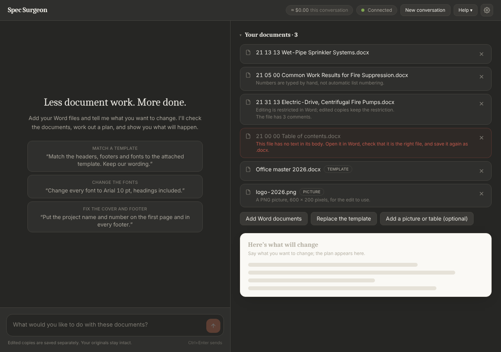
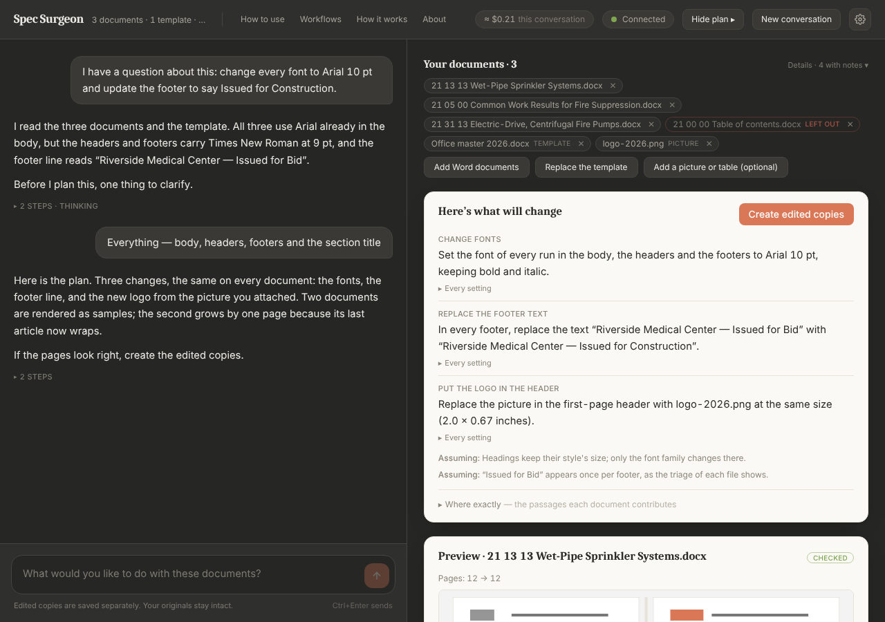

# Spec Surgeon

Surgical edits to Word (.docx) specification files, a few files or dozens at a time, with an independent check and a
verification record for every file: from one word or one property up to whole articles, tables, pictures and
sections.

Spec Surgeon is for people who maintain construction specifications: the engineer or designer who has to change the
font, the header and footer, the issue stamp, the numbering or a defined term across a whole set of sections, and who
cannot afford a single file in which a paragraph went missing or a word appeared that nobody wrote. The transform is
deterministic Python over the document XML. The expected result is predicted *before* the transform runs. A separate
verifier, sharing no code with the transform, reads only the before and after packages and asserts that prediction.
A file is delivered only when every check passes and the source has not moved since it was read. No language model
is in the per-file loop; Claude is optional, and its job is to turn a plain-English request into a specification you
approve, to look at preview pages, and to investigate files the engine set aside. Safe mode does the common changes
from buttons, with no AI at all.

It runs as a Windows desktop app and as a Python library (Windows, macOS or Linux). There is no command line.

## Install

**Windows 10/11 (64-bit):** download `SpecSurgeon-<version>-Setup-x64.exe` from
[GitHub Releases](https://github.com/Abe-Borg/spec-surgeon/releases), run it, then launch **Spec Surgeon** from the
Start menu. The installer includes Python, the window (a local server and its page, shown in a native WebView2
window; the WebView2 runtime ships with Windows 10/11), the editing engine, Word integration and the Anthropic
client; no separate Python installation or terminal commands are needed. From then on the app keeps itself up to date:
a banner offers each new version, and **About → Check for updates** checks at any time. It installs for the current
user without administrator access, offers a desktop shortcut and includes an uninstaller. Example EditSpecs are
available from **Spec Surgeon → Example edit specs** in the Start menu.

Microsoft Word or LibreOffice is still needed for page rendering; neither is installed by this setup program. Safe
mode needs no API key. Default mode's typed requests need your Anthropic API key: enter it in the window's **Settings** and tick *Remember securely on this
computer* to keep it in Windows Credential Manager. The installer is unsigned, so Windows may show a publisher prompt on the first manual install.

**Python package / development setup** (Python 3.10+ on Windows, macOS or Linux; from the project folder):

```powershell
py -3 -m pip install -e .            # core: lxml, regex (bounded pattern searches), PyMuPDF 1.x (2.0 loads an AI layout model the app never uses)
py -3 -m pip install -e ".[gui]"     # the window: FastAPI, uvicorn, pywebview (WebView2 on Windows) — spec-surgeon-gui
py -3 -m pip install -e ".[word]"    # Windows: adds pywin32 so Word is the renderer/oracle (recommended)
py -3 -m pip install -e ".[agent]"   # optional: anthropic SDK for typed requests in the window
py -3 -m pip install -e ".[dev]"     # pytest, pytest-xdist (pytest -n auto: every core) + python-docx (fixtures)
```

or `py -3 -m pip install -r requirements.txt` for everything. Start the window with `spec-surgeon-gui` (or
`py -3 -m spec_surgeon`); a copy installed this way is not updated in-app, the banner shows the `pip install -U` command
instead. On Linux and macOS use `python3` in place of `py -3`. Without pywebview the window opens in the default
browser instead of its own window.

The window is a web page served by a local server on your computer (the contract is
[docs/WEB_API.md](docs/WEB_API.md)). The built page is committed under `src/spec_surgeon/web/static/`, so a
checkout runs as is; Node 22 is needed only to rebuild it after changing `frontend/` (`cd frontend`, then
`npm ci` and `npm run build`).

Rendering needs one of Microsoft Word (Windows, with `pywin32`) or LibreOffice (any platform; set
`SPEC_SURGEON_SOFFICE` if it is not on `PATH`). Without either, the engine still runs every XML check; the two
render checks are recorded as N/A with the reason.

| Variable | Purpose |
|---|---|
| `SPEC_SURGEON_AUTHOR` | default tracked-change author (else the OS user name) |
| `SPEC_SURGEON_SOFFICE` | path to `soffice` / `soffice.exe` |
| `SPEC_SURGEON_WORD_INSTANCES` | how many private Word instances may render a batch side by side (default 3, at most one per two cores; `1` renders every file in one instance) |
| `ANTHROPIC_API_KEY` | typed requests, Claude's visual check, custom transforms and recovery; or enter it in Settings |
| `SPEC_SURGEON_MODEL` | the model every Claude call uses (default `claude-opus-5-5`) |
| `SPEC_SURGEON_NO_UPDATE_CHECK` | any value: the window never checks for updates on its own |
| `SPEC_SURGEON_CONFIG_DIR` | where the app keeps `settings.json`, your saved recipes (`recipes.json`) and, under `data`, its scratch folders (one per window, deleted when it closes), the render cache, downloaded updates and its logs |

## The window: documents and a conversation



The window is one conversation. On the left is the chat, with the one button above the box you type in; on the right
are your documents (optionally with one template) and the before/after pages. The top bar, in the style of Build-a-Spec, carries the in-app guide —
**How to use**, **Workflows** (the typical operations of each mode, with whether the app can do each, and recipes for
the usual jobs), **How it works** and **About** (the version, the model, the release notes, the license,
**Check for updates**, **Open diagnostic logs** and **Save a diagnostic bundle**) — beside a line saying what the conversation works on ("3
documents · 1 template · building on your copies"), the estimated spending, the context the assistant's conversation
holds (below), the connection, **New conversation** and Settings. On a narrower window (1280 px wide, say) the top bar says the same in fewer words, one step at a time
until it fits on one line: the context line goes first, then words such as "this conversation" and "context", and the
help topics become **Guide**, **Workflows**, **Mechanics**, **Trust** and **About** (the full name on hover); on a
narrow window the context pill goes too.

**New to the window? Take the guided tour.** **Tour** in the top bar, the chip at the top of an empty conversation,
or **Help → How to use → Start the guided tour** walks through every part of the window, chapter by chapter, on
bundled practice documents: four short specifications, a file triage refuses, a prepared header/footer template, a
logo and a table of values. The tour has a workspace of its own. Your conversation is set aside the moment it starts
and comes back exactly as it was when it ends; nothing of yours is read or written, and no AI call is made at any
point. Its Safe-mode chapters press a real button through the real engine on the practice copies (a preview, then
checked copies, in a practice folder inside the window's scratch folder that is deleted when the tour ends), so what you see
is what the app does; its conversation chapters show a recorded example, labelled as one, with Send and the answer
buttons held still. You only watch: Continue, Back or End the tour at any step, a reload picks the tour back up where
it was, and once you have finished it the chip stops inviting. Help → How to use starts it at any chapter.

1. **Add Word documents.** Drop `.docx` files anywhere in the window, or use **Add Word documents**. Files can come
   from different folders, including files with the same name. Only the files you attach are edited; nothing is
   picked up from their folders. **Add a folder of documents** attaches a folder's own `.docx` files at once (its
   subfolders are not entered; the chat says how many documents they hold, so you can add those folders too).
   The ✕ beside a file takes it out of the conversation; with two or more documents listed, **Remove all
   documents** takes them all out at once after one confirmation (the template, pictures and tables stay, and the
   files themselves are never touched). A removed document's edited copy leaves **Your edited copies** and Export
   with it, so Export it first if you want to keep it; attached again, the document starts from its original.
2. **Check the list of files.** The moment a file is attached, Spec Surgeon reads it (milliseconds, no model
   call) and lists it by its name. What it finds (typed numbers instead of automatic list numbering, no paragraph
   styles, text boxes in the headers or footers, an older compatibility mode, editing restrictions, pending tracked
   changes, comments, irregular spacing, an empty body) is not shown in the list. A file that does not open
   as a Word package, has a part with an XML document type declaration (which Word never writes), or has no
   paragraph at all in its body, stays in the list greyed out with the reason and never enters a plan. A `.docm`,
   `.doc` or `~$` lock file is not attached; a notice asks for a `.docx`.
3. **Optionally add a template.** One reference `.docx` for requests such as "Match the headers and fonts to this
   template. Keep our technical wording."
4. **Describe the result.** Type what you want and press **Send** (Ctrl+Enter). Spec Surgeon inspects the documents,
   goes ahead on sensible defaults (and says what it assumed), asks at most three questions, each with the answer it
   recommends, and prepares a plan — while you watch its words flow in as they are written, with one line above them
   naming each step as it happens (the steps and its thinking summary fold under that line once the reply is written).
   Before it plans, it reads every document side by side (no model call): each one's section number and title, every
   header and footer line, and the File Properties title. It names the document that differs from most of the others
   (a footer title in other capitals, a header or footer line missing or extra, a Properties title naming another
   section) and offers a fix; nothing changes until you ask for it.
   A question comes as a card with buttons and short replies you can tap: click one, type its number, or answer in
   your own words. A choice that would put words into the documents shows those exact words; picking it approves
   exactly those words (a tapped reply never does). When Claude drafts wording for you, **Edit wording** opens it in a
   box, already filled in: change it and **Use this wording** approves exactly your version, never the draft. Changes that touch the same parts of a file — the template's
   header and footer beside its font, say — are composed into ordered steps by the engine; nothing is asked of you
   in two steps.
5. **Look at the pages.** The chat says in plain words what will change. Beside it: rendered before/after pages for
   sample documents with their page counts, and **Left untouched**: any file the plan cannot cover, with the reason.
   The reason is specific: the step that refused the file ("Step 1 of 2 (Match headers and footers to template):"),
   what it looked for (the words to find, the document's SECTION line, a setting the template differs on) and what
   the document holds instead (its first line, or the two section numbers it gives).
   When a change is kept to one place and the same words remain elsewhere (the footer renamed while the first page
   keeps the old title, a header filled with a title the document does not have), a note under **Worth knowing**,
   beside the pages, names the document and where; Spec Surgeon offers to change those too when you reply, and
   never does it unasked. A header or
   footer fill that will show in another case than the template's (a title typed "Identification for …" where the
   template shows "DOOR HARDWARE") is noted the same way; "show it in capitals like the template" makes it look so
   through formatting, without retyping a letter. Word has no title-case look, so when the template shows its title
   in title case ("Specification Name") and your files type theirs in capitals, matching it is wording: Spec Surgeon
   drafts each document's title in the template's case as one choice you can pick or correct, and one plan then
   puts each document's own approved title in its footer.
   A file the plan cannot cover is listed under **Left untouched** with the reason, and the preview of the others
   stands; the assistant names it in its next reply and says what would let it take part. In a plan done in steps
   (the template's headers and footers, then the fonts), a sample the later step refuses is listed there too. So is
   a document whose preview did not pass its checks while another's did (its page layout moved, say): its preview
   stays, marked **Did not pass** with the failed checks, so you see why, and the chat says it gets no copy; one
   failing document never holds back the others. Only when no preview passes is **Create edited copies**
   unavailable, with the reason beside it.
   Each preview starts with its green checkmark filled: it gets its copy, so there is nothing to tick. The red X
   says it needs more work: set it aside for after the others (the checkmark, a second X, or **Include all** beside
   the button takes it back). The button counts the copies it makes ("Create 30 edited copies"), including the
   documents without a preview of their own (the previews are a sample), and says how many of those there are.
   To leave documents out of a request altogether, say so ("leave out 20, and 23 for now"), or keep the
   request to the ones you mean ("only 23", "just the Michigan one"): the plan covers those, every other document
   stays exactly as it is under **Left untouched**, and your next request covers them all again unless you leave
   them out again. To park documents for later instead, say that ("set 20 aside for later, I'm waiting on the
   owner"): they go on your to-do list at once, with your reason, and stay out of every request until you work on
   them or put them back.
6. **Create edited copies.** One button, in the conversation above the box you type in, approves the displayed plan.
   The engine applies it to every file you did not set aside and that is not under **Left untouched**, verifies each
   one independently, and lists the copies under **Your edited copies**; click one to open it in Word. Originals are never written. A file that fails a
   check is not delivered; Spec Surgeon checks it again internally and comes back with a question or a new plan,
   never a method to choose. The documents you set aside wait on a to-do list; once the other copies are saved, the
   conversation offers to work on them: they are planned alone, from the same request, and you say what should be
   different.

**The to-do list.** What could not be done on a document is still owed, each with why, until you come back to it:
the to-do list is every such case, the crosses of **Where each document stands** (below). On it are the documents
you marked with the red X and the ones you asked the assistant to set aside, and the ones the app could not change:
a file the plan, a button or a saved recipe could not be applied to or whose preview did not pass its checks (it is
on the list once you create the others' copies), and a file whose copy could not be made with nothing left to check
it again. The two kinds differ in one thing. A document you set aside waits: it is out of every button and request
until you work on it, or until **Put back** beside it returns it to the other documents as it is. A document the app
could not change stays in the batch, in every mode: your next button or request works on it with the others, and
what it missed stays on the list. While files are being checked again after a run, **Leave the rest for later**
(offered once the ready copies are saved) leaves what was not fixed as it is, on the list too, and ends the request.
Nothing on the list is changed. "Work on my to-do list" (a reply the app offers, and the button of the to-do card
in the chat) plans one request at a time, the oldest first, for the documents that still owe it, with the assistant
told why each one failed; in Safe mode the button reads **Work on it in Default mode** and switches modes first. A
cross in the grid offers the same for that one document, **Not needed on this one** when a later change made it
moot and, with Obliterate mode shown in Settings, **Obliterate this one** (below, under the modes). Each new request
tells the assistant which documents you set aside and what the others still owe, so it can answer "what did I set
aside?" without planning those files, and it plans an earlier request for a document only when you ask. The list is
kept in the saved conversation; **Start over from the originals** clears it.

**Questions.** A question the assistant answers in words, with no plan and nothing to pick ("which of these carry a
Subject property? don't make an edit"), ends there: no button follows the answer, and your next message is a new
request, even after you put a document back or attach one. The assistant is told the last five such exchanges with each
new request (what you asked, and the first sentence of its answer), so it can refer back to them without answering
again.

**Mixed batches.** Documents from different projects are often built differently: styled article titles in one,
plain paragraphs with typed numbers in another. For such a batch the plan has one specification per layout, and the
previews cover at least one sample of each. One button still approves all of them. A document built differently
from every layout the plan covers is left untouched with a sentence.

Keep chatting: the next thing you ask for is made on the copies the last run created, your originals stay as they
are, and **Start over from the originals** is one tap away. The copies live in the window's scratch folder until
you save them with **Export**, in the top bar. It is ready whenever the window lists edited copies and no work is
running (copies a run delivered while it still checks other documents included), and offers three choices, then
asks for a folder:

- **Word (Tracked Changes ON)** — each copy as it is, byte for byte the copy the checker passed: its tracked changes
  and comments stay, to accept or reject in Word.
- **Word (Tracked Changes OFF)** — each copy with every tracked change accepted; its comments stay.
- **PDF (Clean)** — a PDF of each copy with every comment removed and every tracked change accepted, made by Word (a
  new, invisible instance, never the Word you have open) or LibreOffice when Word is not installed.

The two clean choices make a clean version of each copy first, with a plan fixed in the app, and check it with the
same independent checker as any copy (and each PDF opens, has pages and carries no comment notes); your edited
copies are not changed, and a document whose clean version cannot be made exactly (a change only Word can settle,
such as an inserted table cell or a change inside an equation) gets no file and the chat says why. In every choice a
file already there with the same content counts as saved, a different file under the same name is left alone and
the new one is numbered beside it, and a folder where a file would land on one of your attached files is refused.
Ask the conversation for PDFs and it points you to Export. A copy is saved while a file with its content sits where
Export → Word (Tracked Changes ON) put it: clicking a copy opens that saved file, and a copy you then change in Word
through the window's scratch folder reads **CHANGED** and counts as unsaved again until the next Export (which writes
it beside the file saved before). Closing the window deletes its scratch folder, after one question if a copy is not
saved that way as it is now, so every start is a clean one; a window that never closed is restored at the next start
instead, once.



**Two modes, and a hidden third.** The switch is in the top bar, beside the help topics, and the window opens in the
mode you last used (Safe the first time; never Obliterate).

- **Safe — buttons, no AI.** What you control: the common changes, one button each — *Match headers and footers to
  template*, *Remove headers and footers*, *Add or remove a watermark*, *Swap the logo*, *Match body formatting to
  template*, *Match font to template*, *Change font*, *Page size and margins*,
  *Find and replace* (typed pairs or an attached table; body, headers and footers; every occurrence found is listed
  under the previews with a checkbox — and a box to tick or untick them all at once — so a historical reference can
  be unticked and left as it is, the plan remade
  with **Update the preview**, and the checker confirms it was left untouched), *Change the issue stamp*, *Add END OF
  SECTION where missing*, *Keep numbers with their units*, *Accept or reject all tracked changes*,
  *Remove all comments*, *Remove highlighting*, *Remove hidden text*, *Remove specifier notes*, *Remove empty
  paragraphs*, *Clean up spaces*,
  *Standardize quotes and dashes*, *Remove hyperlinks*, *Freeze fields as plain text*, *Remove unused styles*, *Name
  files by section number and title*, *Set the document title property*, *Turn off Track Changes*, *Set author and
  company* and *Set proofing language* (clean PDFs are Export's, in every mode). A note above the buttons says what Safe mode is, what it
  cannot do (anything that is not a button), and that Default mode, with a Claude API key, is the way to more; its
  **Add a Claude API key** opens Settings and **Switch to Default mode** switches, and **Hide** folds it to one line
  (the window remembers). Each button has a short
  form (your words and choices only), then **Preview**, the same pages, checks and **Create edited copies** as Default
  mode. What it costs: only what the buttons do. The copies are clean unless you tick *Show my changes as tracked
  changes in Word* (offered where the change can be tracked). The template buttons take either a prepared template
  (yellow-highlighted or `{{NAME}}` placeholders: the section number and title come from each document, every other
  placeholder's value is typed in the form, the same in every copy) or an ordinary specification whose headers and
  footers show its own section number and title. A placeholder is the section number when it is shaped like one
  (`XX XX XX`, `00 00 00`, `000000`, `## ## ##`) or named for it (`SECTION NUMBER`, `SPEC NO.`…), and the title when
  it is named for it (`SECTION TITLE`, `SECTION NAME`, `Specification Name`…); case, underscores and enclosing
  brackets do not matter. The form names the placeholders each document fills itself, so it asks only for the rest. No model is called — no plan, no visual check, no recovery — so it needs no API key and
  spends nothing.
- **Remove specifier notes** (Safe mode) is the one-press clean-up of a master's editorial notes, with no form and
  no settings. It deletes every whole paragraph that is a note — in a note style (CMT, Specifier Note, Editor's Note,
  Note to Specifier, Editorial Note, Coordinator Note, matched by the style's id or name as Word shows it, or a style
  based on one) or opening as a specifier's instruction ("NOTE TO SPECIFIER", "[Specifier: …]", "[Editor's Note …]",
  "Retain or delete …", "Delete if not applicable", "Retain paragraph below …", "Select one of the following
  paragraphs", "--- OPTIONAL ---" and the like) — and Word's hidden text, in the body, headers, footers, footnotes and
  endnotes. The opening words are SpecCleanse's rules, each narrowed there against requirements it once took, and
  anchored here at the paragraph's start, so a requirement that only contains them ("Provide two [retain or delete]
  spare heads", "Retain records of all tests", "Select one of the listed manufacturers") keeps them; no heading
  (SECTION, PART, ARTICLE, END OF SECTION) is ever one. Placeholders (`[Insert …]`, `[Verify …]`, `[TBD]`), "to be
  determined", copyright and confidentiality lines, headings, coloured or italic text, tracked changes and comments
  stay: in a copy that goes to a client a placeholder is an open item, not noise. It runs as two steps — the hidden
  text first, then the note paragraphs — so a hidden note holding a field goes whole; a visible note paragraph that
  holds a field or a section break sets its document aside with the reason. Clean copies; the preview lists every
  removed note. Default and Obliterate mode go further when asked: cut placeholders out of their sentences, delete
  copyright lines or headings, edit "to be determined", accept or reject tracked changes.
- **Convert to Canadian CSC PageFormat** (Safe mode, under **Fonts & formatting**) uses the bundled Canadian numbering scheme without an API key or an attached template. Choose automatic Word numbering or CSI numbers typed as text, then preview and approve the copies. Numbers keep their values; mixed or ambiguous outlines are left untouched. Automatic numbering keeps paragraph styles; typed CSI numbers take the scheme's styles. This button converts numbering; it does not apply a complete office page or header template.
- **Match body formatting to template** (Safe mode) makes each document look like your template without touching a
  word or a table. The form shows the template's style for each part of a section (the section number line, the
  title, PART, articles, paragraphs and subparagraphs, END OF SECTION), read from the template and changeable. Each
  document's outline takes those styles and the template's numbering, and every number keeps its value: a "1.01"
  article shows as the template's "1.1", but a list that would renumber sets the document aside. An outline typed as
  text converts when its numbers are the ones the list counts (a typo, a skip or a duplicate sets it aside). With its
  boxes ticked (the default) it also sets the template's page size and margins (a document with a landscape page keeps
  its pages), its fonts on the body (the outline in the template's own fonts and sizes, other body text in its body
  font; headers, footers and tables keep theirs), and lets the styles set paragraph spacing, indents and alignment —
  bold, italic and underlined words stay. Documents built alike run as one plan and the rest are planned their own way; a document it
  cannot read (no outline, typed and Word numbers mixed, an outline deeper than the template's, one of its styles
  shared with paragraphs it does not restyle) is left untouched with the reason.
- **The third set of Safe buttons** (2026-10-28), each one operation the engine already checks, built in code from
  its form. *Change font* is *Match font to template* without a template: you type the font (Arial) and choose a
  size, or keep each document's sizes; only text in each document's own body size changes size, so headings and
  notes keep theirs. *Page size and margins* sets the paper (Letter, Legal, Tabloid, A4, or each document's own) and
  the four margins in inches on every section, and optionally the header and footer distance; with a paper size
  chosen, a document with landscape pages is left untouched so a landscape schedule never turns upright. *Change the
  issue stamp* finds the stamp by the wordings you type (ISSUED FOR BID, ISSUED FOR PERMIT) wherever it sits, on the
  cover, in a header or a footer, and replaces each with your new wording. *Add END OF SECTION where missing* ends
  each document with your line (`END OF SECTION {number}` to start; it begins with END OF SECTION, so pressing it
  again adds nothing), its own number read from its SECTION line,
  formatted like that line or as plain text, and corrects one that reads otherwise. *Keep numbers with their units*
  puts non-breaking spaces in "150 psi" and "21 13 13" so Word never splits them; no words change. *Clean up spaces*,
  *Standardize quotes and dashes* (straight or curly quotes, `--` as an en or em dash, section numbers with spaces or
  hyphens), *Remove hyperlinks* (the words stay), *Freeze fields as plain text* (page numbers never) and *Remove
  unused styles* (the document's own, or Word's built-in ones too) tidy a set before issue. *Accept or reject all
  tracked changes* can now throw away a round of edits. *Set author and company* sets File → Info → Author, Company
  and Subject, or clears the author names before issue. *Set proofing language* sets every language, or only other
  kinds of English, to the one you choose.
- **Default — a conversation.** What you control: any change you can describe, from one word to whole tables,
  sections and pictures, on documents built in different ways. What it costs: an Anthropic API key and the AI's
  spending, and the AI can misread a request, so you read what it plans and look at the pages before you approve.

  Default mode also does what the Specification Formatter did, under the same checks as every other request:
  - **Format a consultant's specification to an architect's template.** The template's role styles, page, headers and
    footers go onto each document. Claude reads each document's outline (the section number line, the title, PART,
    articles, paragraph levels, END OF SECTION) with the app's own structure reader first; only the paragraphs the
    reader cannot place, and typed "PART 1" or "1.5" openings whose words read as a requirement rather than a heading,
    go to a separate Claude reading. Claude's message names the parts of the outline that rest on its reading, so you
    check them in the preview. The plan names each document's own paragraphs, so one document's choice can never land
    on another's. Ask for the template's even/odd page headers and the switch that shows them comes with them. The
    template's theme and compatibility settings are never carried; its fonts reach the copied styles as their own
    values.
  - **Convert CSI numbering to Canadian CSC PageFormat, or back.** With an architect's Canadian or CSI template, the
    outline moves onto its list. With no template, Claude offers a built-in scheme (CSC PageFormat, nine levels:
    PART 1, 1.1, .1 … .1; or CSI: PART 1, 1.1, A., 1., a., 1), a), (1), (a)) as a choice; picking it attaches it as
    the template. Every number keeps its value ("A." becomes ".1", "1.01" becomes "1.1") or the document is set aside,
    and you can keep each paragraph's own look so only the numbers change. Typed CSI numbers ("PART 1 - GENERAL",
    "1.01", "A.") become automatic PageFormat numbers. Numbers stay automatic both ways: no number is ever typed into
    the text. A typed Canadian ".1" is not converted, because it does not say which level it is.
- **Obliterate — the conversation without guardrails (hidden).** Off the switch until Settings → **Advanced** →
  *Show Obliterate mode* is on, and chosen only after its warning, every time (tick *I understand*, then **Turn on
  Obliterate**). What you control: Claude may write wording itself (every word it places must be in its reply to
  you, which the app checks before the plan is previewed); when no operation
  fits, Claude may write a custom method that changes anything Word stores, not only formatting, and may use the
  template, pictures and tables you attached. Such a method predicts nothing: it just does the work on a copy, and
  the independent checker then reads the original and the copy and reports what differs — the words added and
  removed; the paragraphs, tables, pictures, text boxes, fields and tracked changes counted before and after; the
  formatting, styles, numbering, settings, relationships and parts that changed; and any changed part it compared
  by its bytes only (a chart, an embedded file, stored data, the theme), named as not read. It also checks that the
  copy is a file Word opens: every part well-formed, every reference pointing at something, tracked-change ids and
  markup Word accepts, no new schema error, and, when pages are rendered, that the renderer opened it. Claude reads
  that report before it settles on the method, and a copy whose file is broken goes back to Claude first. The
  method's copy of every document is then made before you approve anything: the chat and each copy's preview card
  list what it changes, as the checker read it, and **Create edited copies** delivers those same copies, never a
  new run of the method. A copy made this way is never called verified: it is delivered marked **UNPROVEN** (what
  it changed was shown to you, not proven), or **UNVERIFIED** when a check of its file failed. A document the method
  could make no copy of says why on its card and goes on your to-do list. Claude may also plan a **raw XML edit**,
  an operation the other modes do not have and refuse: one part of the file, an XPath that names elements of it,
  exactly how many elements that is in this document, and one action for each (set or remove an attribute, remove,
  replace, insert, set the text, or unwrap — the element goes and what it held stays). A document where the XPath
  finds another number of elements is set aside untouched, with what it found. This is the cheap way past the one
  thing a built-in operation refused to guess about — a text box in a paragraph to delete, a content control bound
  to data, a field that will not resolve: the edit clears exactly that, and the plan the other documents got then
  runs as the next step, checked as in any mode. The edit itself is proven: the independent checker finds the
  elements with its own reading of the XPath, makes the same edit in its own copy of the part and compares the whole
  part exactly, text between tags included, so exactly those elements changed as stated and nothing else in that
  part did. What the edit does to the words is not predicted; it is listed from the sample copies, in the chat and
  under each preview, before you approve — the words added and removed, any other text between tags that is not a
  paragraph's words (a chart's title, a document property), then what else changed. A value the edit sets in an
  attribute is not listed as words; the plan's own sentence quotes it. Such a copy is checked, not UNPROVEN; an edit that
  leaves markup Word repairs or will not open is made as stated and fails the check of its file, and the copy is
  then delivered marked **UNVERIFIED**. The file's own relationship and content-type parts are not edited this way.
  And a copy that fails a check is
  delivered anyway, marked **UNVERIFIED**
  with the checks it failed, instead of being held back (the mark stays on every later copy built on it). What it
  costs: no proof that the rest of the file is untouched (a custom method's copy is checked only for being a file
  Word opens), content can be lost or invented without a refusal, a copy
  may need Word's repair, results can differ from run to run, and more AI spending. What still holds: copies only
  (your originals are never written), a source that changed is never delivered over, the custom method's sandbox, and
  the independent checks on every copy, their results kept beside it. The warning also carries one box, empty
  every time: **Also turn on the hands-on tools** (the mode's strip above the message box switches them too). With
  it ticked, each document carries **Parts**: a read-only browser of the parts its file is made of — every part
  with its size, the XML shown as text a page at a time, and a search across all of them. Nothing in the window
  edits XML. **Save this part…** writes one part out exactly as it is, to a folder you choose; you change it in an
  editor of your own; **Replace this part…** then puts your file in that part's place in a copy, after a preview.
  The replacement is a plan the app builds itself, with no AI: the independent checker hashes the part in the copy
  and proves it holds exactly your file's bytes and that no other part changed, and the words the new part changes
  are listed from the copy, in the chat and under the preview, before you approve. Any part can be replaced — the
  body, a header, the styles, a picture, the package's own relationship parts. What Word would not open is said by
  the checks: a part that is no longer well-formed XML, or a reference left pointing at nothing, shows **Did not
  pass**, and in this mode the copy is still created, marked **UNVERIFIED**. None of these tools uses AI or needs
  an API key, nothing they read is sent anywhere, and Claude is never told of them and cannot use them. They are
  never remembered: the next time you choose Obliterate the box is empty again. While the mode is on, each document
  also carries **Word actions**: a fixed menu of things Microsoft Word itself does to a copy — *Open and repair,
  then save*; *Remove protection*; *Accept all tracked changes*; *Reject all tracked changes*; *Update fields*;
  *Unlink fields* (headers and footers keep theirs live, for their page numbers and running titles); *Turn automatic
  numbers into typed text*; *Leave compatibility mode*; *Turn text boxes into plain text*; *Delete drawn shapes*
  (pictures, charts and embedded objects stay). Tick the actions (they run in the order you tick them, *Open and
  repair* first), tick **Also run on the other documents** if they should get them too, and press **Run in Word**.
  No AI is used and no API key is needed; Claude may also name the same actions in a plan of its own. Nothing else
  can be asked of Word: no script is written for it by you or by Claude, and an action that is not on the menu is
  refused. Word opens a private copy of the document — never your file — in an instance of its own, with macros
  disabled and links not updated, and saves the result under a new name. Because Word saves the whole file again,
  nothing is predicted: the copy is made first, and the chat and the copy's card list the words it adds and removes
  and what else it changes, as the independent reader found them (it pairs the parts by their place in the document
  and sets Word's own save marks aside, so a save that changes nothing reads as nothing changed), with Word's own
  count of what it did shown apart, as Word's. **Create edited copies** then delivers that same copy without running
  Word again, marked **UNPROVEN** (or **UNVERIFIED** if it does not open as a file). A document Word cannot finish,
  or finds nothing to do in, gets no copy and Word's reason. Nothing else can be planned in the same approval:
  whatever the document still needs is your next request, on the copy Word made — and when you ran the action on a
  document from your to-do list, the pass stays open and **Continue** plans the request it was set aside from on that
  copy. Needs Microsoft Word on this computer. A file the app **refuses when you attach it** can be rescued here:
  it carries **Try to rescue**, and an old `.doc` or a `.docm` can be attached in this mode to be rescued. The app
  tries the one thing that fits why the file was refused. Its own mending, with no Word: a part that carries an XML
  document type declaration is written again without it; a body with no paragraph gets one empty paragraph; for a
  file past the size limits nothing is written and the limits are raised for this window. Word's, on a private copy
  with macros disabled: a `.doc`, a `.docm` (its macros are not kept) or a Strict Open XML document is saved as a
  `.docx`; a file that is not a readable package is opened with Open and Repair; a document protected with a
  password asks for it first, gives it to Word for that one attempt and keeps it nowhere. **Your file is read and
  never changed.** What comes of it is attached in the refused file's place, marked **Salvaged** — a mark it keeps
  for as long as it is attached, in every mode, and that every copy made from it carries too — because the file
  could not be read as it was, so nothing can prove the rescue kept everything it held: compare the rescued
  document with your file in Word before you rely on it. From then on it is a document like any other, and its
  copies are checked against the rescued file. A document rescued with its password has **no password**
  afterwards, and neither have its copies; it sits in the window's scratch folder until the window closes. No AI
  is used. A lock file, a folder, a missing file and any other kind of file are still refused. And **Export may
  make a marked copy's clean version anyway**: when Export → Word (Tracked Changes OFF) or PDF (Clean) cannot be
  made the checked way for a copy that carries a mark (UNVERIFIED, UNPROVEN or Salvaged), the Export menu then
  offers that kind under **Made by Word, unchecked**. Word accepts every tracked change on a private copy of your
  edited copy (for the PDF it deletes every comment first) and saves it; nothing is planned or predicted, so no
  check proves the file. The chat names it **UNCHECKED** and gives Word's own count beside what the app read in the
  file Word saved: whether its words are your copy's with every tracked change accepted, and whether a tracked
  change (or, for the PDF, a comment) is left. A file with such a finding is saved all the same, and the finding
  said. Your edited copies stay as they are, no AI is used, and Claude can never choose it. Needs Microsoft Word on
  this computer. Obliterate is the last rung of a ladder —
  Safe first, Default for what Safe could not take, Obliterate for the one or two documents neither could — so it
  also starts from the to-do list: **Obliterate this one**, on a cross of Where each document stands, opens the same
  warning and then turns the mode on for that one document and that one change, the request it failed standing and
  every other document, copy and cross left as it is. The assistant is then told what the engine recorded of that
  document (the refusal, or the checks its copy failed) and the plan the other documents got, and may read a document
  of the same run that took the change as a worked example; where one thing stopped the document, it clears that
  with a raw XML edit and runs the same plan as the next step. When a copy was made and held back because it failed
  a check, the chat offers **Use the copy that failed, marked UNVERIFIED**: after the app checks that this copy and
  the file it was made from are unchanged, it joins your edited copies as it is, with no AI call, and **Undo the last
  change** takes it off again.
  **Back to Default** (or any other mode) leaves
  it; the app never opens in it.

On a batch from different projects, Safe mode's buttons work on every document they can change exactly and leave
the rest untouched, each with the engine's reason — a template's section line it cannot find, an odd-and-even pages
setting that differs from the template's, a phrase whose formatting changes partway through, a preview whose page
layout did not come out as the plan predicts. Nothing is guessed and nothing is half-edited: a copy passes every
check or is not made, and a document whose preview failed never holds back the copies of the others. After the
copies are created, each document the button could not change has a cross under that button in **Where each document
stands** (below), with the reason, and stays among the documents your next button works on. **Work on it in Default
mode**, on the cross or on the to-do card in the chat, switches to Default mode and begins a pass over it, where the
conversation can plan it — for any cross, however many buttons ago.

Changed your mind in Safe mode? While a button's preview waits, **Discard preview** (or **All buttons**) withdraws it
and nothing is created; each button's form keeps what you typed until **Clear form**. After the copies are created,
**Undo the last button** goes back one button at a time: the next button builds on the copies from before it (your
originals, after the first one), and the copies the undone button made stay where they were saved. Nothing is deleted.
Default and Obliterate mode have the same ways back: **Discard preview** withdraws a plan and its preview, and **Drop
this request** ends a request still open at a question, a pause or a reply to continue; nothing is created, and your
next message starts a new request (the assistant is told the last one was withdrawn). **Undo the last change** goes
back before the last run that made copies, one run at a time. While a run that already saved some copies has its
other documents checked again, those copies join the ones your next request builds on only when that check ends, so
adding or removing documents, a change of mode, the to-do list, Discard and Undo wait until you save the ready copies
or leave the rest for later; the greyed button says why.

Need to stop a button's work part-way, say a preview of sixty documents rendering through Word? **Stop now**, in the
bar above the buttons while the work runs (and the red **Stop** in the top bar), is Safe mode's kill switch. Safe mode
calls no AI, so Stop ends the work itself, at once: the worker processes are ended, and so is the private Word
instance or LibreOffice the app started; your own Word is never touched. Nothing the stopped work made is kept. A
preview being made is withdrawn, and the window shows what it showed before you pressed the button. A stopped
**Create edited copies** makes no copy at all (copies reach your documents only once every one is made and checked)
and its preview waits again, so you can create the copies later or discard it. A stopped Export saves nothing. Your
originals are never written either way.

Under the copies, **What you've done so far** lists every button you ran since the originals, oldest first, in the
words of your line in the chat, with how many of the documents attached now carry each one (which do not, and why,
is in the grid above it, per document). **Undo the last button** takes the newest off, Start
over clears the list, and a button you already ran carries a checkmark, so the steps of a long batch never need
remembering. In Default and Obliterate mode the list names each request the same way.

Above it, **Where each document stands** answers "what worked on what, and what didn't" for the whole job, in every
mode: a grid with every button or request across and every document down. A check means that document got it, with the
mode that did it (Safe, Default or Obliterate, and UNVERIFIED or UNPROVEN where a copy was delivered with that mark); a
cross means it could not be done; a dash means it was not run on that document (you left it out, you had set it
aside, it was attached later, or you said it is not needed there). Click a mark for its reason and every attempt made
on it. A reason stays there however many buttons you press afterwards, a button that no document could take is
listed too, and when a document that failed in Safe mode is later fixed in Default or Obliterate, its own cell turns
to a check and keeps both attempts. The line under the grid counts what is still not done, and **Show only these**
lists just those documents. **Undo** takes its newest column off and **Start over** clears it.

**The crosses are your to-do list.** Click one for what you can do about it, from any mode: **Work on it now** begins
a pass over that document alone, where you tell the assistant what should be different (from Safe mode it reads
**Work on it in Default mode** and switches modes first), and **All N it was not done on** takes every document that
button or request failed on; **Obliterate this one**, with Obliterate mode shown in Settings, takes that one document
to the last rung; **Not needed on this one** takes it off the list when a later change made it moot, and it can be
put back. Pressing the same Safe-mode button again with the same form settles its own earlier crosses on the
documents it now changes. A document the app could not change stays in the batch, so your next button or request
works on it with the others; a document you set aside yourself, with the red X or by asking, waits out of them and
carries a **set aside** badge with **Put back** beside it. The grid itself changes no document.

**Save as a recipe…**, on that list, keeps the changes you tick under a name, to run again on the next set of
documents: in Safe mode the buttons and what you filled in their forms, in Default and Obliterate your requests with
the plans you approved. Safe mode shows your recipes under **My recipes**, above the buttons; Default and Obliterate
beside the message box (**All recipes**). Open one, change a step's form or skip a step for this run, and **Preview**:
every step is built from the documents attached now and checked by the same gate as any plan, then previewed once,
with the pages after every step; one **Create edited copies** makes the copies, and **Undo** takes the whole recipe
off. No AI is called, so a recipe costs nothing to run. A step that needs a template, picture or table uses the one
attached when it runs; a document a step cannot take is left as it is, with a cross in the grid and the reason: it
is on your to-do list, and stays among the documents your next change works on, in every mode. A recipe runs in the
mode it was saved in or one with fewer guardrails: Safe recipes in every
mode, Default ones in Default and Obliterate, Obliterate ones only in Obliterate. A change Claude wrote a custom method
for, or planned with values read from particular documents, cannot be kept, and the dialog says why. Recipes are kept
in `recipes.json` beside `settings.json`; **Manage** duplicates and deletes them.

**Edit**, in Manage, changes a recipe after it is saved: its name, what it is for, and its steps — moved up or down
with the arrows, removed (greyed until you save, **Put back** brings one back), or, for a button, given another form
(the fields you type or choose; what a button reads from the template, a picture or a table is chosen in the recipe's
run form, with them attached). A step saved from a request runs as you approved it, so it is moved or removed whole,
never rewritten; to change one, ask again and save that run. To add steps, run the new changes and choose **Add to a
saved recipe** in the Save as a recipe dialog: the changes you tick go after the recipe's steps, in the order you ran
them. Removing a recipe's last request makes it a Safe-mode recipe again, and adding one makes it a Default-mode
recipe; the dialog and the chat say so. An edited recipe is previewed and approved like any other, and an edit is
refused when the recipe changed in another window since you opened it.

Besides Word documents you can attach pictures and tables for the edit to use, such as a new logo to swap in or
insert, a schedule to place as a table, or a spreadsheet of project values to fill in; Claude is told about them and can read the tables, and nothing
beside your documents is ever looked for.

For Default mode, connect an Anthropic API key once in **Settings**. Every AI step runs Claude Opus 5.5
with room for its full 128,000-token answer (the conversation, and the visual check it runs inside a turn, at medium
effort; writing a custom method, here or in recovery, at extra-high (`xhigh`), after which the next call goes back to
its own effort; the outcome planning when no ordinary plan fits (no operation for the request, a plan that
covers no file, or a preview none of whose samples passes its checks), and recovery, at high;
no step at max; every operation's settings ride the cached prompt, so a plan is one or two calls; that prompt is cached for an
hour, so a follow-up request reads it instead of paying for it again). While Claude asks you something or writes a
plan, its words reach the chat as they are written. The
header shows the estimated spending as it accrues, and while work runs a **Stop** button beside it is the kill
switch: it cuts off the AI step that is running at once and starts no other (the stop button in the chat does the
same). Beside them, once the assistant has worked, a pill such as **142k / 1M context** (adapted from Build-a-Spec's)
counts the context its conversation holds, as Anthropic counted it at the last step (the whole prompt plus Claude's
answer), against the model's context window; hover it for the exact count, the share of the window, and what happens
to a long conversation: past about 900,000 tokens by the app's own estimate it is sealed on your computer and goes on
in a fresh conversation that carries your request, your decisions and the approved words, and Claude can still read
the sealed part. Only the conversation you talk to moves it (writing a custom method, outcome planning, recovery and
the visual check keep contexts of their own). Each request starts the assistant on a fresh conversation, so once a
request ends the pill turns faint and stands for the one before until your next message. It is a measurement read
from what each answer already reports: no extra call, nothing spent, nothing kept. Safe mode, which calls no AI,
shows none. **Settings → Spending check** is the most one request (a message, a pick, an approval) may spend, as the app
estimates it: $20 until you type another amount, or **Turn off** for none. Before each AI step the app adds the most
that step could cost to what the request has spent, and a step that could pass the amount is not started: the work
pauses with its progress saved, and **Continue** allows the amount again and picks the request up where it stopped.
The amounts are estimates from the app's price table, never a bill. A call that fails for a
passing reason (an overloaded service, a dropped connection) is sent again automatically. A failed call keeps its
estimate, since it may have been billed, unless it never connected (no network, a proxy or firewall that refused it)
or Anthropic refused it for its key or its permission before running it: those count nothing. Every request needs
the key: without one the window keeps your draft and asks you to connect one in Settings.

**Settings → Fast responses** trades money for time. It is off until you turn it on, and Settings shows both sides
before you do: Claude Opus 5.5 writes its answers (and its thinking) up to 2.5 times faster, the same model at the
same effort, every plan checked, previewed and verified exactly as before; and every AI step costs twice as much ($8
instead of $4 per million input tokens and $40 instead of $20 per million output tokens; the cache discounts apply
on top). Turning it on takes a second click on a button that names the price; one click turns it off. It speeds up
Claude's writing, not the moment before it starts and not the work on your computer. When Anthropic's fast capacity
is busy, a step runs at standard speed and price at once instead of waiting; if Anthropic refuses fast mode for your
key, every step runs at standard speed and Settings says why. While it is in effect, the spending estimate in the top
bar is priced at the fast rates and says **Fast**. The choice is kept for the next start. Switching it during a
conversation makes the next step re-read the conversation once without the cache discount (the two speeds are
cached separately).

**Settings → Appearance** picks the window's colour scheme: Warm Clay (the default), Blueprint, Graphite & Teal,
Carbon & Hi-Vis or Linen (the light one). The window changes at once and opens in the scheme you chose from then on.

**Many documents at once.** The work on your computer is shared over its cores. A batch of three or more documents is
edited and checked in worker processes of the app, one per core (at most eight), each document from start to finish
in one of them, so its copy and its verification record are exactly what they would be alone; a preview plans twelve
or more documents, and checks three or more samples, the same way. Word renders the pages in up to three private,
invisible instances side by side (one per two cores; never the Word you have open). On eight 50-page sections and
four cores, creating the copies (before rendering) took 1.6 s instead of 4.6 s. The environment variable
`SPEC_SURGEON_WORD_INSTANCES=1` keeps Word to one instance.

**When something goes wrong.** **About → Save a diagnostic bundle** writes one zip (and shows it in Explorer) with
everything a diagnosis reads: the app's log and its event journals, crash logs, its settings, this conversation,
and the logs, records and reports of its runs. Folders of copies and
page pictures are left out, but conversations and records can quote your words and your documents' text, and a
conversation's saved history can hold the page images Claude was shown, so it is yours to share or not. The
log says what the window itself went through: each request and job as it starts and ends, every error in the window's
page, a page that stopped answering (a frozen window) with where every part of the app was at that moment, a job
that stopped moving or did not obey Stop, the window closing, and at the next start what a session that never closed
was doing last. If the window ever fails to draw, it shows **Reload the window** instead of going blank: the app
behind it keeps running, so the conversation and any work in progress carry on.

**Help → Why trust it** says in eight points why the copies can be trusted and what runs without you, and **I'm not
convinced — show me exactly what runs →** opens the long answer: every action with what runs, what is sent, which AI
(if any) is involved and what bounds it, what leaves your computer, what Claude may touch, and how to check all of it
yourself. [docs/TRUST_CLAIMS.md](docs/TRUST_CLAIMS.md) is the ledger behind it: every claim, the code that makes it
true, and the test that checks it — and the findings where the code falls short of what one would hope.

See [the window guide](docs/CONVERSATIONAL_DESKTOP.md) for triage, pictures and tables, layouts, previews,
conversations and a clean start, recovery, resource use, verification limits and what the window logs about itself.

## Without the window

There is no command line. Developers and coding agents drive the engine from Python, and the test suite
(`python -m pytest -n auto --dist worksteal`, one worker per core) is how a change is checked; see
[CLAUDE.md](CLAUDE.md). Only the tests marked `render` render real pages, with Word or LibreOffice when one is
installed (`-m "not render"` leaves them out for a quicker run); every other test sees no renderer. A batch
from Python:

```python
from pathlib import Path
from spec_surgeon.batch import run_batch
from spec_surgeon.editspec import load_spec

spec = load_spec(Path("examples/specs/change-all-font-arial.json"))
result = run_batch([r"C:\Projects\AVC11\Specs"], "edit-spec", {}, Path(r"C:\Temp\ss-fonts"), spec=spec)
print(result.counts())          # {'PASS': ..., 'FAIL': ..., 'EXCEPTION': ..., 'PENDING': ...}
```

Inputs may be files, folders (every `*.docx`, lock files skipped) or globs, mixed. The results folder holds the
verified copies under `outputs/`, a verification record per file under `records/`, `BATCH_REPORT.md` and
`DIAGNOSTICS.md`; nothing is written over an original. Files are planned, edited and verified one at a time unless
`workers=N` asks for more: that work holds one processor core whatever the thread count, so extra threads only add
memory (rendering runs its own parallel renderers either way).

## The verification record

One per file, `records/<name>.record.md` and `.json` in the results folder. It is the audit artifact: what to read
when someone asks "how do I know nothing else changed?"

| Check | What it asserts |
|---|---|
| **V1** Package whitelist | only the plan's intended parts changed; members removed or added exactly as predicted; member order kept; no new dangling relationship or content-type override |
| **V2** Text preservation | per-paragraph text across every text part (body, headers, footers, footnotes, endnotes, comments) differs from the source exactly as the predicted diff list says, count and content |
| **V3** Structural children | per-paragraph counts of tabs, breaks, hyphens, symbols, field characters, references and drawings identical, or changed exactly as declared |
| **V4** Revision accounting | every kind of tracked change moves by its predicted delta (default 0); every new revision id unique, reusing no id of a bookmark, comment or revision anywhere in the source (styles and numbering included), and no larger than the largest Word reads (2,147,483,647) |
| **V5a** Schema vs baseline | changed parts validated against the vendored ECMA-376 schemas; zero errors the source did not already have |
| **V5b** Untracked-edit check | tracked edits: the reject-all view of the output equals the source character for character; formatting edits: no insertions or deletions added |
| **V5c** Revision grammar | deleted text only inside deletions, id and author on every wrapper, `xml:space` on edge whitespace |
| **V6** Render comparison | source and output rendered with the same renderer, changed pages rasterized; the words shown on every page of the original counted against the copy's, less what the plan removes — a word the original's pages show that the copy's do not is named in the record and the report as a warning (text a shape, a colour, a size or the spacing hides), never a failure, since a layout change moves words between pages; automated evidence, not human acceptance |
| **V7** Geometry | word positions on every page the plan did not expect to change move by at most 0.5 pt; N/A with the op's reason where layout changes by design (the preview card says so in one plain sentence, naming no operation). For a header/footer template, the copy's headers and footers rendered alone against the template's as the plan fills them for that document (its own values in the slots, at its own text width, and at its own header/footer distances when the request keeps them), so a fill shorter or longer than its placeholder rewraps both alike while the template's header and footer positions still hold. A custom method's copies, in its preview and before delivery, are held to the layout its own plan declares |
| **V8** Accept / reject | the accept-all view equals the predicted view and the reject-all view equals the original |
| **V9** Overwrite guard | at delivery the source's size, time and digest are unchanged since it was read; no lock file; atomic replace |
| **V10** Property assertions and residual | every asserted formatting change is re-resolved independently, target counts equal the plan's, each target carries exactly that change; after stripping what the assertions cover, the changed parts must be identical to the source |

Every row is PASS, FAIL or N/A, and N/A always carries its reason. A file is delivered only when no check is FAIL;
one that fails is moved to `failed/` for diagnosis and never delivered. The record's **WHY IT FAILED** section names
the paragraph, the characters and the check in specifics, and `DIAGNOSTICS.md` adds where the file stopped and its
trace. The record distinguishes checks that were performed from checks that were N/A, and automated rendering from
a person looking at the pages: a PASS means the engine found exactly the predicted change and nothing else, not that
the result is what you wanted.

## EditSpecs

An **EditSpec** is a JSON program over the operation library: a request, a summary, assumptions, a mode, a list of
operations with their selectors and parameters, numeric expectations the plan must reproduce on every file, and
post-conditions. Claude writes one from your request; you can also write one by hand or edit the `spec.json` a
preview wrote. `examples/specs/` holds a worked example for every operation. Unknown keys, unknown operations,
wrong parameter types, open questions and two operations that touch the same thing are refused before anything runs.
A **layout plan** is several EditSpecs in one file (`"kind": "layouts"`, one spec per structure pattern): each spec is
planned on the files of its own pattern, and a file no layout covers is set aside.

Operations cover fonts and sizes; header/footer templating from a template or an architect's spec; page numbering;
tracked text replacement (whole words unless you say otherwise; new text may hold tabs and line breaks) and replacement tables; inserting paragraphs, with
styles and bold, italic or superscript segments; deleting paragraphs, from one to the whole body, with the tables,
fields, section breaks, comments and notes inside them (tracked, over someone's pending tracked changes as Word
deletes over them); moving paragraphs and the tables between them; placeholders
and site variables; MasterSpec option groups; tagged paragraphs; issue stamps; END OF SECTION lines; output names;
inserting, removing, resizing and swapping pictures; inserting and deleting tables, rows and columns, cell shading,
alignment and widths, and merged cells; comments (adding, replying, resolving, removing), highlighting, hidden text,
specifier notes, footnotes and endnotes, blank paragraphs, hyperlinks, fields (inserting page numbers, dates, style
references and properties, or unlinking them), watermarks, document properties (a title built from each
document's own section number and title included), track changes and Mark as Final;
bold, italic, caps, superscript and subscript, hidden text, highlight, character spacing, colour and pagination
flags; tab stops; borders and shading; style spacing, style application and style mapping from a template; clearing
direct formatting; the proofing language; unused styles; numbering schemes, typed numbers, list levels and a
numbering audit; table properties and table styles; page setup, columns, line numbers and section breaks inserted or
removed; character hygiene; and review comments with wording you supply. A large change is an edit like any other:
deleting a whole PART, or everything, is planned, previewed and verified the same way.
Every operation also describes itself in one plain sentence; those sentences are how each edited copy's changes are
recorded for the requests that follow.

## Limits

- **Nothing here has been proven on your files yet.** The engine, the window and the installer are tested on
  synthetic fixtures (including a family of deliberately dirty files) and in CI; the live Claude path, Word
  rendering and the first real batches are the user's to run. Expect fixes from the first real runs of every operation.
- Safe mode's buttons do only what each says. A document a button cannot change exactly is left as it is, with the
  reason kept in Where each document stands; no AI looks at it there, and **Work on it in Default mode** takes it to
  the conversation. Text boxes as objects, shapes and the other objects out of reach stay out of reach in every mode.
- A PASS is the engine's proof of the predicted change, not acceptance of the result. Look at the before/after
  pages. Claude's visual check is advisory and can be wrong both ways.
- A clean PDF is checked as a file (it opens, has pages and carries no notes) and is made from a checked clean copy;
  its pages are the renderer's. Word's are the ones to trust: LibreOffice's can differ from Word's in fonts, line
  breaks and numbering.
- Normalizing a file (typed numbers, direct formatting, whitespace, pending tracked changes) is never automatic; it
  runs only as a first stage you were offered and accepted.
- Where Word's behaviour is uncertain, or Word and LibreOffice differ (shared list definitions, overridden levels,
  linked lists, hidden numbered paragraphs), the engine refuses rather than predicts; LibreOffice proofs can differ
  from Word there.
- Operations that touch the same part of a file are never ordered by guess inside one specification: the window
  composes them into ordered steps in the order they were listed, each step planned and verified on the one before
  it. Text boxes as objects (adding, moving or sizing one, or its formatting) are not supported; the words inside one
  are changed by Default's term replacement, while Safe mode's **Find and replace** button (and a table of pairs in
  Default) sets a file aside for an occurrence in a text box. Finding text across tabs or line breaks, tracked
  cell-level table changes, tracked numbering changes, run and table-cell borders, and tab stops in styles are not
  supported. Shapes, SmartArt, charts, equations, embedded objects, data-bound content controls and the theme are out
  of reach by decision: an edit that would touch one is refused with a reason, to be made in Word.
- Column deletion, cell merges, cell properties, section breaks and picture sizes are never tracked (Word does not
  track them as such); inserted fields carry no result until Word updates them (page numbers at once, other fields
  when the file opens).
- Header/footer templating pins the properties it models; conditional table-style formatting, east-Asian and
  complex-script fonts and sizes are not modelled. A toggle set at more than one style level is refused.
- Custom transforms are plain formatting on text parts, the styles part and (for list labels only) the numbering
  part, write edited copies only, and run in a sandbox that is not an operating-system security boundary. Obliterate
  mode lifts the plain-formatting limit and the prediction, and nothing about the sandbox: there the checker reports
  what a method changed and no check says the change is the one asked for (above, and
  [docs/CONVERSATIONAL_DESKTOP.md](docs/CONVERSATIONAL_DESKTOP.md)).
- Obliterate's hands-on tools replace one part of one document at a time, with a file of at most 64 MB; a part is
  replaced, never added or removed. The part browser shows XML indented for reading (the file's own bytes are what
  Save writes), 400 lines to a page, lists a part over 32 MB without showing it, and lists up to 200 lines for a
  search. A replacement cannot be saved as a step of a recipe.
- Obliterate's Try to rescue proves nothing about content: a rescued document and every copy made from it stay
  marked Salvaged. Its Word-based rescues (a `.doc`, a `.docm`, a Strict Open XML, damaged or password-protected
  document) need Microsoft Word on this computer; other kinds of file (`.rtf`, `.dotx`, a PDF) are not converted. A
  part that uses an entity its document type declaration defines is not rescued. The size limits are raised only
  for the window that asked, only as far as that file needs, and never for a file over 2 GB; a very large document
  can still run the computer out of memory. A refused template is not rescued. No test machine has Word, so each
  Word-based rescue is proven only by your own runs (docs/BACKLOG.md).
- Obliterate's Export anyway writes a file no check proves: the chat is where it is named UNCHECKED, and the file
  itself carries no mark. What the app reads in the file Word saved covers the words (against your copy with every
  tracked change accepted) and whether a tracked change or, for the PDF, a comment is left; it does not cover
  formatting, numbering, fields or layout. It is offered only for a copy that carries a mark, only after the checked export of that kind left
  that copy without a file, and only while the window stays open (a window started again runs the export again).
  A copy with no mark is not offered it: accept its changes in Word, or run the Word action that does, and export
  again. It needs Microsoft Word on this computer, and no test machine has Word, so what Word's own Accept All and
  Delete All Comments make of a real document is proven only by your own runs (docs/BACKLOG.md).
- Obliterate's Word actions need Microsoft Word on this computer and are limited to the menu: nothing else can be
  asked of Word. A plan of Word actions holds nothing else (no other operation, step or layout), so a change that
  needs Word and then something more is two requests. Word may take up to 5 minutes a document. A restriction set
  with a password is not removed (Word needs the password; a raw XML edit can take the restriction out of the
  settings part). Unlink fields leaves headers and footers alone; update fields skips a field that reads another
  file or asks a question; text boxes that are in line with the text, or inside a drawing canvas, are left as they
  are. A copy Word made is never called verified, and its run cannot be saved as a step of a recipe. No test machine
  has Word, so each action's behaviour on real documents is proven only by your own runs (docs/BACKLOG.md).
- The raw XML edit exists in Obliterate mode only. Its XPath is XPath 1.0 over a fixed table of prefixes (others can
  be declared with the edit), at most 1,000 characters, with 2 seconds to run on a part; inside `[ ]` it may not
  start a path at the root of the part, and it may not use the `following` or `preceding` axis. It changes one XML
  part per edit, never the package's relationship or content-type parts nor a part with a comment or processing
  instruction outside its root element (the app could not write it back whole), and is never tracked. Text it places
  between tags is traced like any Obliterate wording; attribute values are not. To clear an obstacle
  and then run a plan, the two are separate steps of one request; a plan whose template operation carries bindings
  cannot follow another step, so that case is two requests.
- The installer is unsigned: the checksum checks prove the download is the file the release lists, not who published it.
- Costs shown for Claude calls are estimates from a built-in price table.
- The structure reader knows seven numbered levels (PART, article and five below); PageFormat's eighth and ninth
  levels convert by list level but are not given a role. A typed Canadian ".1" is never converted. An imported
  template style leaves out Word 2010's text effects (a text fill, glow, shadow, ligatures).

## Where everything else is

- [docs/CONVERSATIONAL_DESKTOP.md](docs/CONVERSATIONAL_DESKTOP.md) — the window guide.
- [docs/TRUST_CLAIMS.md](docs/TRUST_CLAIMS.md) — the claims ledger behind Help → Why trust it and its long answer.
- [docs/DEVELOPER_DIAGNOSTICS.md](docs/DEVELOPER_DIAGNOSTICS.md) — investigating a failure: what each log and journal
  holds, how to follow one action through them, and what the window records about itself.
- [docs/releases/](docs/releases/) — release notes per version, what the update banner shows.
- [docs/BACKLOG.md](docs/BACKLOG.md) — the open work: what is not built yet, and the real-file runs that wait on
  Windows and Word. Earlier plans, audits and retired guides are in the git history.
- [docs/RELIABILITY.md](docs/RELIABILITY.md) — the review flow, what PASS means and the remaining evidence limits;
  [docs/RECOVERY.md](docs/RECOVERY.md) — how files a run set aside are investigated;
  [docs/TEXT_HYGIENE.md](docs/TEXT_HYGIENE.md) — the character hygiene operations; the
  `docs/BUILTIN_OPS_BATCH*_DESIGN.md` notes define every operation.
- [src/spec_surgeon/skill/SKILL.md](src/spec_surgeon/skill/SKILL.md) — the `docx-surgical-edit` method the engine
  implements; its verification checklist is the suite.
- [CLAUDE.md](CLAUDE.md) — the invariants and working notes for anyone changing the code.

## License

Spec Surgeon's own code is free software under the [MIT License](LICENSE), Copyright © 2026 Abraham Borg. It
uses [PyMuPDF](https://github.com/pymupdf/PyMuPDF) and MuPDF by Artifex Software, which are licensed under the
[GNU Affero General Public License v3](src/spec_surgeon/legal/AGPL-3.0.txt) (AGPL) or a commercial license from
Artifex. No commercial license is held, so the Windows app, which bundles PyMuPDF, is distributed as a whole under
the AGPL v3: you may use, change and share it, and whoever shares it passes it on under the AGPL v3 with its
complete source. The MIT License still applies to Spec Surgeon's own code taken by itself.

The installer shows the full terms (the app's `LICENSE.txt`: the notice, the MIT License and the AGPL v3) and
installs them with the app; an in-app update runs the installer silently, so its pages are skipped, and the same
text is under **About** → **Licenses**. Each release page carries the Corresponding Source: the tag's source
archives (this repository, with the build scripts in `packaging/windows`) and the source of the exact PyMuPDF and
MuPDF the installer was built with (`pymupdf-<version>.tar.gz`, `mupdf-<version>-source.tar.gz`, fetched by
`packaging/windows/license_notices.py` and listed in `SHA256SUMS`).

It comes as is, without warranty of any kind, so check every delivered file yourself. The installed app bundles
other open-source components under their own licenses; the About box lists them. Contact: abrahamborg@gmail.com ·
[GitHub](https://github.com/Abe-Borg/spec-surgeon) · [LinkedIn](https://www.linkedin.com/in/abrahamborg/).
