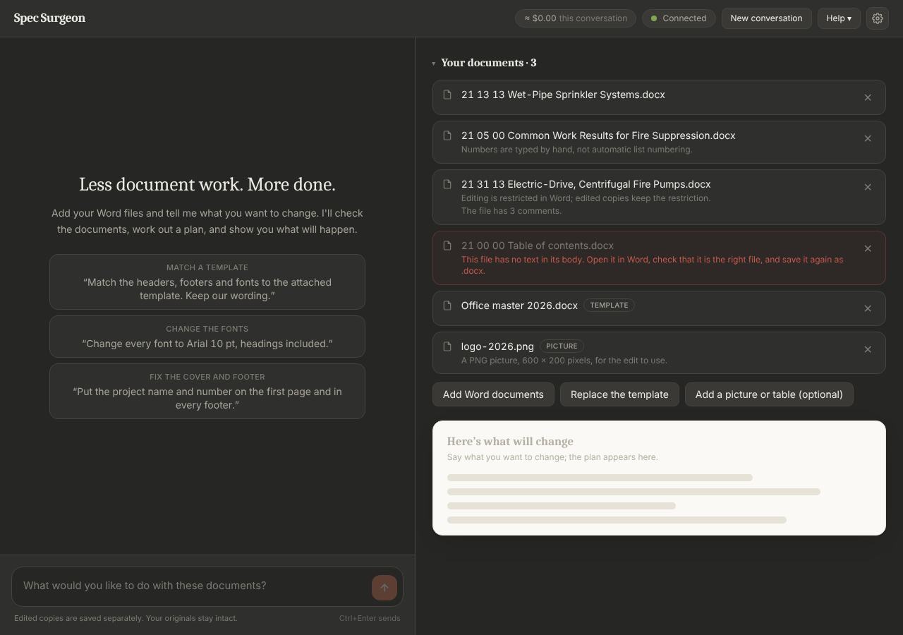
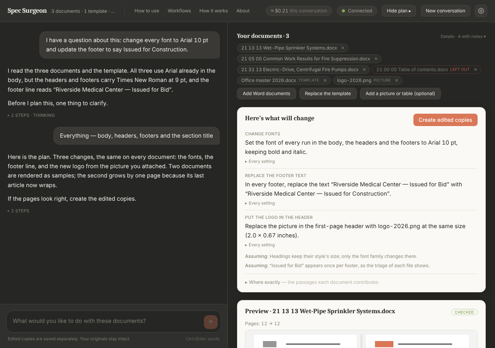

# The conversational desktop

Spec Surgeon is one window: a web page shown in a native window (Microsoft's WebView2 control through pywebview;
the default browser when pywebview is not installed) and served by a local server on your computer — nothing
leaves the machine but the model calls you ask for (the contract between the page and the server is
`docs/WEB_API.md`). On the left is the conversation, with the one button above the box you type in. On the right
are three sections, each with its own fold and its own button to add more: the Word documents you attached,
optionally one reference template, and any pictures or tables you attached for the edit to use. Each folds to one line
once a plan exists (click its title to open it); below them are the before/after pages. You add documents, describe the result, look at the pages, mark each preview with a green checkmark or a red
X, and create edited copies. Nothing else is asked of you: no operations, methods or settings beyond an API key.
That is Default mode. Safe mode, the other choice in the top bar, puts buttons for the common changes where the box
you type in is, and calls no model at all ("Safe mode" below).
Both panes render what the assistant writes as formatted text (lists, bold, links), in the chat and on the cards
beside it alike.

## Safe mode

The top bar's **Safe | Default** switch chooses how a change is asked for; the window opens in the mode last used
(Safe the first time, `Settings.mode`). Documents, copies, the to-do list and any preview stay as they are when the
mode changes. A Default-mode preview approved after switching to Safe mode is created as a button's is, with no AI
step: what it leaves untouched waits beside the copies instead of going to recovery.

In Safe mode the box you type in gives way to buttons, in groups: headers and footers (match to template, remove, a
watermark, swap the logo), fonts and formatting (match body formatting to template, match font to template, change
font, page size and margins), text (find and replace, with every occurrence listed to untick; change the issue stamp;
add END OF SECTION where missing; keep numbers with their units), clean up (accept or reject all tracked changes,
remove comments, highlighting, hidden text or empty paragraphs, clean up spaces, standardize quotes and dashes, remove
hyperlinks, freeze fields as plain text, remove unused styles) and files and properties (name the copies by section
number and title, the document title property, Track Changes off, set author and company, set the proofing
language). Clean PDFs are Export's, in every mode ("Export: saving the copies", below). A button that cannot be
pressed yet says why when the pointer rests on it (no documents, no template, no picture). Pressing one opens a short form — the words to find
and their replacements, the issue stamp as it reads now and as it should, the watermark's words, a template's values,
a font's name, the margins, a naming pattern — and **Preview**.

Above the buttons a note says what Safe mode is (fixed buttons, no AI, no API key needed), what it cannot do
(anything that is not a button: rewriting or moving paragraphs, editing tables, adding an article, a change that
depends on reading what each document says), and that Default mode, with a Claude API key, is the way to more. Its
buttons are **Add a Claude API key** (opens Settings; shown while no key is set) and **Switch to Default mode** (the
top bar's switch); the same switch ends the line under the buttons. **Hide** folds the note to one line that still
points to Default mode, and **What is Safe mode?** opens it again; the window keeps the choice in `settings.json`
(`safe_note_hidden`). The note's words are `frontend/src/lib/safeNote.ts`.

What happens then is what happens to a plan in Default mode, with no model anywhere (`recipes.py`):

- The button's plan is built in code from the form and the attachments, then passes the gate every plan passes
  (`compiler.compose_submission`): its settings are checked, every file it reads must be one you attached, every
  word it would place must be one you typed, and it is planned dry on the documents; overlapping operations are put
  in order as always.
- The preview plans every document, checks the samples and renders their pages. Claude's visual check is not run.
  A sample that fails a check while another passes does not hold the others back: its card stays, with its failed
  checks and without the checkmark and the X, the chat says it once, it is listed under **Left untouched** ("Its
  preview did not pass its checks, so no copy of it is made: …"), and **Create edited copies** makes the others'
  copies and leaves it as it is (`Session.failed_samples`; the owner's run of 2026-10-28, where one sample of twelve
  failed its page-layout check and Create was unavailable for all twelve). Only a preview none of whose samples
  passed makes Create unavailable, with the reason beside it.
- **Create edited copies** makes and checks every copy as always. A document the button could not change exactly is
  not handed to recovery (an AI step): it is listed under **Left untouched by the last button** beside the copies,
  with the engine's reason, and **Try these in Default mode** puts it on the to-do list and switches to Default
  mode, where "Work on the documents I set aside" plans it with the button's sentence as its request. Unlike a
  Default-mode plan's refusals, which go on the to-do list by themselves, a button's stay among the documents the
  next button works on until you hand them over. A preview's document you mark with the X goes on the to-do list as
  in Default mode; with every document marked, nothing is created and no conversation starts.
- The button's sentence (what you pressed and what you typed) is your line in the chat, and the change sentences of
  its plan join the history the next request in either mode hears.

Changing your mind (`DocumentTask.discard_preview`, `DocumentTask.undo`; the same two buttons in Default and
Obliterate, below under "The conversation"):

- **Discard preview**, beside Create while a button's preview waits, withdraws it: nothing is created, and the window
  shows again the copies and the Left untouched list it showed before the button was pressed (`_before_button`).
  **All buttons** while a preview waits does the same. The form stays as you filled it; each button's form keeps what
  you typed when you go back to all the buttons, until **Clear form**, New conversation or Start over (the page's
  memory only).
- **Undo the last button**, beside Start over, takes the working set back one run: each document builds on the copy
  it had before that run (its original, when it was the first), the history and each copy's changes are as they were,
  the copies and Left untouched list that run replaced show again, and the documents its ✗ put on the to-do list come
  off it. A point is taken at each approval (`_undo_point`) and kept once the run delivers copies
  (`_advance_generation`); the points are kept in the saved conversation (`undo`), so they survive a restart. Undo
  waits while a preview is open ("Discard the preview first") and refuses when a copy it would go back to is no longer
  where it was saved. No file is written or deleted: the copies an undone button made stay in the scratch folder until the window closes. Start
  over and removing the last working copy clear the points; a run whose approval took none (it resumed after a
  restart) clears them too, so no undo reaches past a step it did not record.

Tracked changes are off in Safe mode unless the form's *Show my changes as tracked changes in Word* is ticked (find
and replace, the issue stamp, END OF SECTION, numbers kept with their units, remove hidden text, remove empty
paragraphs, clean up spaces, standardize quotes and dashes); every other button's change is plain formatting or never
tracked, as in Default mode. The template buttons tell a prepared template (yellow-highlighted or `{{NAME}}`
placeholders) from an ordinary specification used as one without a model (`recipes.template_kind`): a prepared
template's section number and title placeholders are filled from each document and its other placeholders are typed
in the form, one value for every copy. A placeholder is the number or the title by its name or, for the number, its
shape (`recipes.slot_role`: `NUMBER_SLOTS`, `NUMBER_SHAPE` — `XX XX XX`, `00 00 00`, `000000` — and `TITLE_SLOTS`,
`Specification Name` among them), and the form names the ones each document fills (`slot_roles`); an ordinary
specification gives each document its own number and title wherever its headers and footers
show its own; a template with nothing to fill is refused at the button.

**Match body formatting to template** (`template_roles.py`, `body_match.py`) plans
each document on its own, in code. The form shows the template's style for each part of a section (the section
number line, the title, PART, articles, paragraphs, subparagraphs, END OF SECTION: `template_roles.detect`, from
`structure.role_summary` over the template), each changeable, and boxes for the page, the font and the paragraph
spacing (all on). For each document, `body_match.plan_file` reads its own structure:

- an outline Word numbers converts to the template's styles and list (`convert_numbering`: the main list, each role's
  level mapped onto the template's, table cells left out, every number keeping its counters — "1.01" shows as
  "1.1", a renumbering refuses); an outline typed as text converts by value (`convert_typed_numbers`, `match:
  "counters"`); a mix of the two refuses;
- the section number line, the title and END OF SECTION take the template's styles (`apply_style`), each only where
  one selector finds exactly that paragraph;
- the template's page size and margins (`set_page_setup`, every section, unless one is in another orientation) and
  the clearing of paragraph spacing, indents and alignment outside tables (`clear_direct_formatting`, runs
  untouched);
- the font, on the body outside tables only: the template's body font on runs that name a font (`set_font`) and on
  the styles nothing else uses (`set_style_font`), the document defaults only when no table, header, footer or note
  could inherit them; and, in a last step of its own, every style the plan brought from the template pinned to the
  font and size it has in the template (`body_match.template_look`), since an imported style is based on the
  document's own Normal, and the body text outside tables the plan does not restyle taking the body font on its runs
  (its style may be one a table or a header shares). Headers, footers and tables keep their fonts;
- a document whose own style has the id of a template role style and is used by paragraphs the plan does not
  restyle — in a table cell the conversion leaves out, a header, a footer, a note or a comment as much as in the
  body — is refused (the template's definition would change their look).

Documents of one structure pattern whose plans agree run as one layout (the largest agreeing group; each other one
is left out with why), and each layout's spec passes `compiler.compose_submission` on its own documents, which puts
the overlapping operations in ordered steps. A document left out is listed beside the preview with its reason
(`Session.left_out_reasons`) and, after the run, under **Left untouched by the last button**, ready for Default mode.
Every change is plain and no word is placed.

**Match font to template** (`recipes._font_template`) sets the template's body font and size (the font most of its
body text is in, `profile.body_text_fonts`) on the runs that name a font, every style and the document defaults —
the size only on text in each document's OWN body size, the size most of that document's body text is in, so its
headings, notes, tables and other sizes keep theirs. Documents of one body size share one spec; a batch of two or
more body sizes is a layout plan with one layout per size (`recipes._font_layouts`), each passed through
`compiler.compose_submission` on its own documents, all previewed and approved together. A layout covers structure
patterns, so documents built alike (one pattern) whose body sizes differ take the size most of them have (the
first attached decides a tie); the others are left out with the reason, to be pressed alone. A document with no
measurable body size takes the font alone; one that cannot be read is set aside by the preview with its reason.

**Change font** (`recipes._set_font`) is Match font to template with the font and size typed in its form instead of
read from a template, by the same rule (`_font_by_body_size`): "Keep each document's sizes" sets the font alone; a
size changes only the text in each document's own body size. **Page size and margins** (`set_page_setup` on every
section) sets the paper upright, so with a paper size chosen a document with a landscape page is left out with the
reason (its schedule never turns upright); margins alone, with "Keep each document's own" paper, go on every
document. A header and footer distance left empty keeps each document's own.

**Change the issue stamp** (`set_issue_stamp`) finds the stamp by the wordings typed in its rows, wherever it sits
(the cover, a header or a footer), and replaces each with the new wording; a change of capitals alone is refused as
find and replace refuses it. **Add END OF SECTION where missing** (`ensure_end_of_section`) takes each document's
number from its SECTION line by the reference rule and the line as typed (`END OF SECTION {number}` to start; it
starts with END OF SECTION, the words a line already there is recognized by, so a second press adds nothing), adds
it after the last content or corrects one that reads otherwise, formatted like the SECTION line (written in
capitals, so a "Section 230513" reference is never taken for it) or in the plain text style. **Keep numbers with their
units** (`protect_nonbreaking_spaces`) puts non-breaking spaces between a number and the units typed and inside spaced
section numbers; a space a field shows (a cross-reference) sets the document aside, since Word would put the field's
own result back.

**Clean up spaces** (`normalize_whitespace`), **Standardize quotes and dashes** (`normalize_punctuation`: quotation
marks straight or curly, `--` as an en or em dash, section numbers with spaces or hyphens; at least one),
**Remove hyperlinks** (`remove_hyperlinks`: web and e-mail links, links to places in the document, or every link; the
words stay), **Freeze fields as plain text** (`unlink_fields`: every field but page numbers, the dates, the
cross-references or the document properties) and **Remove unused styles** (`remove_unused_styles`: the document's own
styles, or Word's built-in ones too; names typed to keep) are one operation each. **Accept or reject all tracked
changes** is the accept button with a choice: reject undoes every change. **Set author and company**
(`set_document_properties`) sets Author, Company and Subject to the words typed, or clears the author names (Author
and Last Modified By), not both for Author. **Set proofing language** (`set_language`) sets every language, or only
other kinds of English, to the one chosen.

Typing is not possible in Safe mode, and the server refuses a message there; the conversation and its question cards
belong to Default mode.

## Obliterate mode (hidden)

Most people never see it. Settings → **Advanced** → *Show Obliterate mode* (a second click, **Show it**) adds a third
choice to the top bar's switch; turning the setting off removes it and leaves the mode. Choosing **Obliterate** opens
its warning every time — what it grants, what it costs, what still holds — and **Turn on Obliterate** works only once
the box under it is ticked. The mode is the conversation, as in Default, with a red strip above the box you type in
(**Back to Default** leaves it) and the switch in the error colour. The window never opens in it: settings.json keeps
Safe or Default, and a window closed in Obliterate opens in Default.

What it lifts (`Session.unguarded`; CLAUDE.md, "Modes"):

- **Wording.** The gate no longer requires placed words to be the user's own: Claude may write wording itself, but
  every word it places must be in the reply you read in the chat (its plain text or its message; the window shows
  no plan card). `compose_submission(unguarded=True)` traces each placed word to your own words or to that reply
  (`Conversation.shown_text`) and refuses a plan whose words appear in neither, so what you read before approving is
  what will be placed. The conversation's prompt rewrites the rules it lifts where they stand
  (`compiler.UNGUARDED_RULES`) instead of leaving them in to contradict the mode; "never invent project facts,
  requirements or citations" stays.
- **Custom methods.** When no operation fits, the custom method is offered whenever any method could make the change,
  and it may change anything Word stores: the writer's prompt drops the plain-formatting limits and `codegen` skips
  `hard_limits`. The writer gets what that takes: the governed path's helpers (`GOAL_FROM`: text edits, tracked
  revisions with `pkg.author`, parts and relationships; `allowed_imports(unguarded=True)`, re-checked by the sandbox),
  the V10 assertion kinds that let a correct change prove itself, and the files the user attached (a template,
  pictures, tables) as `pkg.inputs` — pinned by digest when the method is written (`GeneratedOp.attachments`, part of
  its approval), refused at any later trial if one changed (`stale-input`), readable with `read_template` and
  `read_input_file`. A trial whose only failures are its checks — the verifier read the copy, the source did not
  move — goes back to the writer up to `codegen.UNGUARDED_CHECK_ROUNDS` times: it fixes what it did not intend, or
  resubmits with `accept_failures` (a check and its reason, which the user reads beside every copy:
  `GeneratedOp.accepted_failures`, in the approval too; V1, V4, V5a, V5c and V9 can never be kept, since their
  failure is a member, revision or XML the method got wrong, or a source that moved: `codegen.NEVER_KEPT_CHECKS`).
  After those rounds the latest method is used with its failures listed, never called passed: the notes the model
  hears, the transcript lines beside them, the chat before the button (the app's own note, ahead of the words below:
  `DocumentTask._say_text_changes`), the window's message and the plan group's details name the checks each
  sample failed, as the preview and the delivered copies list them (`codegen.samples_verdict`,
  `codegen.unverified_lines`; a check the writer kept with a reason that no sample failed is named apart, never as a
  failure: `codegen.kept_lines`); a writer that stops otherwise (an API error, a stall, its attempts) leaves the best such
  method, but the pause for the user's go-ahead never does. A custom method has no plan sentence (`Op.describe`) and the
  gate's trace of placed words does not reach it, so before approval the window lists the words its sample copies add
  and remove — in the chat, as the app's own note before the button, and under each sample's pages — taken from the
  independent checker's V2 record of each copy (`preview.text_changes_of` → `SampleView.text_changes`,
  `DocumentTask._say_text_changes`), never from the method's plan or the model: the exact words quoted, the part named
  ("footer", "body paragraph 12"), the same change in several documents said once; a method that changes no words is
  said to change none. Where a part carries tracked changes, the checker reads the copy in its accept-all and
  reject-all views too (V2's `views`), and the words are what either view removes or adds, said to sit in the copy's
  tracked changes — a tracked deletion reads as the words it takes out, never as no change. The same list shows for a Default custom method (which is formatting only, so it reads "No
  words change").
- **Holding back.** A copy that fails a check is delivered to the run's `outputs/` instead of `failed/`, its record
  kept with every failure and V9 saying *delivered UNVERIFIED*; a chain's step hands its copy on and the chain's copy
  carries everything that failed. The preview already says so: a sample whose copy fails a check shows **Did not
  pass** and the plan stands (no outcome investigation; a chain's sample goes on through every step, as the run will),
  and a custom method's sample shows the checks it failed, never a pass. The copies list marks it **UNVERIFIED** with
  the checks it failed, and the done message counts them. No recovery runs after a run in this mode; a document whose copy could not be made at all
  goes on the to-do list as in Default. The mark stays with the document: a later copy that builds on an unverified
  one was checked against it, not against the original, so in every mode it is marked *in an earlier copy* with the
  checks that failed (`DocumentTask._mark_unverified`) until Start over, Undo or removing the document, and the next
  request's history tells the assistant so.

What holds, in every mode: copies only (the window never writes in place, and an unverified copy is never written
back); the source guard (a source that moved is never delivered over); the sandbox, its import whitelist and its time
and memory limits; the independent checker on every copy; built-in operations refusing what they cannot predict; and
the governed outcome path, which is never unguarded. Entering or leaving the mode voids the plan on screen: what was
planned under one set of rules is never created under the other (Continue plans the request again).

## The top bar

The top bar follows Build-a-Spec's. Beside the title, a quiet line says what the conversation works on ("3
documents · 1 template · 1 picture · building on your copies"; files triage refused are not counted) while the bar has
room for it, ending in an ellipsis past 22rem. Then the in-app guide, one dialog with a tab strip:

- **How to use** — the modes (Obliterate's entry says it is hidden and how to show it), what each lets you control and what it costs, Safe mode in four steps, a Default
  first pass in eight steps, what a refused file means, and how spending, Stop now and the pause work.
- **Workflows** — first **Typical operations**: three tables, one per mode (`frontend/src/lib/typicalOperations.ts`),
  each row a job in a spec writer's words, the Safe buttons that do it (pinned to the catalog by
  `frontend/tests/typicalOperations.test.ts`), whether the app can, and what to know; the words above them say the
  lists are not exhaustive and that Obliterate can do everything Safe and Default can. Then the recipes: a Safe-mode
  clean-up before issue, five Default requests word for word (fonts across a set, headers and footers from a template,
  a logo, values from a sheet, an issue stamp), a mixed batch, one change after another (several changes in one request
  included), a file left untouched, stopped or paused work.
- **How it works** — the mechanics in plain words.
- **Why trust it** — eight claims, each with the mechanism that makes it true, and **I'm not convinced — show me
  exactly what runs →**, which opens the long answer on top of it: where every change comes from, what the engine is,
  what leaves the computer (a diagram), one card per action answering the same five questions (you do, what runs,
  what is sent, AI involved, bounded by), what Claude may touch, what the key words mean, the parts with no AI,
  security, money, what the app does not do, and how to check all of it. Escape closes the long answer and leaves
  Why trust it open. Every claim in both is in `docs/TRUST_CLAIMS.md` with its source in the code and its test.
- **About** — the version, the model, the release notes, the licenses (MIT for its own code, the GNU AGPL v3 for the
  app as a whole, with PyMuPDF) and the open-source components, the author's links, **Check for updates** (it says "Checking for updates…" until the check answers, then the answer or the update
  with **Download and install**), **Open diagnostic logs** and **Save a diagnostic bundle** (below, "When the window
  has a problem"). These replace the old Help menu and About box.

Before the guide's tabs, **Tour** starts the guided tour (below). On the right: the estimated spending of the
conversation, then (after **Stop** while work runs) the context gauge adapted from Build-a-Spec's context pill: "142k /
1M context", the conversation's context at its last step as Anthropic counted it against the model's window, with the
exact count, the share and the rollover point (past which `contexts.manage_context` seals the history and goes on in a
fresh epoch) on hover (`lib/chat.contextPill`, `contextTip`; `cost.context` in `docs/WEB_API.md`). Only the chat's own
calls move it; once a request ends, the next message starts a fresh conversation, so the gauge turns faint and stands
for the one before until the next step. None before the first step and none in Safe mode. Then the connection pill (it
opens Settings),
**New conversation** and the gear. An update set aside with the banner's **Not now** stays in the top bar as a pill
("v1.7.0 available — install"), and About offers it too.

The bar is one line. When it holds more than the window's width (at 1280 px with copies to save, a request running,
Obliterate shown or an update waiting), it gives way one step at a time until everything fits, measured on the page
rather than guessed from the width (`frontend/src/lib/useFit.ts`; the steps are `GIVE_WAY` in
`frontend/src/components/Header.tsx`): the context line goes, the spacing tightens, "this conversation" leaves the
spending pill, "context" leaves the context gauge, the connection pill says **Key**, **No AI** or **Credentials** (**Add your API key** stays whole), the
help topics take one word each (**Guide**, **Workflows**, **Mechanics**, **Trust**, **About**, the full name on hover),
**New conversation** and **Export · 3 unsaved** become **New** and **Export · 3**, the dividers go, "this request"
leaves the request's spending, the spacing tightens again, the context gauge goes (a measurement, no control), and
last the update pill (About still offers it). The title, every topic, the mode
switch and every button always stay, and a wider window gets the words back.

## The guided tour

The tour (adapted from Build-a-Spec's) walks through every part of the window on bundled practice documents, in a
workspace of its own. Three ways in: **Tour** in the top bar, the chip at the top of an empty conversation (it pulses
a few times until this computer has finished the tour once), and **Help → How to use**, which starts it at the
beginning or at any chapter. Everything about it is built so that nothing is pretended and nothing of yours is
touched:

- **A practice workspace, not your conversation.** When the tour starts, the window's conversation is set aside
  untouched (`web/server.py`, `WindowState.original_task`; its journal is not written to, its settings — the mode,
  the folders — are not changed) and a `TutorialTask` (`tutorial.py`) takes its place over the showcase shipped in
  `examples/tutorial/`: four short specifications (21 13 13, 21 13 16, 21 05 00 and another firm's clean agent
  section with no section number line), a table of contents saved as text that triage refuses, a prepared
  header/footer template with one typed placeholder, a logo and a table of project values. The copies and previews
  the tour makes go to a practice folder under the app's data folder (`data_dir()\tutorial\`), deleted when the
  tour ends and replaced at the next start. **New conversation** during a tour ends it first; the conversation comes
  back, then starts afresh.
- **Real where it can be, recorded where it cannot, and labelled.** Each chapter asks the server for its state
  (`POST /api/tutorial/scenario`), and the server builds it from the showcase through the production code paths:
  triage on arrival, a Safe-mode button (**Headers and footers from the template**, the placeholder filled with
  "ISSUED FOR CONSTRUCTION 2026-03-01") through `recipes.build` and the gate to a real preview, the real run that
  writes checked copies with one document held by the red X and the other firm's left untouched, and in Default mode
  a plan from a worked EditSpec (every font to Arial, 21 05 00 left out) through the same gate, preview and run. No
  model call anywhere, in any chapter. The conversation chapters' messages and the question under them are a
  recording: an app note at the top of each says so, **Send**, the answer buttons and the suggested replies are held
  still with one sentence saying why, and the server refuses a send or a choice in the practice workspace before
  anything could reach Claude. A step whose control is not on screen (a Continue card, say) says that beside the
  workbench rather than showing a pretend one, and a step whose subject would spend money is marked optional and
  explained without being run.
- **A fixed track you only watch.** The tour highlights one control at a time with a card beside it: Continue, Back,
  and End the tour at every step; the mode switch is held while it runs (the tour switches modes as its chapters
  need). Escape asks before ending. The last step's Continue is **Finish and return to my conversation**. The chapters,
  in order: your practice workspace, the documents, Safe mode's note and buttons, the preview (checkmarks and the red X, Left
  untouched, the one button), the copies (the working set, the hand-off to Default mode, the to-do list), the
  conversation, questions and suggested replies, a plan in Default mode, the to-do list's pass, Help and About, and the
  finish.
- **Picked back up, and remembered.** The page keeps its place (chapter and step, with the tour's id, in the
  browser's local storage under `spec-surgeon:tour-progress`, discarded when the tour's version changes); a reload
  while the practice workspace is up resumes there, and a reload with no place to go back to ends the tour and brings
  the conversation back. Finishing writes `tutorial_version` to `settings.json` (`POST /api/settings`), which is what
  stops the chip pulsing and makes it read "Take the guided tour again"; nothing else about the tour is kept.
- **Pinned.** `tests/test_tutorial.py` builds every chapter state and checks it (the showcase bytes match their
  builder, the sources stay byte-identical, the original task is returned as it was, the practice folder is gone);
  `frontend/tests/tour.test.ts` keeps the manifest, the page and the server in step (every end-user control carries a
  `data-capability` some step teaches, every step's anchor exists, every chapter's scenario is one the server builds,
  the form the tour prepares is the one the server ran).

## Attachments and triage

Drop `.docx` files anywhere in the window or use **Add Word documents**. Dropping a file attaches that file
only; it never selects the other documents in its folder, and tables or pictures beside the documents are not
listed. **Add a folder of documents** opens a folder dialog and attaches the folder's own `.docx` files, as if
you had picked them one by one (`DocumentTask.attach_folder`): its subfolders are not entered, and the chat says how
many documents they hold so you can add those folders too; Word's `~$` lock files are skipped, the app's own folders
are refused as a source, and nothing about the folder is remembered. Files from different folders can be used
together, including files with the same name. Each file has
a remove button. **Add a template (optional)** attaches one reference document; it is never part of the batch,
and if one of the documents is a copy of the template the window says so and asks you to remove one of them.

**Add a picture or table (optional)**, or dropping one, attaches a file for the edit to use: a picture
(`.png`, `.jpg`, `.jpeg`, `.gif`, `.bmp`), for example a new logo to put in place of the old one or a detail to
insert, or a table (`.xlsx`, `.csv`, `.json`), for example a sheet of project names and numbers to fill in, or a
schedule to place in the documents as a table. It is listed under
Pictures and tables by its name, tagged Picture or Table; one that
cannot be read or is larger than 20 MB is refused with the reason. Claude is told about each one (a picture's
format and size, a table's sheets and columns) and can read the tables, but nothing beside your documents is
ever looked for. A plan that uses one names it, and
the approval covers its exact content: changing the file after the preview means the plan must be checked again.
Values a table gives are yours, not Claude's words.

The moment a file is attached, Spec Surgeon reads it. This takes milliseconds and makes no model call. The
list shows each file by its name only (with a Template, Picture or Table tag, and To do or Working on while the
to-do list is in use):

- Accepted. What the check found stays out of the list: editing restricted in Word (edited copies keep the
  restriction); saved in an older compatibility mode; no paragraph styles in use, so changes pick paragraphs by
  appearance and text; numbers typed by hand, not automatic list numbering; text split into many small runs;
  text boxes in the headers or footers; pending tracked changes; comments; irregular spacing (non-breaking or
  doubled spaces); nothing in the body yet (an empty document is taken: a request can add to it, or change its
  headers, footers and page setup). The server still reports these as the attachment's `notes`; the window does
  not show them.
- Refused, greyed out with the reason: the file cannot be opened as a Word package (not a zip, a part missing,
  `[Content_Types].xml` missing — Word itself refuses or repairs such a file — or a compression Word never writes), is
  password-protected (the reason says to remove the password in Word and save again), is a Strict Open XML
  document, is larger than the app opens, has a part with an XML document type declaration (`<!DOCTYPE …>`, which
  Word never writes; the reason names the part), or has no paragraph at all in its body. The reason says what to do,
  usually to open the file in Word and save it again as `.docx`. A refused file never enters a plan.

A `.docm`, `.doc` or `~$` lock file is not attached; a notice asks for a `.docx`. A template that would be
refused is not attached either.

The planner receives the same facts for each structural layout in the batch (styles, numbering, spacing,
fragmentation, and how that layout marks its section title, PART headings and article titles), so it plans with
them instead of discovering them. Before those, it reads an overview of every document side by side
(`profile.batch_overview`, no model call): each file's section number and title as the reference fills read them, how
the title shows, every displayed header/footer line (capitals by formatting marked), and the File Properties title,
with flags naming the documents that differ from most — a title or header/footer line in other capitals, a line
missing or extra, a Properties title naming another section or none of the file's title words. The flags describe and
choose nothing; the assistant names the ones a request touches. `compare_files` shows every file's lines in full. The
overview is computed whenever a batch is, so a request after a run reads the copies it made.

A change kept to one place says where the same words remain: a replacement whose words also occur outside its scope or
selection (and no other replacement of the plan changes them), or a literal header/footer fill of the section number or
title that differs from the document's own (C3). The window lists these notes under **Worth knowing**, beside the
pages, each under its document's name as **Left untouched** lists its documents (`Preview.worth_knowing`), and the text the
assistant reads lists them for every file (`WORDING LEFT ELSEWHERE`), which then offers to change them too; nothing
changes unasked. The check's findings describe the file, not the edit: a file with any of them
is edited like any other, and a file with none can still be set aside at plan time.

Adding or removing a document after a plan exists voids that plan. The conversation says so, and the button
reads **Continue** until the documents have been checked against your request again.

## The conversation

Type what you want in the box at the bottom and press **Send** (Ctrl+Enter). Spec Surgeon inspects the
documents and the template before asking anything their contents can answer. What it writes in the chat is a
message to you in plain words; operation and selector names never appear there.

When something needs your decision, a card titled **One thing to clarify** shows the question and its answers
as buttons. Click one, type its number, or answer in your own words. A choice that would put words into the
documents shows those exact words beneath the button; picking it approves exactly those words and nothing
else. Questions are asked once, and per layout, never per file. For an explicit request to draft or rewrite
wording, the conversation may offer exact draft wording as a choice; it is applied only if you pick it. A choice
that offers one wording has **Edit wording**: the draft opens in a box, and **Use this wording** picks the choice with
your edit, which is then the approved wording instead of the draft (one line of visible characters, the rule every
offered wording passes; `conversation.edited_wording`). Claude is told the exact words you approved. A reply
that asks nothing (an answer, an apology, a list of findings) stays in the chat alone; the card never repeats it.

**When a request ends.** A request is finished when the conversation about it created copies, when its preview was
discarded or the request dropped (below), or when the assistant's reply ends the exchange with an answer and nothing pending: no plan, no question, no
suggested reply, no custom method being prepared ("Which of these carry a Subject property? Do not make an edit."
answered in words). The answer stays in the chat as it is, no button follows it, and your next message is a new
request, whatever happened in between — a document put back from the to-do list, one attached, a mode change — never
a revision of the question it answered. The assistant is told the last five such exchanges with each new request (what
you asked, and the first sentence of its answer), so it can refer back without answering them again
(`DocumentTask.exchanges`, kept in the saved conversation). While a question or a preview is pending, a follow-up is
a revision of the open request in the same conversation, as before; so are the assistant's words after the gate
refused its plan, which is still to be made.

**Changing your mind**, in Default and Obliterate as in Safe mode (`DocumentTask.discard_preview`, `discard_kind`,
`_discard_request`, `undo`):

- **Discard preview**, beside Create while a preview waits, withdraws the plan and its preview; **Drop this request**,
  in the same place while a request is open with nothing to approve (the assistant's question, a reply to continue, a
  custom method being written, a pause at the spending check), withdraws that. Nothing is created and no model is
  called. The request ends: the decisions are cleared, the window rests on the copies it had, and your next message
  is a new request. The assistant is told with it that the last one was withdrawn ("a plan was previewed and the user
  discarded it", "the user dropped the request", among the exchanges above), so "the same, but italic" still reads.
  A pass over the to-do list ends with its request, and its documents wait on the list again as they did. Discard is
  not offered while recovery checks the documents again after a run: there the ready copies are saved and
  **Set the rest aside for later** ends it.
- **Undo the last change**, beside Start over, takes the working set back before the last run that delivered copies,
  exactly as Undo the last button does in Safe mode (the copies each document builds on, the history the assistant
  hears, the copies and Left untouched list shown, the ✗ entries that run added); it waits while a preview is open
  ("Discard the preview first") or a request is ("Drop the request that is open first, or finish it"). In
  Obliterate mode a copy's UNVERIFIED mark goes back with the copy it belongs to. No file is written or deleted.

The assistant goes ahead on sensible defaults and says what it assumed; it asks at most three questions per
turn, each with the answer it recommends, and offers short replies you can tap. A tapped reply is your decision
and is sent as your reply, but it is never approved wording: words that go into a document are always ones you
typed or picked. Changes that touch the same parts of a file — a font change beside a header/footer template,
restyling beside direct formatting — are composed into ordered steps by the engine itself, each step planned and
verified on the step before it; nothing is asked of you in two steps.

**The next request builds on the result.** After copies are created, the next thing you ask for is made on those
copies; your originals stay as they are, and the assistant is told what was already done so it plans only what is
new. **Start over from the originals** (a reply you can tap, or type) returns to your files. A document attached
after a run is an original beside the copies: the window says so, and it gets only the next change.

While work runs you see it: the assistant's words as they are written, flowing in at a reading pace; above them
one line naming what it is doing ("Reading your documents…", "Writing the plan…"), which folds into a summary of
its steps, the words it said along the way and its thinking once the reply is written; the pages as they render
and the copies as they are written. **Stop now** keeps what landed.

## The plan

When the plan is ready, the assistant says in the chat, in plain words, what will change and where, and the
window shows the rendered before/after pages of sample documents. The window has no separate card listing the
changes: the pages are what you review. A plan the engine composed into ordered steps is still one plan with one
button.

JSON, approval hashes, operation catalogs and recovery internals are not part of the window.

## Layouts for a mixed batch

Documents from different projects are built differently: article titles in a PR1 style in one, Heading 2 in
another, Normal paragraphs with typed numbers in a third. One selector cannot say "the article titles" for all
of them. When one specification cannot express the request for every structure pattern in the batch, the plan
has one specification per layout. Each is validated and dry-planned on that layout's documents only; every
delivered file still has exactly one specification, and the independent verifier is unchanged.

The preview covers at least one sample per layout, and one button approves all of them. A document whose structure no layout covers is listed under **Left untouched** with a
sentence: attach it on its own, or ask for a plan that covers it.

## Previews and page counts

Each sample document gets a card **Preview · name** with rendered before/after pages; click a page to enlarge
it. The card shows the page count before and after and flags growth ("Pages: 12 → 13 (+1)"). For a custom
method's sample it also lists the words the copy adds and removes, paragraph by paragraph, as the independent checker
read them (**Words removed … · Words added …**, from the checker's V2 record, `samples[].text_changes`), or says that
no words change; a plan's sample carries no such list, since the chat's sentences say what the plan changes. Samples
are applied and verified in memory; sources are never touched. Rendering is requested automatically and uses
Microsoft Word when available, otherwise LibreOffice. The rendered pages are then compared as the run compares
them (checks V6 and V7, `batch.compare_pair` over the same references: the source render, the template's headers
and footers as the sample's plan fills them — its own values in the slots, at its own text width, at its own
header/footer distances when the request keeps them — rendered alone,
the independent header/footer-removal reference), so a sample's **Checked** covers its
page layout: a layout that moved is a sample that did not pass, and the plan goes the way a failed check sends it.
The card says in one line what the layout check found, or why it is not asserted (no layout reference by design, a
wording change that reflows the text), or that it waits for the run and why: no pages were rendered; the pages
were rendered but the preview could not check them (a custom method's trial kept without its plan;
a layout reference that could not be rendered or compared — the pictures and page counts on the card stand, and
the line says the pages were rendered); or the plan is done in steps and only its last step's pages are rendered
(a step whose reference is its own input is checked step by step when the copies are created). A custom method's
samples are checked by the plan the method predicted (its trials are verified without pages), and its copies are
rendered and compared before any is delivered, as a plan's are: a sample whose layout check fails is said in the chat
before the button and, outside Obliterate, makes Create unavailable; in Obliterate its copies are delivered marked
UNVERIFIED with that check beside them. If no renderer can
provide usable page evidence, each preview
says that page appearance was not checked for its document and asks you to open the edited copy in Word.

The same comparison counts the words shown on every page of the original and of the copy, less what the plan
removes (a replaced or deleted wording, a removed header's text, a removed watermark), so a word that moved to another
page cancels out. A word the original's pages show that the copy's pages do not is a warning ("N word(s) shown in
the original's pages are not shown in the copy's: …"), said in the chat in the app's words before you approve, given to Claude's visual check so it looks for those words on the pages, and carried in each copy's
record and in `BATCH_REPORT.md`. It is never a failed check: a layout change (a font, the margins) reflows words
across pages, and when the page counts differ the header and footer words — which repeat once per page — are
recorded, not compared. What it catches is text a copy hides without moving a line: a shape drawn over it, white on
white, a size of nothing, spacing that pushes a line off the page.

**Find and replace, occurrence by occurrence.** A plan with a find-and-replace (`replace_table`: Safe mode's button,
or a conversation's) lists every occurrence it found under the previews, in every document of the plan — not the
sampled ones only — with the part it sits in, its paragraph, the article it sits under where the structure analysis
reads one, and the words around it. Each has a checkbox; the box above the list ticks or unticks every occurrence at
once (mixed while only some are ticked), and with several documents a box beside each name does the same for that
document's, so a long list can be unticked whole and the few to replace ticked back. Untick an occurrence to leave it as it is (a historical
reference, a line that should keep the old wording) and press **Update the preview**: the window writes the unticked
occurrences into the plan (`replace_table.params.skip`, each by its file, part, paragraph and place in the text), the
plan passes the gate again with exactly those as the ones you unticked (a request can never write `skip` on its own),
and the preview is made again with them left out; **Create edited copies** waits while your ticks differ from the
preview's. The checker re-finds every occurrence on its own, confirms each unticked one is untouched and every other
one replaced, and each copy's record and the batch report list them all (the occurrence log). A document the plan set
aside — two pairs overlapping on the same words, an occurrence inside a hyperlink that a tracked change cannot take —
lists every occurrence found too (the refusal waits until the whole document is listed, so both copies Word
keeps of a text box are there), so the occurrence its reason names can be unticked and the document then
plans with the others. A plan done in steps lists its first step's occurrences only. The ticks belong to the plan on
screen; a new plan starts them over.

The pages are those of the plan in front of you, and nothing older. Sending a message or picking a choice takes
the plan and its pages off the window while the reply is worked out, and a new plan's pages replace them; once
copies are created, their pages leave with the plan. During recovery, a document whose copy you already saved
drops out of the previews, and its visual findings with it, while the conversation goes on about the rest.

## The green checkmark, the red X and the to-do list

Every preview card carries two marks. The green checkmark says the pages look right. The red X says this
document needs more work: it is **set aside**. When you create the edited copies, the documents you set aside
get no copy; they go on a to-do list, and the button says so ("Create edited copies (2 set aside)"). Every
other document is created and verified as usual, each one still held to the exact file the preview was made
from; a document that is not part of the displayed plan can never be set aside or run.

Once the other copies are saved, the conversation shows **Set aside for more work** with the documents'
names, why each one waits, and one button, **Work on them now** (the same as typing “Work on the documents I set
aside”); the same list sits under the copies, with **Put back** beside each document. The pass
over them begins: they are the only documents in the plan, tagged **Working on** in the documents section; the
request they were set aside from stands; the assistant is told that you looked at the preview of that plan and
set these documents aside, and is shown the plan you saw. Tell it what should be different for them, or
**Continue** to plan them again as before. The pass ends when their copies are created; the other copies stay
as they are and the whole set is the working set again. A document you set aside once more goes back on the
list. Documents set aside from different requests are worked on one request at a time, the oldest first; the
others wait and are offered again. The assistant always hears what each document carries: a change that some
documents got and others did not (left out, set aside or refused) is named per document, never claimed for all, and
only a document attached beside the copies since the last run is named as one that arrived after the changes. Documents on the to-do list are tagged **To do** and are out of every plan until you work on them;
removing one drops it from the list, and **Start over from the originals** clears the list. Setting every
document aside creates nothing and begins the pass at once. The list and the pass are kept in the saved
conversation.

The red X is one way onto the list. The others:

- **You ask for it.** "Set 20 aside for later", "park the Michigan one", "I'll come back to 23": the assistant puts
  those documents on the list at once, with your reason when you give one, and the conversation goes on about the
  others (a plan it submits afterwards covers only them). "Leave out" is different: it keeps a document out of this
  one request, and the next request covers it again. Setting aside every document ends the request; setting aside
  the documents of a pass over the list again ends that pass, and the others come back.
- **The plan could not be applied to it.** A file listed under **Left untouched** because its result cannot be
  predicted goes on the list, with that reason, when you create the others' copies. So does a document whose
  preview did not pass its checks while another's did ("Its preview did not pass its checks, so no copy of it is
  made: …", why `failed`): it was never run. A click that is refused (a file changed since the preview) moves
  nothing.
- **Its copy could not be made.** A file whose copy failed and that nothing will check again goes on the list. While
  files are being checked again (below), **Set the rest aside for later** is offered as a reply once the ready copies
  are saved: what was not fixed, and the documents of layouts still waiting their turn, go on the list and the
  request ends; the copies already saved are the working set.

Each entry says why it is there, in the window and to the assistant: every new request tells it which documents
wait on the list and why (it cannot read, plan or bring them back), and a pass over them tells it why each one
waited. **Put back** takes a document off the list without a pass: it is among the documents the next request
works on, as it is (during a pass it joins them when the pass ends). Nothing on the list is ever changed.

Claude's visual check of the rendered pages is advisory. Its findings, and the other advisory notes of the checks
(the renderer used, page counts that changed, the words the copy's pages do not show), are not listed in the window
(the owner's decision, 2026-10-29): they are kept in the preview's records (`PREVIEW.md`, `preview.json`,
`visual_review.json`) and its log, which a diagnostic bundle carries. The window lists only the notes worth reading
before the copies are made, under **Worth knowing** beside the pages, by document: the same words a change leaves
elsewhere and a fill shown in another case than the template (above), a layout of the plan that no attached
document has, and a file that changed while the preview was being made (make the preview again). A finding the
visual check marks as blocking shows every note under **Please check** instead, with their file and page, and changes
the button to **I reviewed the flagged pages — create copies**; that is a separate, explicit decision on the
displayed preview.

Rendering. Word renders a batch in up to three private, invisible instances side by side (one per two cores, one
more per two files; never your open Word; `SPEC_SURGEON_WORD_INSTANCES=1` keeps it to one), each with a deadline per
file: a file Word gets stuck on is reported as not rendered and the rest of its share carry on in a fresh
instance. The engine's own work is shared the same way: a batch of three or more documents is edited and checked in
the app's worker processes (one per core, at most eight; each document whole in one of them, so its copy and record
are those it would have alone), and a preview plans twelve or more documents, and checks three or more samples, side
by side (`docs/RUNTIME_RELIABILITY.md`, "Desktop-safe workers"). LibreOffice keeps its user profiles under the app's config folder (`render-profiles`) instead of
creating one per run. Rendered pages are kept in a cache beside the window's scratch folders (`%LOCALAPPDATA%\Spec Surgeon\scratch\.render-cache`,
at most 2 GB, oldest first out), keyed by the document's exact bytes and the renderer's version: the run does not
render again what the preview rendered, and a source you attach again unchanged is not rendered again either — a
file whose content differs in any way is always rendered afresh. The preview and run logs say how many pages came
from the cache. `SPEC_SURGEON_RENDER_CACHE=0` turns the cache off (see `docs/RENDER_PIPELINE.md`).

## One action

Every path ends in the same button, in the conversation pane above the box you type in, with one sentence on
what it does. Its label says what it does:

- **Create edited copies**: approve the displayed plan and preview. The engine applies the specification to
  every document you did not set aside with the red X, verifies each one independently, and delivers only the
  files that pass every check. "(N set aside)" on the label counts the documents that go on the to-do list. A
  document whose preview did not pass while another's did is not run (its card carries no marks); the sentence
  beside the button says it gets no copy.
- **Continue**: the documents or the plan changed while a request was open; the documents are checked against the
  request again before anything can be approved. A request the assistant answered without a plan is not open (above),
  so no Continue follows the answer.
- **Save N ready copies**: during recovery, save the copies that are already verified while a question about
  other files is still open.
- **Continue** after a pause: the request reached your spending check, the price table cannot estimate the model
  that answered, or the app closed while work was running (see below). A custom method that was being written goes
  on from where it stopped, with everything it had looked at.
- **Stop now**, while work runs: the kill switch, in the composer and as **Stop** beside the spending in the top bar
  (see below).

The button is tied to what is on screen. If a document, the template, the plan, a preview or a visual finding
changes, the displayed action is void and the window says "The documents or plan changed. Review the updated
plan first." Typing a new message disables the button until the message is sent, and unticking a find-and-replace
occurrence holds it until **Update the preview** has made the plan again. The marks on the previews
belong to the displayed plan too: a new plan or preview starts the review over.

## What is left untouched, and why

Originals are never written; the window always creates copies. Each run's copies go into a timestamped session
folder inside the window's scratch folder (`%LOCALAPPDATA%\Spec Surgeon\scratch\<start>-<pid>` on Windows), which
is deleted when the window closes. **Your edited copies** lists them; click one to open it in Word, and **Export** in
the top bar saves them to a folder you choose ("Export: saving the copies", below).

A file can be left out at five points, each time with one sentence that names the file and the reason:

- At attach time, when triage refuses it (above).
- When you ask: "leave out 20", "not 23 for now"; or keep a request to some documents ("only 23", "just the
  Michigan one"), which leaves out every other one. The plan, its preview and its copies cover the documents the
  request keeps; the ones left out are not planned or changed, are listed under **Left untouched** ("You asked to
  leave it out of this request"), and come back with the next request unless you leave them out again (a follow-up
  plainly about the same documents, "now make its title bold too", keeps to them again). "Set 20 aside for later"
  puts it on the to-do list instead (above), out of every request until you come back to it.
- At plan time, when the operation cannot predict its result on that file, or when no layout covers its
  structure; in a plan done in steps, at whichever step cannot predict its result (every step is planned on every
  document, each later step on what the step before it would make). These appear under **Left untouched** before
  anything runs; no paid investigation
  precedes them. The preview of the other documents stands, and the assistant names each one with its reason in its
  next reply; **Create edited copies** leaves them as they are (they are not run, so no recovery follows for them)
  and puts them on the to-do list with their reason. Only a plan that covers no file at all, or a preview none of
  whose samples gets through (each fails its check or is refused), sends the request on to outcome planning.
- At preview time, when a document's sample fails a check (or the engine fails on it) while another sample passes.
  Its card stays, with its failed checks and its pages, so you see what went wrong; it is listed under **Left
  untouched** and the chat says it before the button. **Create edited copies** makes no copy of it and creates the
  others: it is not run, so no recovery follows for it; after a Safe-mode button it is under **Left untouched by
  the last button**, and in Default and Obliterate it goes on the to-do list with its failed checks. The other documents of its layout are not set aside on its account: each runs and is checked
  on its own. In Obliterate a sample whose copy was made but failed its checks is not set aside: it is delivered
  marked UNVERIFIED. A custom method's samples are never set aside: one its method fails on makes Create unavailable
  for the method.
- At delivery, when a file fails a verification check. It is never delivered. Spec Surgeon then checks it
  again internally (below); a file nothing can check again goes on the to-do list.

## Recovery and custom methods run internally

After **Create edited copies**, a file that did not pass goes straight into recovery ("Checking the files that
still need work…"). Recovery works on copies, within the same conversation, and ends where everything else ends:
a question in the chat (for example "Which passage(s) in Spec.docx should change? Reply with the number, or
numbers separated by commas.") or the same button. While a question is open, the copies that are already
verified can be saved; once they are, **Set the rest aside for later** puts the documents recovery has not fixed on
the to-do list and ends the request. The independent checks and the source-change guards are the same as for a
first run.

With a plan per layout, recovery takes one layout at a time, each against that layout's own specification: the
first layout whose documents did not pass is investigated at once, the others wait and are checked by themselves
after the first layout's copies are saved (the queue is kept in the saved conversation). A document that no layout
covered has no specification to recover against; it stays as it was and is named under **Left untouched**.

When no built-in operation fits a request, Spec Surgeon may prepare a custom method internally, prove it on
the sample documents, and show its result as a preview like any other. You never choose a method; you see what
will change and decide once. Nobody picks the method (`Session.outcome` takes it on its own), so before it is
written the chat says Claude's reason and, as the app, what the method is to do in Claude's words — its proposal,
which otherwise lived only in the plan's data the window does not show (`DocumentTask._collect_conversation`,
`CUSTOM_METHOD_WRITTEN`; the stress test's F1). Then before the button the chat says, as the app, the words the method's sample copies add
and remove — derived from the independent checker's V2 record of each copy, never from the method or the model
(`preview.text_changes_of`, `DocumentTask._say_text_changes`) — or that no words change, and each sample's card lists
the same words. Custom methods write edited copies only and run under the same verification.
The writer that prepares one reads before it writes, through tools that change nothing: the sample files'
XML, paragraphs, styles and part texts (`show_xml`, `find_paragraphs`, `list_styles`, `show_part_text`, the
inspection tools) and the verifier's own contract of each independent check it must satisfy
(`describe_assertion_kind`: a V10 assertion kind's keys, their allowed values, what the kind compares and what
makes a method refuse, with a worked assertion — `verify.props.KIND_CONTRACTS`, filled by the verifier's own
modules, never by an operation). Its submissions are tried in the sandbox and judged by the verifier; the
contract is what tells it, before the first try, what a passing assertion looks like.

When no ordinary plan fits (no operation for the request, a plan that covers no file, or a preview none of whose
samples gets through), the outcome planner proposes the outcomes it would check
instead, and the conversation offers them as one choice, **Use these outcomes and continue**, with every word they
would place beneath it and the outcomes in full above. Nothing runs until you pick it, and the pick approves those
words as any pick does (`Session.outcome` takes a custom method on its own, never an outcome plan;
`continuous_recovery.approve`). The documents you left out of the request stay out of the outcomes and their trials
(`Conversation.left_out`); they wait under **Left untouched**, and the planner is told they are out of scope.

Normalizing a file (typed numbers to automatic numbering, clearing direct formatting, whitespace, pending
tracked changes) is never automatic. It is only ever offered to you as an explicit first stage and runs only if
you accept it.

## Connection and resource use

Typed requests need an Anthropic API key. **Settings** opens one dialog. **AI connection**: paste the key and
tick **Remember securely on this computer** to keep it in Windows Credential Manager. **Appearance**: the window's
colour scheme, one of Warm Clay (the default), Blueprint, Graphite & Teal, Carbon & Hi-Vis and Linen (the light
one); a click recolours the window at once and `settings.json` keeps it, so the next start opens in it. **Spending
check**: the most one request may spend (below). **Fast responses**: Claude's fast mode, off until you turn it on
(below). Nothing else is configurable there. Without a key the composer keeps your draft, **Send** stays disabled and the footer
says "Connect your Anthropic API key in Settings to start."

Every AI step (one call to Claude Opus 5.5, whether for the conversation, a
custom method, the visual check or recovery) may write up to 128,000 tokens, the most the model writes. The
conversation runs at medium reasoning effort (its sentences and plans are short and the operations' settings ride the
cached prompt, so a plan is one or two calls), and so does the visual check it runs inside a turn, because the
conversation's budget sets the effort for every call inside it. The outcome planning when no ordinary plan
fits (no operation for the request, a plan that covers no file, or a preview none of whose samples gets through), and recovery, think at high: their own budget sits inside the
conversation's and wins. Writing a custom method — the one place Claude writes the code that edits the documents,
from the conversation or inside recovery — thinks at `xhigh` (`resources.CODEGEN_EFFORT`, the owner's decision,
2026-10-26): `codegen.generate_op` enters `llm.effort_scope`, an effort-only budget with no limits of its own (the
spending check and the spending shown still count every call), and when the method is written the next call is back at its own
effort; the method's conversation is separate from the chat, so the chat's cache is untouched. No step runs at max:
`resources.EFFORTS` refuses it (the owner's decision, 2026-10-22). The
instructions and the operations' settings (the same for every conversation) are cached for an hour, so the next
request after a run, a start over or a changed attachment reads them instead of paying for them again; the
conversation itself is cached for five minutes between its calls, and the one-call checks (the visual check, the
recovery critic) are not cached at all beyond the instructions. Three things keep the spending in your hands:

- **You see it.** While work runs the chat shows the assistant's words and its thinking summary as they are
  written, a sentence per step, and the top bar the estimated spending so far. A question or a plan's message streams
  as Claude writes it (`compiler.STREAMED_TOOLS` carry `eager_input_streaming`); since the server then no longer
  checks that tool input is complete JSON, `llm` does, and a broken one is sent again instead of being acted on. A step that is still running is
  counted when it ends. The amounts are estimates from a built-in price table, not provider bills.
- **Stop now.** While work runs the button is the kill switch, in the composer and as **Stop** beside the spending
  in the top bar. It cuts off the AI step that is running at once, so Claude stops writing, and starts no other; a
  document check or file operation already running finishes first, since it costs nothing. A step that was cut off
  is counted from the input it reported and at most what it could have written in the time it ran. Your progress is
  saved, and **Continue** picks the conversation up where it stopped.
- **Your spending check.** Settings → **Spending check** is the most one request — a message, a pick, an approval,
  a button — may spend, as the app estimates it: $20 until you type another amount and **Apply**, or **Turn off**
  for none (`Settings.spending_limit_usd`, 0 off; the owner's decision of 2026-10-27, in place of a pause after
  every 48 AI steps). Each request gets its own ledger inside the conversation's (`DocumentTask._new_request`).
  Before each AI step `CallBudget._preflight` adds the most the step could cost (the conservative input estimate at
  the dearest cache-write rate, and the longest answer it may write) to what the request has spent, and a step that
  could pass the amount is not started: the work pauses with its progress saved and the card says what the request
  spent; **Continue (up to $N more)** allows the amount again on top of it and the request goes on where it
  stopped, with everything it had found. That holds for a custom method being written: the writer's exchange is
  checkpointed after every answered call (`contexts.checkpoint_history`, the record recovery resumes from too), the
  pause marks it (`GeneratedOp.budget_stop`), and Continue takes the writer up in its own folder with the same brief,
  pins and approved words, its calls and attempts counting on (`codegen.generate_op(resume_from=)`), so it does not
  read the documents again from the brief; the chat says so. A writer that failed outright is a spent attempt, and
  the next one starts afresh. While a request runs the top bar shows its spending beside the check
  ("this request ≈ $0.40 of $20.00"). A model the price table cannot estimate pauses the request too, since the
  check cannot be kept; Continue then goes on without a check for that request. The check counts estimates, not
  Anthropic's bill; a refusal re-run on another model inside one call can go past a step's reservation. A failed
  step keeps its reservation as spent (it may have been billed), unless it never connected — no network, a name that
  does not resolve, a proxy that refused the tunnel (`llm.never_sent`) — which reached nobody and counts nothing, or
  Anthropic refused it for its key or its permission before running it (HTTP 401 or 403, `llm.refused_unrun`), which
  ran no model and counts nothing either.

**Fast responses** (Settings) is the one way to trade money for time, and it is yours to choose: off until you turn
it on, with both sides on screen first. On, every call to a model Anthropic serves fast (`llm.FAST_PRICES`) asks for
its fast mode (`speed="fast"`): the same model at the same effort, writing its answer and its thinking up to 2.5
times faster, at twice the price on every token (the cache discounts apply on top; Settings quotes the prices from the
app's own table). Turning it on takes a second click on a button that names the price; one click turns it off;
`settings.json` keeps the choice and the window applies it from its start (`llm.set_fast_mode`). It does not speed up
the moment before Claude starts writing, nor anything done on your computer. When Anthropic's fast capacity is busy
(a 429 or 529), the step is sent again at once at standard speed and price instead of waiting; if Anthropic refuses
fast mode for your key, every step runs at standard speed until you turn the setting off and on, and Settings says
why. While it is in effect (on, and not refused), the spending pill prices the calls served fast at the fast rates and says **Fast**, and a stopped
fast call is estimated at 2.5 times the stopped-call rate. Switching it during a conversation costs one cache refill:
the two speeds are cached separately.

A call that fails for a passing reason (the service is overloaded or rate-limited, a server error, a dropped
connection or a response cut off in transit) is sent again automatically, up to twice, after 5 and then 20
seconds (longer when the service asks for it). Every attempt counts as an AI step. A request the service
refuses is never sent again. When Claude declines to answer a reply (Anthropic's checks flag it, for instance as
asking Claude to reveal its own reasoning), the chat says so in plain words and the reply is taken back out of the
conversation, its wording no longer approved, so it does not go out again with the next message; rephrase it and
send it again.

## Export: saving the copies

Nothing of a session is written anywhere but the window's scratch folder until you choose in **Export**, in the top
bar. It opens whenever the window lists edited copies and no work runs: the copies the next request builds on, and
those a run whose recovery still checks other documents has already delivered (`DocumentTask.export_set`; before
2026-10-29 it counted the working set only, and stayed greyed out while those copies were listed). Its label counts
the copies not saved yet. It offers three choices, in the owner's words (`exports.py`, `ExportMenu.tsx`):

- **Word (Tracked Changes ON)** — each copy as it is, byte for byte the copy the checker passed: its tracked changes
  (the request's own and any the file already had) and its comments stay, to accept or reject in Word.
- **Word (Tracked Changes OFF)** — each copy with every tracked change accepted. Its comments stay: the choice names
  tracked changes only, and nothing is removed that the user did not ask to remove.
- **PDF (Clean)** — a PDF of each copy with every comment removed and every tracked change accepted.

The native folder dialog opens next, where you last exported (Settings shows the folder). Word (Tracked Changes ON)
writes every copy into it under its planned name, each written whole and then renamed into place
(`DocumentTask.export`, `guard.write_new`), all or nothing: every copy is read and every destination settled before the
first write.

The two clean choices run as a job, since they make and check a file per copy first (`exports.make_clean`). Their
plans are fixed in code: one step, every tracked change accepted (`resolve_tracked_changes` accept), for Word (Tracked
Changes OFF); two ordered steps for PDF (Clean), every comment removed (`remove_comments`, replies with it) and then
every tracked change accepted. The comments go first so that a comment anchored in text a tracked deletion takes
away does not stop the deletion from being accepted. The plan passes the gate (`compiler.compose_submission`) and runs
over the edited copies as any plan does (`batch.run_batch`, `chain.run_chain`), in a folder of the scratch folder
(`exports\<stamp>-<kind>\`, with its records and reports), each copy planned, applied and checked by the independent
verifier; only a clean copy that passed every check is used, never one delivered unverified. The choice in the menu
names the change and approves it (the owner's decision, 2026-10-29, which retired Safe mode's **Save clean PDFs**
button): there is no preview, and nothing else changes — the edited copies keep their comments and tracked changes,
nothing joins the history the assistant hears, no undo point is taken, and a request open (a preview waiting, a
question) stands as it was with its approval. For PDF (Clean) each clean copy that passed is rendered with the
renderer the preview and the run use (Word in a new, invisible instance, or LibreOffice when Word is not there),
through the render cache, and each PDF is checked (`pdf_export.check_pdf`): it opens without a password, has at least
one page, and no page carries a note. A PDF that fails its check is kept apart in `pdf-failed/`, with `PDF_REPORT.md`
beside the run's other reports. A document whose clean version cannot be made exactly (a change Word must settle
itself: an inserted or merged table cell, a change inside an equation; or, for Word (Tracked Changes OFF), a comment
a tracked deletion would take away), does not pass every check, still carries a tracked change anywhere afterwards
(one in a style or a list definition, which the accept step flags and leaves for Word: `exports.pending_changes`;
an Export has no preview to show that flag), or whose PDF cannot be made or fails its check, gets no file: the chat
names it with the engine's reason in plain words. PDF (Clean) needs Word or LibreOffice: without
either the choice is held back and says why (the view's `pdf`), and the server refuses it before any dialog.

Every kind: a file already there with the same content is that file, saved, and nothing is written over it; a
different file under the name is left alone and the new one is numbered beside it (`name (2).docx`); a folder where a
file would land on one of the files this conversation works on — an attached document, an original, an edited copy —
refuses the whole export (checked before any clean copy is made), and so does a folder inside the app's scratch tree,
where a saved file would go with the window. A PDF never lands on an input, so a PDF can be saved beside the
originals. The chat says how many were saved and where (and, for a copy delivered UNVERIFIED in Obliterate mode, that
the clean file was made from it).

Word (Tracked Changes ON) records each copy's destination with the md5 of the bytes written (`DocumentTask.exported`,
kept in the journal): a copy is saved while a file with its current bytes sits where Export put it — the copy's bytes
and the saved file's both agree with the fingerprint (`DocumentTask.export_states`). The clean choices write files made
from a copy, not the copy, so they save it as nothing. The copies list marks a saved copy **SAVED** (its hover says
where, and its link opens the saved file); a copy whose bytes moved since — opened through the window's link, which
opens the working copy in the scratch folder, and edited and saved in Word — is marked **CHANGED** and counts as
unsaved again: its link opens the working copy, the one with the newer content (the hover says so), and the next
Export writes it beside the file saved before, which is never written over. A copy whose saved file no longer holds
its bytes (written over, truncated or edited after Export) is marked **NOT SAVED** and counts as unsaved again the
same way, its link opening the working copy; one whose saved file is gone is unsaved again, plainly. The journal keeps
what was saved where (an entry from before the fingerprint reads as saved, its hash taken from the saved file while
it is there), so a later run's new copies read as unsaved again and Undo's older copies as saved. Saving the records
beside the copies, saving beside the originals and writing back over the originals are not offered (backlog H4).

The assistants know Export: asked for PDFs, or for clean or accepted files, the conversation answers in plain words
naming the Export choice that does it and plans nothing (`compiler.SIMPLE_EXPERIENCE`), and the outcome planner and
recovery are told the same (`exports.PROMPT_NOTE`) — before 2026-10-29 the assistant told the owner it could not make
PDFs.

## Conversations and a clean start

The window works in a scratch folder of its own, `%LOCALAPPDATA%\Spec Surgeon\scratch\<start>-<pid>` on Windows
(under `SPEC_SURGEON_CONFIG_DIR\data` when that is set; `scratch.py`), locked while it runs: every session folder
(the conversation's records, previews, runs, recovery checkpoints, custom-method attempts), every file dropped on the
window (`attachments\`) and the conversation's journal, `conversation.json`, go under it. The journal is written as
the conversation goes: the attachments with their triage state, the messages, your decisions and approved wording,
the result locations, the working set (which copy stands for each original, and the changes already made to it),
what Export saved where, the to-do list and the pass over it, the spending ledger and the location of a recovery
checkpoint. It can contain document text. It never contains the API key, an approval to deliver, or an
acknowledgement of a visual finding; those belong to one displayed preview only.

Every start of the app is a clean one: an empty conversation, nothing attached, in a new scratch folder. A clean
close deletes the scratch folder whole — after one native question when an edited copy is not saved as it is now:
never saved with Export → Word (Tracked Changes ON), changed since it was, its saved file changed since, or gone (every copy's and
every saved file's bytes are read again at the close, not the last fingerprint; OK closes and gives the copies up,
Cancel keeps the window open; the only
time a close is refused); what Export
saved stays where you put it, and so do the render cache, the logs and `settings.json`. **New conversation** starts
an empty one over the same scratch folder, its journal written over (the page asks the same question first; the old
conversation's copies stay in the scratch folder until the window closes). A window that never closed — a crash, a
kill, a power cut — leaves its folder behind: the next start takes that folder over, restores the conversation and
its copies, and says so in its first message, with where Python's fault handler wrote what it saw; every other
leftover folder under `scratch\` is swept, and a folder another open window holds is left alone. A folder a clean
close could not delete whole (a copy held open in Word) loses its journal first, so it is swept, never restored. The
browser fallback cannot ask the close question, so a window closed there with unsaved copies keeps its folder for
the next start to restore.

## When the window has a problem

The window's page runs in WebView2, where nobody sees its console, so the page reports on itself to the app
(`frontend/src/lib/diagnostics.ts` → `POST /api/diagnostics` → `web/watch.py`) and the app writes it down in the logs
folder (`%LOCALAPPDATA%\Spec Surgeon\logs`): `spec-surgeon.log` for a person, `app-events-<pid>.jsonl` for a query.

- **What it records.** Every request the page makes (route, status, time; never a body), each job as it starts and
  ends, Stop, the window's open and close, the page's loads and reloads (with the WebView2 version), every error in
  the page that nothing caught, a job stream the page lost before its end, and a page blocked for 2 s or more (its
  long tasks, sent with a heartbeat every 10 s).
- **A frozen window.** A showing page that sends nothing for 45 s is written down as frozen, with where every thread
  of the app was at that moment, and again when it answers. A hidden or minimised window is never called frozen, and
  a computer waking from sleep restarts the clocks.
- **A stuck job.** A job that shows no progress for 5 minutes (no words, no step, no log line) gets every thread's
  stack in the log, again every 15 minutes it stays quiet; so does a job still running 30 s after Stop, and one that
  did not stop within a minute of the window closing.
- **A window that fails to draw.** Instead of a blank window, a screen says the window ran into a problem, with
  **Reload the window**, **Save a diagnostic bundle** and **Open diagnostic logs**. The error and the parts of the
  window it happened in go to the log. The app behind the page keeps running: a reload finds the conversation as it
  was, and a job in progress carries on (the page follows it until it ends).
- **A session that never closed.** The next start writes, in `spec-surgeon.log`, what that session was doing last
  (the last events of its journal) and whether its crash log caught a native crash; an empty crash log means the
  process was ended from outside (Task Manager, signing out, a power cut) or stopped answering and was closed.
- **Save a diagnostic bundle** (About, or the error screen) writes `spec-surgeon-diagnostics-<time>.zip` under
  `%LOCALAPPDATA%\Spec Surgeon\diagnostics` and shows it in Explorer: the logs folder, `settings.json`, this
  conversation's journal from the scratch folder, and from its five newest session folders their logs, records,
  reports and conversation records. `MANIFEST.txt` lists what is in it and what was left out. The folders
  that hold documents and pictures (`outputs`, `failed`, `samples`, `pages`, `images` and the like) are left out, but
  conversations and records can quote your words and your documents' text, and a conversation's saved provider
  history (`chat\context\*.json`) can hold the page images Claude was shown: treat a bundle like your documents.

## Capability and verification limits

The window does not make arbitrary Word requests verifiable. The supported operations, the template rules and
the custom-method limits still apply; a request outside them is explained or clarified, not approximated.
Operations that touch the same part of a file are never ordered by guess inside one specification: the engine
cuts them into ordered steps in the order they were listed, and a step that still cannot be planned sets the
file aside with the reason. Draft wording the conversation proposes is applied only when you pick it, and
picking it never authorizes invented project facts, technical requirements or citations.

The paragraph roles the planner reads (what an article title or a PART heading looks like in each layout) are
evidence for writing concrete selectors with required counts. They are never the authority for an edit: the
verifier re-resolves the concrete selectors on its own, and the role classifier plays no part in that check.

A PASS means the engine found exactly the predicted change and nothing else, not that the result is what you
wanted. Automated page comparison and Claude's visual check are not human acceptance in Word; look at the
pages, and open the copies.

The window has two modes (Safe and Default, above) and a hidden third (Obliterate), and there is no command line: it was removed on 2026-10-21 together with the
features only it offered (the recipe library, office profiles, specification QA audits, project evidence, built-in
workflows, campaign and recovery workspaces, evaluations).

Validation uses generated Word fixtures (including a family of deliberately dirty files), scripted model
responses, the real engine and verifier, and the window's server driven in-process (FastAPI's test client, no
browser); the page's own rules are tested in `frontend/` with Node. It does not establish live-model success
rates or acceptance of rendered Word layouts; those remain the owner's to run on real files.
